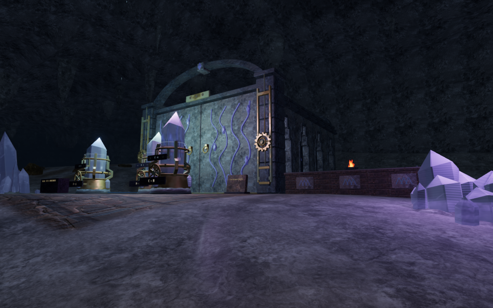
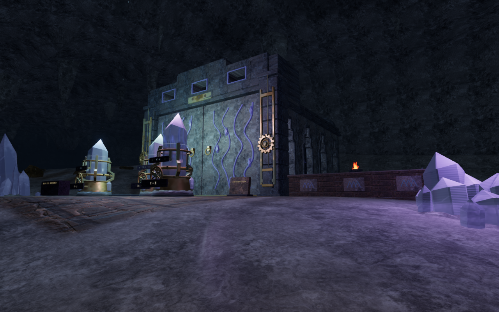
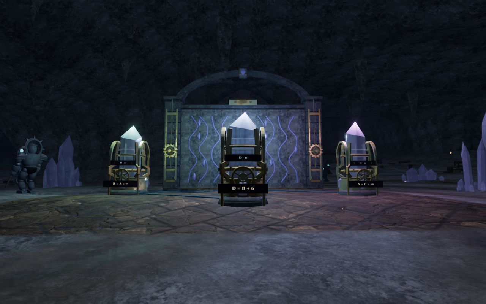
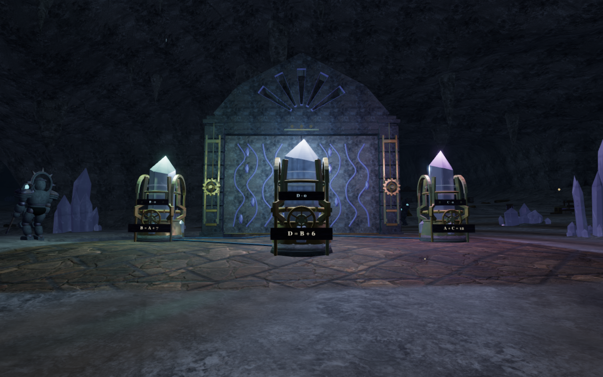
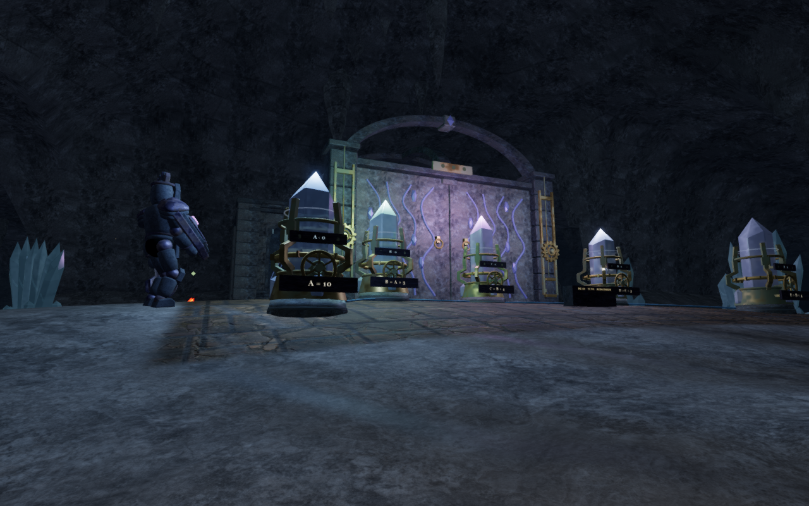
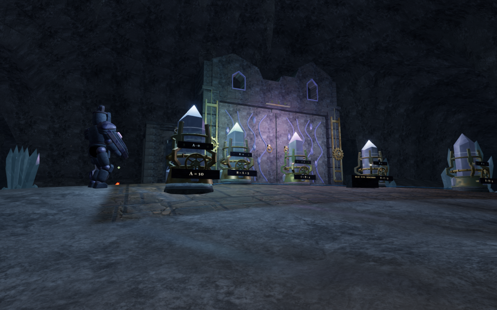

# Windowed archive fronts

The eight archive entrances in The Night Below now have substantial stone
crowns in place of their repeated thin front arch. Their profiles follow the
chambers' different tuning disciplines, with twenty-four real window openings.

| Chamber | Entrance profile |
| --- | --- |
| Three guide lights | Low loggia with three horizontal windows |
| Descending echo | Stepped crest and descending lancets |
| Mirrored archive | Paired shoulder towers and mirrored openings |
| Ascending chamber | Unequal rising terraces |
| Violet fan | Faceted pediment with splayed apertures |
| Broken archive | Unequal surviving crests and a missing central section |
| Crystal heart | Rounded head with an open oculus |
| Prism lantern | Tall central register and a hexagonal opening |

Closed recessed masonry carries the dressed courses, window rims and coping.
Deep side returns enter the continuous walls below the old cornice joints;
the front screens bed into the existing entrance lintels. The other interior
vault ribs, chamber plans, tuning arrangements and gate drives remain.

An older-save inspection also exposed lower jamb gaps beside the basins.
Forty-seven of 192 sampled sections had more than 20 mm of open space between
terrain and masonry, reaching 1.601 m. Sixteen new footings seat below the
delivered terrain and overlap the existing piers. Their continuous cores close
the dressed course joints. Physical contact includes the original pier stones
and the new footings, while a smaller standing-support footprint keeps a body
margin beside a cap from becoming an unreachable floor for the boots.

## Actual comparison views

The following three pairs use matching prepared ground observers at High,
with identical player positions, cameras and zero elapsed simulation time.
The baseline captures' runtime sources match published `df1fb19`; the revised
captures include the new fronts and footings. Lossless WebP exports retain
the decoded 1280 × 800 source pixels, without cropping or retouching.

Guide-light loggia, before and after:

Violet fan, before and after:

Broken archive, before and after:

## Verification and limits

All 21 selected vault, enclosure, resonance and resonance-terrain tests pass.
They inspect 76,812 facade vertices below the cave roof, 2,376 rendered/physical
surface rays, twenty-four clear window-centre camera paths, 792 masonry
bearings and forty cap heights. Foundation checks sample all sixteen lower
faces at 448 points and close all 192 recorded terrain/jamb sections; another
64 rays match the physical piers to delivered surfaces within 1 mm. The
recorded unsupported high rest is rejected, and a continuous crown walk-off
clears the stone and settles on ground.

The 62 reviewed development views cover four entrance headings, eighteen court
fronts/backs, all eight complete fronts at High/Balanced/Performance and sixteen
nearby footing views. The footing observers were reframed on clear dry ground
after early camera detours missed some piers. Generic overview cameras can
still crop taller tops; the dedicated front views fit the full profiles.
Sampled HDR values are finite, observed shaders link and GL checks pass.

The final cap-support correction changes collision footprints only. All 53
static masonry meshes retain identical geometry buffers, transforms and
material values. Sixteen fresh views and the local walking/audio/cleanup
checks cover that correction. The 41 tuning-area walking legs, 33 mineral
approach/return pairs, 41 controls, 66 tuning-tone fronts and 33 hum fronts
remain clear. The live hum follows its existing distance fade and retires
beyond 34 m; the 32/80/75 mix persists. This is state verification rather than
subjective listening acceptance. Chapter change disposes all 53 tracked
geometries and three materials and retires the outgoing masonry colliders.

The final production build passes with the existing large-chunk advisory.
Native keyboard/High at 1280 × 800 and portrait touch/Performance at 540 × 900
each exercise thirteen tuning turns, reset, stage completion and 5.7 m of
return movement at 100 health. Four complete-store reload comparisons pass,
excluding only `lastPlayed`. The occupied older jamb-cap save now recovers
nearby without its floating rest, retains 91 health, two medkits and stage zero,
and passes an additional complete-store reload comparison. All eleven final
release images are reviewed. These prepared local checks do not establish an
unassisted campaign playthrough or supported hardware frame rates.

Checks use the shared locked five-of-sixteen CPU allowance, with owned browsers
and preview servers closed afterward. Broad cave floors, repeated lower doors,
continuous moving body/solid contact, complete routes, consumer hardware
performance and listening/device acceptance remain open in
[production status](production-status.md).
