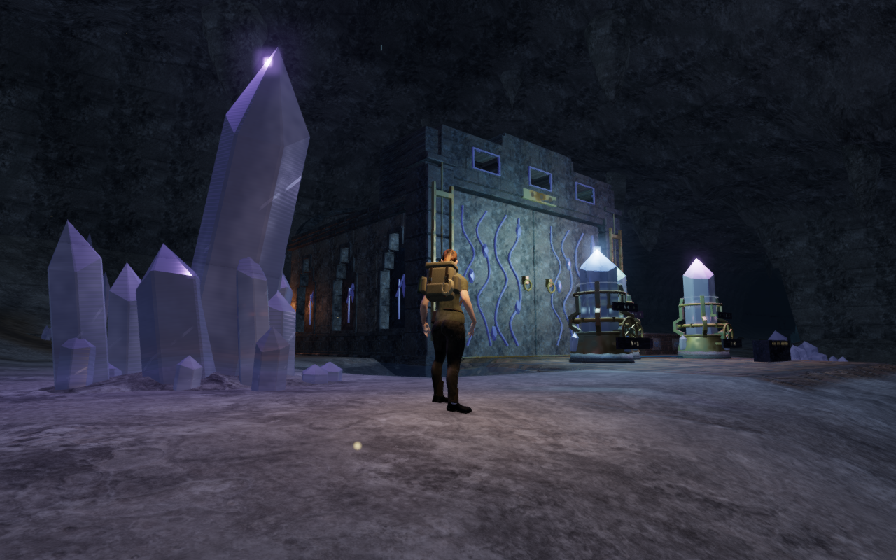
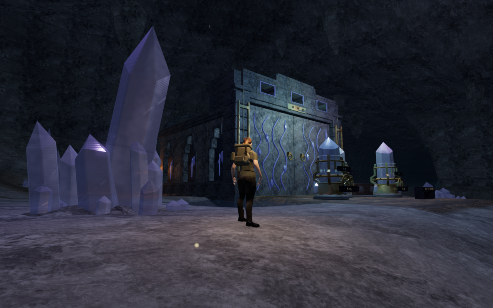
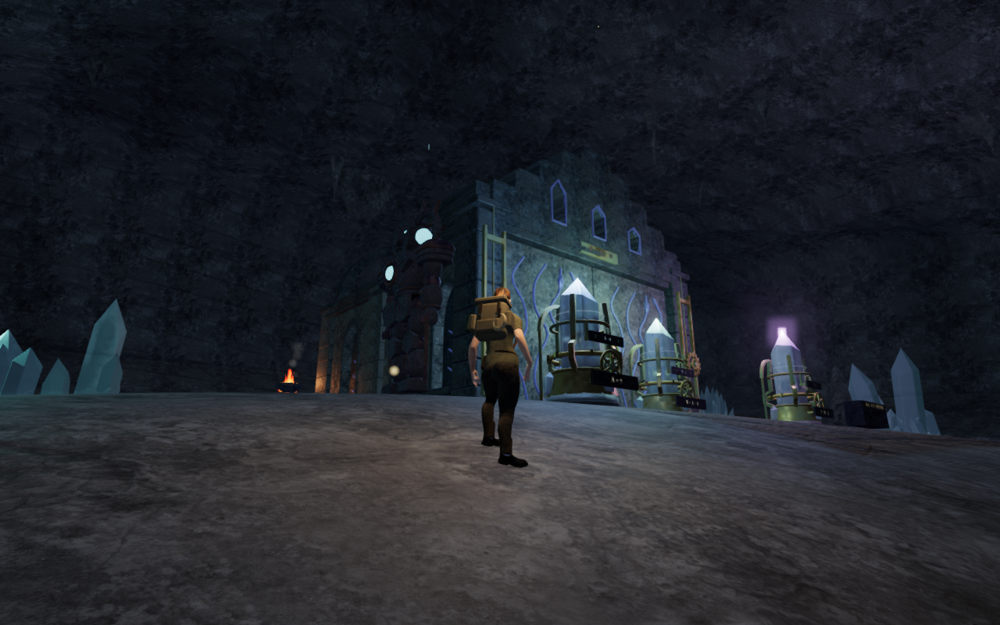
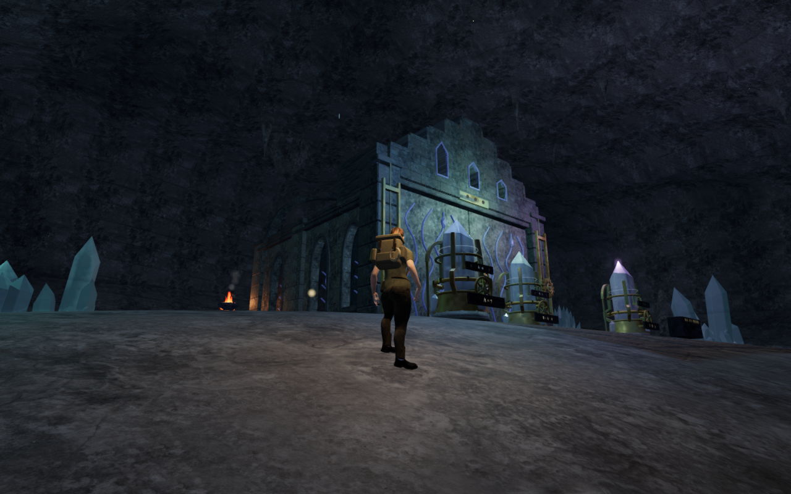
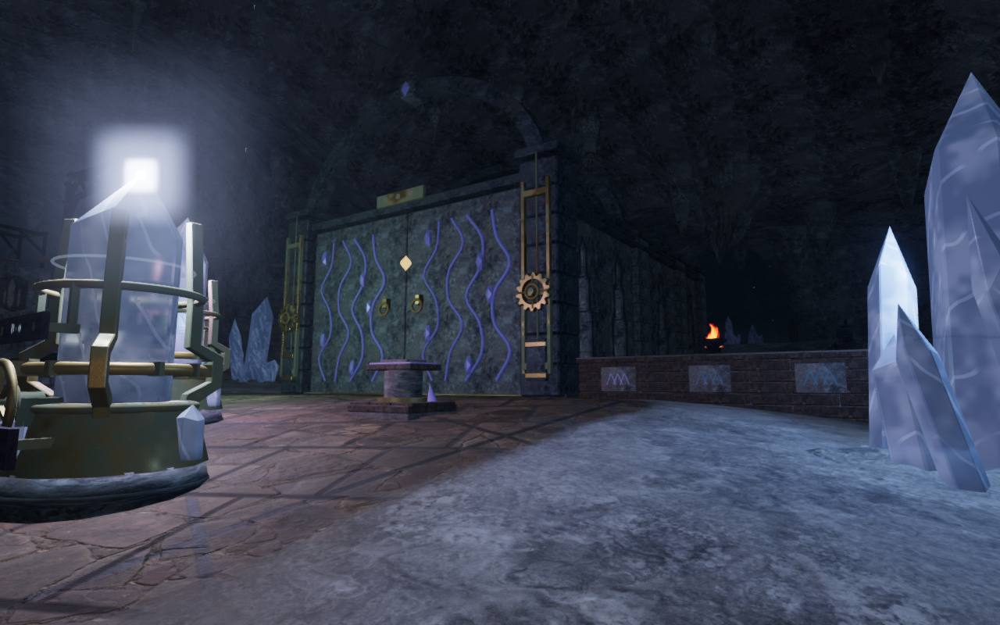
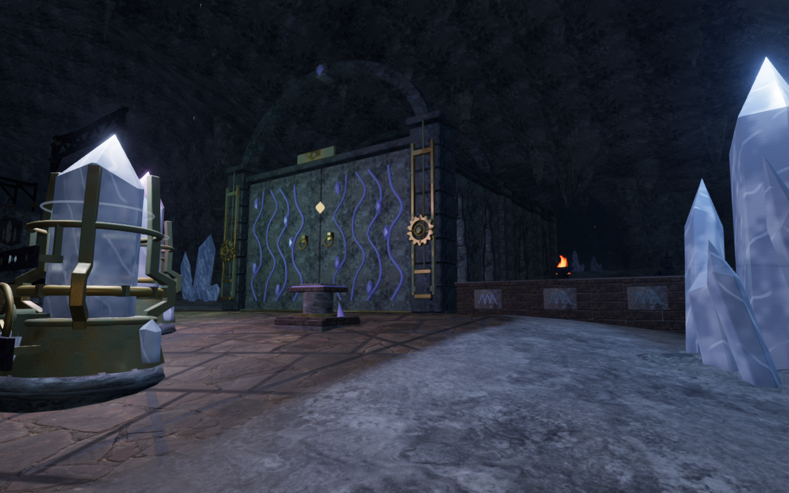

# Crystal lights clear their emitting geometry

## Clearance for the revised quartz surfaces

The archive-front review found smaller square halos at natural crystal and
resonator tips on the current glossy quartz. The previous 75 cm clearance kept
the lights outside the geometry, but their inverse-square highlights still
spread through bloom. The four existing pooled lights now sit three metres
above each source's actual bounds. Facet materials and the bloom pipeline keep
their existing settings.

The comparisons use High quality, the ordinary follow camera and prepared dry
standing positions. Camera, player position and zero elapsed simulation time
match within each pair. They retain the explorer and existing court lighting.
The source placement changes nearby illumination as well as the reflections;
the facets still catch smaller highlights.

| Matched High view | Previous scene HDR peak | Revised scene HDR peak | Previous bloom peak | Revised bloom peak |
| --- | ---: | ---: | ---: | ---: |
| Guide court / natural formation | 268.93 | 16.91 | 1.913 | 0.402 |
| Descending court / resonator | 829.32 | 15.77 | 2.092 | 0.179 |

These are whole-frame linear luminance maxima, before display tone mapping.
The scene input, bright-pass, five blur levels and bloom composite are finite
in both revised views, with linked programs and zero WebGL error.

The existing geometric regressions now require at least 2.99 m between each
light and the delivered source triangles, covering 33 natural clusters and
33 instrument assemblies. All 21 selected cavern, mineral and resonator tests
pass. The change adds no geometry, light slots, texture or dependency.

All 34 current development views are reviewed: eighteen High court overviews,
eight High follow-camera fronts, four Performance/Balanced fronts and four
nearby footing views. Small facet-edge glints remain visible, including on the
ascending court's natural formation. This pass reduces the reproduced glare;
it does not establish polished lighting at every moving viewpoint.

The live scene selects all 66 recorded anchors through the same four-light
pool. Its smallest sampled ceiling clearance is 12.663 m. Forty-one assisted
tuning-area legs and 33 mineral approach/return pairs pass, with the existing
control and sound fronts clear. The live mineral voice falls from gain 0.320
at 2.777 m to 0.247 at 10.071 m and retires beyond its range; these are state
checks, not a listening assessment. The saved music/ambience/effects mix remains
32/80/75. All 53 tracked facade geometries and three materials dispose when
leaving the chapter, with no old facade colliders retained.

The production build passes with the existing chunk-size advisory. All three
CPU-budget checks pass, including child/thread affinity and nested launches.
Verification uses the shared locked five-of-sixteen CPU allowance, at most two
test workers and one browser. Owned previews and browsers close after each run.

Production keyboard/High at 1280 × 800 and portrait touch/Performance at
540 × 900 both pass inspection, raising/lowering marks, reset, alignment and
stage advancement. Each performs thirteen control turns and a 5.7 m return
at 100 health. Four complete-store reload comparisons pass, excluding only
the play timestamp. The eight release captures are reviewed; served bundle
names match the build and the development hook is absent. No application error
or warning is recorded. These checks do not establish consumer-device frame
rate or subjective sound quality.

The four new comparison images are lossless exports of actual game captures,
with identical decoded source pixels and dimensions. The before runtime
source hashes match published `7b9f2c5`; the revised runtime hashes are recorded
and checked after capture. No external asset is added.

Broader cave-floor composition, repeated lower doors, continuous body contact,
full routes and listening/device acceptance remain open in the
[whole playable-world audit](visual-audit.md).

## Earlier 75 cm placement repair

The earlier eight-chapter overview survey exposed a square white glow around
several resonator tips. The cave's pooled point lights used a fixed four-metre
offset above each source centre. That put a light directly against the terminal
facets of some crystals, producing extreme specular highlights and a square
bloom footprint.

At that milestone each source recorded a light position 75 cm above the
world-space bounds of its crystal cluster or complete instrument housing. All 33 mineral
clusters and 33 resonators use these positions through the existing four-light
pool. Selection distance, colour, restoration response and light range retain
their existing rules. The repair adds no geometry, texture or dependency.

### Earlier verification

The reproduced High view has a peak linear HDR luminance of about 41,286 before
the repair and 61.3 afterward. Its camera, player position, quality and simulation
time match. The explorer is hidden for the lighting comparison. Disabling bloom
removes the halo; disabling transmission or environment illumination leaves the
extreme source highlight. A separate placement prototype removes the square by
moving the point sources clear of their geometry.

All nineteen selected cavern, mineral and resonator tests pass. The two new
regressions measure point-to-triangle distance against actual static geometry,
covering all 33 clusters and all 33 instrument assemblies. The production build
passes with its existing large-chunk advisory.

The actual browser scene exercises every one of the 66 light candidates through
the pool. Each selected position matches its recorded anchor, remains below the
cave ceiling and stays at least 0.759 m from its source geometry. The smallest
measured ceiling clearance is 13.413 m; four pooled lights remain allocated.

All eighteen High front/rear court views and four Performance views are reviewed.
Their recorded cameras and player positions match the preceding overview survey.
Sampled shaders link, the inspected HDR scene, bright-pass, blur and composite
buffers remain finite, and no application error, warning or WebGL error is
recorded. Performance views render without the HDR pipeline.

Production keyboard/High and portrait-touch/Performance cases pass from prepared
mid-chapter saves. Each opens the ascending chamber's actual controls, preserves
an earned tuning change through reload, solves the array and advances the stage.
Movement, crouching, camera look, jumping, landing and map input pass. Each case
compares the complete local save through three reloads, excluding its play
timestamp. All fourteen release captures are reviewed; the served bundles and
character model match the production build. No application error or warning is
recorded. Software-driver readback diagnostics are retained separately; these
checks do not establish consumer-device performance.

Both documentation images are lossless exports of actual game captures, with
identical decoded pixels and dimensions. All verification uses the shared locked
five-of-sixteen CPU allowance, at most two test workers and one browser at a time.
Owned browsers and previews close when their checks finish.

The preceding overview survey reviews 154 labelled views across all eight
chapters on unchanged source, resuming only its final eleven views after a
supervisor deadline. Several rear observers see foreground walls rather than
complete halls; they need offset views. Snow-hall repetition, coastal terrace
edges and cloud-cliff composition remain follow-ups. This survey does not close
the [whole playable-world audit](visual-audit.md), continuous-route coverage or
the separate listening/device acceptance work.
