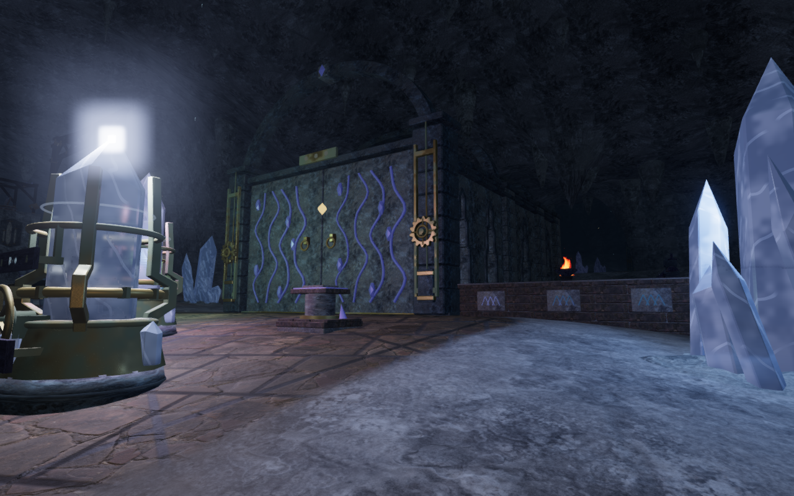
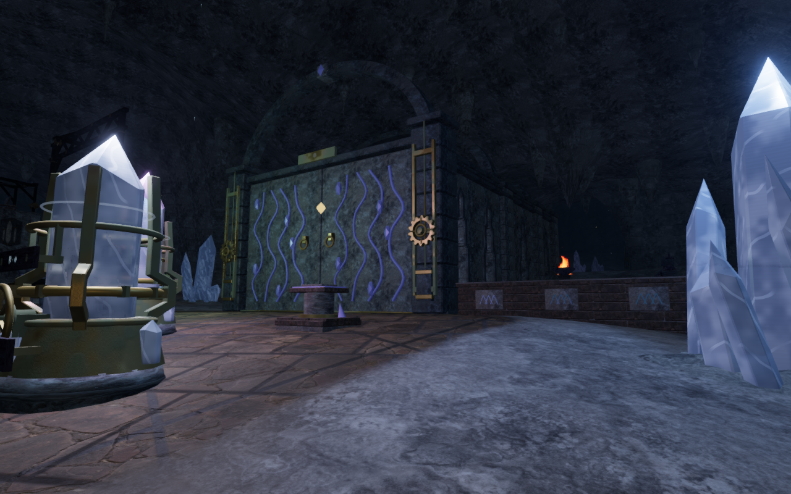

# Crystal lights clear their emitting geometry

The current eight-chapter overview survey exposed a square white glow around
several resonator tips. The cave's pooled point lights used a fixed four-metre
offset above each source centre. That put a light directly against the terminal
facets of some crystals, producing extreme specular highlights and a square
bloom footprint.

Each source now records a light position 75 cm above the world-space bounds of
its existing crystal cluster or complete instrument housing. All 33 mineral
clusters and 33 resonators use these positions through the existing four-light
pool. Selection distance, colour, restoration response and light range retain
their existing rules. The repair adds no geometry, texture or dependency.

## Verification

The reproduced High view has a peak linear HDR luminance of about 41,286 before
the repair and 61.3 afterward. Its camera, player position, quality and simulation
time match. The explorer is hidden for the lighting comparison. Disabling bloom
removes the halo; disabling transmission or environment illumination leaves the
extreme source highlight. A separate placement prototype removes the square by
moving the point sources clear of their geometry.

All nineteen selected cavern, mineral and resonator tests pass. The two new
regressions measure point-to-triangle distance against actual static geometry,
covering all 33 clusters and all 33 instrument assemblies. The production build
passes with its existing large-chunk advisory.

The actual browser scene exercises every one of the 66 light candidates through
the pool. Each selected position matches its recorded anchor, remains below the
cave ceiling and stays at least 0.759 m from its source geometry. The smallest
measured ceiling clearance is 13.413 m; four pooled lights remain allocated.

All eighteen High front/rear court views and four Performance views are reviewed.
Their recorded cameras and player positions match the preceding overview survey.
Sampled shaders link, the inspected HDR scene, bright-pass, blur and composite
buffers remain finite, and no application error, warning or WebGL error is
recorded. Performance views render without the HDR pipeline.

Production keyboard/High and portrait-touch/Performance cases pass from prepared
mid-chapter saves. Each opens the ascending chamber's actual controls, preserves
an earned tuning change through reload, solves the array and advances the stage.
Movement, crouching, camera look, jumping, landing and map input pass. Each case
compares the complete local save through three reloads, excluding its play
timestamp. All fourteen release captures are reviewed; the served bundles and
character model match the production build. No application error or warning is
recorded. Software-driver readback diagnostics are retained separately; these
checks do not establish consumer-device performance.

Both documentation images are lossless exports of actual game captures, with
identical decoded pixels and dimensions. All verification uses the shared locked
five-of-sixteen CPU allowance, at most two test workers and one browser at a time.
Owned browsers and previews close when their checks finish.

The preceding overview survey reviews 154 labelled views across all eight
chapters on unchanged source, resuming only its final eleven views after a
supervisor deadline. Several rear observers see foreground walls rather than
complete halls; they need offset views. Snow-hall repetition, coastal terrace
edges and cloud-cliff composition remain follow-ups. This survey does not close
the [whole playable-world audit](visual-audit.md), continuous-route coverage or
the separate listening/device acceptance work.
