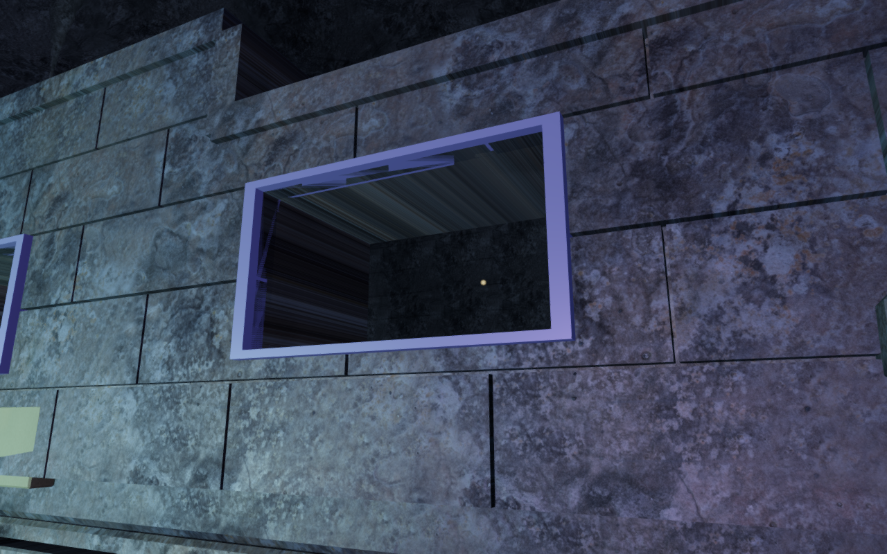
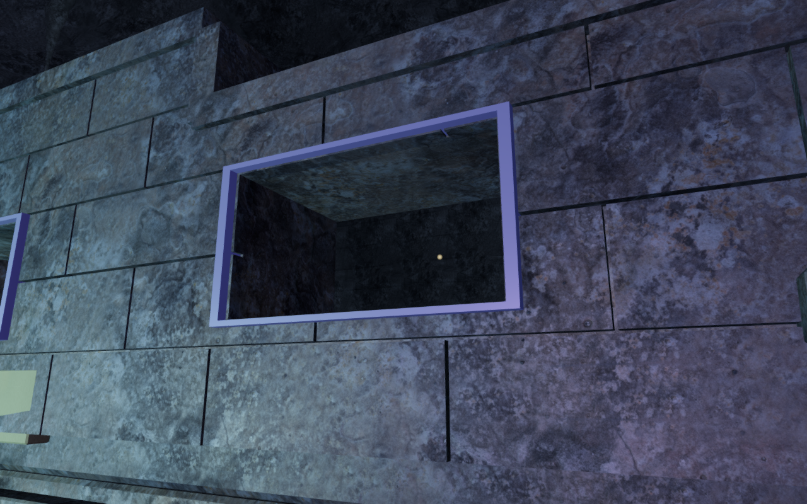
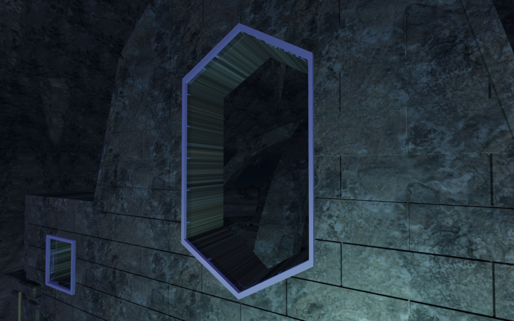
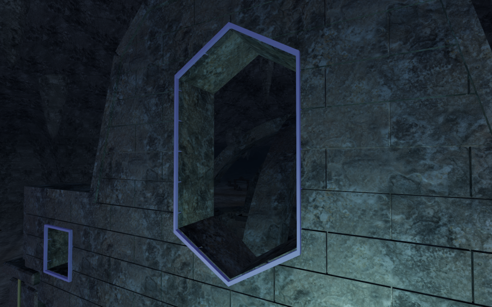

# Archive stone returns and window rims

The archive recesses and upper window openings used front-facing texture
coordinates on their depth faces. That collapsed the texture into streaks along
the returns. Stone now uses an orientation-dependent projection with a consistent
two-metre tile scale. The broad fronts retain their existing XY projection.

Close inspection also exposed overlapping colored trim and stone on the window
returns. The trim now leaves a small reveal around the original aperture instead
of sharing its exposed plane. The outer profiles and stone openings keep their
dimensions.

The complete gate comparison inspects 121,956 leaf/front triangles. Collapsed
texture triangles fall from 20,406 to zero. The projection-only step preserves
all positions, normals, colors, topology, transforms and material values across
318 render geometries. The subsequent trim correction changes nine rim groups
and their eight facade kernels; every other non-UV geometry buffer remains
identical to published `8c8abe6`. All 90 obstacle envelopes, 13,080 camera
surfaces and positioned gate-drive sources retain their previous data.

All nine selected tests pass. They cover texture area and physical scale,
unchanged front coordinates, closed carved components, masonry bearings,
window and threshold clearance, pier seating, supported caps and the earlier
unsupported-rest regression. All 115 sampled window edges separate the trim
and stone return planes, with a deliberate coincident control detected.

The browser review includes 22 views isolating the UV change and eight final
views after the rim adjustment. All are reviewed: selected front/interior follow
views, fixed close-up inspection cameras and Performance/Balanced approaches.
Sampled programs link, HDR inputs remain finite and no application warning or
WebGL error is recorded. The production build passes with its existing chunk-size
advisory. The preceding [shutter milestone](crystal-shutters.md) retains the
native field, tuning and complete-store reload evidence; this repair's new
verification covers the surfaces, trim, support and rendering.

The comparison's before views restore the published projection buffers inside
the paused game, after verifying the exact vertex and UV fingerprints. The final
after views use the revised application. Fixed inspection cameras, prepared
player positions, High quality and zero elapsed simulation time match within
each pair. Four lossless WebP exports preserve the decoded source pixels and
1280 × 800 dimensions. The existing credited materials and models are reused;
no external asset or dependency is added.

Verification uses the shared locked five-of-sixteen CPU allowance, at most two
test workers and one browser. Owned browsers and previews close after each run.
Broad cavern composition, repeated installations, moving contact, full routes
and listening/device acceptance remain open in the [world audit](visual-audit.md).
