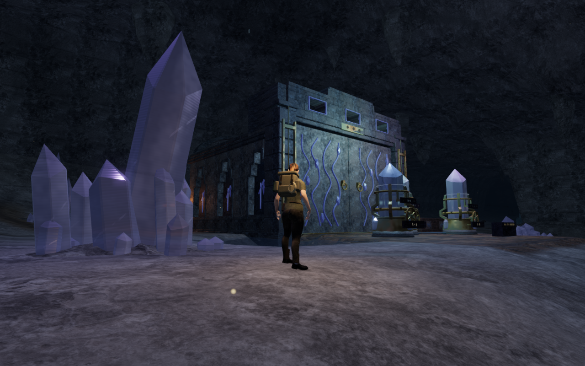
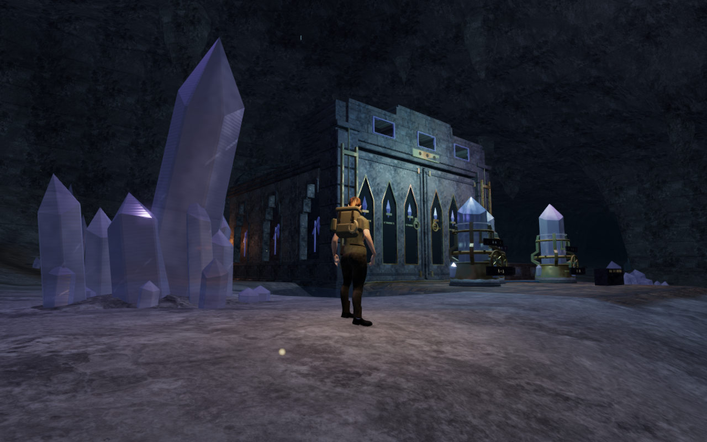
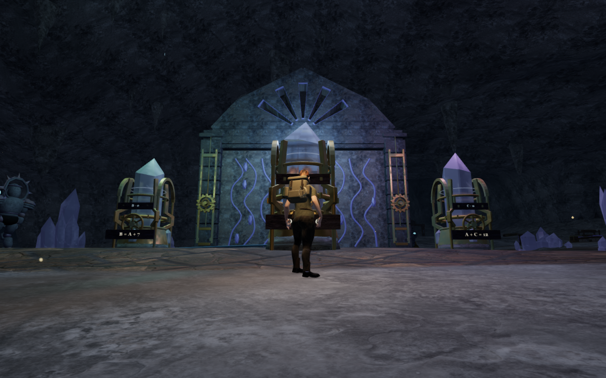
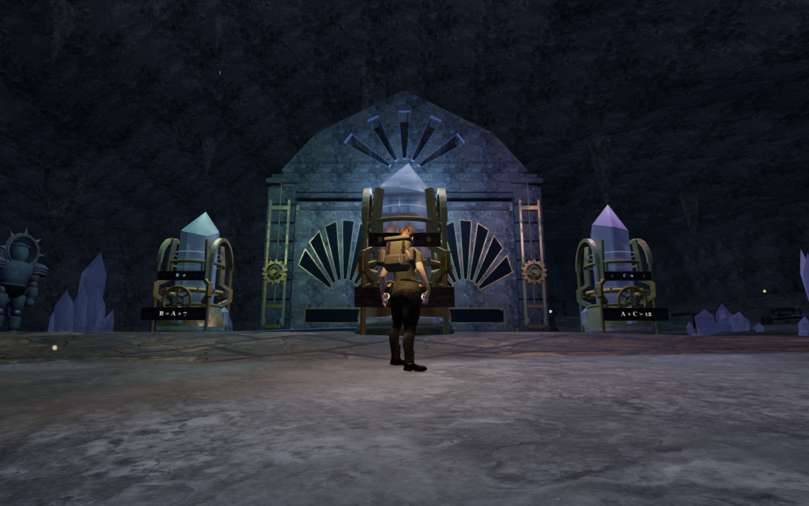
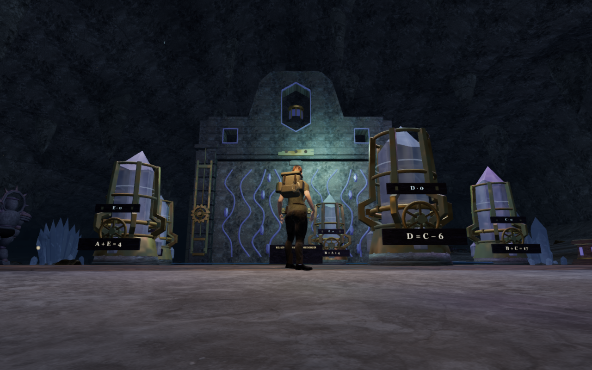
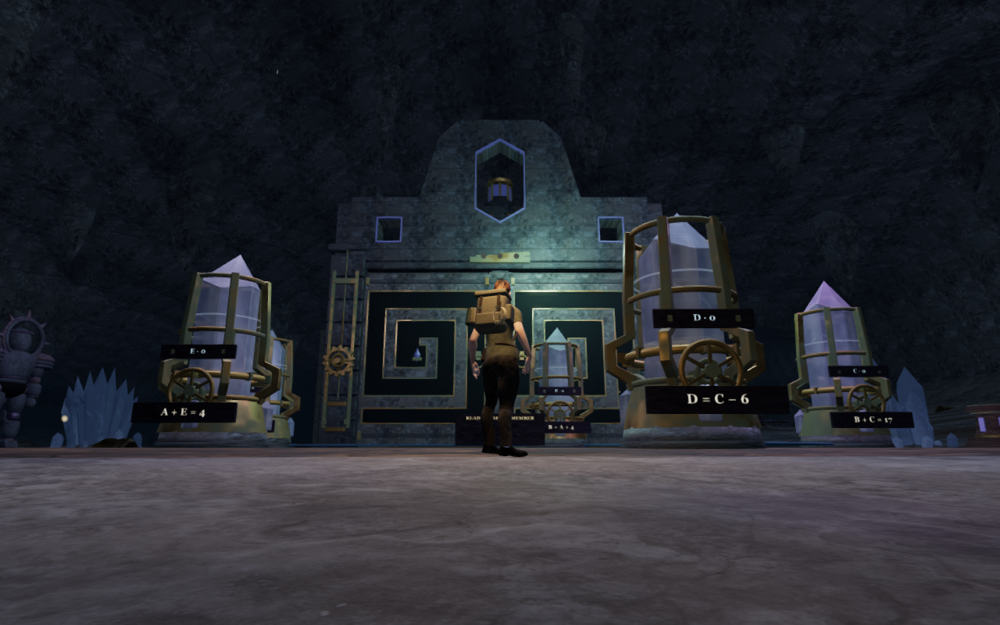

# Carved archive shutters

The eight cavern archives previously repeated the same blue vein decoration on
their descending stone doors. They now have different recessed compositions,
with bronze lips, fittings and small facet stones. Both the approach and interior
faces are carved. The large stone shapes remain visible when distant fine
fittings are culled.

| Chamber | Door composition |
| --- | --- |
| Guide lights | Tall pointed niches and cradled facet stones |
| Descending echo | Stepped registers and horizontal echo bars |
| Mirrored archive | Paired pointed panels with long inset stones |
| Ascending chamber | Rows of flutes rising across the complete pair |
| Violet counterpoint | Two radial fans above low registers |
| Broken conversation | Unequal fragment outlines joined by bronze cramps |
| Heart's two voices | Paired oval recesses and small answering stones |
| Remembered path | An angular meander cut into each leaf |

These motifs reinforce the chamber themes. The existing inscriptions and tuning
controls continue to carry the actual puzzle relations.

Each recess has a closed dark back seated into the original slab. The narrow
metal strips follow its actual return, including the concave meander. The
existing descent, floor slot, handles, counterweights, field seals and positioned
drive sounds retain their rules. The new relief fits inside the existing body
obstruction; the moving camera envelope now includes both deeper faces.

All 25 selected tests pass. They include the existing construction, saved state,
opening and standing-passage checks for all 69 gates across eight chapters.
New checks inspect closed finite components and sample every coffer back on
both sides of all sixteen archive leaves. The closure observer accounts for collinear
triangulation joins and rejects a deliberately removed cap triangle. Every
delivered leaf vertex also stays within its moving camera envelope at six
positions through the descent, with a 5 mm allowance for the existing chipped
slab edges.

All 38 development views are reviewed: eight High approach views, sixteen close
front/interior views, eight Performance/Balanced views and six half/full-opening
views. The visibility search found dry legal standing positions with framed door
bounds and at least five of eight door targets visible. Nine captures and the
verified positions were retained at a supervised handoff; the remaining views
use the same source fingerprints, and replayed cameras match exactly. Some
instruments and piers still obscure parts of the close views. Sampled shaders
link, HDR inputs remain finite and no application warning or WebGL error is
recorded.

Forty-one assisted tuning-area legs and 33 mineral approach/return pairs pass,
with all 54 sampled feature approaches, 41 controls, 66 tone fronts and 33 hum
fronts clear. A live mineral voice falls from gain 0.320 at 2.777 m to 0.247 at
10.071 m and retires beyond its range. The 32/80/75 music/ambience/effects mix is
retained; these are state checks, not a listening assessment. Leaving the chapter
disposes all 80 tracked door geometries and five shared materials, with no
archive leaves retained in the next chapter.

The production build passes with the existing large-chunk advisory. Verification
uses the shared locked five-of-sixteen CPU allowance, at most two test workers
and one browser. The supervised previews and browsers close after each run.

Production keyboard/High and portrait touch/Performance checks each restore the
final field station through native input, retaining the earned field completion
after reload at a prepared tablet start. Each then exercises thirteen tuning
turns, reset, alignment, stage advancement and a 5.7 m return at 100 health.
Four complete-store reload comparisons pass, excluding only the play timestamp.
All twelve final release captures are reviewed; the served bundles match the
build and the development hook is absent. The field and tablet starts are
prepared separately; continuous route coverage remains open.

The art uses the existing credited stone, bronze and inlay materials. No external
model, texture, recording or dependency is added. The comparisons use prepared
standing positions and the follow camera; their player positions, cameras,
High preset and zero elapsed simulation time match within each pair.
The six lossless WebP exports preserve decoded source pixels and dimensions;
before runtime source hashes match published `67f6abb`.

Broad cave floors, repeated drive and instrument structures, moving body
contact, full routes and listening/device acceptance remain open in the
[whole-world visual audit](visual-audit.md). This local door revision does not
establish completion of that broader work.
