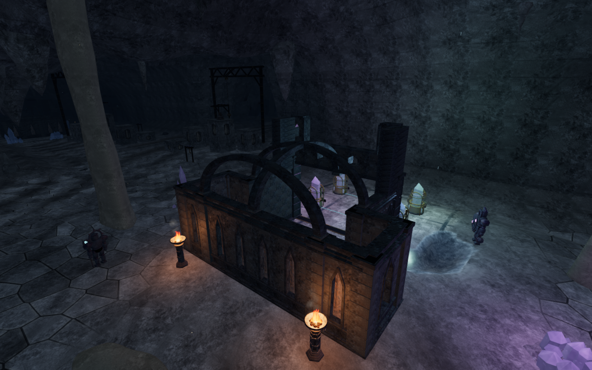
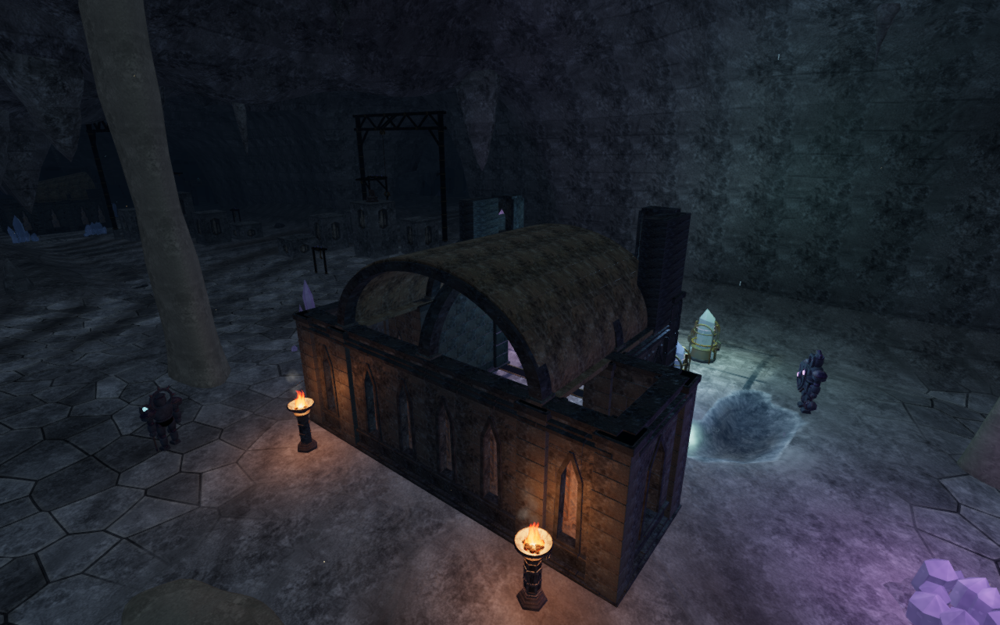
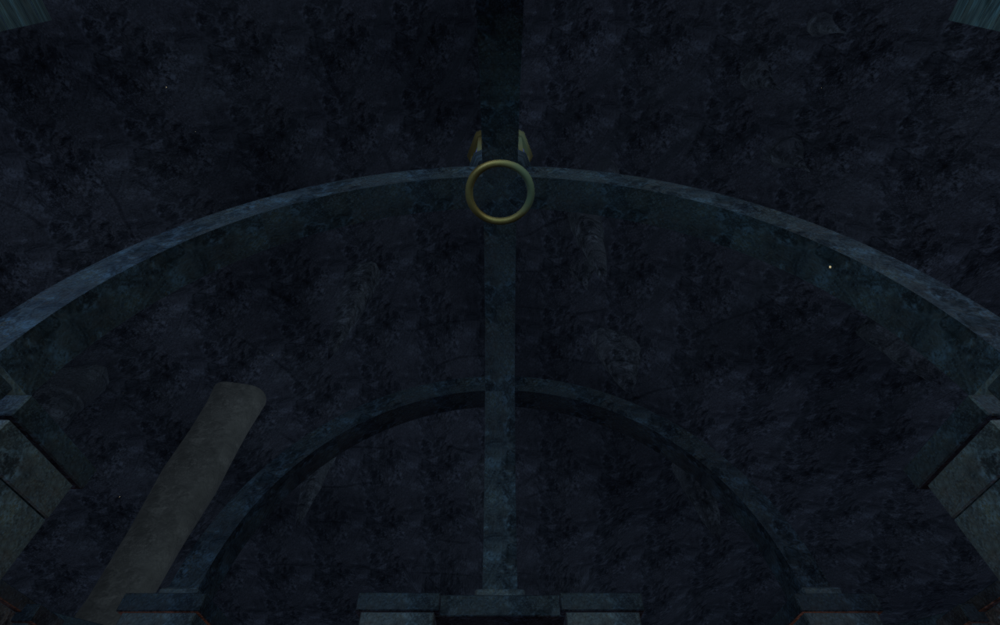
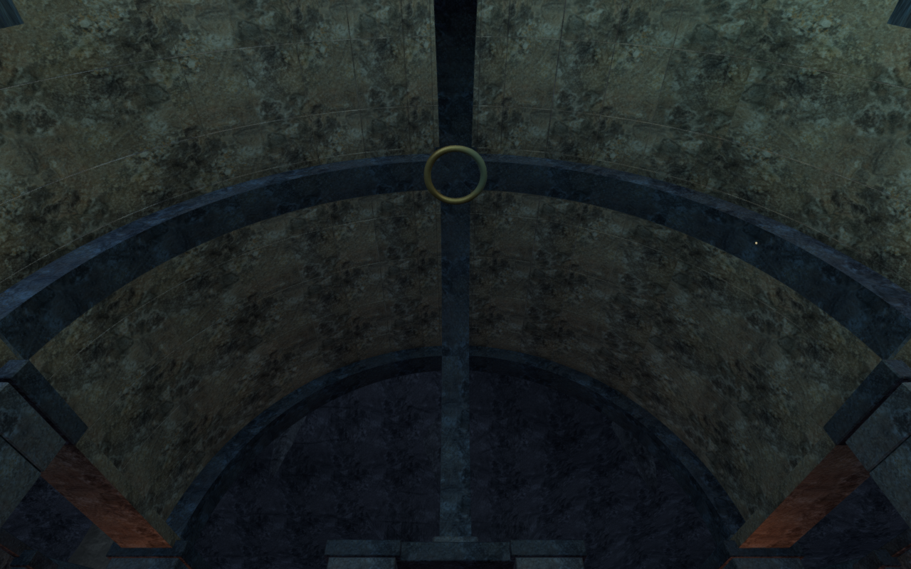

# Stone webs over the cavern archives

The eight cavern archives previously had open masonry ribs over their working
cores. Coursed limestone now fills selected spans, giving the chambers roof
volume and visible interior ceilings. The guide chamber keeps its open front
porch; a descending barrel, rising canopy and violet cloister vault give the
middle chambers different profiles. The western archive retains a broken roof
section, and the final canopy leaves an aperture beneath its existing lantern.
The extended reading wings and front clerestories remain open around the older
vaulted core.

Each curved block has closed outward faces. A continuous recessed mortar bed
closes its narrow joints, with dressed stone visible on both the top and
underside. Edge beams bed into the existing cornices and springing piers.
Terrain, lower walls, gates, tuning instruments, specimen cases and their
working coordinates are retained. The webs reuse the credited limestone maps;
this pass adds no texture downloads, dependencies, sound voices or light slots.

The comparisons use the preceding application and the revised construction at
matching prepared cameras, player positions, High settings and elapsed scene
time. Four lossless WebP exports preserve the full 1280 × 800 rendered pixels
without cropping or retouching. Prepared progress opens the gates; these are
construction inspections rather than complete human playthroughs.

The physical roof uses the delivered closed pieces, preserving their overlaps
as a union. A triangle-aware roof camera index follows their upper and lower
faces and the deliberate holes. Each chamber adds three camera entries: the
roof index and two edge beams. This replaces the draft's thousands of tile
boxes and keeps the hollow space below the vault available to the camera.
Disposing the merged roof geometry clears its camera index.

Independent tests cover 2,718 closed blocks with 76,104 outward triangles.
The assembled construction has 230,424 vertices, including the edge beams;
all stay beneath the actual cavern ceiling. All 5,203 sampled roof rays agree
between rendering, physical collision and the camera index. Four opening probes
pass through the new shell at the guide porch, western breach and lantern aperture.
The lantern retains its existing base and glazing. All 5,400 sampled
working-floor body queries retain their previous results, including standing
and two jump heights. These checks cover the retained samples rather than every
possible continuous stance.

An independent rendered-body observer passes 128 supported standing/crouched
poses on the chamber floors and eight roofs, across four headings. It checks
6,156,160 character vertices with no invalid coordinates or overlap beyond 15 mm. Eight
inside-roof containment controls confirm that the observer detects the stone.
An initially chosen floor position in the descending chamber was already
illegal; that fixture is excluded, and the accepted run selects legal stances.
These are prepared resting poses, not complete rooftop access routes or a
continuous moving-body audit.

Eight local chamber controller runs cover 38.1 m over 384 updates.
Every recorded player and lens position stays legal with full avatar
visibility. Seven runs return exactly to their starts. The guide-chamber run
stops at existing hardware and ends 0.30 m from its start. Replacing the chapter
releases all twelve tracked roof resources exactly once: eight geometries, one
material and three shared textures. All eight roof camera indices are cleared.

The existing columns, chamber/feature metadata and all 187 sound anchors match
the preceding version. The eight new roof assemblies account for the changed
obstacle count. Sound rays use their actual triangles; the additional ceiling
can therefore affect occlusion without moving a sound source.

All 64 selected regressions, three CPU-budget checks and the production build
pass. The existing build chunk-size advisory remains. All sixteen baseline
images and 39 current development images are reviewed. Two original exterior
views are obscured by limestone columns. Four alternate views provide three
clear roof observations; their fourth remains partly occluded and is excluded
from complete-roof coverage. The separate interior construction views inspect
the soffits. Eight High follow views retain full sampled body sight; these,
two Performance repeats and eight movement views cover gameplay framing and
often crop the ceilings. Sampled programs link, HDR inputs stay finite and no
application warning or WebGL error is recorded.

An initial native case saved while jumping over existing guide hardware. Its
airborne save records ground height, placing the saved ground point inside the
hardware. Reload correctly recovers by 0.75 m; an independent check produces
the identical occupied point and arrival with the new roofs removed. That case
is excluded from exact-position reload acceptance. The accepted native fixture
uses a checked clear lane beneath the guide canopy and waits for landing.

Native production keyboard/High and portrait touch/Performance cases each
move 3.60 m through that lane, crouch, jump and land with 100 health. Both
complete-store reload comparisons pass, excluding only per-level timestamps,
with the selected heading and pitch retained. All ten release images are
reviewed. Loaded JavaScript/CSS names match the current build, and the developer
hook is absent. All 423 runtime source hashes and 800 frozen code/test/build
inputs match the verified content; the other 421 preceding runtime sources
retain their hashes. Owned browsers, previews and workers close after each run.

The broader [playable-world audit](visual-audit.md) remains open, including
other repeated structures, wider scenery, continuous moving contact and
listening/device acceptance. Verification shares the locked five-of-sixteen
CPU set, with at most one browser and two test workers. Temporary helpers close
after each run. Existing [asset attribution](asset-credits.md) is retained.
