# Crystal archive vaults

The eight archive chambers in The Night Below now have distinct vaulted
crowns in place of their repeated front corbel. Their masonry rises from the
existing chamber walls, corner jambs and entrance lintels. Open ribs retain the
cavern behind them; a broken rear arch and the final glazed lantern give the
later chambers different profiles.

| Chamber | Upper construction |
| --- | --- |
| Guide-light porch | Low rear span and higher entrance arch |
| Descending apsis | Tall rear arch over three smaller masonry hoods |
| Mirrored nave | Three transverse ribs crossed by a longitudinal spine |
| Ascending vault | Three ribs rising toward the entrance |
| Violet fan | Two diagonal corner spans and a lower entrance arch |
| Broken archive | Open rear crown, two intact ribs and a longitudinal spine |
| Heart crossing | Tall central crossing with a bronze collar and keyed boss |
| Prism lantern | Three tall ribs, a spine and an octagonal glazed lantern |

The new construction contains 21,424 source triangles in 26 material batches.
Its geometry arrays occupy 2,001,696 bytes. It reuses the existing credited rock
maps, masonry, bronze and mineral inlay materials, with no new texture, light
slot, dependency, recording or music. The original gate drives, shutters,
mechanisms, field tasks and resonance controls retain their coordinates.

Geometry checks cover 62,409 delivered vertices beneath the cavern ceiling,
9,768 reachable standing/jumping body rays and 522 bearing probes against the
existing masonry. The dressed springing blocks bridge intentional narrow
cornice joints; bearing tests sample their contact footprint. Closed voussoirs
retain finite outward surfaces. The new arches stay above reachable body
envelopes, with no added walking piers or movement obstacles. Their camera
surfaces are captured after batching, using the delivered geometry.

The final visual survey uses legal prepared stances and the normal follow
camera at the front and rear of every chamber. An explicit facing check
rejects observer views that settle away from their chamber. Wider construction
lenses inspect each complete crown, including an oblique view that reveals the
lantern and crossed ribs. These elevated observer lenses inspect construction;
the follow-camera and native checks cover gameplay framing.

Comparison scenes build the preceding gate code alongside the current gates,
then alternate their visibility at an identical camera and simulation time.
They retain the same explorer state, environment and prepared progress, with
fresh water reflections in both views. They are controlled in-game
comparisons, rather than photographs of the preceding production application.
Prepared field progress opens gates; enemy simulation is disabled and audio is
muted. All new geometry batches dispose once when changing chapters.

The local controller check completes 32 legs through all eight chambers and
back to their entrances, covering 314.078 metres in 4,703 updates and 52
recorded batches. Forty revised views retain legal grounded positions, full
health, finite HDR and linked shaders. Its bounded 0.35 m navigation grid
resolves the first chamber's narrow aisle, which the preceding 1.4 m inspection
grid could not sample. The collision and water predicates remain unchanged;
starting stances avoid the resonance stones.

The eight-file regression selection passes 79 of 80 cases. Its sole failure is
`verdant` stage 2 at the restored threshold offset `(-3, +7.2)`. Isolated copies
of the preceding gate and field builders reproduce the same failure, with
movement and terrain code identical to the published commit. The failure
remains unresolved and prevents a claim that the full regression suite passes.
Both final vault cases pass, including all eight locked thresholds and all
72 restored threshold queries for the affected crystal chambers.

The build passes in 3.12 seconds with the existing large-chunk advisory. Source
triangle and array counts include the indexed bronze collar; they describe the
new geometry rather than total renderer or spatial-index memory.

The production build passes keyboard/High at 1280×800 and touch/Low at
540×900. Both cases open the memory tablet through Use, operate the ordinary
tuning buttons, retain an earned first adjustment across a reload, solve
the descending echo at `[7, 5, 0]` and advance from objective 1 to objective 2.
Movement, crouching, look, jump/landing and map checks pass, followed by two
further complete-store reloads per case. Each case therefore verifies three
reloads; the complete stores match apart from their played-time timestamp.
Neither layout overflows. The actual built bundles and delivered explorer
model are checked, with no development hook or application/HTTP error.
Chromium emits only the known screenshot readback stall diagnostic.

All 122 final captures are reviewed: 36 paired follow-camera images, sixteen
frontal construction images, sixteen oblique construction images, forty local
controller views and fourteen native production views. The last chamber's
Low and Medium comparisons are included. High/Medium output has finite HDR;
Low uses RGBA8. Shader links and WebGL error checks pass. Follow-camera crops
sometimes omit the top of a crown; the separate fixed construction lenses
inspect its complete shape. These checks do not cover every route, arch face
or intermediate player pose.

The eighteen paired follow views add 6–85 rendering calls and 4,304–55,360
submitted triangles across the sampled rendering passes. The eight frontal
construction pairs add 9–71 calls and 4,304–49,928 triangles; the eight oblique
pairs add 9–61 calls and 4,304–37,800 triangles. These counters include fresh
reflection/shadow work and any other crowns visible from the observer. They
are sampled incremental costs, not a supported frame-rate measurement.

Verification runs serially behind the shared CPU guard, locked to nine of
sixteen available CPUs (56.25%), with one browser and one test worker. Every
browser closes after its check; descendant audits retain only the helper,
which then exits. Both temporary server ports are closed. All 26 added
geometries dispose exactly once on chapter change. Private fixtures, saves,
browser profiles and raw results stay in ignored local staging.

The fourteen public images below preserve decoded RGBA pixels and dimensions
through verified lossless WebP conversion. The construction comparisons
recreate the preceding gate builders inside the current environment, as
described above. They are elevated fixed observer views, with prepared open
gates; the native views show the actual built interface.

| Chamber | Oblique construction view |
| --- | --- |
| Guide-light porch | 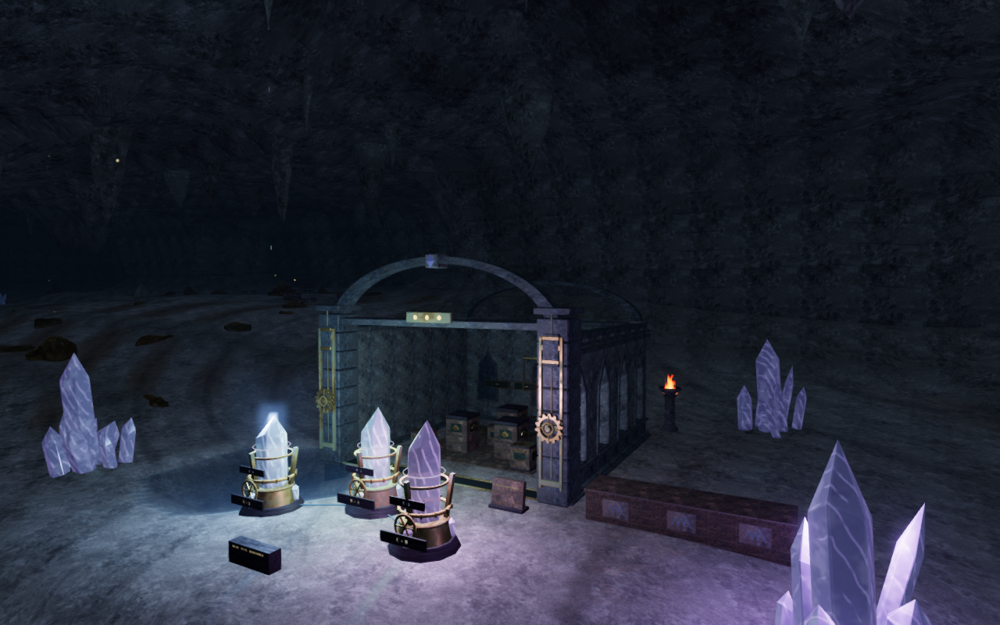 |
| Descending apsis | 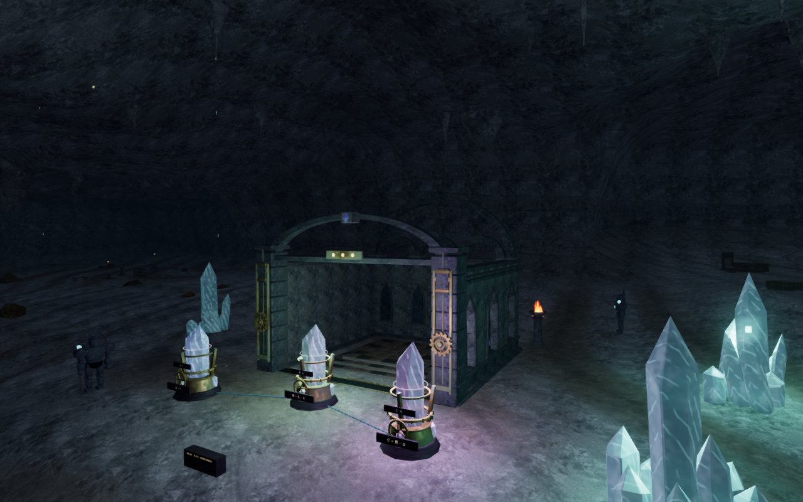 |
| Mirrored nave | 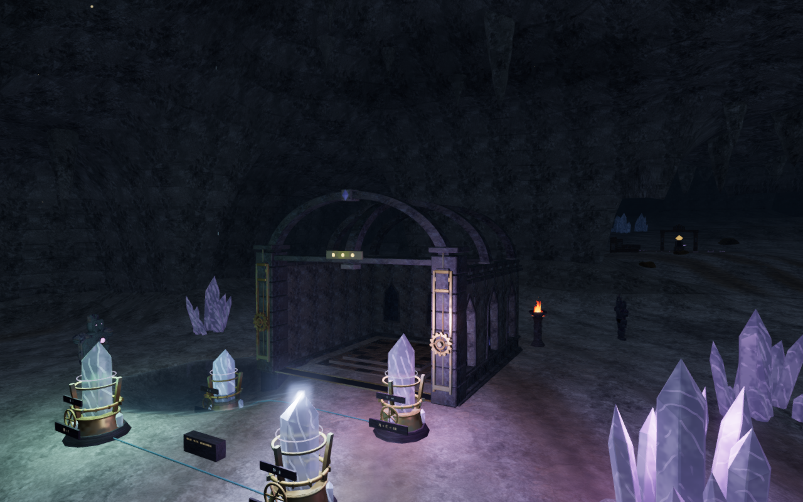 |
| Ascending vault | 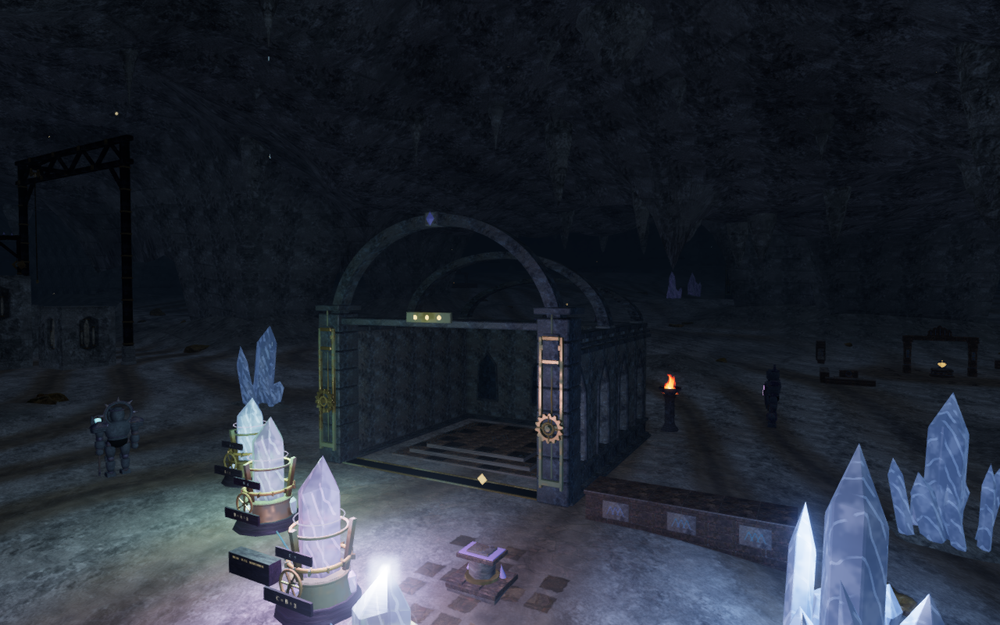 |
| Violet fan | 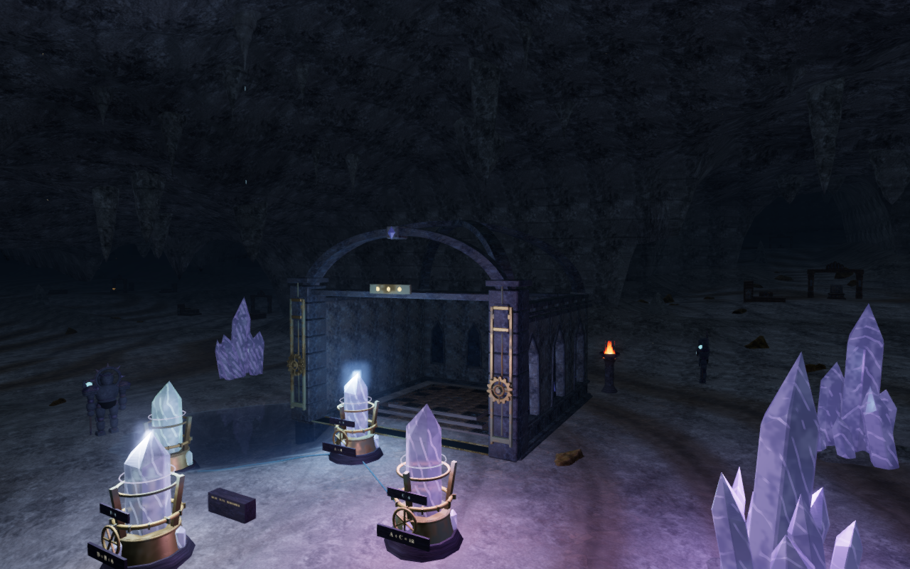 |
| Broken archive | 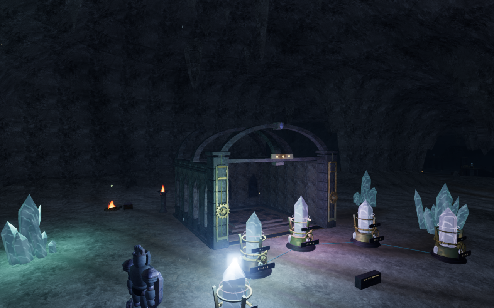 |
| Heart crossing | 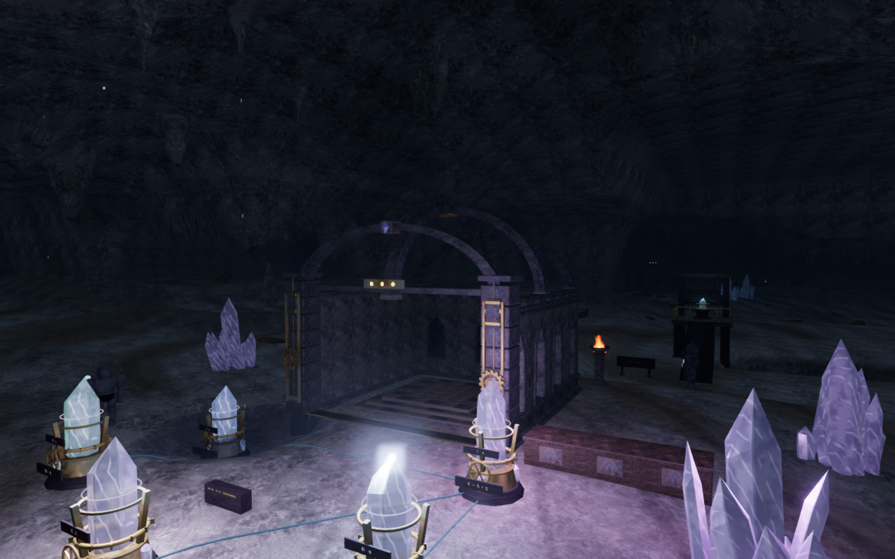 |
| Prism lantern | 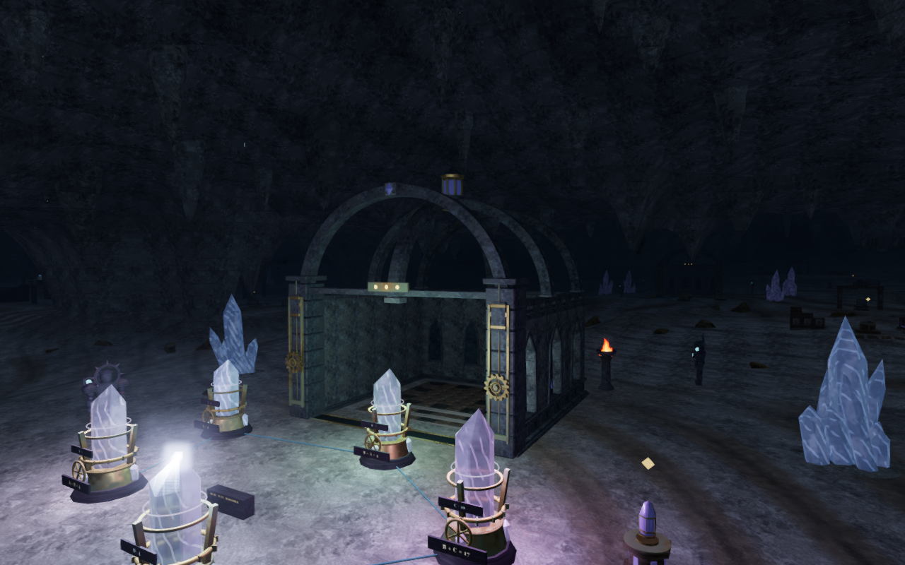 |

| Controlled construction reference | Current construction |
| --- | --- |
| 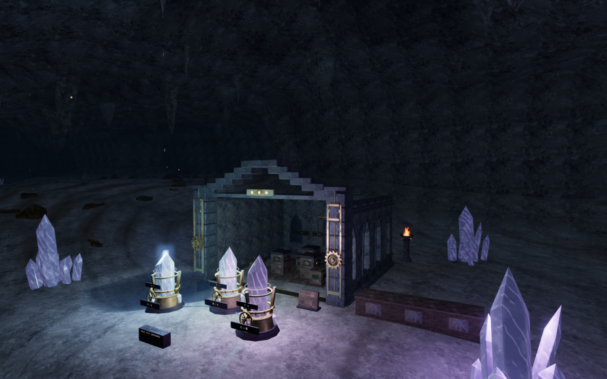 |  |
| 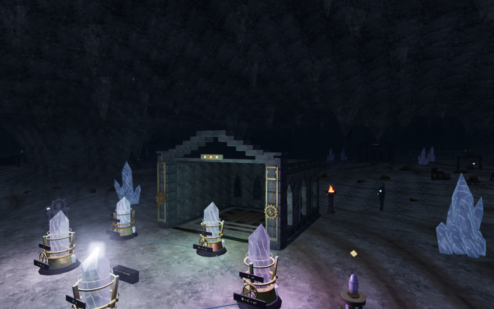 |  |

| Native built view | Keyboard / High | Touch / Low |
| --- | --- | --- |
| Crouched approach | 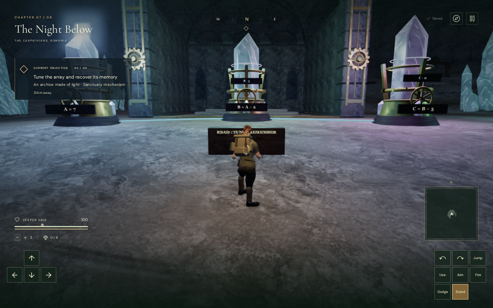 | 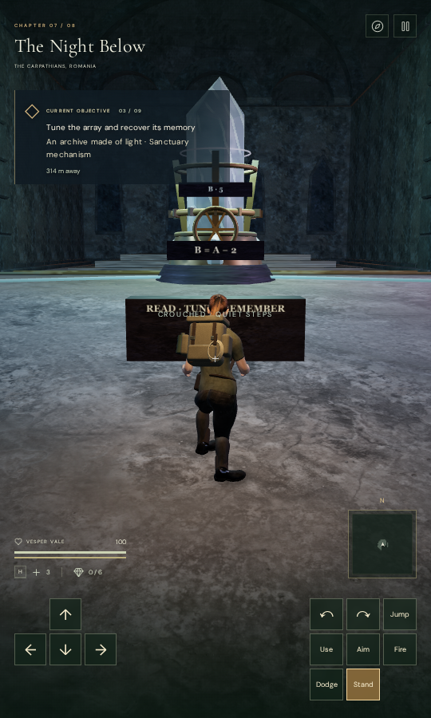 |
| Tuning inspection | 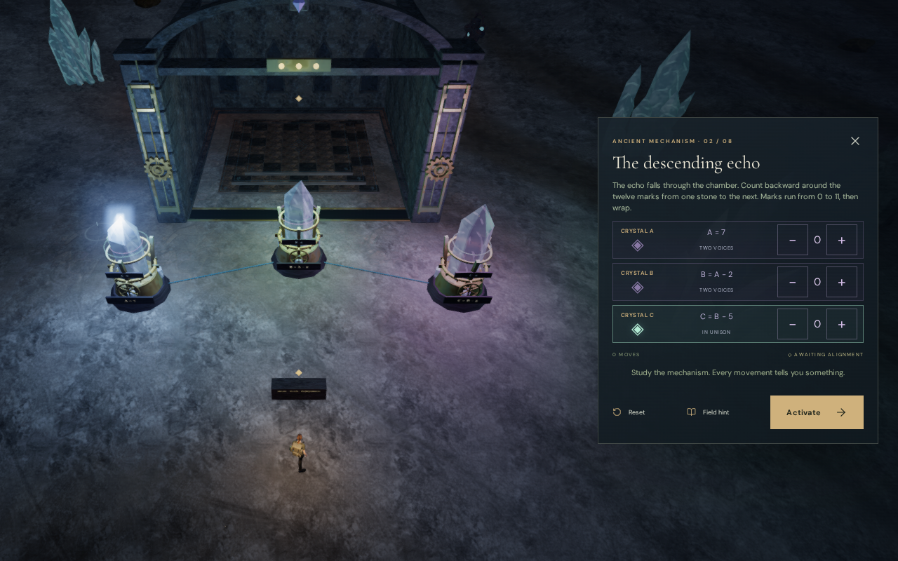 | 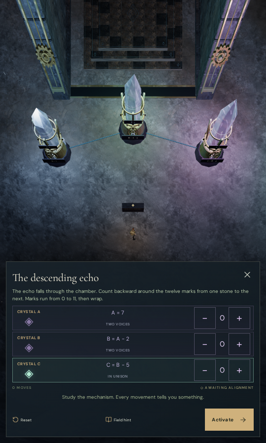 |

This improves the repeated upper chamber silhouettes. The instrument families,
lower chamber footprints, sparse wider cavern spaces and full eight-chapter
visual acceptance still need work. These checks do not establish human
playthrough duration, subjective sound quality or consumer-device frame rate.
