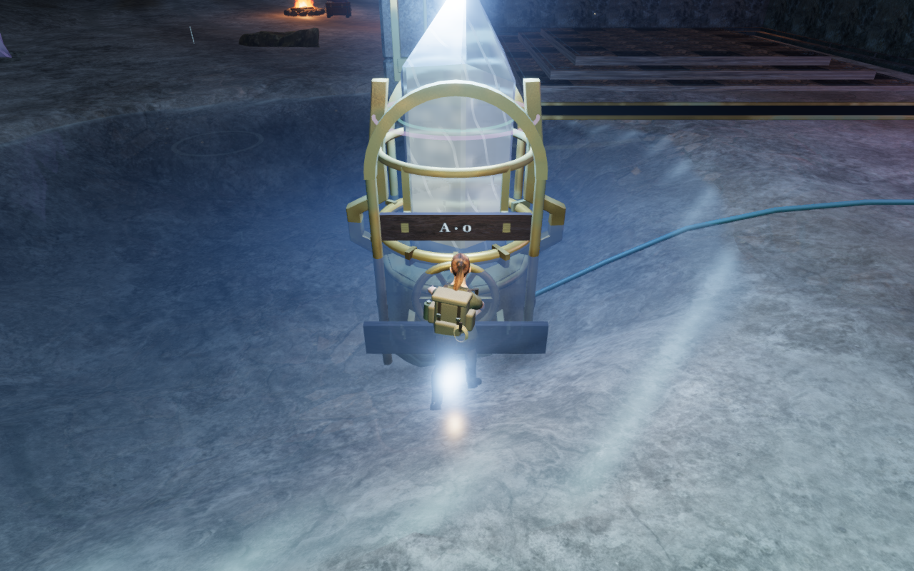
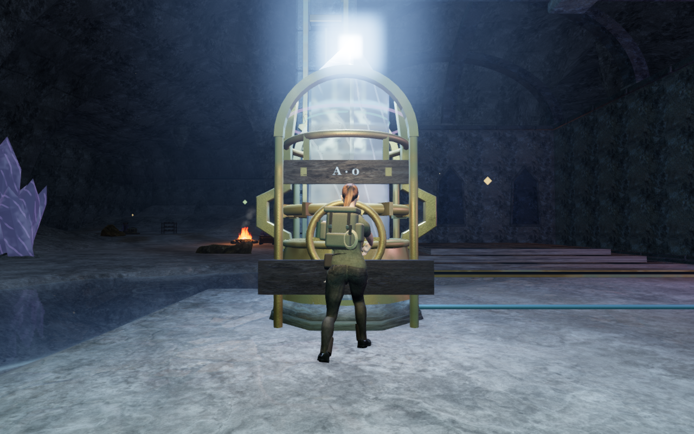
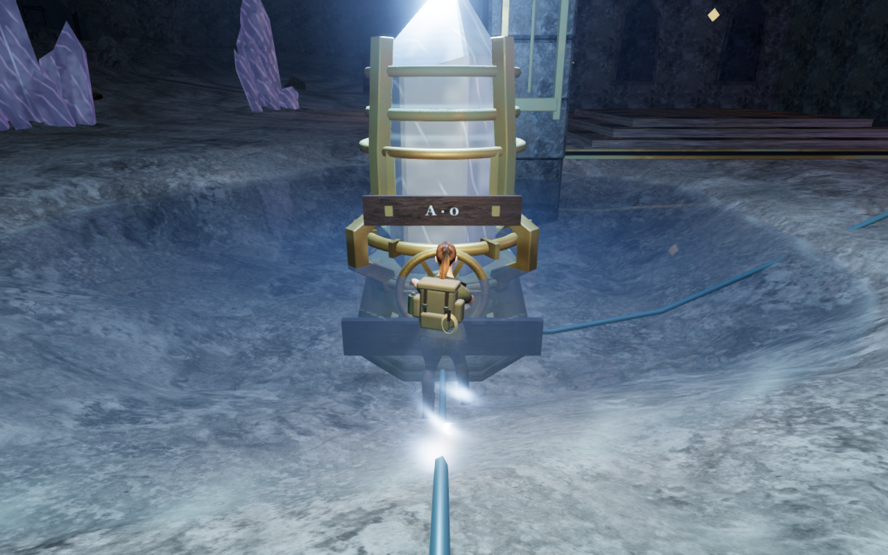
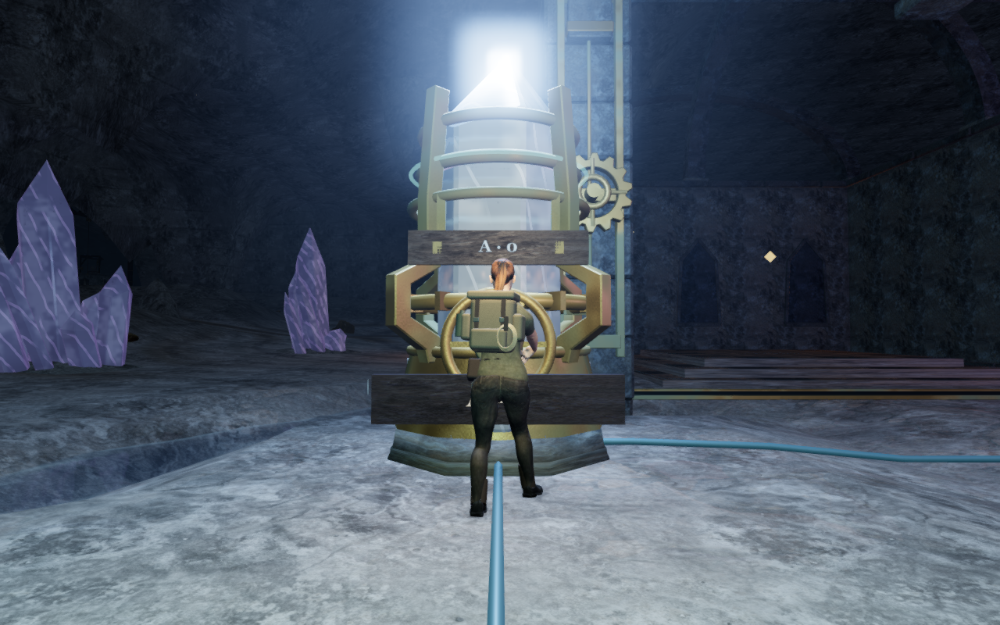
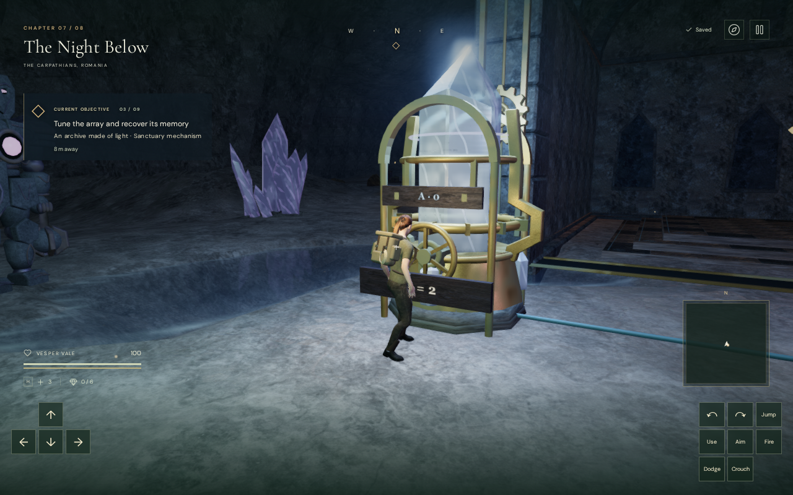
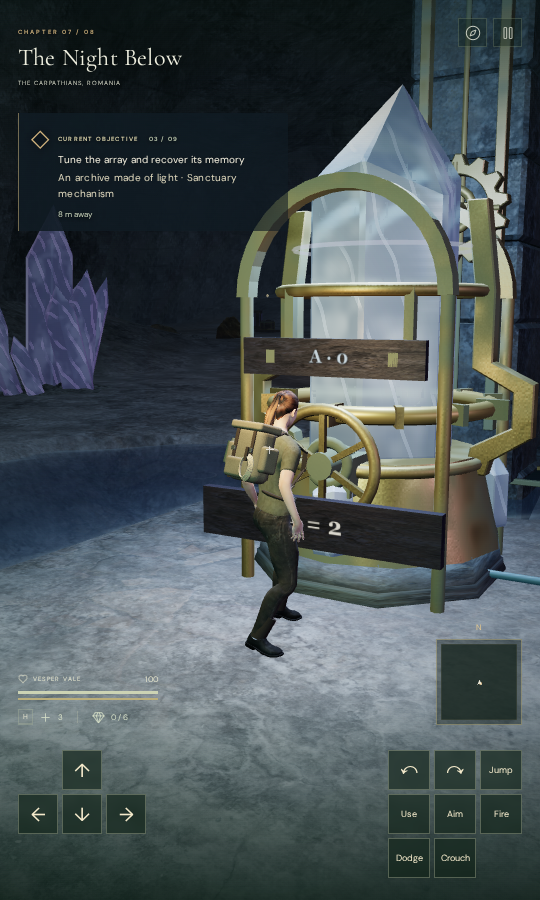

# Dry working ground in the crystal archive

Reservoir excavation now preserves the existing court ground beneath the
crystal instruments and their front working margins. The pools remain beside
the machinery, while wheels, bronze bases and the explorer's boots remain
above their water surfaces.

The preceding camera review recorded a bright overlay over footwear near the
mirrored and paired-heart instruments. Controlled render checks isolate the
water surface: hiding it removes the overlay, while disabling bloom alone
does not. The character's distance coverage remains fully opaque. A subsequent
depth survey identifies a placement defect, rather than a reason to dim the
scene: two wheel centres are below the water plane, their operators stand in
roughly a metre of water, and a third instrument base is partly submerged.

| Canonical position | Previous water depth | Current water depth |
| --- | ---: | ---: |
| Mirrored A base | 1.436 m | 0 m |
| Mirrored A operator | 1.003 m | 0 m |
| Paired-heart A base | 1.239 m | 0 m |
| Paired-heart A operator | 1.010 m | 0 m |
| Counterpoint B base | 0.264 m | 0 m |

The mirrored and paired-heart wheel centres were respectively 36.6 cm and
16.9 cm below their water planes. Preserving the court ground places the
sampled working footprints above the wave crests. The protection includes
the terrain cells around each instrument's footing and crouched operator,
and blends back into the basin over two metres.

This changes the excavation mask for crystal mechanisms. The horizontal
instrument layout, puzzle solutions, control IDs, saved records, water planes,
wave shader, lights, materials, music and recordings remain in use. The
ground-following instrument geometry and controls rebuild at their restored
heights. Existing saves store height relative to the ground, so a former
wet-ground position can use the restored floor at the same horizontal point.

## Terrain and physical verification

All 33 instrument centres and wheel controls are dry. The regression checks
4,224 perimeter points around the instruments and operator margins; 843 lie
inside reservoir render bounds. The minimum sampled ground-to-plane gap is
9.33 cm, above the wave harmonics' combined maximum amplitude of 5.1 cm. The
same perimeter test fails against the preceding terrain at wave clearance.

All four reservoirs retain visible water. Their sampled maximum depths are
1.470 m, 1.347 m, 1.470 m and 0.626 m; the restored working ground does not erase
the pools. A complete array comparison finds 98 changed height samples out of
60,025 in the crystal chapter, all raised by at most 1.65 m. Every other
chapter's terrain array and all chapters' water metadata remain identical to
the preceding generator.

The current rendered-body survey checks standing, crouching and tuning at
all 33 instruments: 99 poses and 4,761,405 delivered character vertex records.
No sampled record enters the frames, footings or terrain, and every control
position remains legal. These are vertex records, including repeated surface
positions, rather than complete coverage of body-face interiors or airborne
approaches. All 41 new frame and footing geometry resources dispose once on
chapter change.

The normal controller completes 49 local legs over 358.634 m and 33 reversible
physical wheel adjustments. These are prepared local approaches with enemy
simulation disabled, rather than uninterrupted campaign traversal. Sixteen
puzzle-panel views cover all eight arrays at 1280×800 High and 540×900 Low;
the complete array geometry fits its focused viewport and stays beneath the
roof, with controls and titles within their available widths.

All 73 selected regressions pass, covering the dry working margins, retained
water, cavern terrain, instrument construction and interaction, camera bounds,
posed framing, terrain sight and audio. The production build passes in
5.97 seconds with the existing large-chunk advisory.

Native built-game checks pass with keyboard/High at 1280×800 and touch/Low at
540×900. Each solves the mirrored objective `[2, 7, 10, 5]` in fourteen turns,
advances from objective 2 to objective 3, and passes movement, look, crouch,
jump/landing and map inputs. Three gameplay-store reloads per case retain the
earned tuning and later state; comparisons exclude `lastPlayed` timestamps.
The built page has no development game hook, and its loaded JavaScript/CSS
filenames and explorer model hash match the current delivery files.

Both input modes also restore a preceding wet operating position at
`x=57, z=180.9, height=0` on the new dry ground. Its complete gameplay store,
including the selected camera angles, is retained apart from timestamp
metadata. Native Use turns the physical wheel, and an additional reload
retains that earned adjustment. This checks the recorded ground-relative
arrival; arbitrary airborne or occupied legacy positions need broader review.

Verification uses the shared CPU launcher, locked to nine of sixteen available
CPUs (56.25%), one test worker and one browser at a time. Raw captures, profiles,
seeded stores, logs and comparison helpers remain in ignored local staging.
All 115 diagnostic and current-game captures were reviewed, including the
desktop and portrait arrivals. Every owned verification browser and preview
server closed after its check; the final process and port audit finds none
remaining.
No external asset, dependency or recording is added.

Wider cavern composition, camera motion and full campaign visual acceptance
remain under review. These checks do not establish human playthrough duration,
consumer hardware performance, subjective audio quality or AAA graphics.

## Captures

The before views retain the preceding terrain and all water surfaces. The
current views use the restored ground with every effect enabled. Camera
responses and instrument heights can differ because the physical ground
changes. The comparisons are actual controller arrivals, rather than a fixed
lens or an earlier complete application. Intentional WebP delivery preserves
captured decoded RGBA pixels and dimensions through checked lossless conversion.

| Working position | Previous ground | Current ground |
| --- | --- | --- |
| Mirrored A |  |  |
| Paired-heart A |  |  |

| Native older-save arrival | Capture |
| --- | --- |
| Keyboard/High |  |
| Touch/Low portrait |  |

The excavation protection is in [hydrology.js](../src/hydrology.js), with
the dry-margin and retained-pool regression in
[resonance-terrain.test.js](../tests/resonance-terrain.test.js).
