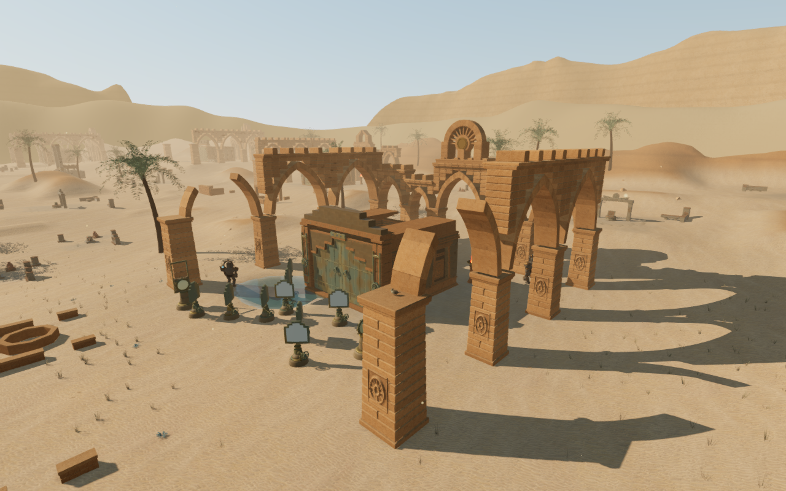
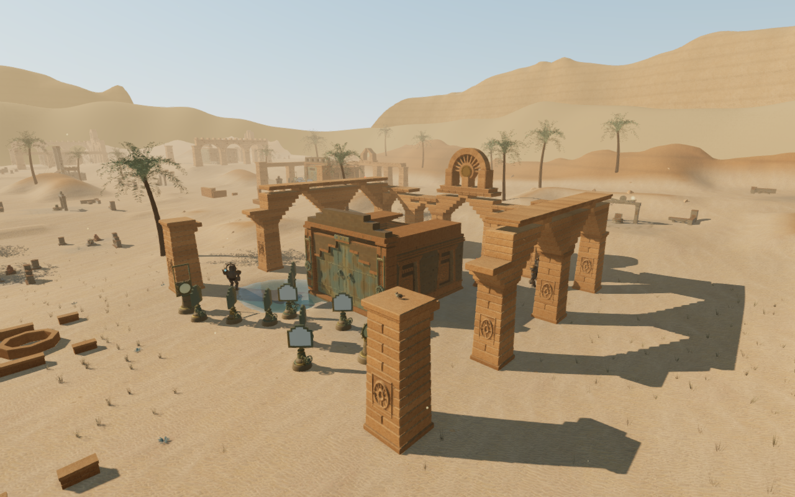
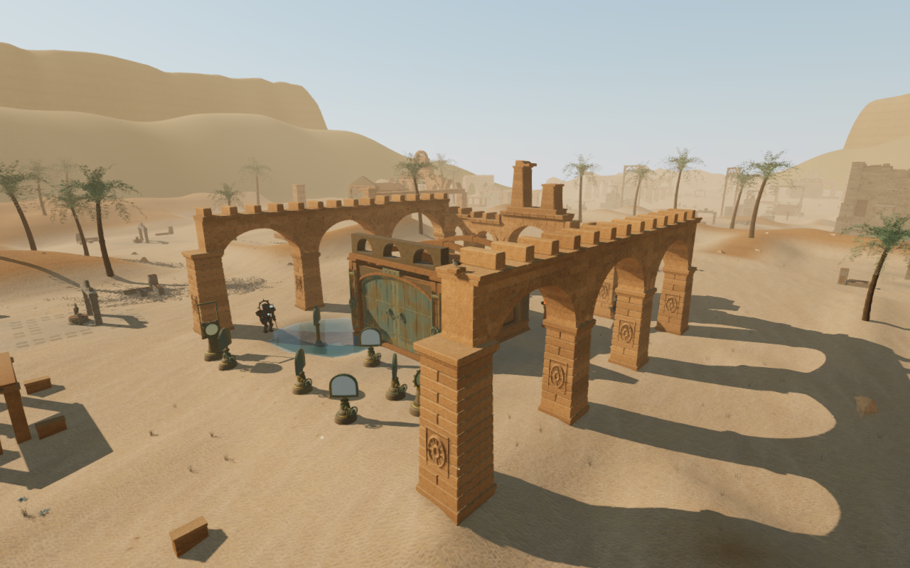
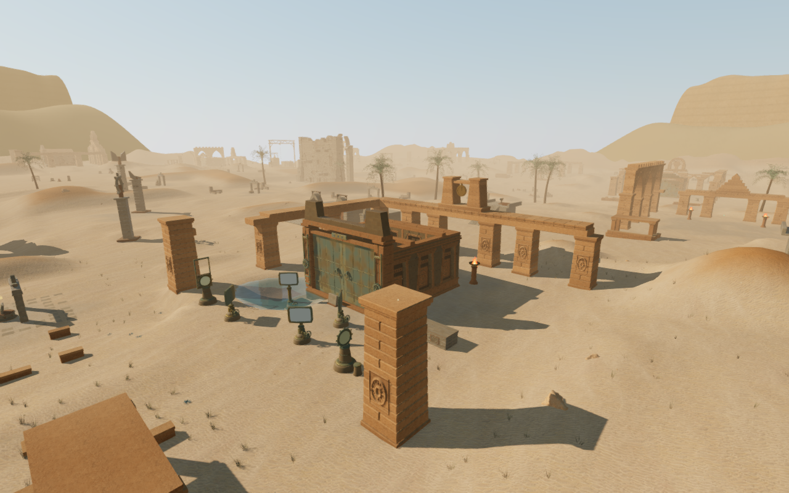

# Desert court arcades

The desert court perimeters now vary their structure along with the solar
sanctuaries. Low lintel colonnades frame the balance and relay trials; round
arcades surround the aqueduct and light well; the ephemeris court has ascending
rear lintels; the western shade court combines unequal wings; and the last
precinct uses stepped corbels. The processional and noon courts retain broken
sections. The existing pier footprints, crossing axes and objectives remain.

| Previous last court | Revised last court |
| --- | --- |
|  |  |

These High game captures use matching prepared player and camera positions,
quality and scene time. Other animation can differ. The documentation images
preserve the decoded source RGB pixels and dimensions through lossless WebP.
The construction uses original procedural geometry and existing materials;
no external asset or dependency is added. Existing
[asset attribution](asset-credits.md) remains applicable.

The former spring placement could leave an arch disconnected from its cap,
especially where its two piers stood on unequal ground. Each pier now fits the
actual low spring stones of its adjoining spans. Closed spandrel courses fill
above the round and pointed openings. Convex camera surfaces retain the open
bays, and finite stone collision supports the coping and pier tops. A small
support tolerance bridges the narrow masonry joints. Bird seats follow the
finished stone surface.

Ground placement and solar clipping query the finite arcade masonry. Using the
whole assembly's enclosing box would remove plants and rubble from empty bays
and prematurely stop light beams. The new regression fixtures distinguish an
empty frame from a filled wall and overhead stone from stone at ground level.

## Recorded verification

- All 98 selected regressions pass, covering desert architecture, crowns,
  forecourts, groundcover, scanned stone, landscape, survey work, solar circuits,
  counterweights and audio. A separate observer regression passes, bringing this
  milestone to 99 distinct passing checks. The three CPU-budget checks and the
  production build pass; the existing bundle-size advisory remains.
- Independent queries inspect all 184 delivered spring bearings across ten
  courts, using 83,260 toe samples. Raising the sampled heads by 0.35 m
  disconnects 162 bearings in the negative control. All four head families,
  broken sections and camera cells retain closed outward stone geometry.
- Nineteen final High views are reviewed: ten matching aerials, three fronts,
  five prepared rooftop landings and one spring detail. HDR inputs are finite,
  shaders link and GL checks report zero errors. These views still show sparse
  surroundings and repeated ancillary structures.
- All 59 feature approaches pass with prepared open gates. The observer now
  uses the delivered receiver consoles in place of decorative mechanism
  plinths; a negative control detects a blocked actual interaction point.
  Seventy-seven prepared local legs reach their solar controls over 7,210
  controller updates. Five ground approaches produce ten stopped standing and
  crouching poses; five prepared falls land on actual coping without a
  horizontal shift at full health. The fifteen endpoint poses inspect 721,425
  delivered character vertices without overlap beyond 15 mm. The ground and
  fall sequences cover another 1,650 controller updates. Combat is not stepped,
  and these checks do not certify every moving body pose.
- The complete game retains 230 scanned stones, 652 rubble fragments and 7,142
  ground plants. All 16,560 sampled scatter vertices within courtyard bounds
  clear the delivered stone. All 161 environmental sound origins remain
  outside the new construction. The four sampled bird seats are within 4 mm
  of their rendered support surfaces. Existing distance falloff and adaptive
  chapter music remain in use.

Production keyboard/High at 1280 × 800 and actual portrait touch/Performance
at 540 × 900 both crouch, jump, land and walk on a prepared lintel roof. The
pause save during each jump records the existing airborne state, followed by
a supported landing save. Native movement covers 1.8 m / 2.4 m at health 100.
Four complete-store reload comparisons pass, apart from chapter timestamps;
the elevated positions remain supported. All eight release images are reviewed,
including two pause dialogs. There is no horizontal overflow. Loaded JS/CSS
names match the current build and the development hook is absent. No page
errors, missing resources or unexpected console warnings are recorded.

All 427 runtime source hashes match the final development capture sets and the
reviewed source. Fresh comparison views use the 426 runtime files from published
`face133a`, with matching player/camera coordinates and scene time. Four
intentionally overridden files are served from that revision in the isolated
baseline preview; the original builder is checked in the running game. Earlier
before images overwritten during the prototype review are excluded. The
generic plinth approach fixture is also replaced by the receiver console
observer described above.

Owned browsers and development/production preview servers close after their
checks. Work shares the locked five-of-sixteen CPU set at lower priority, with
at most two test workers and one browser.

## Remaining work

The revised perimeters make these courts easier to distinguish. Desert ground
and larger spaces remain sparse, and many drives, pedestals and other structural
parts are shared. Wider discovery and traversal coverage, continuous body
contact, listening evaluation and consumer-device performance remain open.
These prepared checks do not establish a complete human campaign playthrough,
subjective audio quality or AAA parity.
