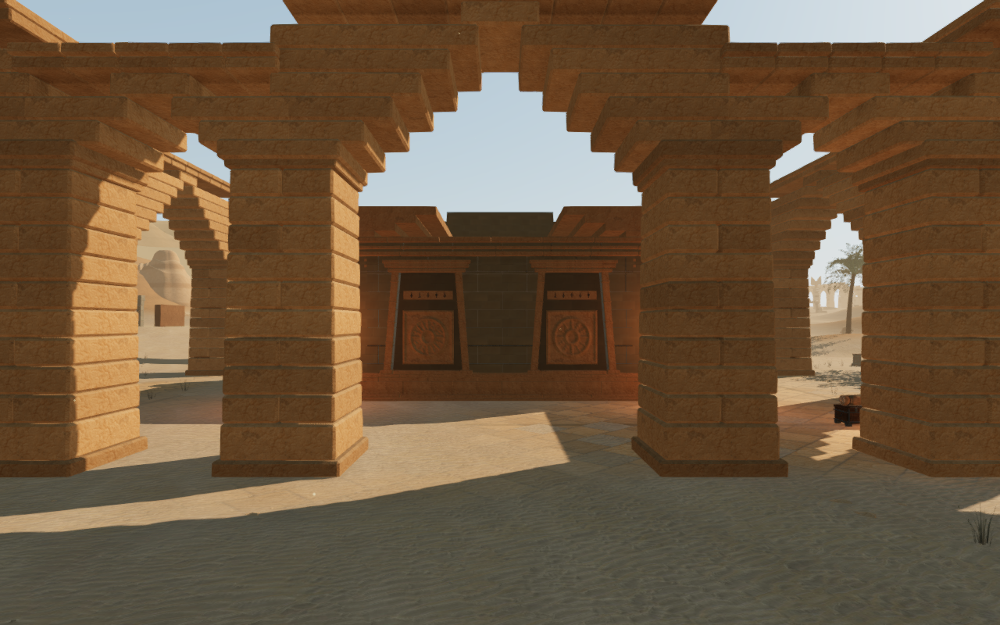
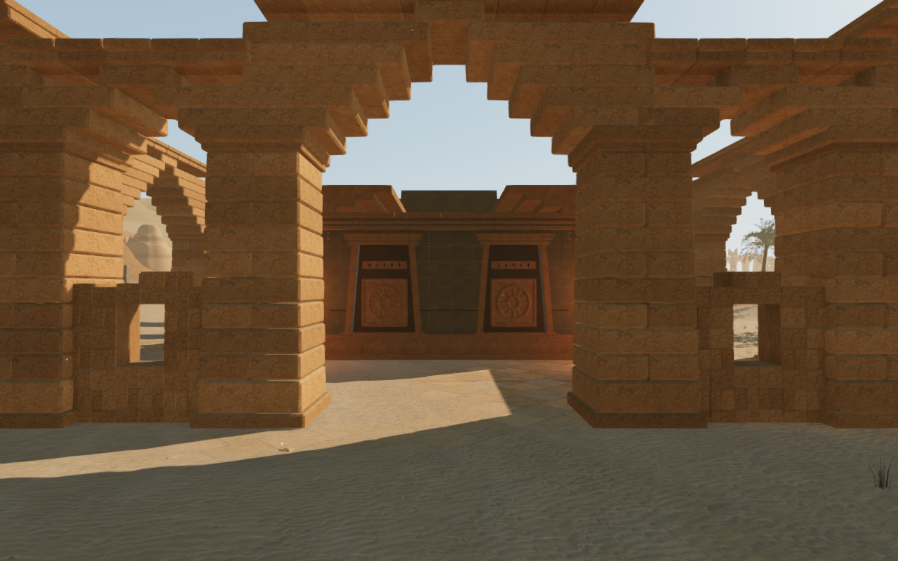
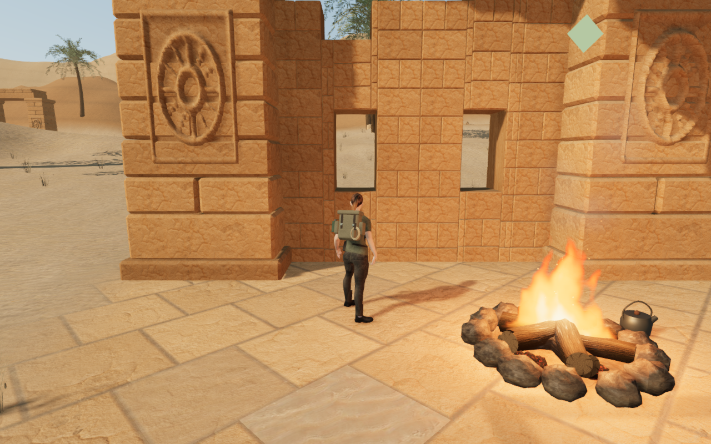

# Surviving walls in the desert courts

The ten solar courts previously repeated open rear arcades, with most of their
identity concentrated in the crowns and instruments. Twenty-four selected rear
bays now retain substantial sandstone walls. Some have single or paired windows;
others descend through collapsed courses. Different surviving bays, heights and
broken crests give the rear approaches a different balance of stone and sky.

These complete 1280 × 800 High captures use the same legal ground-observer
camera, target and scene time. They are direct, unretouched game captures with
the explorer hidden. Fourteen paired observer views cover all ten courts from
the front and four from the rear. Closed sanctuary gates obscure much of the
rear architecture in several front views. The rear masonry is one part of the
larger composition work still needed throughout the world.

Each wall has complete backing and inset facing stones on both sides. The
lower rim is buried below sampled terrain. The nineteen windows are real
openings through both the rendered masonry and its physical triangle kernel.
Individual camera bounds retain these openings, including the smaller sill and
lintel pieces. The central doorway and both crossing axes remain available;
the forward solar installations retain their layouts.

The walls add 136,008 triangles to the ten structural arcade roots in the
delivered terrain. Their counted masonry rises from 235,348 to 371,356 triangles,
excluding the separately drawn crowns and fine relief panels. The walls use the
existing sandstone material and existing per-court batching. This is an explicit
geometry increase; consumer-device frame rate remains unverified.

## Verification

The delivered-world observer records 24 walls, 19 clear window rays, 202
matching render/physical face rays, 404 cap-support probes and 1,968 buried-rim
samples, with no recorded failures. The regression includes a filled-window
negative control. Fourteen preceding observer images and twenty-one revised
observer/preset images are reviewed. High and Balanced sampled HDR output is
finite; shaders link and the recorded GL checks pass. The Performance checks
observe normal output, rather than establish HDR acceptance.

Six further close follow-camera views cover the single and paired windows at
all three presets; a coastal replacement view is also reviewed. All room,
feature, sound-source and arcade-plan records in the paired surveys retain
their values. The assisted rear-doorway and court-width routes complete twenty
legs, 611.570 m and 9,170 normal controller/camera updates at full health, with
combat suppressed. Fifteen wall approaches add 1,350 movement updates and check
legality at every update. All nine full optical circuits and eight miniature
table circuits align; the table walks complete 64 legs and 4,720 movement
updates. These are local assisted observations.

An initial broader ground-only path probe reaches the raised sanctuary
entrance but remains partial even with the new wall kernels removed. That
probe does not establish circulation across the raised threshold. Chapter
replacement disposes all 22 tracked arcade resources exactly once—twenty
geometry buffers and two materials—and replaces the masonry/camera records
without retaining their solids in the new world.

Some prepared central follow-camera views face existing large props closely;
the final-court Performance view fades the explorer. Those frames are retained
as limitations, and do not establish complete foreground or body-contact
acceptance. Repeated gates, sparse spaces, broader composition, continuous
contact, listening and consumer-device evaluation remain open across the eight
worlds. This local masonry pass does not establish AAA graphics.

All 194 selected tests across 31 files, the production build and three CPU
guard checks pass. The new geometry regression checks finite, nondegenerate,
closed, outward components, complete window heads and matching physical/camera
queries. The build retains its existing chunk-size advisory.

The broader regression run also exposed a stale crystal-body negative control
in the published source: the unfitted pose penetrates by about 14 cm, while its
old assertion required 20 cm and more than 200 vertices. The control now
requires an unsafe penetration exceeding 10 cm. The fitted poses still require
zero penetrations, and the complete selected run passes after that test repair.

The production build passes keyboard movement at 1280 × 800 High and simulated
touch movement at 540 × 900 Performance. A prepared older save inside a newly
filled bay recovers to nearby ground and permits movement. All three cases
retain stage two and full health; three complete localStorage reload
comparisons match except for the last-played timestamp. All six release views
are reviewed. Expected built assets load, no development hook is exposed, and
the checks record no application errors or horizontal overflow. The normal
camp views include a large foreground flame; they do not replace the close
wall views. All 452 runtime hashes match the selected checks and development
observations. Owned browsers and preview servers close after verification,
under the shared five-of-sixteen CPU limit.
