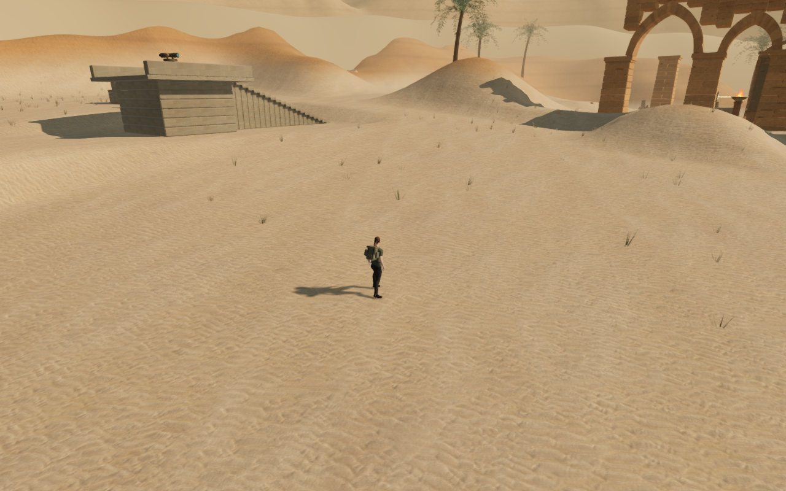
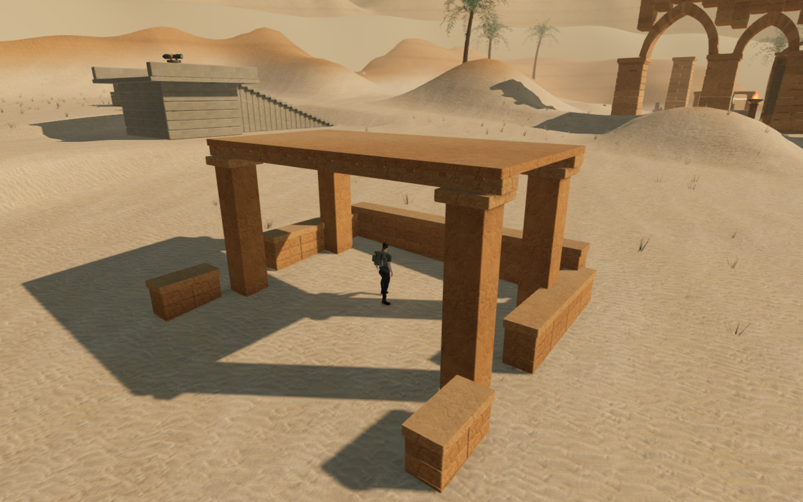
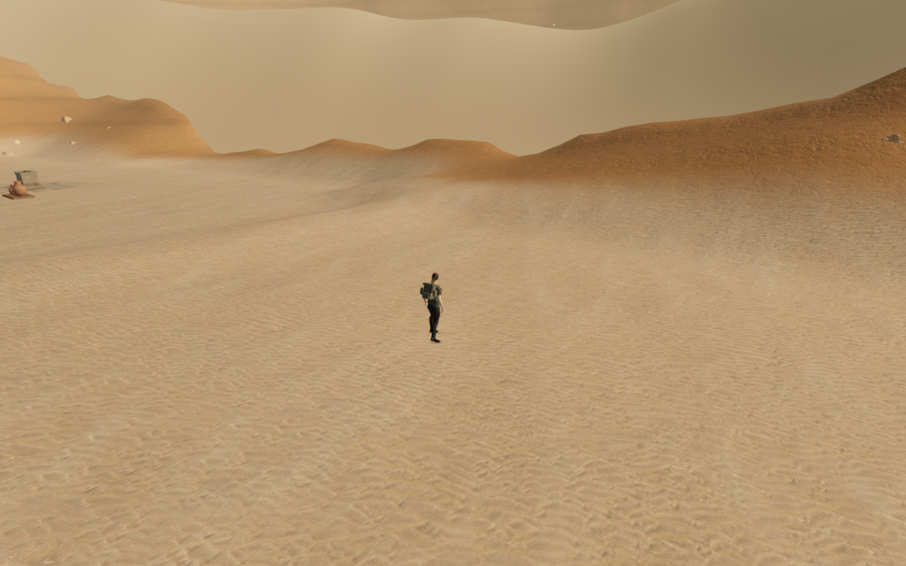
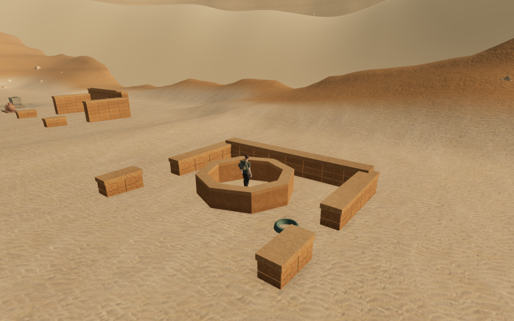
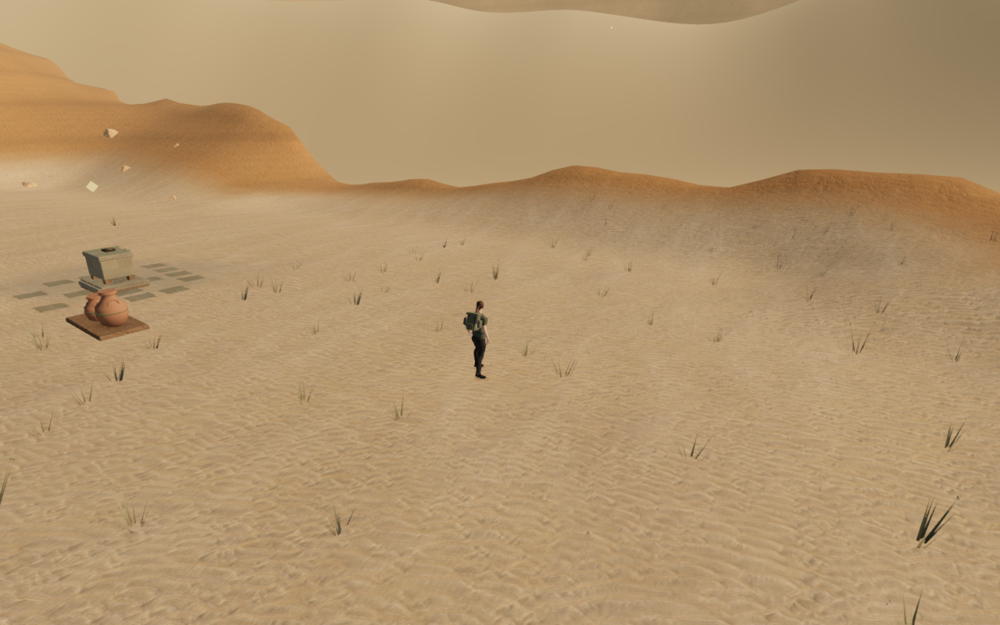
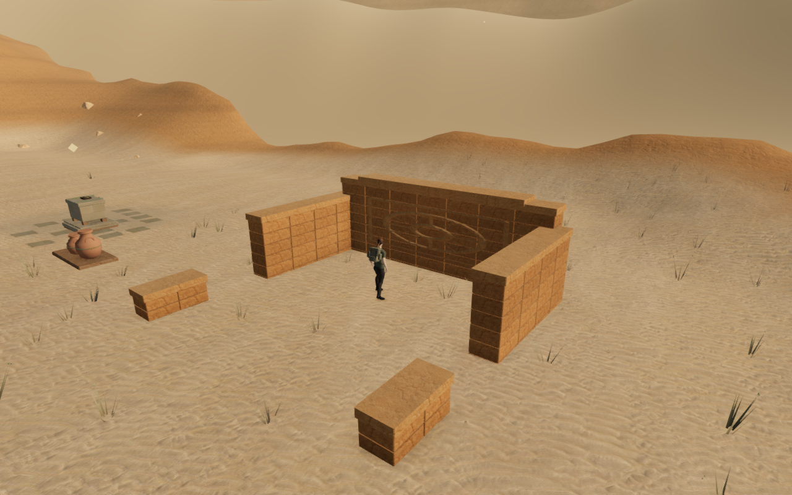

# Desert foreground courtyards

The ten desert courts now have twenty connected foreground areas with different
paired ground plans. Low broken enclosures, five roofed shade galleries, three
hollow dry cisterns and four carved relief walls give the approaches more places
to enter and different silhouettes. The final scene contains 78 wall segments;
reservation checks omit structures that would interfere with paths, objectives,
optics, traversal, discovery settings or palms.

| Forecourt construction hidden                                                                          | Forecourt construction visible                                                                              |
| ------------------------------------------------------------------------------------------------------ | ----------------------------------------------------------------------------------------------------------- |
|  |  |
|  |            |
|    |              |

These are assisted construction comparisons inside the revised development
runtime. Each pair fixes the explorer, simulation state and camera, then hides
or shows the new forecourt roots. The terrain, plants and previous structures
remain present. The hidden views reconstruct the foreground without this art;
they are not captures of the previous map or native production screenshots.

## Construction and contact

Foundations extend below every covering terrain cell. Gallery roofs have a
complete standing surface and recessed underside ribs. The cisterns retain
their open interiors in rendering, collision and point support. The existing
credited sandstone maps and original carved-panel generator supply their
materials; no external model, texture, recording or dependency is added.

The [forecourt observer](../scripts/inspect-desert-forecourts-browser.js) reads
the actual batched render buffers and independent terrain triangles. The
[body observer](../scripts/inspect-explorer-solids-browser.js) reads the posed
explorer and closed rendered masonry, without using the movement kernels.
Decorative open relief sheets are excluded from the closed-volume observer.

| Measurement                                                  | Result                                                                                  |
| ------------------------------------------------------------ | --------------------------------------------------------------------------------------- |
| Authored construction before material batching               | 1,672 parts; 84,524 source triangles                                                    |
| Actual foundation queries                                    | 954; highest sampled underside at least 23 cm below terrain                             |
| Point support compared with rendered caps                    | 431 queries; largest difference 0.000000193 m                                           |
| Gallery headroom                                             | 125 queries; all clear                                                                  |
| Hollow cistern interiors                                     | All three retain empty centres                                                          |
| Standing/crouching centre survey                             | 160 poses across all twenty areas and four orientations; no skipped centres             |
| Actual terrain and masonry body records in the centre survey | 7,695,200 records against each surface; no intersection beyond the 15 mm tolerance      |
| Wall, column and inner-rim pressure survey                   | 40 normal movement approaches; 160 body snapshots; no intersection beyond the tolerance |

The first pressure survey found crouched knee fabric entering one wall and
three cistern rims by up to 27.291 mm. A 0.72 m movement margin on these new
pieces clears the reproduced contacts. Delivered-character regressions cover
all four approaches; restoring the previous margin makes the regression fail.
Thirty-seven pressure cases reach their selected wall or column directly.
Three stop against an inner cistern rim on the way to a back wall; they are
rim-contact checks, not successful approaches to that wall.

A separate jump check found two grounded poses with both boots over empty sand,
more than 1.3 m below the soles. The broad body-support disk could keep the root
beside a narrow cap. These new pieces now require a real upward face under the
root, and falling departures clear their complete side-collision margin.
Existing stations retain their previous support footprint. All fifteen final
jump attempts finish healthy, legal and grounded, with at least one actual
boot contact within 14 mm of visible terrain or masonry. Several attempts stop
on the ground rather than reaching a cap. A boot may extend over a narrow edge
while the other contacts stone; this does not certify every airborne pose.

The recorded occupied edge positions fall safely in delivered-character tests;
restoring the broad footprint makes the regression fail. All twelve normal
jump-and-forward escapes from the three cisterns also return to clear ground.

Crouching inside one cistern exposed a camera defect: a single bound around
the hollow ring caused its rim to be ignored. Eight separate wall-face bounds
retain the empty interior and catch the actual obstruction. The geometry
regression compares the recorded camera arm with rendered ray hits and fails
with the previous bound. All forty repeated pressure views now have full
explorer opacity, clear captured camera arms, linked shaders and finite HDR.
The recorded view shows the explorer's torso clearly; the rim can still hide
lower legs inside the basin.

## Retained world and surrounding details

The annexes add 84 connected walking cells after objective authoring. All 52,325
queries in previously walking cells and all 7,220 water-interior queries retain
their preceding heights. Existing objective, feature, enemy and route records
remain unchanged; the complete height arrays for the seven other chapters
also remain unchanged.

The current map contour has 7,448 shoulder samples rather than 7,793. Its test
coverage bound follows the shorter perimeter; its grade and toe-rise limits
remain in force. The delivered terrain retains 81 chunks, 119,072 triangles and
60,025 distinct vertices, with no invalid geometry or seam mismatch. All 54,425
current standing queries agree with visible triangle support.

Independent contact checks pass for all 230 scanned rocks, 2,030 palm roots,
30,450 palm-edge probes, 4,598 existing court-foundation rays, and 1,138,554 roots
across 7,142 plants. A deliberately raised plant is rejected. The 95 solar
foundations, 68 reflector apertures, 77 working-position checks and 37 cleft
handholds remain clear; all 77 recorded solar-control arrivals remain legal.

High, Medium and Low views have finite HDR and linked shaders. Their visible
plant counts at the recorded observer are 408, 205 and 114. All 2,163 tracked
landscape and forecourt graphics resources dispose exactly once on chapter
change, and the corresponding references clear.

The existing bird and wind voices remain distance-sensitive and retire beyond
their ranges, within the twelve-voice cap. The bird's nearer sample is muffled
by intervening scenery, so the distance comparison accounts for that existing
occlusion attenuation. The original quiet desert/objective score remains in
place. These are behavioral checks, not a subjective listening review.

## Playable verification and limits

All forty entrance-and-return legs arrive across 657.198 m and 9,820 normal
controller updates. Their 81 captured views are reviewed, alongside all forty
construction views, forty body-pressure views, forty revised camera-pressure
views, fifteen final wall-jump views, twelve cistern-escape views and nine
construction/graphics-setting views. Local route preparation advances progress,
disables combat and moves between court starts; it is not a human chapter
playthrough.

The separate continuous route reaches the first, fifth and ninth courts and
returns to the arrival across 925.369 m and 14,060 normal controller updates.
All 24 route captures are reviewed. All four legs arrive healthy, legal and grounded, with full opacity, clear
captured camera arms, linked shaders and finite HDR. Like the local routes,
it uses prepared progress and does not step combat.

All 196 selected regressions and the production build pass. The build retains
its existing large-chunk advisory.

Production keyboard/High gallery and CDP touch/Low cistern cases exercise
movement, crouch, look, jump, map access and two complete-store reloads per case.
The touch case jumps out of the cistern before its sideways movement; it does
not claim a long walk inside the confined basin. Both cases move about 3.1 m
and finish healthy on the ground. A wall-top save earned by normal jump input
retains its 1.320 m height across reloads, departs through native input and
reloads on the ground. An occupied older-format save recovers to clear nearby
ground while preserving progress, checkpoint, settings and other-chapter data;
ordinary missing survey bearings initialize as in preceding versions. The
shipped bundle has no development game hook, and its fetched scripts and styles
match the build. All twenty native captures are reviewed.

One native gallery crouch view places a nearby column over part of the
explorer's arm and legs. The recorded cistern torso obstruction is repaired,
but full-body framing across gallery angles still needs review.

Verification uses a shared 9-of-16 CPU affinity budget, at most two test workers
and one browser. All temporary browsers, workers and servers are stopped; the
final host check finds no live verification processes or listening test ports.
The six public images are lossless game captures with identical decoded RGBA
pixels and dimensions. Attribution remains in [asset credits](asset-credits.md).

The broader eight-chapter visual audit remains incomplete. Sparse surrounding
land, repeated main installations, richer materials and composition, unobserved
body contacts, subjective listening and consumer-device performance remain
open. These changes do not establish AAA graphics.
