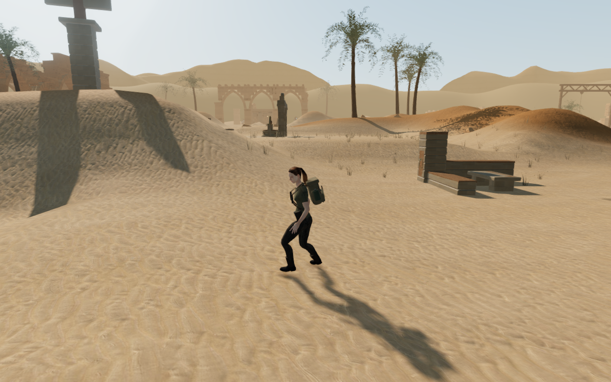
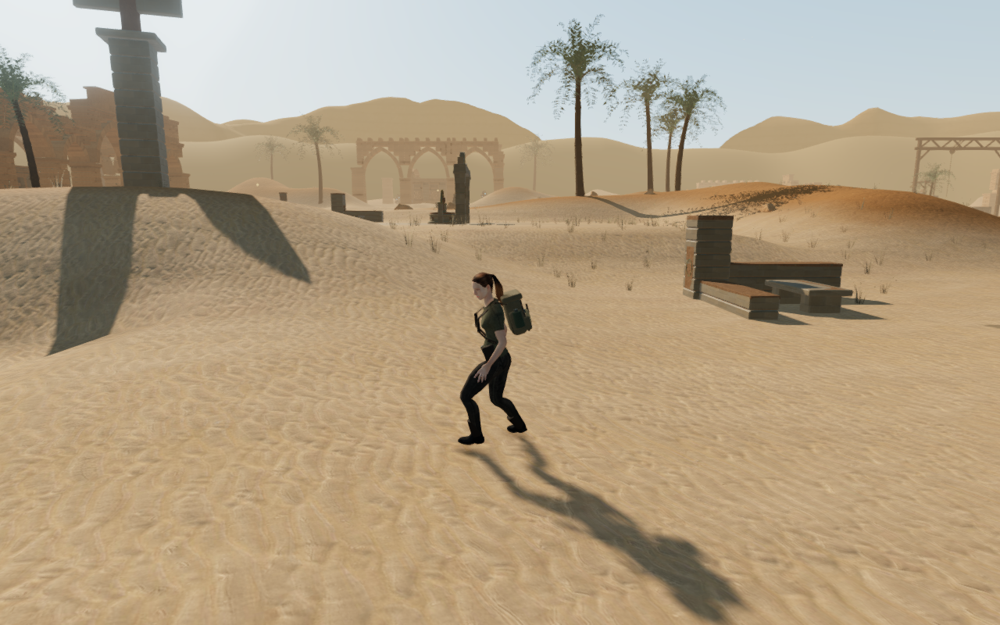
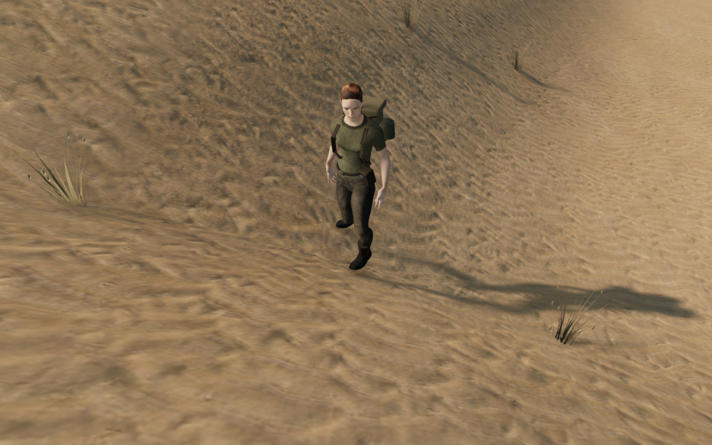
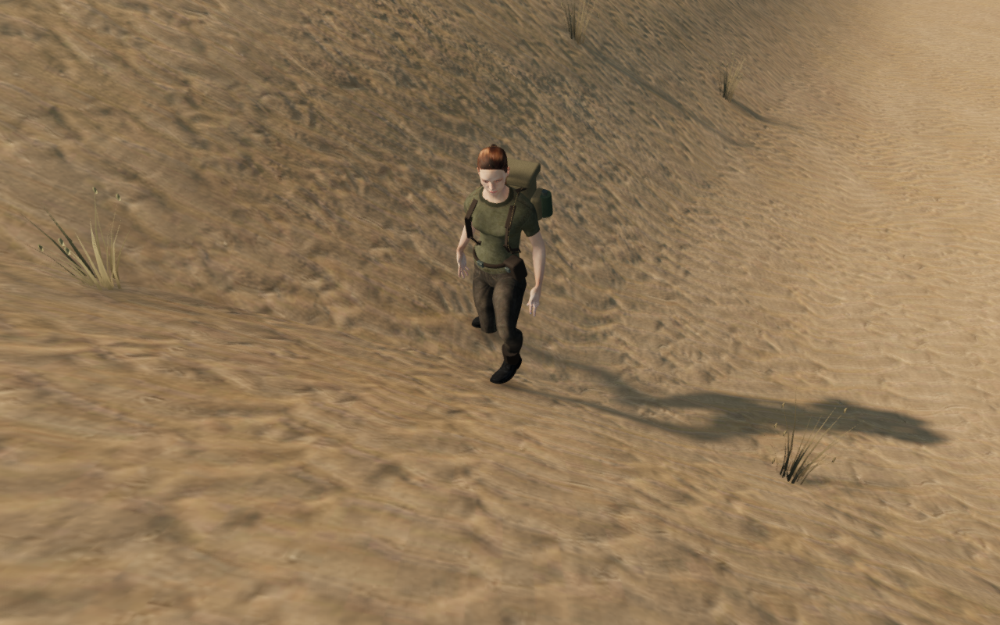
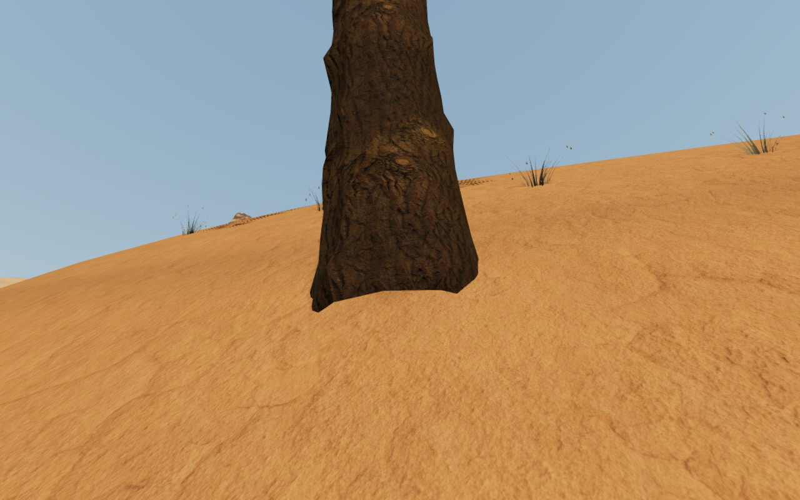
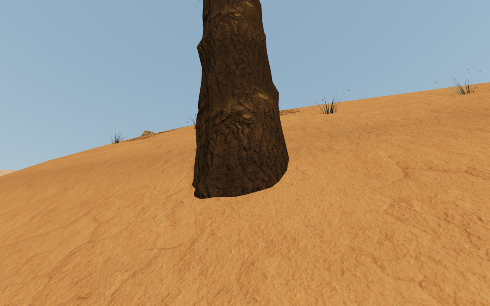

# Desert banks, ground support and palm roots

Narrow desert banks now meet in rounder crests. Standing support follows the
two rendered triangles inside each terrain cell, and palm root rings are fitted
below the complete terrain crossings of their edges. These changes address
three observed defects while retaining the chapter's map and objective layout.

| Previous bank shape                                                                          | Revised bank shape                                                                            |
| -------------------------------------------------------------------------------------------- | --------------------------------------------------------------------------------------------- |
|  |  |

The bank comparison uses captures from separate development runtimes before
and after the change. Horizontal position, chosen look and simulation time
match; corrected standing height changes the feet and follow-camera elevation.

The previous bilinear support calculation could differ from the actual ground
planes by 19.204 cm below or 13.919 cm above the mesh at sampled walking
positions. A cached float32 vertex field now supplies the same triangle
diagonal and planes as the delivered terrain. This adds a small CPU array,
without adding terrain triangles or render passes.

| Reconstructed previous support                                                                | Corrected triangle support                                                                         |
| --------------------------------------------------------------------------------------------- | -------------------------------------------------------------------------------------------------- |
|  |  |

This support comparison temporarily selects the old bilinear getter inside
the revised terrain runtime, then restores the new getter. The camera is fixed
within the pair. It demonstrates the standing-root correction; it is not a
native screenshot of the previous build or a full-body clearance audit.

Center-based palm seating left nineteen root vertices exposed across three
palms, reaching 16.187 cm above the terrain. Seating now includes every root
ring from all three detail tiers, including intersections with grid lines and
triangle diagonals. An edge can cross a low point between higher endpoints.

| Reconstructed center-based palm seating                                                   | Complete root-edge seating                                                                    |
| ----------------------------------------------------------------------------------------- | --------------------------------------------------------------------------------------------- |
|  |  |

The palm pair also reconstructs the earlier seating inside the revised
runtime, with a fixed camera. Palm horizontal positions, rotations, scales and
variants retain their original values; their vertical seating changes.

## Delivered geometry and contact evidence

The reusable [bank and contact observer](../scripts/inspect-desert-shoulders-browser.js)
reads delivered mesh buffers. Independent triangle queries test standing
heights, actual palm roots and merged courtyard footings. Deliberately raised
seams, palms and masonry verify that the observer detects defects.

| Measurement                                          | Result                                                                                                                                   |
| ---------------------------------------------------- | ---------------------------------------------------------------------------------------------------------------------------------------- |
| Near-bank slope changes across 10,577 sampled hinges | 90th percentile: 21.787° → 11.801°; 99th percentile: 58.009° → 19.477°; maximum: 85.753° → 29.701°                                       |
| Delivered terrain                                    | 81 chunks, 119,072 triangles and 60,025 unique vertices; counts unchanged; all 3,984 duplicated seam vertices agree                      |
| Actual standing support against rendered terrain     | 52,325 queries; no missing terrain or failures; largest absolute difference below 1.7 × 10⁻¹⁴ m                                          |
| All 70 palms, across three detail tiers              | 2,030 root vertices and 30,450 interior edge probes; no exposed or missing samples; highest point approximately 4 cm below terrain       |
| 38 courtyard masonry cores                           | 4,598 underside rays; no exposed or missing samples; highest underside 18.912 cm below terrain                                           |
| Solar installations                                  | All 95 footings / 6,935 rays, 68 mirrors / 6,800 front rays and 77 controls / 693 probes pass                                            |
| Updated dry vegetation                               | 7,110 plants / 1,134,396 root queries; no exposed, missing or reserved-area roots; raising one plant rejects all 162 of its root queries |

The smoothing preserves the previous bilinear generation heights at 52,325
walking/foundation queries and 7,220 reservoir queries. Walking mesh heights
agree within floating-point rounding; reservoir mesh heights agree exactly.
All seven other biomes retain their complete terrain height arrays. Off-route
bank vertices change by up to 1.650 m. Standing support deliberately changes
where the old bilinear surface disagreed with the mesh.

Loaded before/after records retain the map, feature and water records and all
37 climbing holds and 37 edges. Collider footprints and sound-source horizontal
positions remain intact; height offsets follow the corrected ground at their
physical models. Existing positioned audio, attenuation and quiet chapter and
objective music remain in use. This pass does not establish subjective mix or
listening quality.

High, Medium and Low views have linked shaders and finite HDR output. Visible
plant counts at the recorded observer are 409, 205 and 114 respectively; these
are scene observations rather than consumer performance measurements. On a
chapter change, all 2,112 tracked landscape geometries, patch wrappers, instance
buffers, materials and textures dispose exactly once, with references cleared.

## Playability and limits

The continuous four-leg controller route reaches the first, fifth and ninth
courts and returns to the arrival: 930.352 m over 14,102 updates. All 24 recorded
views are reviewed, with health 100, legal grounded positions, full explorer
opacity, clear captured camera paths, linked shaders and finite HDR. The route
uses prepared late-chapter progress and normal movement; it is not a campaign
playthrough. Changed support means controller and camera states need not match
the previous milestone exactly.

All 106 selected regressions pass, covering terrain support and boundaries,
root seating, vegetation and scatter, court and solar geometry, movement
camera, prop and explorer contacts, campaign saves, mechanisms and audio.
The production build passes with the existing large-chunk advisory.

Production keyboard/High and CDP touch/Low cases exercise solar controls and
an older ground-position save, including movement, crouch, look, jump, map
access and two complete-store reloads per case. Console-cap replay, departure
and reload, and an occupied older-save recovery also pass. The shipped bundle
has no development game hook. All 36 final native captures are reviewed.

All public images are lossless conversions of actual game captures, preserving
decoded RGBA pixels and dimensions. No external assets or dependencies are
introduced; provenance is retained in [asset credits](asset-credits.md).
Verification uses the shared CPU cap, at most two test workers and one browser
at a time. Temporary servers and browsers are closed after their checks. The host
process and port check finds no live verification processes and neither test port
(5174 or 5180) listening.

These measurements close the reproduced support mismatch, exposed palm rims
and sampled sharp bank crests. They do not certify all boot soles, raised-body
contacts, airborne poses or every bank in every chapter. Broad sparse spaces,
repeated installations, the full eight-chapter visual audit, subjective
listening and device performance remain open.
