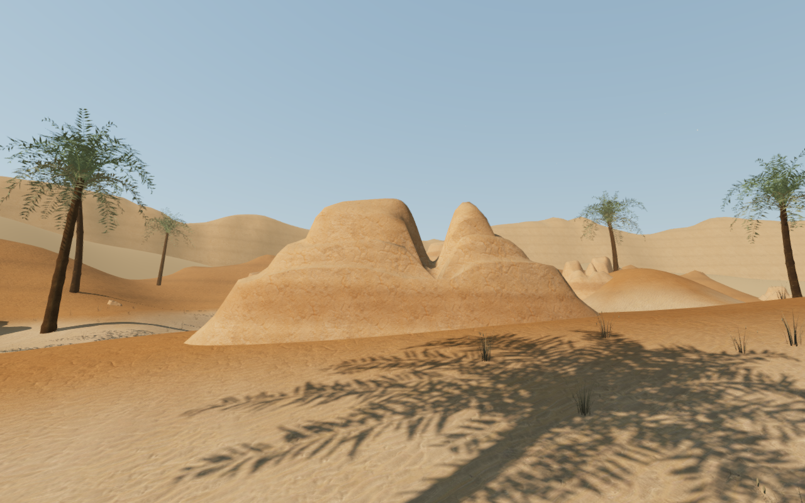
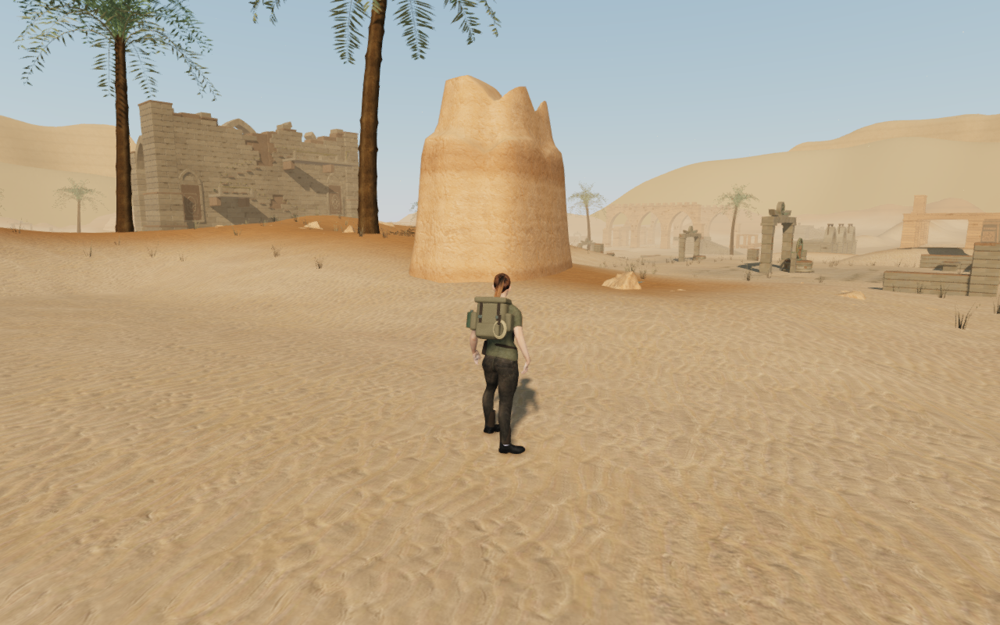

# Sandstone banks between the solar courts

The representative eight-chapter survey at `0307f85` retained broad, sparse
desert banks between the ruins. Twenty-eight sandstone outcrops now interrupt
those stretches with terraced crowns, divided ridges, narrower fins and lower
weathered banks. Their deterministic districts include interior banks and the
outer dunes. They are scenery beside the existing routes; the campaign map,
terrain field, objectives and saved mechanism layouts retain their values.

The closed shells follow the surrounding bank height, with complete buried
rims and undersides. Different bed profiles and offset erosion channels vary
their crowns. Broad iron-stained beds and finer, pixel-filtered cross-bedding
borrow the existing terrain's sandstone color, normal and roughness maps.
The physical and camera readers follow the delivered slopes and leave the
empty corners of each broad bound clear. Existing birds, machinery, water and
adaptive scores remain in use.

These complete 1280 × 800 High images are direct, unretouched game captures.
The first uses a ground observer with the explorer hidden; the second uses
the ordinary follow camera at a prepared legal stance. No new external model,
texture, recording, music or dependency is added.

## Verification

All 160 selected tests across 25 files, the production build and three CPU
guard checks pass. Coverage includes the new shells and their observer, desert
terrain, banks, foliage, scatter, architecture, forecourts, solar instruments,
miniature tables, thresholds, portals, the sun bridge, triangle solids, chapter
startup and audio. A deliberately raised shell fails the buried-rim observer.
The existing build chunk-size advisory remains.

The actual world contains 107,520 new triangles. All 10,347 perimeter probes
remain below the delivered terrain; the highest measured rim is 30.8 cm below
it. Independent mesh, support, sight and camera queries agree at 1,845 surface
points and retain 1,543 empty bounding-corner queries. All 161 sound origins
remain outside the new stone. An additional static-geometry check finds no
intersecting triangle bounds in its 169 broad mesh candidates; an inserted box
control is detected. That check excludes terrain, actors, instanced foliage
and the small natural rubble.

All 10,885 sampled working-floor points retain their before/after movement
classification, including the same 9,944 legal points. Fifty-six short nearby
controller legs complete 3,696 updates. All nine restored solar paths align,
their 77 sampled controls remain legal, and the eight miniature-table circuits
complete 64 assisted legs. The first solar trial uses counterweights and has
no miniature table. These prepared checks do not establish a complete
unassisted chapter playthrough or continuous full-body contact acceptance.

The final-source review covers 53 desert views: four entrance headings, every
new outcrop, three representative court fronts, eight follow-camera stances,
four examples at Balanced and Performance, and two visibility controls in the
same loaded world. All are reviewed, with linked shaders, finite sampled HDR
buffers and no reported GL error. Terrain, columns and foliage partly obscure
some formations, and close follow cameras crop some crowns; these are recorded
view limitations rather than complete surface coverage.

Changing to the coastal chapter disposes all 28 tracked geometries and their
shared material exactly once, empties every observed outcrop camera index and
retains no old outcrop obstacle or chapter reference. The coastal High view
also renders and is reviewed. All 451 runtime source hashes match the selected
tests and browser observations.

The production bundle passes a 1280 × 800 High keyboard case and a
540 × 900 Performance simulated-touch case at the dawn mechanism. Each
exercises mirror changes, reset, alignment and activation, reaches stage 2
at full health and walks back into the court. Four complete-store reload
comparisons retain all fields except `lastPlayed`. Two additional cases load
the earned progress at a prepared stance near an interior outcrop, move with
keyboard/touch, and pass another two complete-store reload comparisons. All
ten release captures are reviewed, including four frames with the world and
normal HUD visible.
Both viewports retain their layout without horizontal overflow, load the
checked bundle and contain no development hook or reported application error.
The owned browsers, workers and preview servers close under the shared
five-of-sixteen CPU limit.

## Remaining work

The larger eight-world audit remains open. Repeated court installations,
sparse spaces, rounded procedural forms and broader landscape composition
still need work. Continuous route/prop/body contact, water interiors, wider
device performance and subjective listening acceptance remain unverified.
This local landscape revision does not establish AAA graphics.
