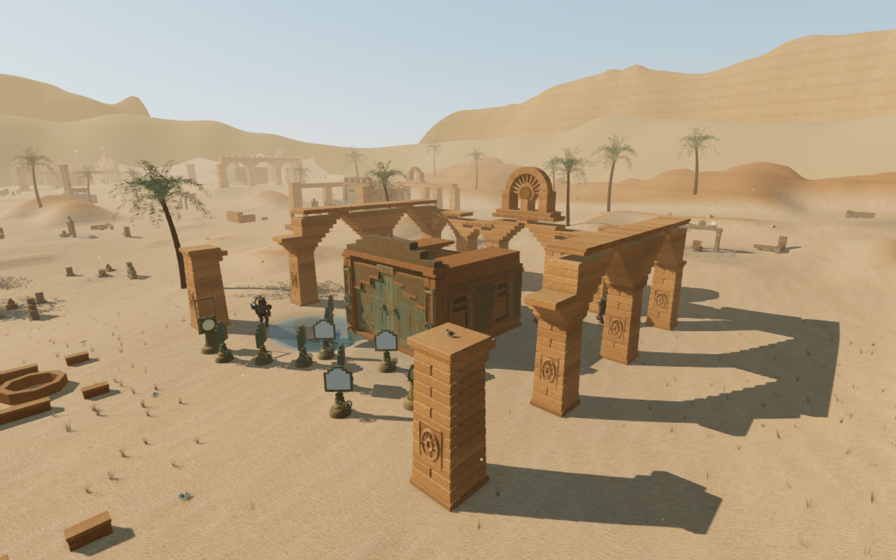
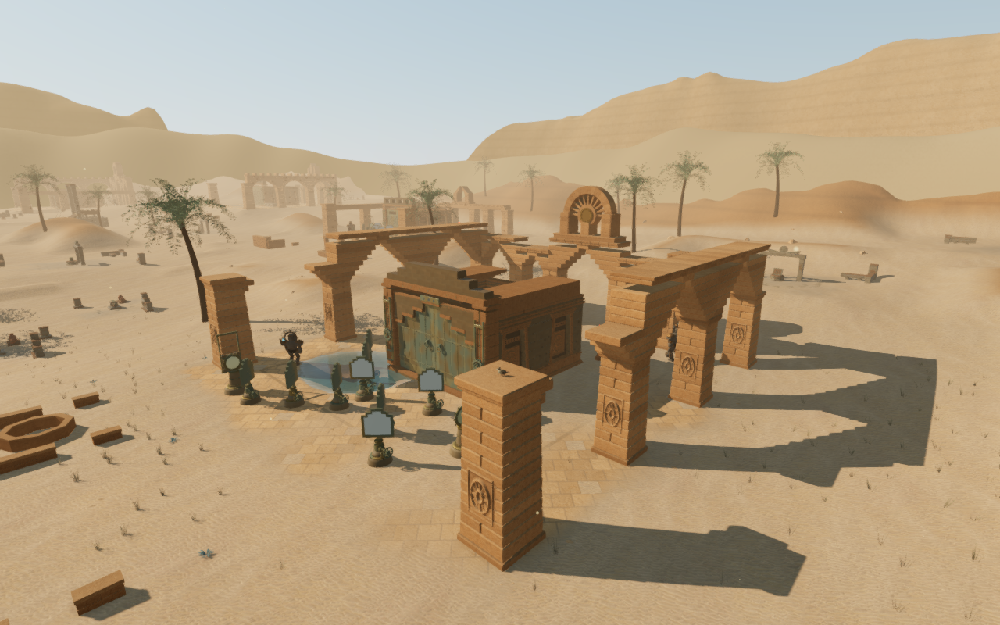
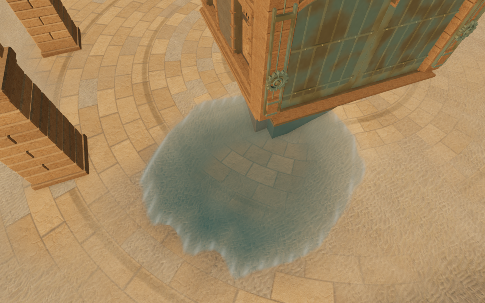
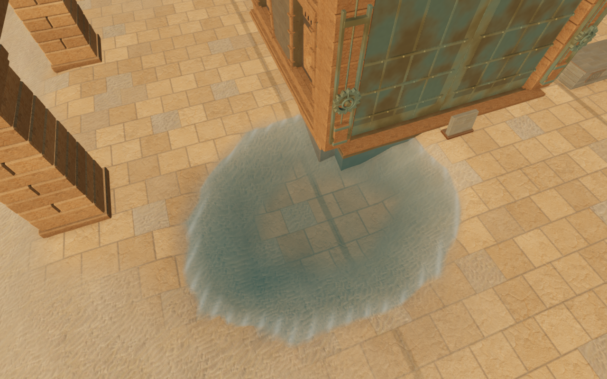

# Worn desert court paving

The solar courts now have worn stone layouts that follow their architecture
and trials. Previously, their open floors used the same faint paving blend,
leaving broad areas of visually similar sand. Exposed slabs, sand-filled
sections and shallow joints give the courts a stronger ground plan.

| Published court floor | Revised court floor |
| --- | --- |
|  |  |

These High game captures share the prepared camera, player position and scene
time. Other animation can differ. The four documentation images preserve their
decoded source RGB pixels and dimensions through lossless WebP conversion.
Existing [asset attribution](asset-credits.md) remains applicable: the treatment
reuses the chapter's loaded stone textures and adds no external asset.

| Court | Floor treatment |
| --- | --- |
| Processional ruins | Staggered courses with paired processional lines. |
| Balance colonnades | Square slabs and two panel lines. |
| Dawn portico | Fan courses around the rear solar axis. |
| Aqueduct arcades | Long crosswise courses and parallel bands. |
| Broken noon court | A turned rectangular field with a diagonal line. |
| Ascending ephemeris | Radial courses and concentric rings. |
| Western shade | Oblique courses and repeated diagonal bands. |
| Open light court | Small square slabs with nested square lines. |
| Relay colonnade | Longitudinal runners and narrow courses. |
| Corbelled precinct | Diamond courses inside a square border. |

The treatment is part of the actual terrain material. It adds no overlay plane,
terrain displacement, collision surface or new texture request. Normal shading
suggests shallow joints. Dust varies exposure across the field, while the
outside edge fades into the surrounding sand. Radial courses use whole sector
counts at the angle wrap and guard their centers against an undefined angle.
The other seven terrain themes retain their existing bindings and cache keys.

## Verification

- All fourteen focused checks pass, covering terrain construction, desert
  landscape, shared material bindings and existing cavern floor integration.
  The three CPU-budget checks and production build pass; the build retains
  its existing bundle-size advisory.
- The old and new factories generate identical vertex hooks in all eight
  themes. Map data, height fields and requested texture URLs match the
  published version. The desert still requests its existing nine textures;
  no new sampler is introduced.
- Independently compiled old/new shaders produce identical half-float pixel
  values in fourteen isolated flat-ground and slope fixtures across the other
  seven themes: 8,300,600 compared channels. Each of the ten desert fixtures
  changes visibly. Two close radial-center fixtures remain finite. Across
  fifty fixture renders, 29,645,000 read channels contain no nonfinite value,
  shader links pass and GL checks report zero errors. These fixtures are
  narrower than full-world or device coverage.
- Fifteen final High game views are reviewed: ten court overviews, four nearby
  floor views and one ordinary follow-camera stance. HDR inputs are finite
  and shaders link. The follow view includes a nearby pier; the character and
  adjacent paving remain visible. Fourteen comparison views retain their
  prepared player/camera coordinates and scene time.
- Temporary shader materials, maps, geometry and the render target are
  disposed. Renderer counts return to the starting 2,250 geometries and
  145 textures after the fixture review.

Production keyboard/High at 1280 × 800 and actual portrait touch/Performance
at 540 × 900 both crouch and walk from exposed paving onto sand. Native
movement covers 6.0 m / 6.6 m at health 100. Four complete-store reload
comparisons pass, apart from chapter timestamps. All six release images are
reviewed, with no horizontal overflow. Loaded JS/CSS names match the current
build and the development hook is absent. No page errors, missing resources
or unexpected console warnings are recorded.

All 428 runtime source hashes match the final capture set and the reviewed
source. The fourteen before views match the 427 runtime files in published
`4ce8975`, with matching prepared camera/player coordinates and scene time.
Owned browsers and development/production preview servers close after checks.
Work uses the shared locked five-of-sixteen CPU set at lower priority, with at
most two test workers and one browser.

## Remaining work

The main court floors have more structure, but connecting trails and larger
surroundings remain sparse. Many ancillary objects and parts of the wider
court composition are still shared. Wider discovery and traversal coverage,
continuous body contact, listening evaluation and consumer-device performance
remain open. Existing sound-source placement, distance falloff and adaptive
music code are unchanged. These scripted checks do not establish a complete
human campaign playthrough, subjective sound quality or AAA parity.
