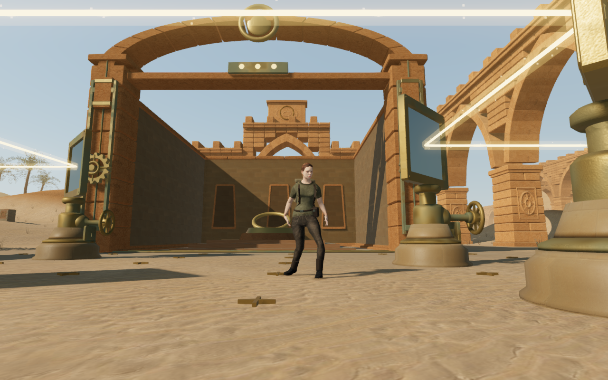
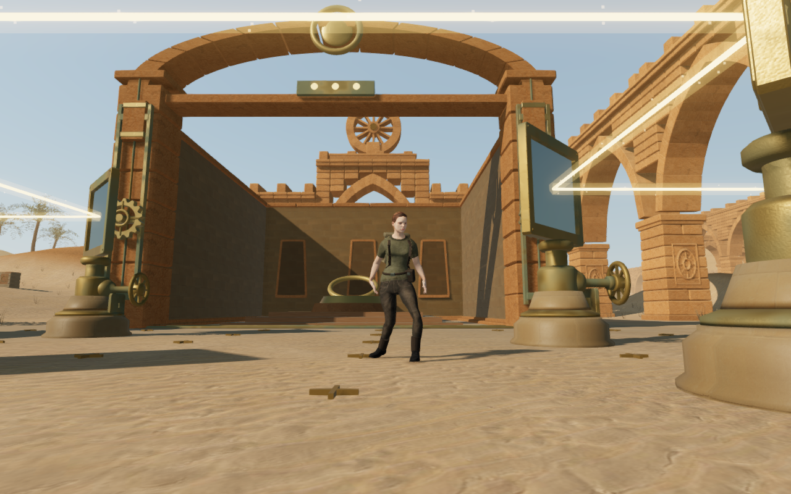
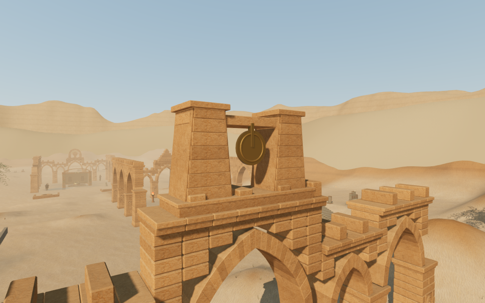
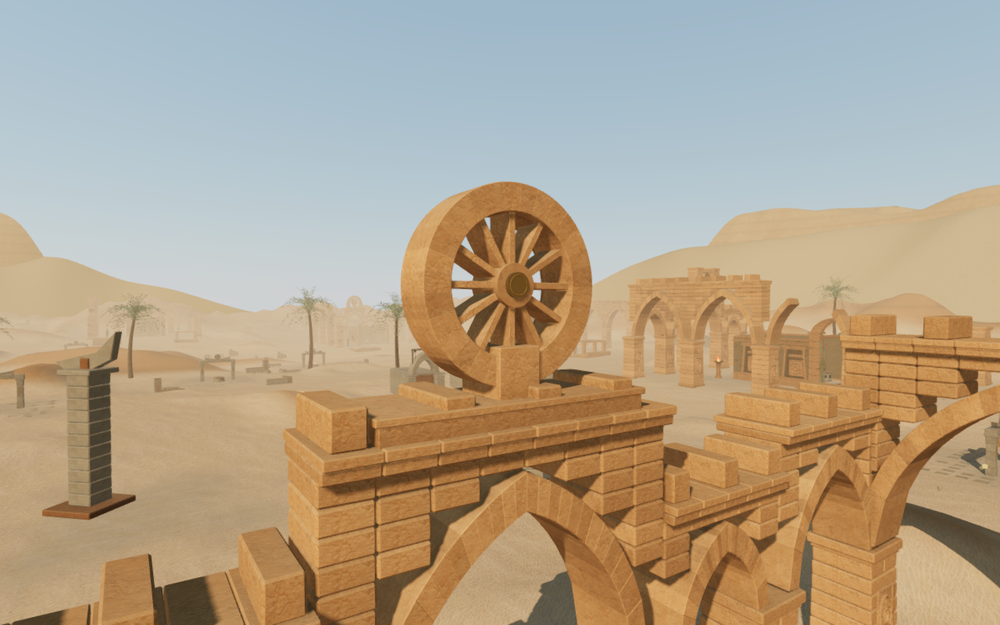
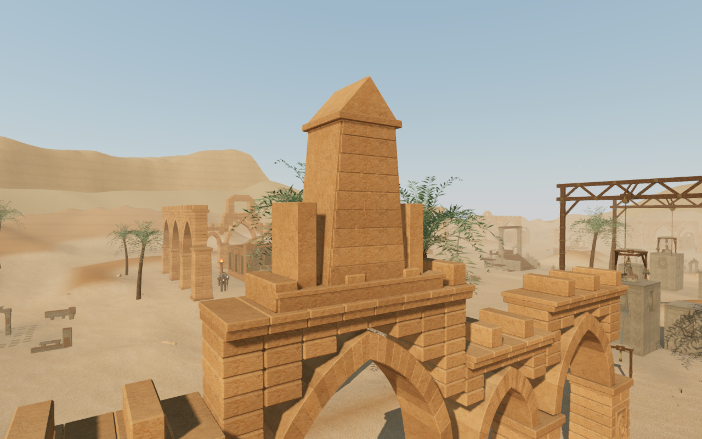
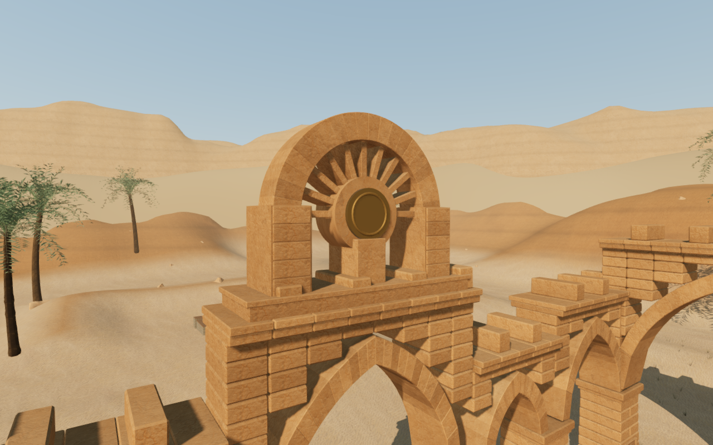
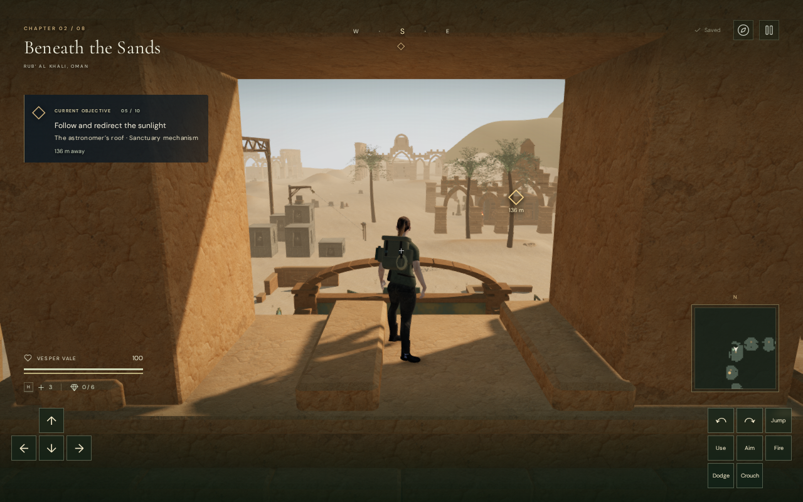
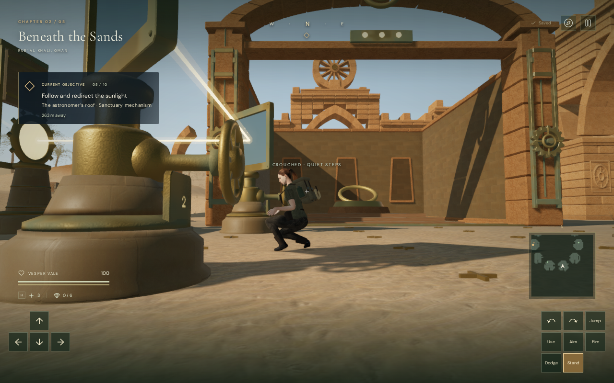
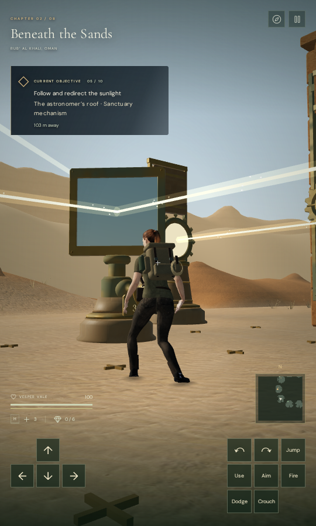

# Desert skyline crowns

The ten main desert arcades now carry distinct monumental crowns in place of
one repeated solar cartouche. Their silhouettes vary from a stepped pyramid
and suspended disk to a pierced rosette, unequal broken towers, a recessed
niche, a tall stele, an open stepped portal, three pinnacles, a split gable and
a radial sun fan. These are original stone constructions using the existing
credited sandstone maps and aged bronze material.

| Earlier arcade                                                                                             | Pierced rosette                                                                                  |
| ---------------------------------------------------------------------------------------------------------- | ------------------------------------------------------------------------------------------------ |
|  |  |

The comparison rebuilds the preceding arcades from the original architecture
module inside the current development runtime. The observer, camera, terrain,
objective scenery and simulation state stay fixed while the two sets of arcade
roots alternate. It is a matched construction comparison, not a capture of the
complete previous game. The close views below use assisted inspection cameras.

| Suspended disk between pylons                                                                                 | Pierced rosette                                                                                                      |
| ------------------------------------------------------------------------------------------------------------- | -------------------------------------------------------------------------------------------------------------------- |
|           |  |
| Tall stele                                                                                                    | Radial sun fan                                                                                                       |
|  |                           |

## Geometry and retained world

Each crown's bearing skirt overlaps the existing cornice. Shafts have complete
backing behind their facing courses, and closed recessed annuli join the ring
stones across narrow joints. Open sectors retain real front-to-back holes;
the niche has a recessed back. The physical triangle index contains the
structural stone, with exact point support and finite vertical collision.
Carved relief sheets and fine bronze ornaments remain decorative and follow
the existing distance/quality culling policy. Structural silhouettes and their
collision remain present when the fine detail retires.

The [independent crown observer](../scripts/inspect-desert-crowns-browser.js)
partitions the final batched render buffers. It checks closed edges, outward
winding, positive volume, actual interior contact witnesses, cornice bearing,
relief backing and support rays. It does not use the placement formulas to
assert that pieces touch. Regressions deliberately raise a crown, detach a
facing course, break an edge and fill an opening; each defect is rejected.

| Delivered measurement                                | Result                                                                                                            |
| ---------------------------------------------------- | ----------------------------------------------------------------------------------------------------------------- |
| Crown parts and triangles, including fine detail     | 274 parts; 41,804 triangles across ten crowns                                                                     |
| Actual part contact witnesses                        | 463 joins; every part connects to its bearing skirt                                                               |
| Sampled cornice bearing                              | All 390 points seated                                                                                             |
| Sampled relief backing vertices                      | 35,736; no detached backing                                                                                       |
| Point support against visible structural caps        | 390 queries; maximum difference below 0.0001 m                                                                    |
| Opening and adjacent stone controls                  | Five of each; render, physical and camera point rays agree                                                        |
| Near/far detail states across three quality settings | All 30 cases retain structural stone and collision                                                                |
| Graphics retirement on chapter change                | All 31 tracked crown geometries, materials and textures dispose once; crown records and physical references clear |

After excluding the removed cartouches, all ten preceding structural arcade
buffers and all ten pier-carving buffers match exactly in positions, normals,
UVs and colours. Plans, foundation records and bird perches also match. The
map, terrain, objectives and other seven chapters have no source changes.
All 95 solar foundations, 6,800 rotating mirror-aperture probes, 693 working
position probes across 77 controls and 77 emitter-front queries pass. None of
the ten existing climbing-course ledges overlaps the new crowns.

A final review found that the portal's lower base could be skipped when its
higher roof occupied the same footprint. Crowns now opt into support selection
from eligible faces below the query height. Descending edge contacts use the
nearby cap's height to clear their body margin. The two-direction lower-base
regression advances 420 ordinary controller updates with clear bodies and
returns to the inspection floor. A separate old-handler control records 28
invalid body positions on the forward departure, compared with zero after the
repair. These are seeded capsule-controller checks, not earned climbing routes.

The release build also restores a supported imported position on this lower
base, retaining its 15.048 m height above the local terrain. Native forward
input departs 5.306 m to nearby ground, finishes with health 100, and the ground
save reloads exactly. This starts from an imported supported pose; it does not
claim that the height was earned through a climbing route.

The 59 generic feature-perimeter queries retain their preceding results. Eight
of these fixed-radius probes are already blocked by existing construction;
they do not certify access to every raised objective. The separate control
checks cover the authored solar working positions.

Bird and wind voices still attenuate with distance and retire outside their
ranges within the twelve-voice cap. The comparison accounts for the existing
occlusion attenuation on the nearer bird sample. Sound emitters remain at
the bird anchors. The existing quiet desert/objective score remains in place;
these checks do not establish subjective listening quality.

## Playable checks and limits

Forty final construction views and High, Medium and Low captures have linked
shaders and finite HDR values. Their observers are legal, healthy and grounded.
One rear inspection camera is inside existing palm fronds; its preceding rear
view and the front view provide additional coverage. Some ordinary court views
still place existing optical posts in front of parts of the explorer. These
broader composition and body-framing cases remain under review.

The recorded continuous ground route reaches the first, fifth and ninth courts and returns to
arrival across 925.369 m and 14,060 normal controller updates. All four legs
arrive healthy, legal and grounded, with full explorer opacity, clear captured
camera arms and finite linked rendering in the 24 route views. This uses
prepared progress and does not step combat; it is not a human playthrough.
These route captures precede the lower-cap repair. The separate regressions and
release checks above cover that subsequent support change.

The separate release-build keyboard/High and CDP touch/Low cases exercise
movement, crouching, looking, jumping, map access and two complete-store reloads
each. They move 5.100 m and 5.798 m respectively and finish healthy on the
ground. Store comparisons ignore only play timestamps. The shipped scripts and
styles match the build, the development game hook is absent, and no failed
responses, browser errors or warnings occur. All eighteen native views are
reviewed.

| Release keyboard/High                                                                                                    | Release touch/Low                                                                           |
| ------------------------------------------------------------------------------------------------------------------------ | ------------------------------------------------------------------------------------------- |
|  |  |

All 259 selected regression cases across 36 files pass in a single-worker run.
Scatter preservation checks compare data snapshots and retained object identity;
this handles collision class instances and keeps failure messages bounded. The
production build passes with its existing large-chunk advisory.

The screenshots are actual game captures converted losslessly to WebP, with
decoded pixel identity checked. This milestone improves the desert skyline;
the complete eight-chapter visual acceptance target, broad sparse spaces,
remaining repeated instruments, continuous body framing, human listening and
consumer-device performance remain open. No AAA parity or chapter-duration
claim is made.
