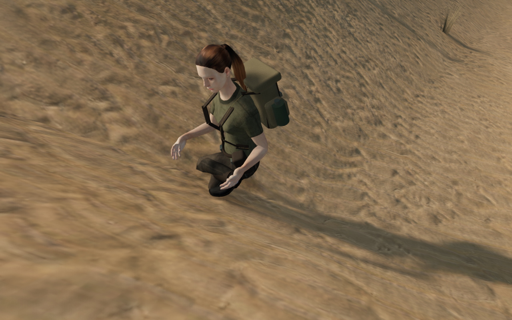
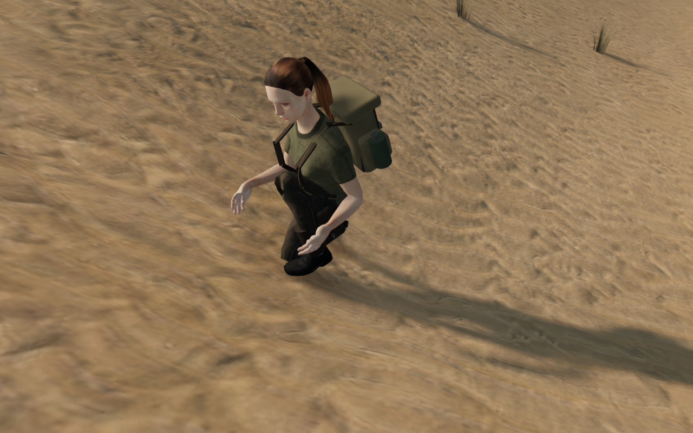
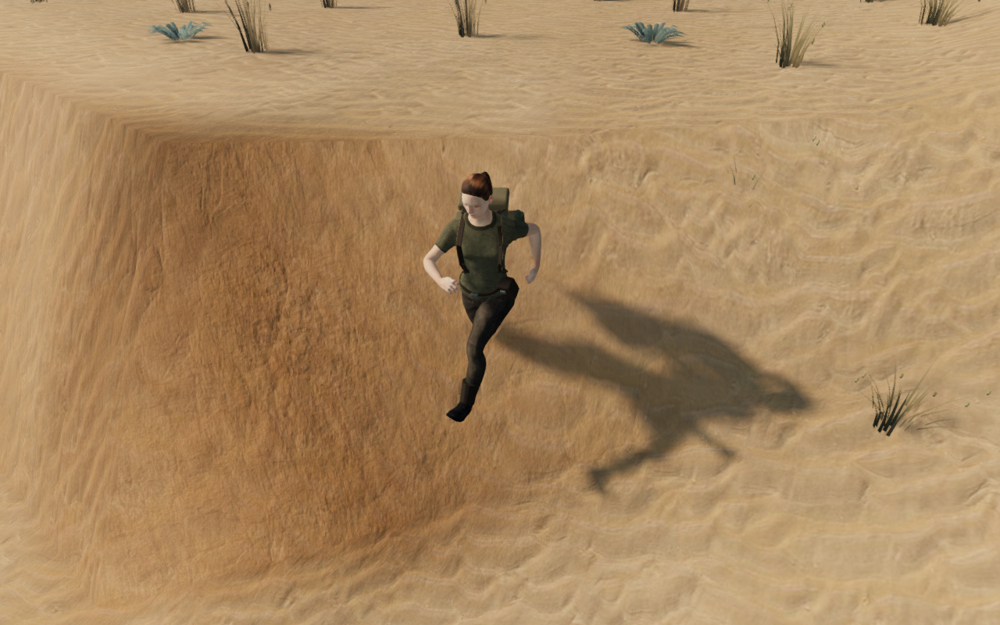
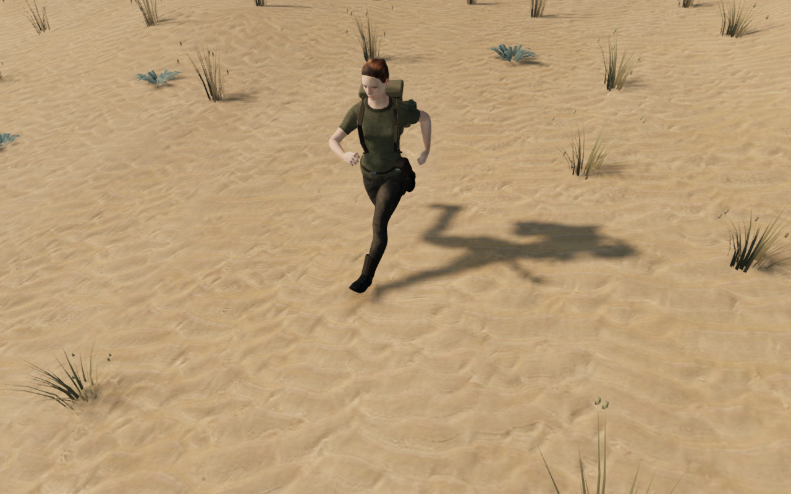
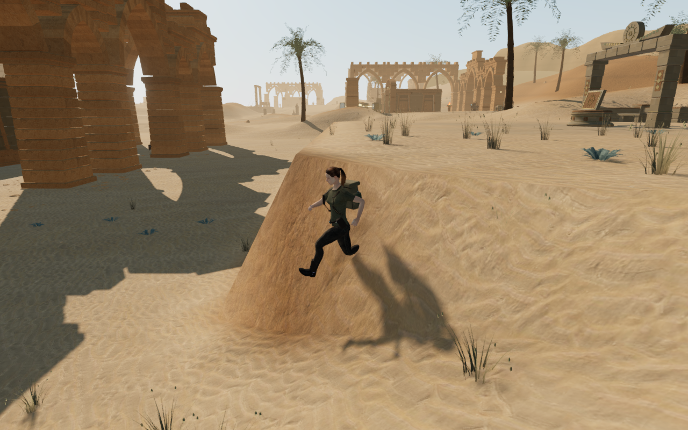
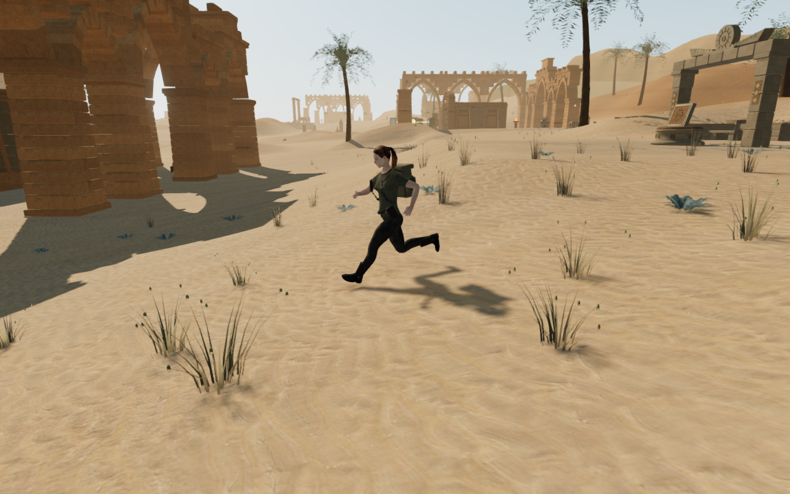

# Desert terrace approaches and complete rock footing

Desert terrace joins now form gradual approaches between the optical courts,
field stations and discovery areas. The chapter keeps its objective layout and
working floors. Decorative scanned rocks and small rubble fit their complete
projected undersides below the rendered ground rather than relying on a sparse
local grid.

A full-body check found five crouched poses with knee fabric inside the sand,
reaching 4.525 cm. A normal descent at the maintenance approach also put a
trailing boot 80.523 cm inside the bank. Matching the standing root to the
terrain was insufficient: a nearby part of the body could still intersect a
steep change of elevation. The approach is now graded using the existing
joined-court terrain method, with a wider protected solar floor and forty
relaxation passes for this chapter.

| Previous crouching slope                                                                                 | Graded crouching slope                                                                            |
| -------------------------------------------------------------------------------------------------------- | ------------------------------------------------------------------------------------------------- |
|  |  |

| Previous descent                                                                                            | Graded descent                                                                                            |
| ----------------------------------------------------------------------------------------------------------- | --------------------------------------------------------------------------------------------------------- |
|  |  |

| Previous approach in context                                                                                 | Graded approach in context                                                                                 |
| ------------------------------------------------------------------------------------------------------------ | ---------------------------------------------------------------------------------------------------------- |
|  |  |

These comparisons use separate development runtimes. The earlier views restore
the four terrain and stone-placement source files from commit `76631e0`; the
later views use the revised files. Both retain the delivered explorer, normal
movement and animation. Horizontal positions, input sequences, simulation time
and each pair's camera are fixed. Terrain grading changes vertical support and
therefore the body's pose. The descent views show frame 10 of the same movement
sequence. They are assisted geometry demonstrations, not native production
screenshots or campaign playthroughs.

## Surface and body evidence

The [body observer](../scripts/inspect-explorer-terrain-browser.js) evaluates
every visible posed mesh vertex, including skinned clothing, against an
independent reader of the actual terrain triangles. It neither uses the
controller capsule nor reuses the rig's support probes. Its tests exercise a
translated skinned body, a displaced bone, hidden geometry, missing terrain
and invalid data. Two delivered-GLB regressions cover the five recorded knee
poses and every update of the recorded bank descent.

| Measurement                                                    | Result                                                                   |
| -------------------------------------------------------------- | ------------------------------------------------------------------------ |
| Loaded standing/crouching combinations                         | 320 poses at 40 dry legal positions and four orientations                |
| Continuous normal descents                                     | 120 keyboard and 120 touch movement updates; every update observed       |
| Actual visible body vertices queried                           | 26,933,200 records                                                       |
| Body intersections deeper than the 15 mm observation tolerance | Zero; deepest remaining sampled contact 2.273 mm                         |
| Actual sole samples                                            | Deepest remaining sampled contact 0.495 mm                               |
| Recorded approach's maximum grade                              | 1.46876 to 0.18296 metres per metre                                      |
| Published main/field work-floor vertices                       | All 8,437 unchanged                                                      |
| Feature centre elevations                                      | All 59 unchanged                                                         |
| Water interior queries and complete water definitions          | All 7,220 queries unchanged                                              |
| Extra 3.5 m dry shore collar                                   | Changes up to 4.885 cm; intentionally outside the fixed water interior   |
| Other chapter height arrays                                    | All seven unchanged                                                      |
| Terrain geometry                                               | 81 chunks, 119,072 triangles, 60,025 distinct vertices; counts unchanged |
| Chunk seams and finite normals                                 | All checked; no seam mismatch or invalid normal                          |

Walking approaches intentionally change height. The old test that froze all
walking samples has been replaced with a recorded work-floor regression and
an actual-surface slope regression. Body tests use a 15 mm tolerance; these
samples do not certify every possible animation or body position.

## Scanned rocks and surrounding details

A separate 32-division, world-aligned underside observer found exposed edges
on 206 of 230 scans on the revised terrain, reaching 52.390 cm. The sparse
seven-by-seven seating grid missed narrow edges. Desert fitting now also
projects mesh vertices and downward-facing triangle centres onto the complete
bottom profile, then seats against both the generation height and the rendered
triangle height. Shapes remain unchanged; unsupported placements are rejected.
Other chapters retain their existing fitting options.

The [independent stone observer](../scripts/inspect-cloud-stones-browser.js)
reads the actual Float32 instance matrices and casts a different grid against
the delivered geometry. All 230 final scans pass 107,723 underside rays; the
highest sampled root is 4.960 cm below the sand. Additional rubble candidates
retain small clusters while rejecting fragments that would bridge a slope or
be almost completely hidden. All 690 retained rubble fragments pass 325,975 independent underside rays;
their highest sampled root is 5.149 mm below the sand. The previous runtime
placed 4,230 fragments. The stronger fitting rejects unsuitable positions, so
this pass retains fewer fragments rather than claiming unchanged density.

The terrain change also passes 52,325 standing-height queries, all 2,030 palm
roots and 30,450 palm-edge probes, 4,598 courtyard footing rays, and the solar
footing, aperture and control checks. All 7,126 plants pass 1,136,268 root
queries; lifting a plant by 40 cm is detected. High, Medium and Low observer
views have linked shaders and finite HDR output. On chapter change, all 2,112
tracked landscape resources dispose once and their references clear.

## Playable checks and limits

The continuous four-leg route reaches the first, fifth and ninth courts and
returns to the arrival over 928.713 m and 14,103 normal controller updates.
All 24 captured views are reviewed. Captured positions remain legal and
grounded with health 100, full explorer opacity, clear camera arms, linked
shaders and finite HDR. The route uses prepared late-chapter progress; combat
is not stepped, and it is not a campaign playthrough.

All 172 selected regressions pass, covering the affected terrain, body and
stone contacts, court and solar geometry, character movement and camera,
chapter saves, traversal and audio. The production build passes with its
existing large-chunk advisory.

Production keyboard/High and CDP touch/Low cases exercise solar mirror turns
and an older ground-position save, including movement, crouch, look, jump,
map access and two complete-store reloads per case. Raised console-cap reload,
departure and ground reload also pass. Recovery of an occupied older save
preserves other chapter progress and mix settings and survives a second load.
The shipped bundle has no development game hook, and fetched scripts/styles
match the build output. All 36 native captures are reviewed.

Verification uses the shared 9-of-16 CPU affinity budget, two test workers at
most and one browser at a time. The final host process and port check finds no
live verification processes and neither port 5174 nor 5180 listening.

The public images are lossless conversions of game captures with identical
decoded RGBA pixels and dimensions. Existing asset attribution remains in
[asset credits](asset-credits.md); this pass adds no external asset, dependency,
recording or music.

The reproduced steep descent, crouched knee contacts and scanned-rock edges
are repaired for the observed cases. Broad sparse surroundings, repeated main
installations, the full eight-chapter visual audit, subjective audio listening
and device performance remain open. These measurements do not establish AAA
quality or a complete human campaign playthrough.
