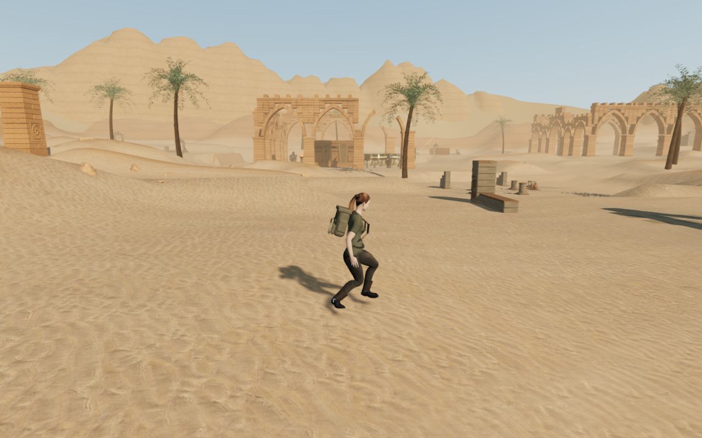
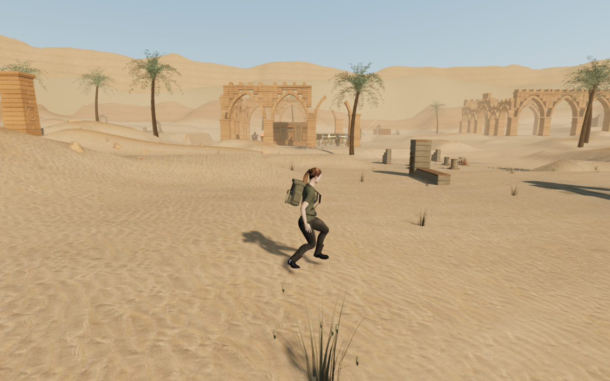
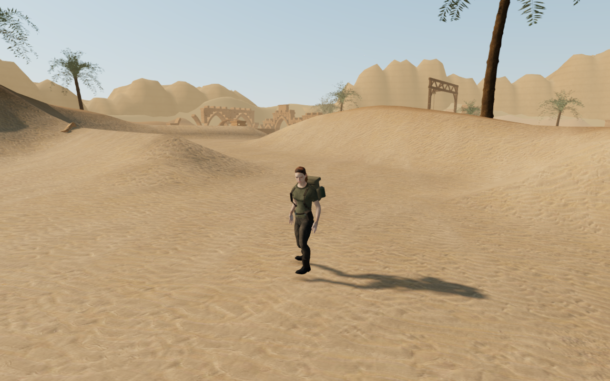
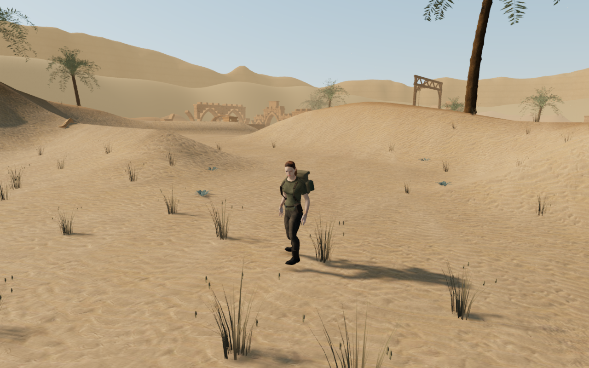
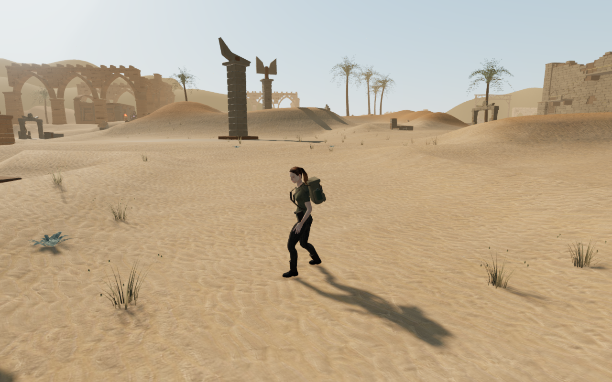
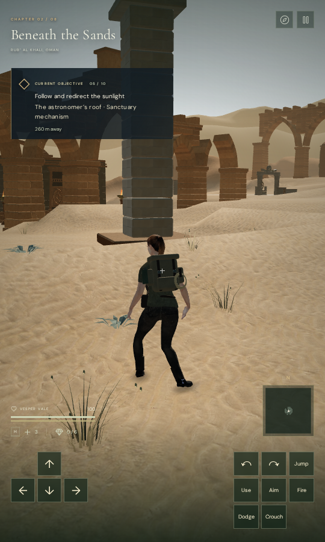

# Desert trail vegetation and distant range

Dry bunchgrass, seed-bearing stalks and low grey-green rosettes now grow in
clusters beside the desert trails. Their roots follow the delivered sand
surface, their tips move in the wind, and three levels of detail limit the
visible geometry with distance. Trails, solar controls, water, discoveries,
gates, rocks and palm trunks retain clear margins.

The distant dune and escarpment silhouettes now use varying spatial fields
instead of repeated angular waves. Rounded rise and fall profiles remove the
old pointed dune crest. Normals come from the continuous height field, keeping
lighting consistent across the triangle diagonals and the joined circular seam.
This pass changes distant scenery and soft vegetation; the playable terrain,
map, objective records and physical rock support remain in use.

| Earlier distant range | Revised distant range |
| --- | --- |
|  |  |

These are paired captures inside the current development runtime, with the
same recorded feet, look, camera, animation time and lighting. The earlier view
reconstructs the preceding milestone's horizon geometry and hides the new
vegetation. It is not a screenshot of the preceding built application. Prepared
field progression keeps the route accessible, and combat is not stepped.

| Earlier trail foreground | Revised trail foreground |
| --- | --- |
|  |  |

## Geometry and lifecycle evidence

The actual loaded chapter has 6,954 plants across 222 patches: 2,817 short
bunchgrasses, 3,239 seed stalks and 898 rosettes. Placement rejects protected
areas and unsupported sharp shelves. A separate observer reads the delivered
terrain vertex/index buffers and world transforms, rather than the height
sampler used to place the plants. Its triangle height queries agree with
independent ray intersections on transformed, overlapping test surfaces and
return no support outside the surfaces.

All 1,110,384 plant-root samples pass against those delivered triangles after
rounding the authored instance transforms to their GPU float32 representation.
There are no missing or exposed roots; the highest root is 1.1674 cm below the
terrain. Deliberately raising the first plant by 40 cm rejects all 162 of its
root samples. All plants also pass the placement reservation policy again;
that policy check is not an independent survey of every nearby physical object.

The specimen regression covers all three variants and detail tiers, supported
slopes, conservative wind bounds, deterministic placement through gate motion
and graphics changes, and buffer disposal. The horizon regression checks
upward triangle winding, exact seam positions and normals, independent spatial
normal derivatives, finite buffers and geometry outside the playable square.
The existing 45,738 desert standing-height samples remain unchanged, along
with the route, objective and water records and other regional terrain profiles.

The two horizon layers now contain 163,840 triangles in total, up from 98,304.
This is an explicit geometry cost. Plant geometry is instanced and clipped by
camera distance; only the nearest detail tier casts shadows. Consumer frame
rate and memory budgets still need device evaluation.

On chapter change, all 2,012 tracked landscape source geometries, patch wrappers,
instance resources and materials dispose exactly once. The desert groundcover
and horizon references are cleared. This includes the nine unrendered specimen
geometries as well as the rendered patch resources.

## Playability and scope

All 24 paired landscaping views and all 24 continuous-route views are reviewed.
The final three graphics-setting views update vegetation detail after setting
the graphics preference: visible plant counts are 399 on High, 204 on Medium
and 113 on Low at the recorded observer. Programs link and HDR samples are
finite with zero GL errors. High and Medium are sampled before bloom; Low is
sampled through a temporary half-float target with bloom disabled.

The continuous four-leg desert circuit completes 930.218 m and 14,094 normal
controller/camera updates. All recorded routes, controller samples and capture
metadata match the preceding milestone exactly. Every recorded view has a legal
player position, health 100, full character opacity and a clear captured camera
path. This is an assisted traversal with prepared prerequisites and combat
suppressed, not an unassisted human playthrough or a campaign duration measure.

All 90 selected regressions pass, covering the landscape changes, scatter,
regional art, solar rules, instance detail, physical rocks, terrain, follow
cameras, campaign saves, puzzles and audio. Formatting and the production build
pass. Vite retains its existing large-chunk advisory; this is not a consumer
performance benchmark.

Built production keyboard/High and actual CDP touch/Low input exercise movement,
crouch, look, jump and map access at 1280 × 800 and 540 × 900. The touch case
uses the visible map and pause buttons. Movement distances are 2.942 m and
2.999 m, with health 100 and no viewport overflow. Both complete stores survive
two reloads per case exactly, apart from per-chapter timestamps. The served
JS/CSS asset names match the final production build, and no development hook,
page error, missing resource or unexpected console warning is recorded. All
fourteen native captures are reviewed.

Heavy verification runs serially with the shared nine-of-sixteen CPU affinity
set (56.25%), lower priority, at most two test workers and one GPU browser.
Browsers close after each check; the development server stops before the build,
and the preview server stops after production checks. The host process/port
observer finds no live verification processes and both temporary ports closed.

All six public images are lossless WebP conversions of actual game captures,
verified to preserve dimensions and decoded RGBA pixels. Saves, browser profiles,
raw captures and helper output remain in ignored local staging.

The existing positioned birds, water and mechanical sounds and the quiet
chapter/objective score remain in use. No recording, external asset, music or
dependency is added. This pass does not establish subjective sound quality.

Broad bare areas, angular nearby bank crests, repeated installations and wider
body contact still need review. The background refinement and trail plants do
not finish the desert or the complete campaign visual target. Other chapters,
landscape composition, listening and device acceptance remain open.
