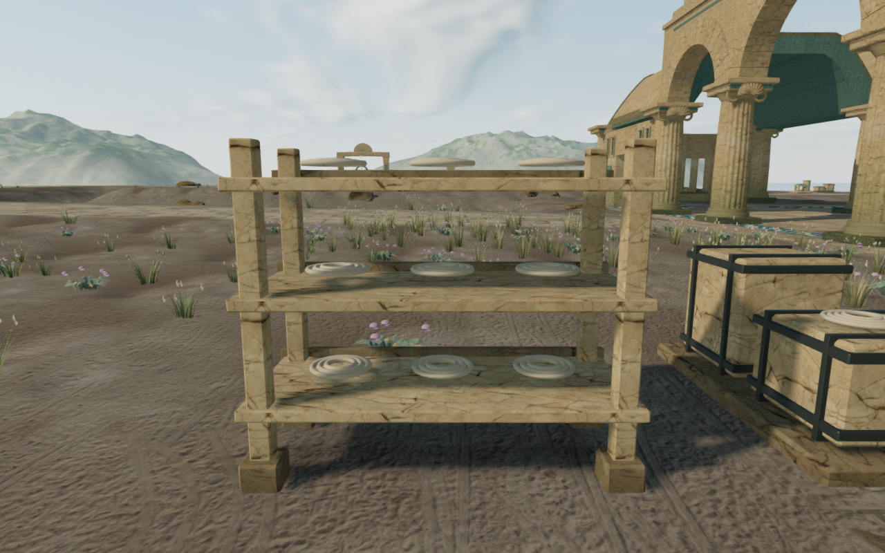
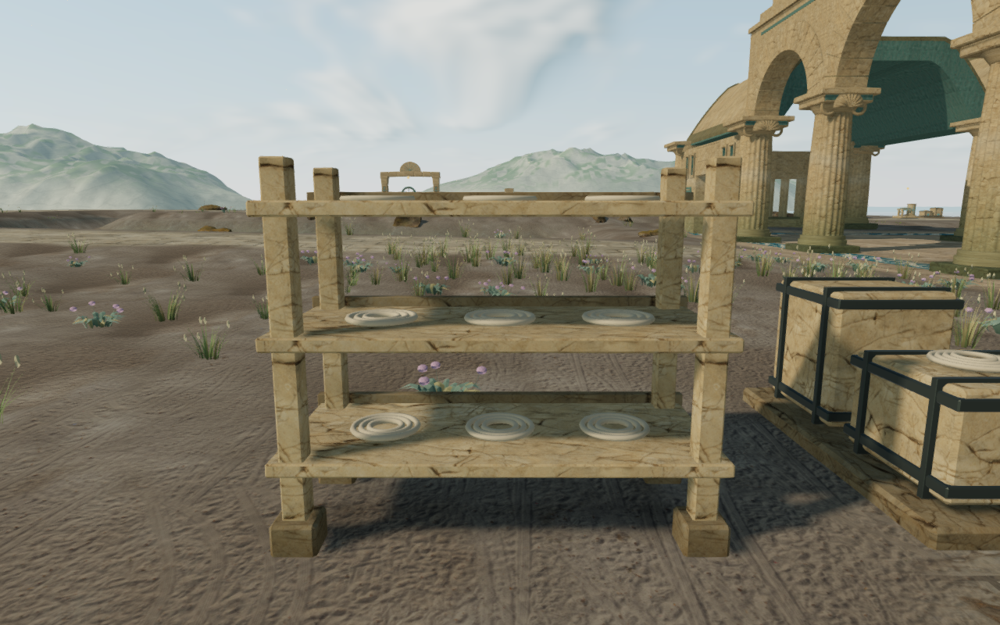

# Seated rack cargo and terrain lighting

A refresh of the eight chapters' discoveries found floating stored cargo and
terrain lighting normals pointing through steep surface triangles. These are
two local construction repairs. The wider visual goal remains open.

The baseline survey contains 160 reviewed High views: all 144 note/cache
collection positions, plus two side views per chapter. All 144 stopped poses
have legal player and camera positions, the expected interaction target and
clear rendered-body probes against discovery solids and terrain at the 15 mm
threshold. Deliberately putting the body into a cache or below the terrain
detects overlap in every chapter. These prepared positions do not establish
continuous moving-body contact or a complete traversal. The low follow camera
also obscures some table details; side and close views provide extra coverage.

Several racks retained visible air beneath their stored contents. Coastal rope
rings sat about 76–92 mm above the shelves; boxes in the desert, winter and
cloud chapters had gaps of about 23–30 mm. The actual bearing vertices now
settle onto each shelf's rendered triangles. Lids, bindings and decorative
pieces follow their container. The jungle rack's middle tablet is shorter and
lower so it clears the board above it.

| Published coastal cargo geometry | Seated cargo |
| --- | --- |
|  |  |

Numeric part identities survive material batching. The independent observer
reads those delivered triangles, probes the bearing footprint and checks all
cargo vertices beneath the next shelf. It accepts bearing gaps from −6 to
+10 mm and requires at least 15 mm of clearance below the next board. Lifting
all cargo by 50 mm must fail every bearing probe; the control restores the
original vertex bytes. Temporary factory mesh references are removed after
the numeric contact records are captured.

Across the eight current worlds, all 726 stored assemblies (counting each
coastal rope ring separately) pass 19,620 bearing probes and 126,879 upper-shelf
clearance probes. Measured bearing gaps are about −2.1 to +5.3 mm; the smallest
upper clearance is about 45 mm. Every lifted bearing control fails as expected.

The normal inspection compares each draw corner with the cross product of its
actual terrain triangle. The published surface has 5,090 opposing corners:
150 in the jungle, one in winter, 4,937 in the cloud chapter and two in the
crystal chapter. Only these corners split from their shared vertices and take
their face normal. Other smooth normals remain. Expanded position, UV and
non-normal attribute streams, triangle counts, heights, water data and texture
requests remain unchanged. The other four chapters retain their normal buffers.
Clipped gallery surfaces are included in the inspection. Reversing all actual
normals must detect every draw corner, followed by exact buffer restoration.
The normal close views are diagnostic inspections, including a cloud viewpoint
outside normal gameplay. They do not establish landscape presentation quality.

The delivered world inspection covers 3,929,439 terrain draw corners, with no
opposing, invalid or degenerate results. Reversed-normal controls detect every
corner. Positions retain their existing silhouettes and coarse transitions;
this repair addresses normal direction, not the broader terrain profile.

The comparison covers all eight terrain factories and 192 discovery-module
fixtures: eight themes, six module kinds and four variants. Original geometry
buffers match, as do all frame and non-cargo transforms. Cargo transforms and
the jungle tablet's height are the intended changes. The terrain repair adds
5,090 vertices across the eight factories without adding triangles.

All 35 selected tests across seven files pass, together with the build and
three CPU-budget tests. These cover both indexed and nonindexed normal repair,
attribute preservation, unchanged valid faces, all eight actual terrain
factories and delivered rack contacts in multiple variants. The build retains
its existing bundle-size advisory.

The current-source repeat checks 64 collection/body positions: all eighteen in
the jungle, desert and winter chapters, plus one note and one cache in each
remaining chapter. Every checked position retains its legal player/camera
placement, expected interaction target and clear body queries. All 144 discovery
placement records match the published survey. Eight additional native-input
seed positions also clear the body queries. Thirty-six current game views and
two restored-geometry diagnostic comparisons are reviewed. Shaders link and
HDR inputs remain finite; there are no page errors, missing resources or
unexpected console warnings. All 438 runtime hashes match the tested source.

Production checks alternate keyboard/High at 1280 × 800 with actual portrait
touch/Performance at 540 × 900, one case per chapter. Each approaches a discovery
by 1.2–1.8 m and collects the expected note or cache at full health. The four
cache cases each earn one medkit. All eight complete-store reload comparisons
pass apart from chapter timestamps. Loaded JS/CSS names match the build, the
development hook is absent and there is no horizontal overflow. All twenty
release captures are reviewed, with no page errors, missing resources or
unexpected console warnings. Prepared saves have guardians defeated and audio
muted; this is local interaction/persistence coverage. Each browser closes after
its chapter, and every preview server stops before the next case begins.

All verification uses the shared locked five-of-sixteen CPU set at lower
priority, with at most two test workers and one browser. Staging, captures,
saves and browser temporary files stay under the ignored local directory.

The paired coastal figures use a diagnostic camera, identical scene time and
the same current world. The previous rack factory's cargo geometry is restored
only for the first image after verifying its correspondence with the delivered
batch; terrain normals retain the repair in both coastal images.

Shared discovery arrangements, sparse margins, broad cliff forms, other
traversal/water coverage, continuous moving contact, surface-specific footsteps,
listening review and consumer-device performance remain open. The game goal
remains active.
