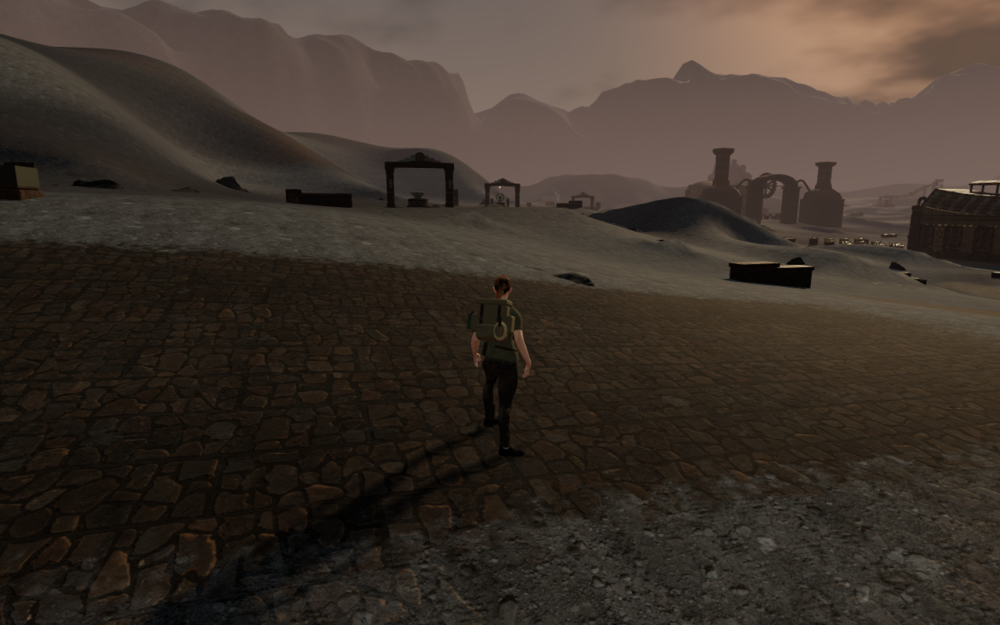
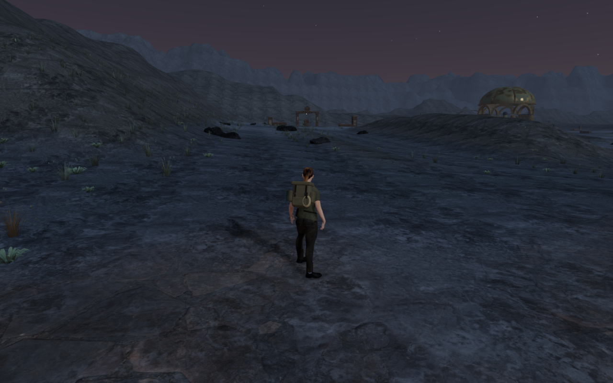

# Current High chapter entrances

This review refreshes the eight chapter entrances after the recent world and
HUD changes. It is an inspection baseline, not a scenery repair or completion
claim. All views use the actual High preset at 1280 × 800, its shadows and the
chapter's native terrain, atmosphere and first objective-facing camera.

| Chapter | Prepared position, X / Z (m) | Current entrance observation |
| --- | --- | --- |
| The Verdant Veil | 56 / 70 | Carved arcades, roots, a camp and layered woodland frame the paved approach. |
| Beneath the Sands | 371 / 224 | Dunes, distant arches and the survey lookout establish the route; broad sand remains open. |
| A Silence of Snow | 84 / 56 | Snowy slopes, timber galleries, firs and the mountain horizon establish the pass. |
| The Drowned Kingdom | 70 / 84 | Arcades, blue roof undersides and hydraulic paving frame a broad palace court. |
| A Heart of Embers | 385 / 224 | Distant forge silhouettes and the caldera are visible, but the large paved foreground and adjacent ash remain sparse. |
| Where Eagles Sleep | 84 / 56 | Stone terraces, timber mechanisms and meadow growth frame the first lookout. |
| The Night Below | 56 / 63 | Large crystals, deposits and the enclosing cave frame the resonator approach. |
| The Last Meridian | 385 / 224 | A distant golden dome and scattered plants/rocks leave a broad, largely uninterrupted foreground. |

The volcanic and final-chapter foregrounds remain composition work. These views
confirm that the observation persists at High, rather than being explained
solely by the lower graphics preset. Improve their visual rhythm and nearby
interest while preserving the route, mechanical access and ground contact.

The later [Meridian planting pass](meridian-planting.md) adds fuller colonies
beside the final chapter's routes and refreshes its eleven courts. The images
above retain this earlier entrance baseline. Volcanic foregrounds, repeated
large installations and wider composition remain under review.

The subsequent [foundry floor pass](forge-floors.md) gives all nine volcanic
work aprons distinct worn courses. Its current comparisons retain broader ash
fields and repeated large installations as open composition work.

All eight standing controllers are legal. Independent terrain observations
inspect 384,760 delivered character vertex records, with no missing or invalid
samples and no overlap beyond the observer's 15 mm threshold. Shaders link and
sampled HDR output is finite in every view. All eight raw canvas captures are
reviewed. Those checks do not prove contact with every solid or a traversal
playthrough.

The two published images are actual prepared raw-canvas captures. Lossless
WebP exports preserve their decoded pixels and 1280 × 800 dimensions, without
cropping or retouching. All world captures were collected before the added
short-landscape HUD rule; their viewports do not match that rule. World-side
source hashes remain equal; subsequent CSS and waypoint-blocker changes only
affect the interface. No world geometry or asset changes accompany this review.
Broader courts, optional spaces, moving mechanisms and full routes still need
current coverage.
