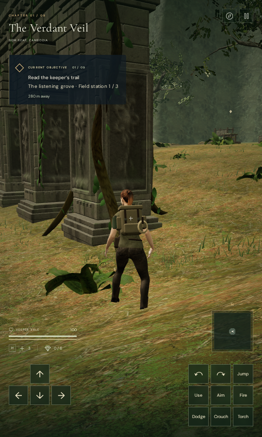
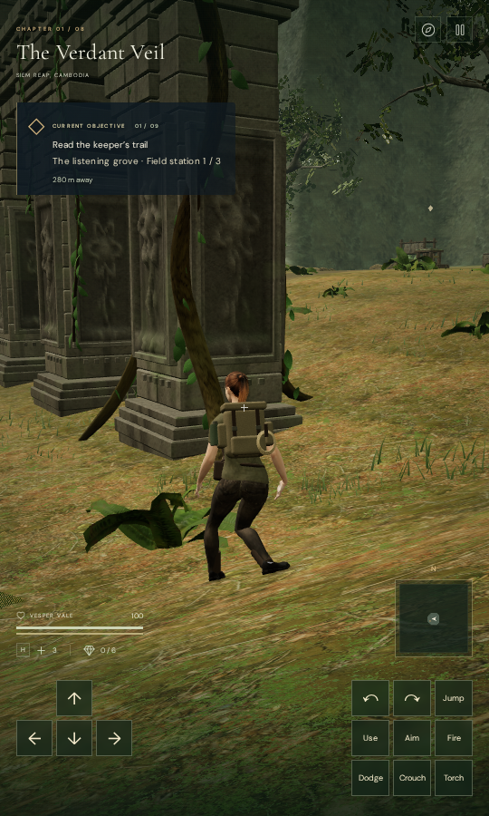

# Explorer contact in the first view

Reloading the jungle flank at x = 377.40 m, z = 49 m previously displayed the
explorer's lower legs through the rising soil while the pause dialog was open.
The controller and saved position were correct. The asynchronously loaded rig
had its initial idle animation but had not fitted its feet to the terrain.
Player updates remained paused, so that unfitted pose persisted on screen.

The chapter now fits the delivered rig after its visual assets and physical
surfaces finish loading, before exposing the first view. This uses the existing
standing, platform and swimming pose logic with zero elapsed time. It preserves
the controller position, chosen facing, animation clock and saved progress.
The existing asset-batch guard prevents a retired chapter's completion callback
from posing the current explorer.

Both captures use the same saved position, facing and Performance preset. The
pause dialog is hidden only for the photograph. The revised image is taken
immediately after loading, without a diagnostic settling loop.

## Evidence

On published 049b5f0, an observer inside the actual first-render path finds
675 of 48,095 delivered character vertices below the terrain by more than
15 mm. The deepest overlap is 119.213 mm. One ordinary animation update clears
the overlap, identifying the missing initial fit rather than an incorrect
saved controller height.

With the revision, that first-render observation has no embedded, missing or
invalid vertices. Its minimum terrain gap is approximately 6 mm. Further
observations after 1, 2, 5, 10, 20 and 40 diagnostic updates remain clear.
The initial complete stores, player positions, facing and animation times match
the preceding run, excluding only the play timestamp. These measurements read
the actual posed mesh against independent rendered-terrain triangles.

All 59 selected character, startup, terrain-observer, tree/rock-contact and
swimmer tests pass. A new frozen-pose case covers 44 poses across all eight
chapter terrains, including the recorded flank and two nearby points, in four
standing directions. Its 2,116,180 delivered vertex observations clear the
terrain sampler while controller position, progress and animation time remain
unchanged. It also retains the unfitted recorded pose as a negative control.
The live first-render check supplies the integration evidence for the loading
callback; the pose fixture alone does not establish that the loader invokes it.

The actual High renderer passes first-view checks at all eight chapter starts
and two saved jungle root positions. All ten views are reviewed, with active
ground fitting, legal controller positions, linked shaders and finite sampled
HDR output. Their 480,950 first-view vertex observations clear independent
terrain triangles. Both root saves retain their exact recorded elevations,
0.925219 m and 1.858947 m above the local terrain. That terrain observer does
not measure the boots against the wood itself.

The production build passes with its existing bundle-size advisory. Built
keyboard/High and portrait-touch/Performance cases both start at the recorded
flank position. They retain the complete store through an immediate reload,
then exercise movement, crouching and jumping before a second reload. All four
store comparisons pass, excluding only play timestamps; the first moves cover
1.0974 m and 1.8000 m respectively. All ten release captures are reviewed.
The served bundle names match the build, and there are no application errors
or warnings. These prepared cases mark guardians defeated and do not verify
combat or an objective playthrough.

Both documentation images retain identical decoded pixels and dimensions in
lossless WebP. Checks use the shared locked five-of-sixteen CPU allowance, at
most two test workers and one browser, with expensive jobs run sequentially.
The owned development and production preview servers, workers and browser
descendants close after verification.

## Remaining review

VA-164's reproduced first-view terrain overlap is repaired. The raised view
near x = 370.5731 m, z = 35.3944 m still makes the resting boots look unsupported
beside the trunk. VA-165 retains that observation for an independent wood/sole
measurement; a legal capsule and an unchanged elevated save do not prove foot
contact. Broader moving contact and the world visual audit remain incomplete,
including the jungle tree-base, masonry and text-contrast findings. Muted
rendering checks do not establish subjective sound quality or device performance.
