# Clear views through foreground foliage

Foreground grass and leaves now open a soft view around the explorer. Low
plants fade as complete clumps, avoiding the detached leaf pieces produced by
an initial fragment-only prototype. Canopy and palm leaves use a local opening
while opaque trunks retain their original rendering.

The framing follows posed joints and the current camera projection, including
crouching, camera detours and portrait viewports. A feathered edge shares the
existing detail-transition pixel pattern. The mask applies only to foliage in
front of the body, with a separate close-lens transition. A render-camera position
check keeps the opening tied to the player camera. These changes do
not move plants, replace their artwork or change the movement rules.

Registration handles both instanced detail tiers and ordinary temple growth
roots. It preserves wind, alpha textures and the detail crossfade. Rocks and
gravel are excluded. The normal contact override excludes masked foliage, while
original leaf shadow materials remain unchanged.

Each instanced foliage tier adds four floats per instance: low plants store a
bounding sphere, while canopy tiers store a mode marker. Their source
vertex/index buffers and wind-expanded bounds remain shared and unchanged.
The metadata is allocated once for each patch geometry and retires with it;
weak patch/material registries do not retain retired chapter resources. The
runtime adds no render pass or draw call for the opening.

## Rendered evidence

The independent GPU observer draws the actual posed body and foliage with flat
identification colours. It retains each original wind, texture-alpha, atlas
and per-instance detail shader, then compares rendered body pixels with and
without foliage. It restores scene visibility, materials, targets and shadow
update state, disposing its temporary materials and target on exit.

Sixteen standing/crouching cases cover six recorded legal plant approaches
and unchanged spawn views in the volcano and cavern. The preceding-effect controls disable only the new mask in
the current runtime. Root, camera, input look, world geometry and simulation
time remain fixed between each comparison. The normal camera settles; there is
no documentation orbit or character-opacity override. Progress is prepared,
enemies removed, timers stopped and audio muted.

| Chapter | Covered body pixels before, standing / crouching | Revised, standing / crouching |
| --- | ---: | ---: |
| Jungle | 60 / 86 | 0 / 0 |
| Sky | 1,034 / 1,218 | 0 / 0 |
| Coast | 53 / 80 | 0 / 0 |
| Mountain | 171 / 436 | 0 / 0 |
| Desert | 67 / 108 | 0 / 0 |
| Eclipse | 274 / 876 | 0 / 0 |
| Volcano | 0 / 0 | 0 / 0 |
| Cavern | 0 / 0 | 0 / 0 |

The controls cover 4,463 body pixels; revised views cover none across 51,312
sampled body pixels. Volcano and cavern have no low plants at these recorded
spawn views; their cases check the unchanged rendering path rather than a
foliage correction. A separate jungle fern approach records 517 standing and
634 crouched covered pixels, also reduced to zero by the whole-clump prototype.
All recorded revised roots are legal, the character stays opaque and grounded,
shaders link and HDR pixels remain finite. No application errors or warnings
occur. This is an assisted local-view survey, not a campaign playthrough or
proof of every moving, climbing, aiming or canopy view.

| Jungle before | Jungle after |
| --- | --- |
| 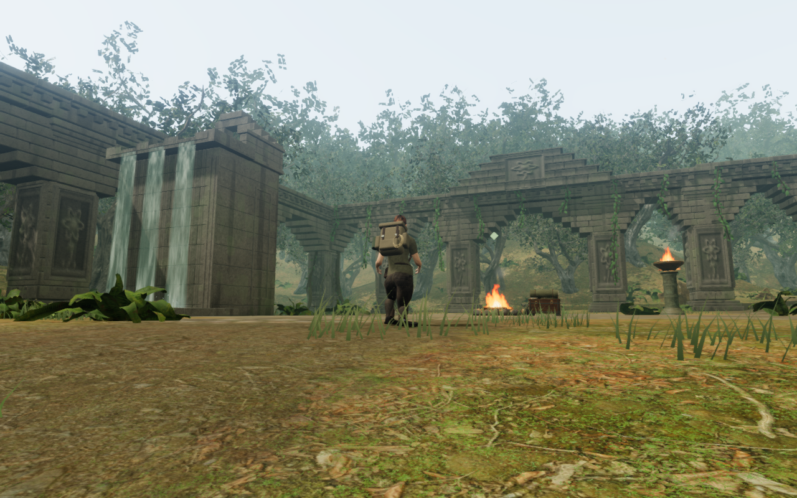 | 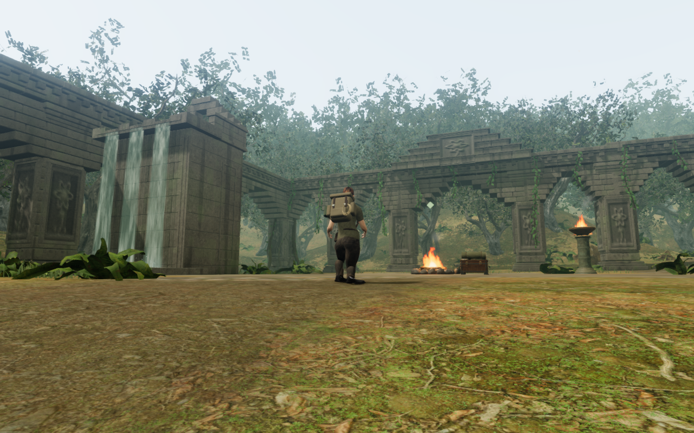 |

| Sky before | Sky after |
| --- | --- |
| 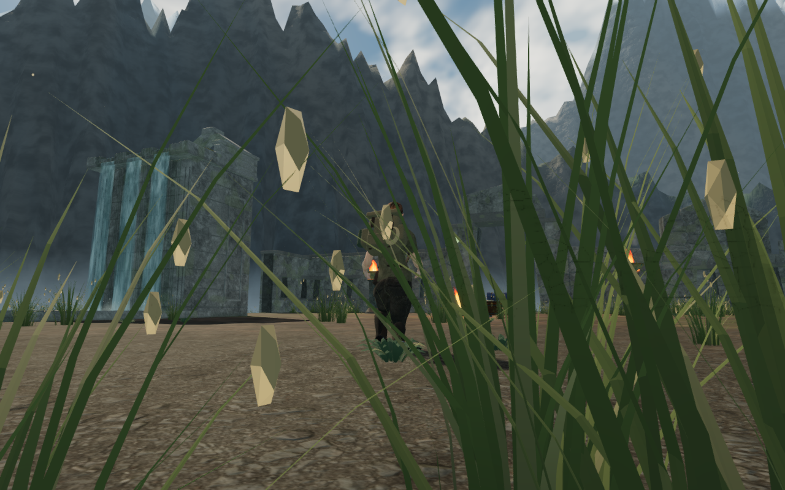 | 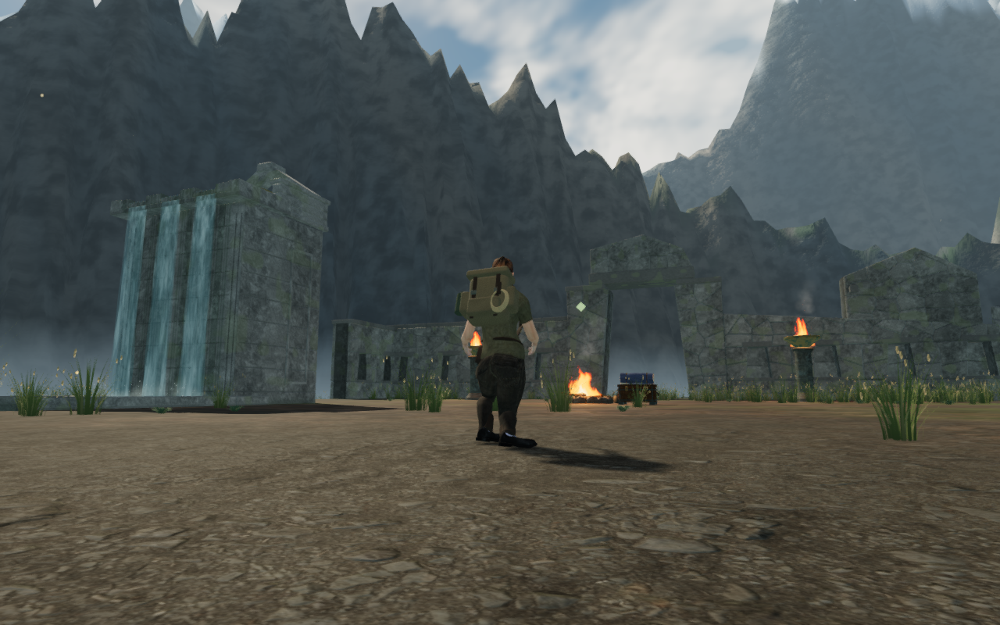 |

| Coast before | Coast after |
| --- | --- |
| 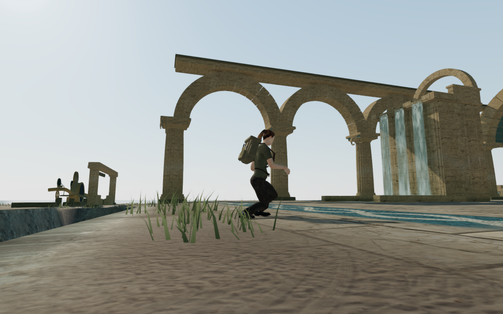 | 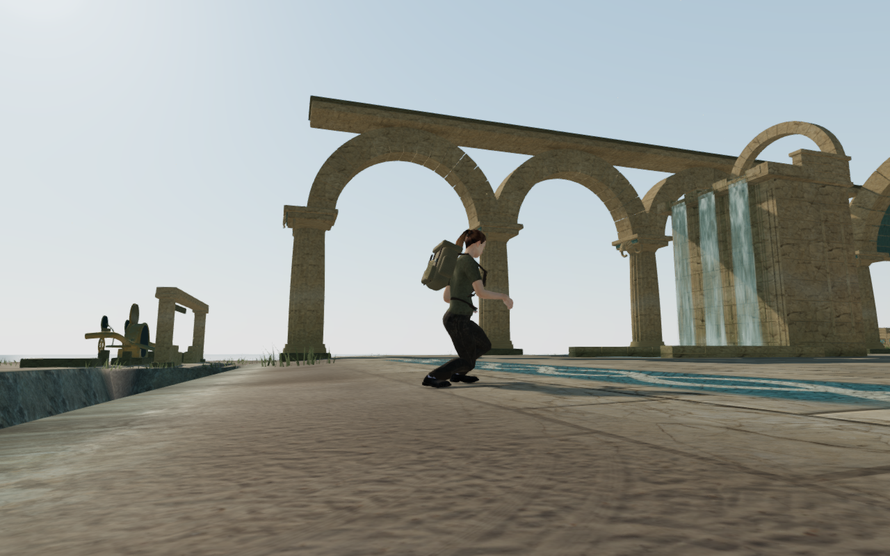 |

| Mountain before | Mountain after |
| --- | --- |
| 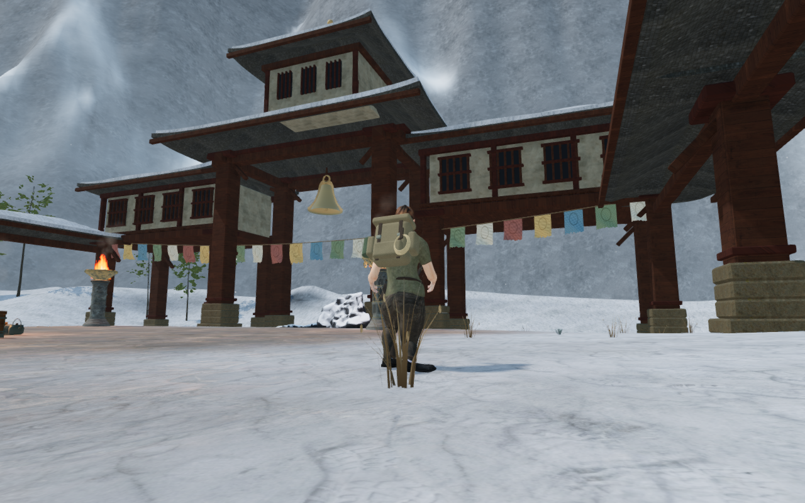 |  |

| Desert before | Desert after |
| --- | --- |
| 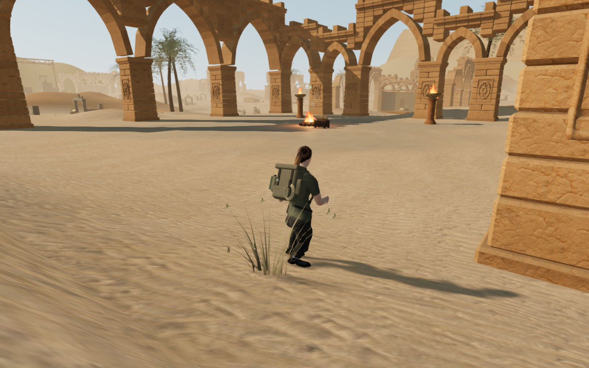 | 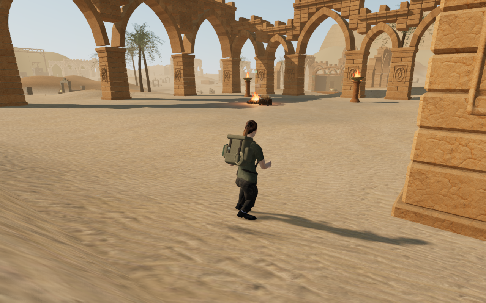 |

| Eclipse before | Eclipse after |
| --- | --- |
| 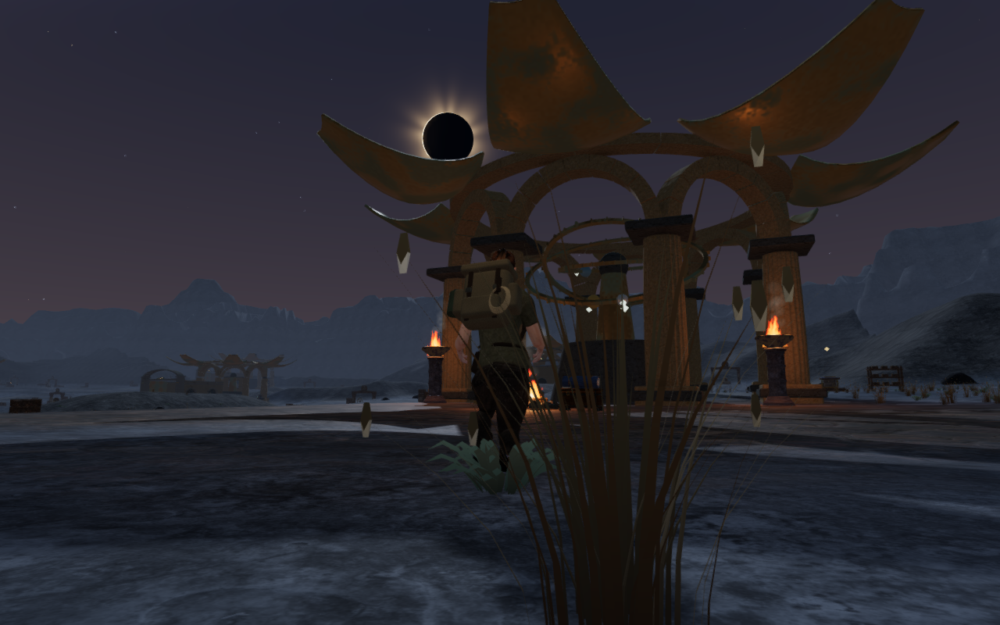 | 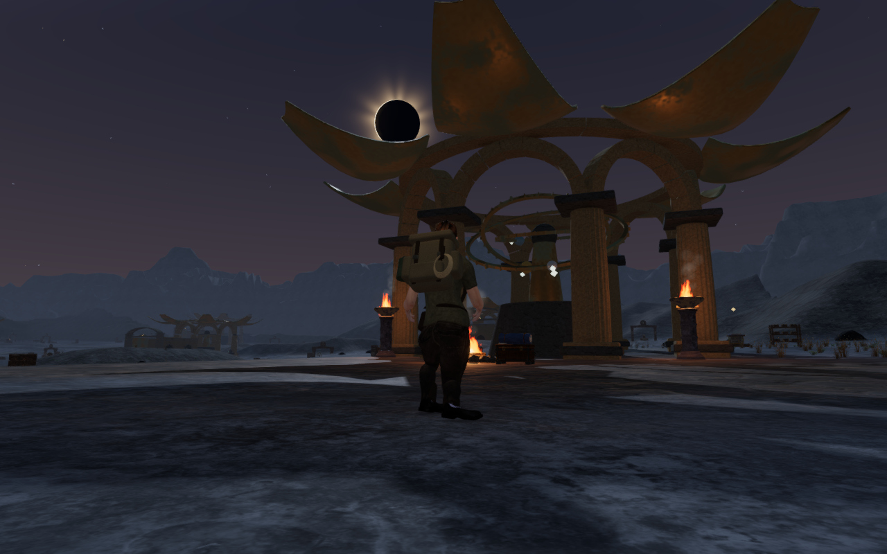 |

## Built release controls and saves

The actual built interface passes keyboard input on High in the jungle at
1280 × 800, and touch input on Low in the sky chapter at 540 × 900. Both restore
the recorded legal arrival exactly. Walking covers 1.5 m and 2.1 m respectively;
crouch, manual look, jump/landing and map access pass. Health stays at 100 and
earned positions settle to ground height.

The complete campaign store survives two reloads per case, excluding only
`lastPlayed` timestamp changes. Neither viewport overflows. The development
hook is absent, loaded bundle filenames match the current build and all six
character responses match the unchanged delivered model's SHA-256. No
application errors, warnings or HTTP failures occur. Saves are prepared and
audio muted; this is not a listening or playthrough-duration check.

| Jungle keyboard / High | Sky touch / Low |
| --- | --- |
| 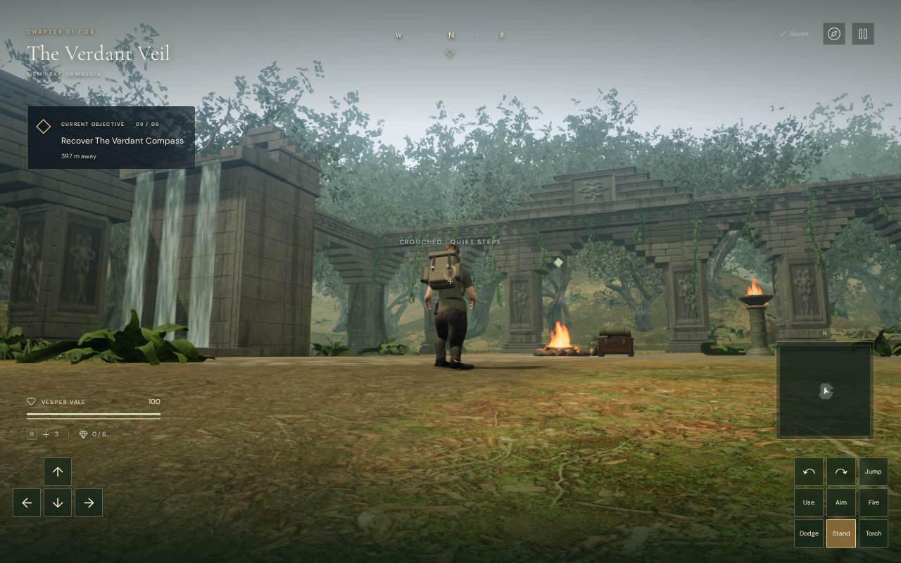 | 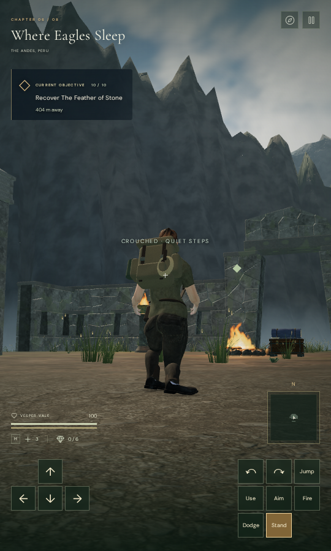 |

All 32 survey captures and both native captures are visually reviewed.
Fourteen public images preserve decoded RGBA pixels and dimensions through
verified lossless WebP conversion.

## Selected checks and limits

Twenty-six selected cases across seven files pass, covering posed/projection
tracking, late loading, shader composition, preservation of bark/rock/gravel,
instance streams, original wind bounds, placement and resource disposal.
This is a selected suite. The build passes with its existing large-chunk
advisory.

Wider continuous routes, nearby canopy branches, aim/weapon and climbing
silhouettes, foreground density, auxiliary views and consumer-device performance still need
review. The soft opening improves the recorded views; it does not complete the
full visual audit. Perceived weight, landscape composition and subjective
spatial listening also remain open.

Verification uses the locked shared allowance of nine out of sixteen available
CPUs, serial heavy checks and one browser. Staging, profiles and player-store
fixtures stay inside the ignored checkout-local directory. Image conversion
uses two Sharp workers with its cache disabled. Owned browsers and temporary
servers are closed after their checks.
