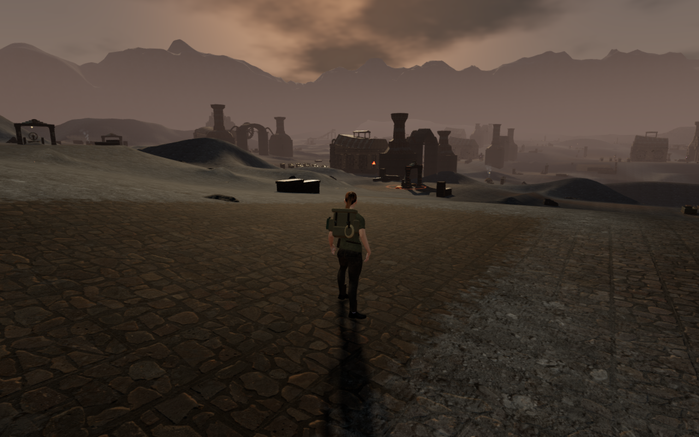
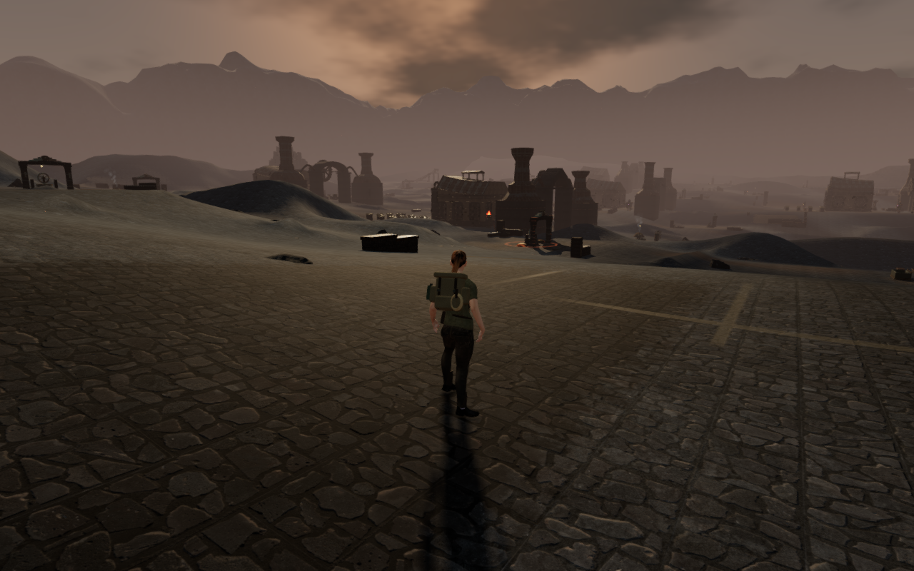
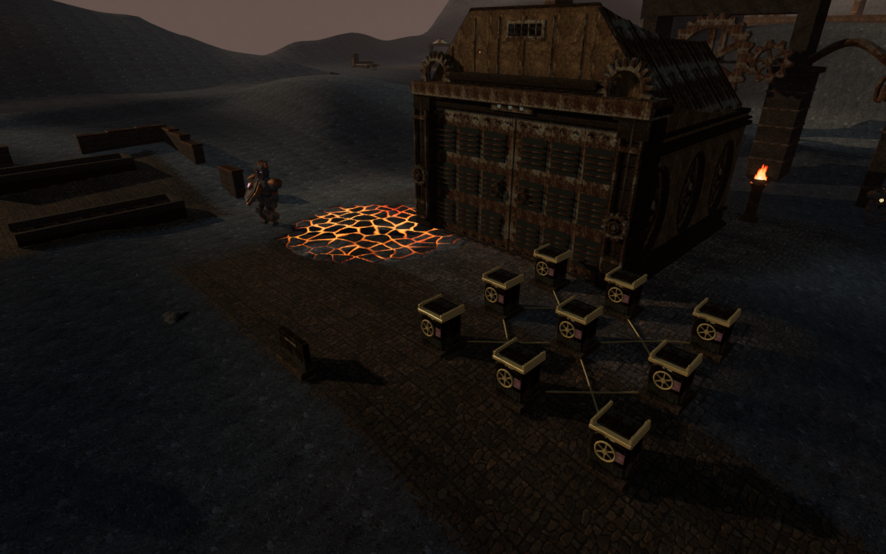
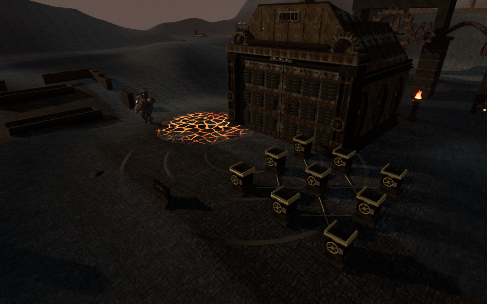
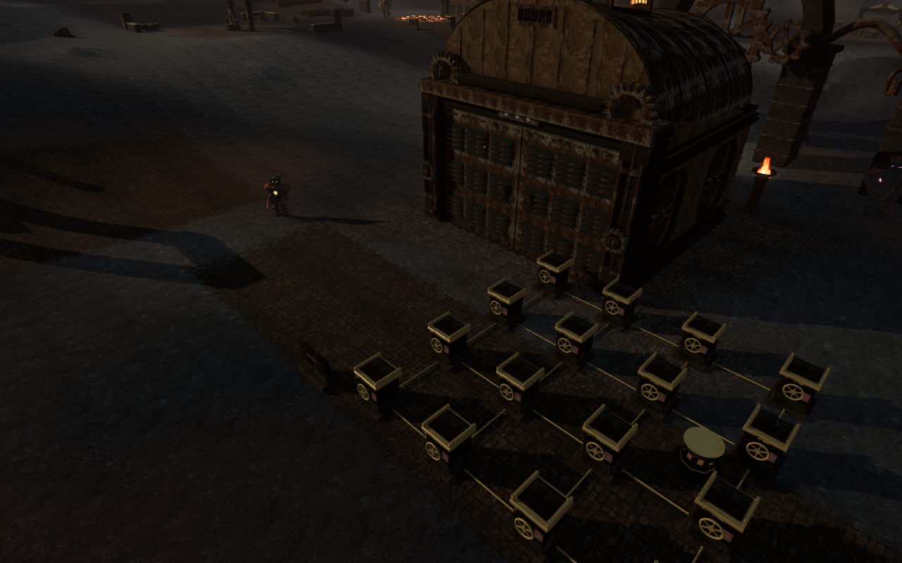
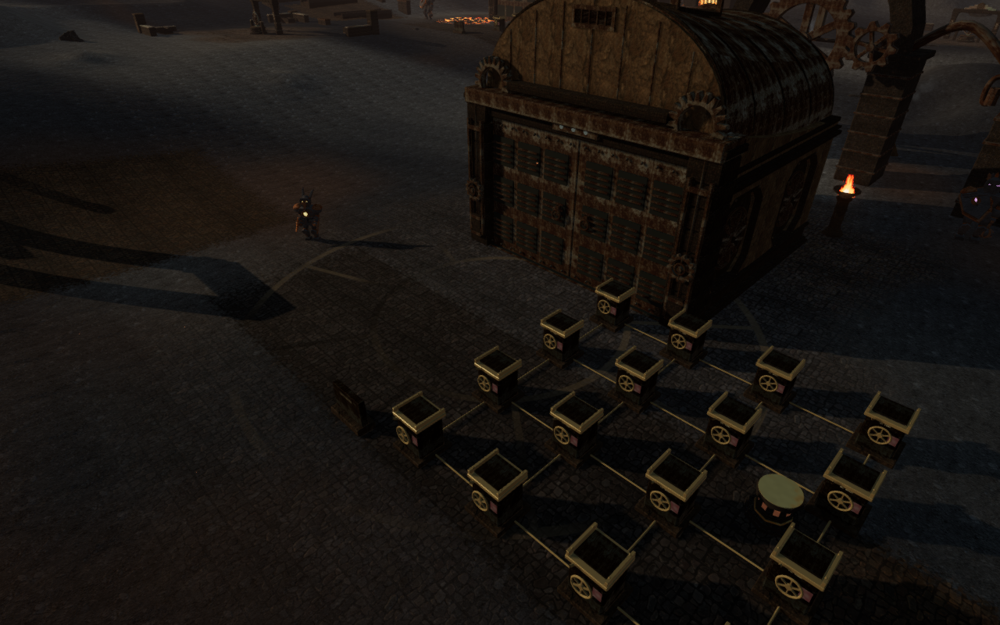

# Foundry floor courses

A Heart of Embers now has nine worn floor compositions around its work areas.
Haul rails mark the receiving apron; fan channels serve the air workshop;
chevrons cross the fuel store; expansion rings surround the pressure court.
Paired gear outlines, casting lanes, a flame rosette, bending quench channels
and a nine-spoke heart distinguish the remaining courts.

The courses blend into the existing paving with broken joints, cooler stone
variation and restrained metal inlays. Their shading follows the terrain and
the thin worn-paving patches. Line filtering uses the projected world-space
pixel footprint so fine marks fade with distance.

These are actual High-preset game captures at 1280 × 800. The approach uses
the explorer's follow camera; the pressure and heart views use elevated
inspection cameras. Each pair shares its frozen player, camera and simulation
time. The control disables only the new floor treatment in the current scene.
The six lossless WebP exports retain the source pixels and dimensions without
cropping, retouching or added artwork.

## Surface integration

Each composition is centred on its working apron, twelve metres in front of
the room centre. Its radius is capped at 18.5 m and shrinks with the distance
to the nearest court. The nine chapter footprints do not overlap. The worn
courses taper around their boundaries and on steeper ground.

Terrain and paving patches share the chapter's numeric floor uniforms. Paving
clones retain the same shader hook and embedded array size. Other chapters
retain their existing materials. The treatment uses colour, roughness and
derivative-normal shading, with no added geometry or texture downloads.

## Verification and limits

All 74 reviewed render captures pass shader linking and sampled HDR checks.
They cover paired controls and revised views for four entrance headings,
eighteen court fronts/backs and nine elevated floor views, followed by nine
player views and three quality presets. Every pair retains its player, camera
and simulation time. The drawn terrain and paving programs receive the expected
floor strength. There are no page errors or unexpected console warnings.

Toggling the treatment retains the geometry position, normal and index buffers
and world transforms across all 140 checked meshes. All 54 supported feature
approaches have a legal stance and a matching visible floor within 15 mm;
the largest observed difference is 5.00001 mm. The observer accounts for the
raised tempering deck. Eighteen controller-assisted local apron legs arrive
on prepared completed progress, covering 4,330 physics updates. These are local
ground checks, not complete routes or full-body contact coverage.

Changing to the flooded chapter disposes each of the five floor materials and
nine owned terrain textures once. A fresh map receives independent numeric
floor uniforms, and the flooded terrain has no volcanic floor uniforms. All 31 focused
material, geology, forecourt, yard and discovery-setting tests pass. The build
passes with its existing chunk-size warning.

The production checks use native keyboard/High at 1280 × 800 and portrait
touch/Performance at 540 × 900. Movement covers 0.953 m and 1.8 m respectively;
crouch/stand, map and pause controls pass. Four complete-store reload comparisons
retain the prepared arrival and earned progress, excluding only `lastPlayed`
timestamps. All fourteen release captures are reviewed. Health remains 100,
there is no horizontal overflow, the development hook is absent and served
bundles match the build. There are no page errors or unexpected warnings.

Verification stays inside the shared locked five-of-sixteen CPU allowance,
with at most two test workers and one browser. Expensive jobs run sequentially;
owned previews, workers and browsers close after their checks. The three
CPU-guard tests pass.

The new courses give the reviewed work areas distinct ground detail. Broad ash
areas and repeated large installations remain composition work. This pass
does not close the [whole-world visual audit](visual-audit.md), continuous body
contact, complete routes or listening/device acceptance. No external asset,
recording or dependency is added.

The later [scoria bank pass](scoria-banks.md) adds grounded deposits and exposed
rock variation between the volcanic courts. The images above retain this
earlier floor-treatment comparison.
