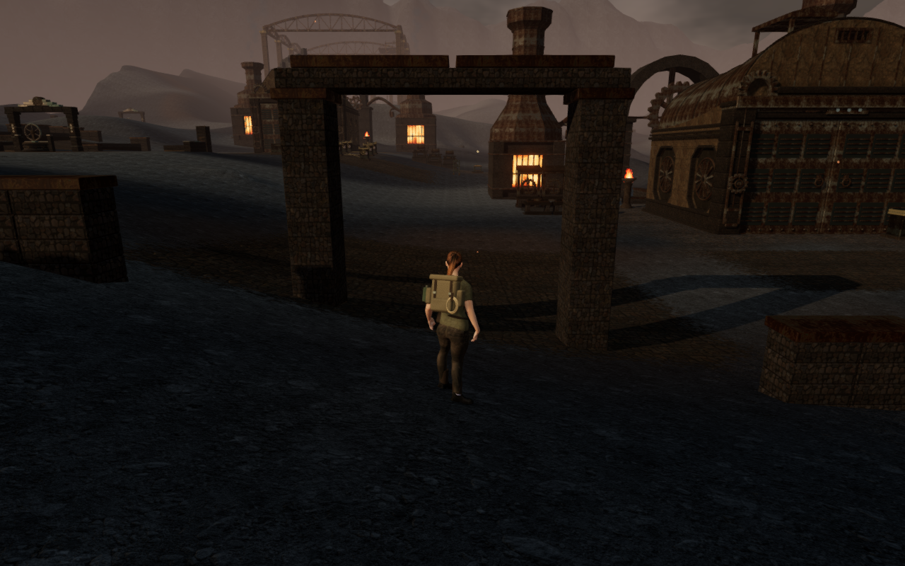
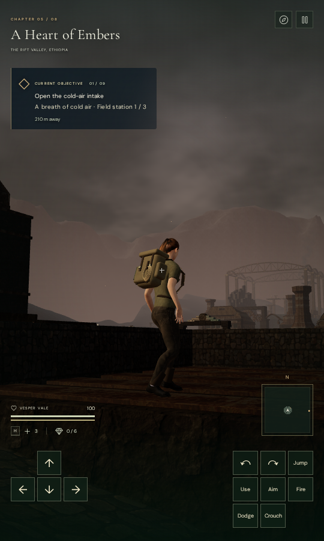

# Foundry forecourts

The volcanic chapter's main halls now open onto eighteen side courts and nine
front aprons. Worn paving, retaining terraces, loading partitions, covered
galleries, casting beds and an engine gateway give their broad approaches more
structure and walking space. Each main court has a different pair of layouts.

| Court        | Foregrounds                                   |
| ------------ | --------------------------------------------- |
| Receiving    | Loading partitions and retaining terraces     |
| Air          | Short covered gallery and two dry channels    |
| Fuel         | Bin partitions and a compact broken enclosure |
| Pressure     | Two casting channels and retaining terraces   |
| Gears        | Corner walls and a covered gallery            |
| Casting      | A casting bed and bin partitions              |
| Pilot fires  | Covered gallery and broken enclosure          |
| Quenching    | Dry basin and retaining terraces              |
| Heart engine | Gateway and casting bed                       |

The plan extends walking ground after objectives and routes are authored, so it
retains their IDs, coordinates and random generation. Foundations extend below
the terrain, and short wall sections follow its slope. Paving follows the actual
ground triangles with worn edges. Casting beds have closed bases and open fronts;
the galleries have solid piers and finite roofs.

Placement reserves existing routes, thermal approaches, field gates, water and
traversal courses. The air gallery fits between two parallel paths, while the
engine gateway stands beyond its junction. Neighboring courts reserve their
completed geometry before the next court is built. The fuel enclosure is compact
enough to leave the neighboring quenching basin clear. The basalt search also
tries more surrounding locations, retaining five formations with 201 columns in
the full level.

The rendered closed pieces also supply body contact, landing support and camera
obstacles. Roof contact stops a rising jump. The widened walking area does not
change the original objective paths or thermal working surfaces.

## Verification

All 72 selected campaign, terrain, thermal, station and forge tests pass.
New cases cover connected forecourt footprints, separate neighboring plans,
original path clearance, foundations beneath the delivered terrain, cap/support
agreement, casting-bed spacing, finite geometry and chapter-reference cleanup.
Bank checks include cell centres as well as vertices, retaining the original
minimum sample count, slope percentile and steep-sample limits as walking ground
replaces some former banks.

The full level contains 159 new wall sections and 98,841 triangles in 36 material
batches. All three galleries, seven beds and the engine gateway survive placement.
Its 27 new paving areas do not overlap one another or the 856 existing paving
pieces. Architecture bounds do not intersect across the new courts.

The assisted browser review covers all eighteen forecourt approaches and four
matched walking views. The final captures also cover the shortened air gallery,
compact fuel enclosure, neighboring basin, intake apron and relocated gateway.
The recorded body survey spans 166 standing/crouched poses and 32 sampled animated
jump frames. The affected neighboring courts were checked again after their
separation; the engine gateway was checked against the final layout. The combined
latest per-court results contain 9,522,810 finite body vertex records with no
penetration detected at the 15 mm threshold. Interior calibration points are
detected by the independent rendered-mesh observer.

All seven final development captures have finite HDR values, linked programs,
zero recorded WebGL errors and legal player positions. Changing chapters disposes
all 36 added geometries and four materials, and clears the forecourt references.
Source formatting, the production build and three CPU-budget guard tests pass.
Vite retains its existing large-chunk advisory.

Native production checks use keyboard at 1280 × 800 High and touch at 540 × 900
Performance. Both exercise Jump, crouch and walking, retain full health and
progress, and restore the complete localStorage save twice, excluding last-played
timestamps. The keyboard walk measures 1.5 metres through a gallery; the touch
walk measures 2.4 metres along the basin. All eight native captures are reviewed.
There is no horizontal UI overflow or application error/warning. The production
development hook is absent, served bundle names match the build, and six explorer
model responses match the repository asset hash.

Verification uses the locked shared five-CPU allowance, at most two test workers
and one browser at a time. Owned browsers and preview servers are closed after
their checks.

## Remaining scope

This is a foreground composition milestone. Repeated lower hall layouts, wider
landscape composition and broader moving or elevated contact coverage remain
open in the [playable-world audit](visual-audit.md). The targeted checks do not
establish that the full visual goal is complete.
