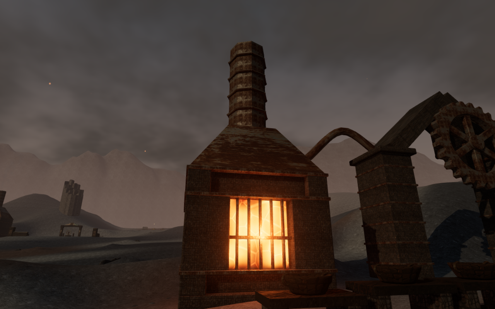
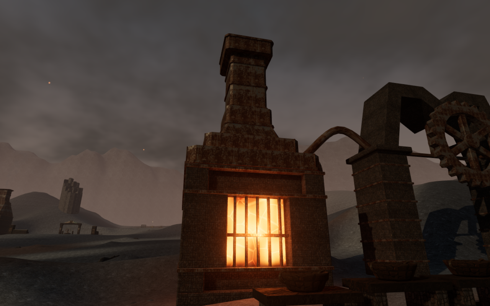
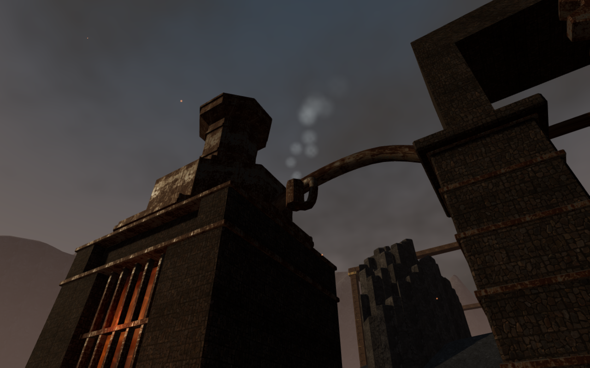
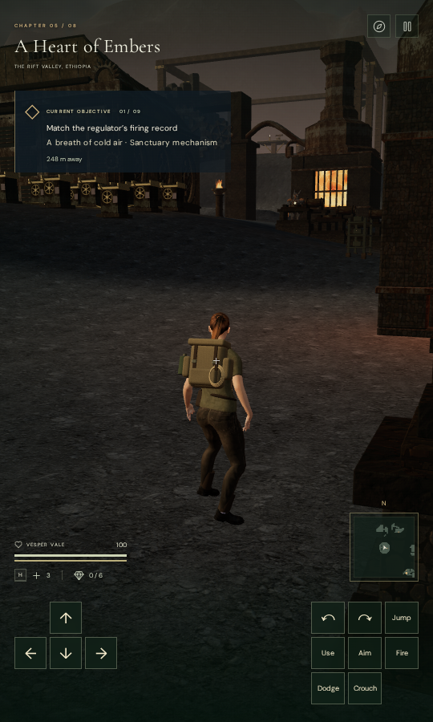

# Furnace profiles and fitted gantries

The nine main halls in A Heart of Embers now have different furnace and gantry
silhouettes. Eighteen hoods and stacks replace the repeated tapered hood and
straight flue. Their fittings retain the existing corroded metal and stone maps.

| Hall              | Furnace construction                              | Gantry               |
| ----------------- | ------------------------------------------------- | -------------------- |
| Arrival foundry   | Broad shoulders and a straight square flue        | Low trapezoid        |
| Cold-air manifold | Stepped recuperator shoulders and a narrowed neck | Segmented round arch |
| Ignition          | Tall tapered hood and narrowing flue              | Offset peak          |
| Pressure relief   | Octagonal pressure drum and necked stack          | Raised flat portal   |
| Gear jacket       | Outward-offset hood and exhaust                   | Paired peaks         |
| Smelting          | Broad stepped shoulders and banded square stack   | Stepped paired ridge |
| Eternal pilot     | Octagonal lantern and flared upper collar         | Pointed arch         |
| Tempering         | Bell shoulders and a necked upper flue            | Low broad lintel     |
| Heart engine      | Tall mantle with a raised stack collar            | Tall segmented arch  |

The metal skins have inner walls and real open throats. Bands fit the actual
profile at both ends, raised seams follow the hood panels, and horizontal steps
retain plate thickness. The smoke originates at each stack's actual outlet,
including the displaced exhausts. Gantry joints use fitted sections: an initial
browser survey exposed open wedges between independent rectangular beams.
The revised continuous masonry closes those wedges and suspends the gear shaft
from each profile's center bearing.

## Coolant and sound placement

The old coolant outlets sat under six of the new hood profiles. Connected
branches now run from the overhead returns to hollow vents beyond the hoods.
The visible steam and positional hiss share each vent's tip. Independent rays
check the bore and lip, and three upward rays at each of the 18 built outlets
clear the hoods and return pipes. The chapter retains its 45 machinery sources,
quiet steam gain, distance settings and adaptive music.

## Body clearance

The independent rendered-body observer found a pre-existing firebox collision:
legal front and outer-side poses embedded boots and clothing by up to 586.294 mm.
Eight recorded standing/crouched poses produced 105,867 embedded vertex records
beyond the 15 mm inspection threshold.

All 18 fireboxes now reserve a finite body margin of 0.65 m, including their
footings and projecting metal bands. The bounds end above the firebox and do
not create a support surface. Actual construction triangles describe the upper
hoods and gantries. Separate camera bounds preserve the open aisle and clear
space beside the narrower stacks. Existing arrival recovery relocates an old
save from an occupied boundary while retaining progress.

The final survey checks 144 settled poses across all 18 furnaces: front and
outer-side approaches, standing and crouching, facing toward and away from the
construction. None of the 6,925,680 rendered body vertex records penetrates the
closed construction by more than 15 mm. Calibration probes still detect the
wall interior. This result covers the sampled ground contacts, not moving or
raised approaches.

Fifty-four controlled route legs approach and return from all nine gantries and
18 furnace fronts, covering 471.7 m in 7,056 controller updates. Each finishes
with full health and full character visibility. Combat and rendering are
disabled for this controller/camera observer; objectives remain at their fresh
state. A first narrow endpoint search found no start at the arrival furnace.
The final search finds safe approaches around the workyards without changing
the application. The completed body results and first two route legs are
retained only after checking that application source hashes match.

## Verification and delivery

Twenty-six targeted tests cover furnace construction, forge state and sound,
workyard approaches and thermal objectives. Joint and camera changes pass the
13 directly affected geometry and forge tests. The production build passes
with its existing large-chunk advisory.

The final development review covers 73 views: 27 matched furnace/context views,
nine closer gantry views, 18 inactive vents, ten active cooling vents and nine
Low-quality furnace views. High output is finite, Low frames contain scene
pixels and sampled shaders link without page errors or application warnings.
Some context views crop one furnace; the individual views inspect both upper
assemblies in each hall. The initial inactive outlet captures had not advanced
the machinery fade, so the ten active views use a settled cooling state.

Reloading the same objective state reproduces the static construction position
bytes, plans and sound-source configuration. Reload and chapter change each
release all 162 watched forge resources exactly once; the jungle retains no
forge patches, sources, lights or shared forge references.

The production build passes keyboard input at 1280 × 800 on High and portrait
touch input at 540 × 900 on Low. The keyboard save starts at the reproduced
occupied firebox boundary and recovers 0.75 m to clear ground. The clear touch
save stays at its saved position. Both preserve objective progress and health.
Keyboard movement covers 1.5 m; touch movement covers 2.1 m. Crouch, look, jump
and map inputs are exercised, ending grounded with full health. Each case passes
two whole-save reload comparisons, excluding only the play timestamp.

The served character matches the delivery file, and the loaded bundles match
the build. All eight native captures are reviewed without page errors,
application warnings or horizontal UI overflow. These are automated checks
from prepared saves with combat enabled and audio muted.

The four documentation images are lossless WebP exports of actual game captures
with identical decoded pixels and dimensions. The paired smelting views share
the same observer and simulation time. Development views hide the explorer;
the active vent uses prepared completed objectives. The portrait shows the built
game after native input and reload, with the pause dialog hidden for capture.
Builds, tests and browser helpers share the locked five-CPU allowance. Owned
browsers and preview servers close after verification, and temporary runtime
profiles are removed.

The renderer is Mesa llvmpipe through ANGLE/Vulkan. These automated checks do
not establish consumer GPU performance, subjective listening quality, or a full
human playthrough. Broader chamber layouts, landscape composition, moving and
raised body contacts, device coverage and listening acceptance remain open.
