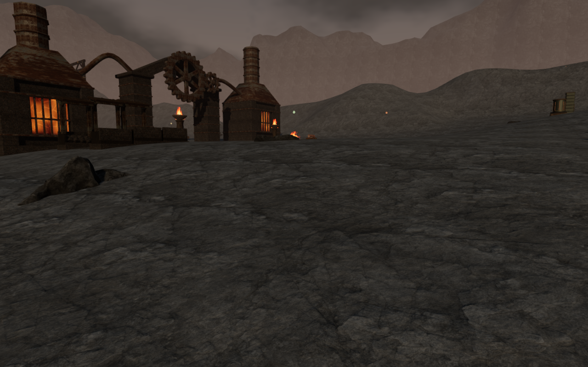
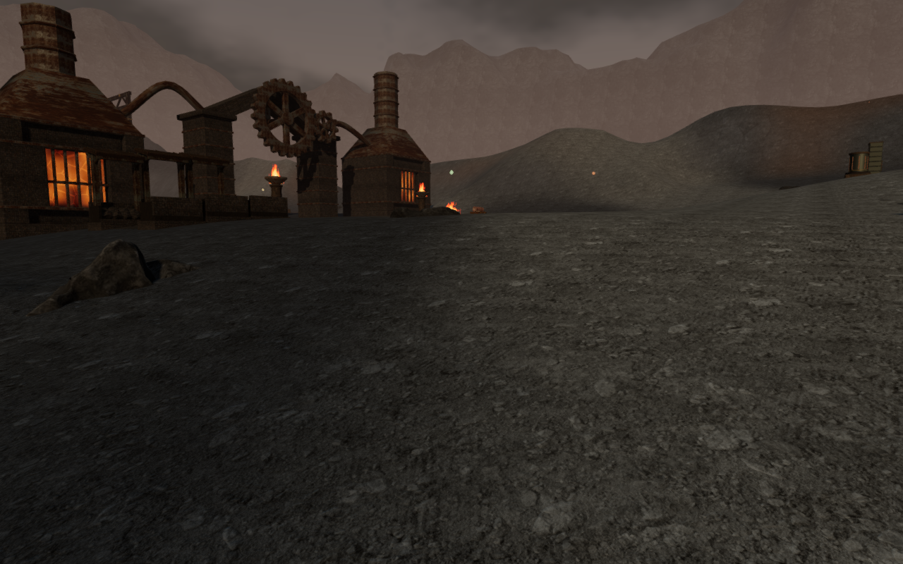
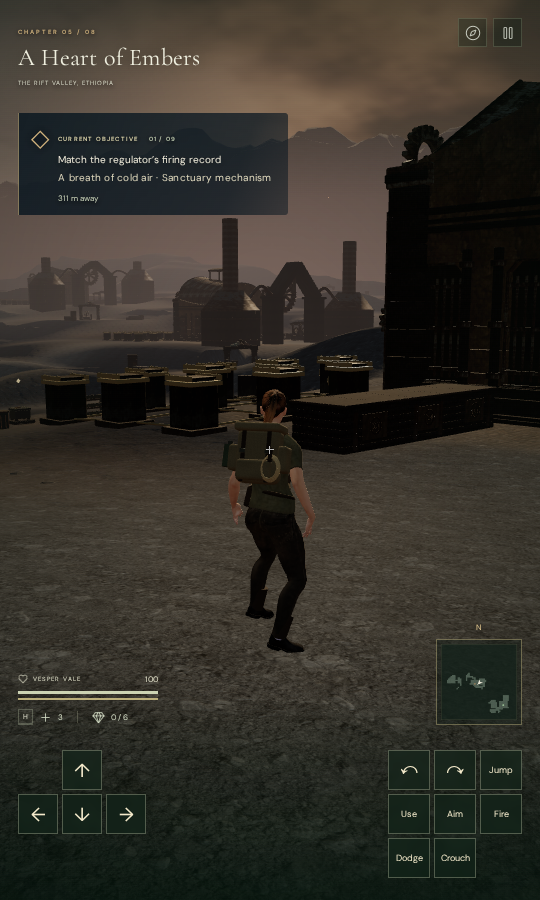

# Gravel and ash in A Heart of Embers

The forge flats now have smaller stone fragments, charcoal tones, pale ash
drifts and restrained rust-colored patches. Their grain differs from the
larger rock faces on the banks. World-space variation breaks up the repeating
scan across the ground, while court paving retains its separate material.

These matched views use the same chapter, observer camera, lighting and
simulation time. The first restores the preceding terrain shader, map selection
and UV scale within the current world. It is a material comparison, not a
separate capture of the entire preceding release. The character is hidden.

## Material and attribution

The ground uses [Rocks Ground 09 by Rob Tuytel](https://polyhaven.com/a/rocks_ground_09),
published by Poly Haven under [CC0](https://polyhaven.com/license). This is a
gravel scan; the charcoal, ash and iron-oxide interpretation comes from the
project's terrain shader. It is not presented as a scanned lava flow.

The three color, OpenGL normal and roughness JPEGs retain their 2048 × 2048
dimensions and use a three-meter repeat. They are recompressed at quality 90
for color/roughness and 95 for normal, with 4:4:4 sampling. The delivery files
total 7,919,717 bytes. Original and delivered hashes, sizes and conversion
settings are recorded in the [source manifest](../asset-sources/forge-ground/sources.json).

The new maps replace the three flat-ground texture objects. The terrain still
uses nine texture objects across its ground, paving and cliff layers, and 81
mesh chunks. The distinct maps add approximately 7.9 MB of unique download data;
the existing cliff maps remain in use. No memory reduction is claimed.

Ash softens the ground normal and raises roughness gradually. Sparse warm
staining follows broad noise contours. The treatment does not displace vertices
or alter terrain heights, collision surfaces, paths or saved positions.

## Verification

All 26 selected terrain, geology, forge-art and workyard checks pass, including
delivery-file hashes, dimensions and attribution records. Formatting and the
production build pass; the build retains its existing large-chunk advisory.

The final development survey reviews 31 captures: paired earlier/current
materials at all nine court fronts and five closer ground views, followed by
three Low views. Sampled shaders link, High output is finite, and Low frames
contain scene pixels. There are no page errors or application warnings.

Reloading reproduces the terrain position, normal, court and trail bytes.
Reload and chapter change each release all 91 watched terrain resources
exactly once: 81 geometries, one shared material and nine textures. The jungle
does not retain the volcanic shader define.

The timing observer used Mesa llvmpipe software rendering through ANGLE/Vulkan.
Sixteen-frame windows in earlier/current/current/earlier order averaged
1179/1099/1176/1188 ms on High and 845/749/874/729 ms on Low. These variable
software-renderer results do not establish consumer GPU performance or a speedup.
Draw submissions and triangle counts were identical within each quality setting.

The built game passes native keyboard input at 1280 × 800 on High and portrait
touch input at 540 × 900 on Low. Both prepared natural-ground arrivals remain
in place and retain objective progress. The explorer walks 1.5 m and 2.1 m,
respectively; crouch, look, jump, landing and map controls pass with full health.
Each case passes two whole-save reload comparisons, excluding only the play
timestamp. The served character matches the delivery file, the loaded bundles
match the build, and the built ground maps match their recorded hashes.

All eight release captures are reviewed with no page errors or application
warnings. These are automated Chromium checks from prepared saves, with combat
enabled and audio muted; they do not establish listening quality or a complete
human playthrough.

The three documentation images are lossless exports of actual game captures,
with identical decoded pixels and dimensions. The portrait uses the built
game's follow camera, with its pause dialog hidden for the photograph.
All verification shares the locked five-CPU allowance. Owned browsers and
preview servers close after their checks, and temporary profiles are removed.

The broader visual audit remains open: larger landscape composition, remaining
construction and body-contact findings, device coverage and listening acceptance
still require work. This pass establishes a local ground-material improvement.
