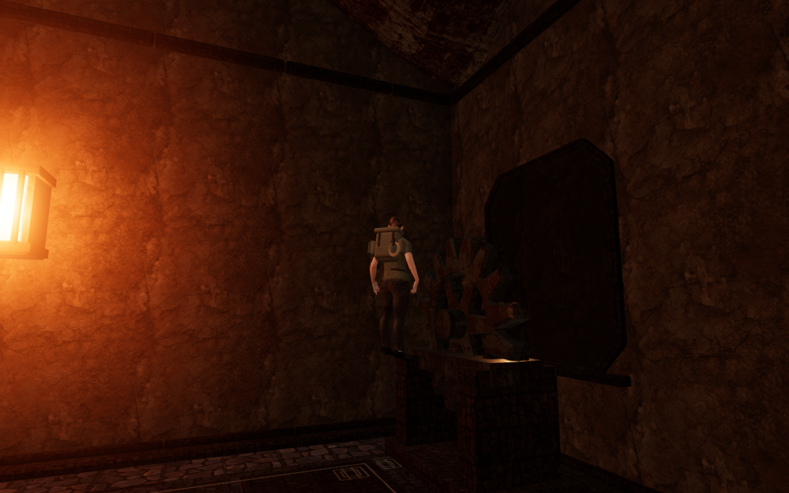
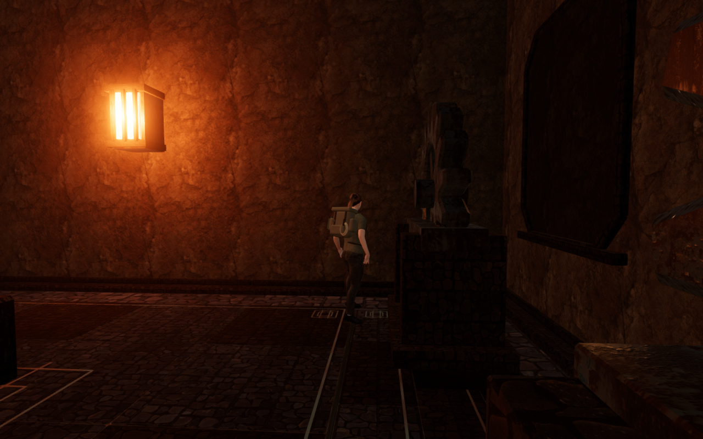

# Service-hall landing contact

Jumping toward either gear stand or the smelting hopper could leave the explorer
standing beside raised iron with both boots suspended above the visible floor.
The character controller considered these positions legal. The independent
rendered-surface check reproduced six standing/crouched cases, with each boot's
lowest sampled sole point between 0.68 and 1.47 metres above its receiving surface.

The service furnishings now use the normal 55 cm movement disk for landing
support, while retaining their 80 cm body-clearance margin. The wider shoulder
margin no longer catches a ledge beyond the boots' resting reach. Actual machinery
tops still supply point support, and the bench, casting beds and trough retain
their jump landings and walk-offs.

These are actual development captures from the initial and revised jump results.
Their follow cameras frame their respective player positions; they are not fixed
observer-camera comparisons.

## Verification

The retained regression fails against the former landing footprint. It checks
the two gear-stand witnesses and hopper witness, settling from the former hovering
heights, and jump/landing/walk-off motion at the four low service furnishings.

The revised controller survey attempts all 23 floor assemblies in the eight
halls, using an available inward or side approach. All 6,900 updates have legal
roots and all 23 return to their starting positions. Tall fixtures stop the
ordinary jump; the four low furnishings retain elevated landings. A controller
root being legal is only one part of this check: delivered-body and rendered
sole contact are inspected separately.

The final rendered survey checks 18 standing/crouched poses at nine recorded
jump results: 865,710 visible body vertex records, with no invalid coordinates
or penetration beyond the 15 mm inspection threshold. Independent rays through
the delivered soles find at least one planted boot in every pose; the largest
minimum planted gap is 6.01 mm. All nine final follow-camera captures are reviewed,
with finite HDR output, linked shaders and no recorded WebGL error.

Three animated jump replays cover the repaired gear and hopper approaches.
All 72 sampled frames retain legal roots and have no detected embedding or
invalid positions across 3,462,840 additional visible body vertex records.

All 19 selected interior, forge, wall, roof and station-foothold tests pass,
together with three CPU-budget tests, formatting and the production build.
The build retains its existing large-chunk advisory.

Native production checks start from the older hovering gear-stand and hopper
saves. Keyboard input uses 1280 × 800 High; touch input uses 540 × 900 Performance.
Both arrivals recover nearby with progress intact, settle onto a stair tread,
and pass Jump, crouch and walking with full health. Recorded walks cover 1.5 m
and 2.4 m. Each case restores the complete settled localStorage save twice,
excluding only last-played timestamps. All eight native captures are reviewed.
There is no application error, warning or horizontal UI overflow. Production
has no development hook; served bundle names match the build and all six
explorer-model responses match the repository asset hash.

Verification shares the locked five-of-sixteen CPU allowance, with at most two
test workers and one browser at a time. Owned browsers and preview servers close
after checks; their temporary profiles are released. The two documentation WebPs
preserve their source captures' decoded pixels and dimensions.

## Scope

This repairs the reproduced unsupported resting positions. Broader continuous
routes, other airborne contacts and wider landscape composition remain open in
the [playable-world audit](visual-audit.md).
