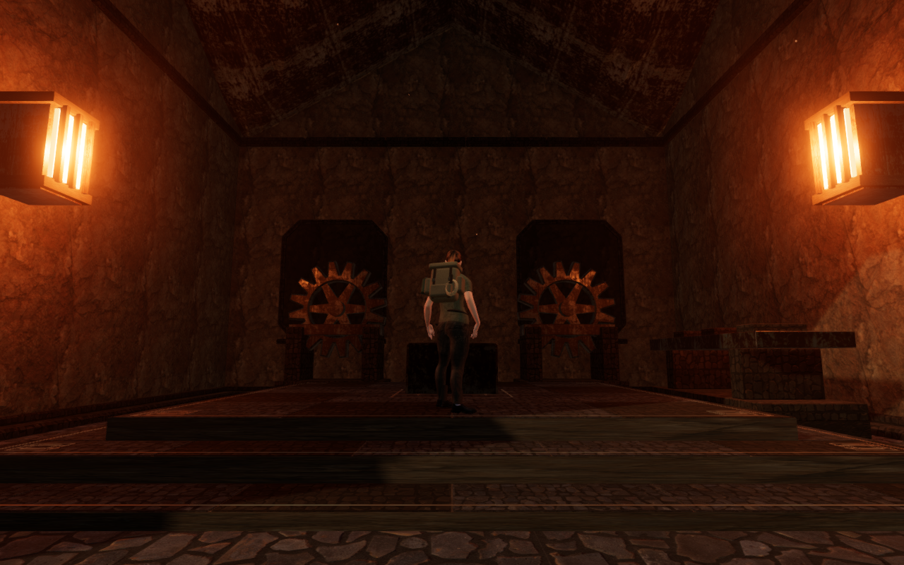
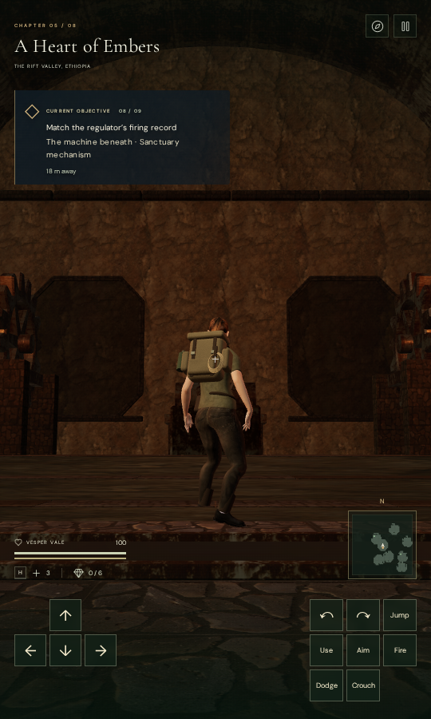

# Foundry service halls

The eight volcanic objective chambers now have different internal service
layouts around their original controls. Twenty-three fitted assemblies give the
rooms recognizable working areas while retaining their front approaches.

| Chamber         | Interior                                                |
| --------------- | ------------------------------------------------------- |
| Cold-air intake | Paired rear duct stacks beyond the counterweight puzzle |
| Ignition        | Unequal banks of freestanding refractory baffles        |
| Pressure        | Three sealed pressure vessels with inspection dials     |
| Gear drive      | Two gear stands and an offset inspection bench          |
| Smelting        | Two casting beds opposite a raised feed hopper          |
| Pilot fires     | Four burner columns around an open central aisle        |
| Tempering       | Rear cooling-fin banks and a side service trough        |
| Heart engine    | Large opposing impellers and a rear axle cradle         |

Each assembly has a foundation extending beneath the lowest floor tread and a
level plinth seated across the highest. Closed meshes supply body collision, camera
contact and landing support before they are combined into material batches.
The original objective IDs, positions and gate rules remain in place.

Sixteen barred wall lamps illuminate the rooms using the forge's existing two
local light slots. The lamp faces are emissive, and the nearer fittings compete
with the existing furnace sources for those slots. The change adds four shared
materials and 32 render batches; it adds no light slots, audio loops, textures,
dependencies or external assets.

## Verification

All 13 selected interior, forge-state, wall and roof tests pass. The new checks
cover all eight layouts, clear front approaches, seated foundations across
shallow steps, agreement between rendered caps and physical support, finite
overhead bounds, and selection of nearby lamps. Formatting, the production build
and three CPU-budget guard tests also pass. Vite retains its existing large-chunk
advisory.

The initial contact survey found boot penetration beside several banks and the
axle cradle, reaching 84.65 mm. A plinth cap slightly above the neighboring stair
tread became the body's support surface, causing foot placement to reach toward
the furnishing's raised trim. Seating the 20 cm plinths just below the next
tread keeps that tread as the walking surface. A regression check covers this
support selection. The fixtures also reserve an 80 cm body/support margin; the
ignition banks are narrower to preserve their aisle. Each gear uses one closed
six-arm web instead of overlapping bars.

The final browser survey covers 46 standing/crouched contact poses across all
23 floor assemblies: 2,212,370 finite body vertex records with no penetration
detected at the 15 mm threshold. The independent observer detects the interior
calibration points and all 18,840 nondegenerate triangles form closed components.
All 23 sampled older positions occupied by new furnishings recover to legal
nearby positions.

Sixteen assisted entry/return walks cover 118.7 metres with full health. All eight
final walking views are reviewed, with finite HDR values, linked programs, zero
recorded WebGL errors and legal player positions. Changing chapters disposes all
32 added geometry batches and four materials, and clears the interior references.
The final run has no application errors, warnings or unexpected navigation.

Native production checks use prepared saves with keyboard input at 1280 × 800
High and touch input at 540 × 900 Performance. Both exercise Jump, crouch and
walking, retain full health and progress, and restore the complete localStorage
save twice, excluding last-played timestamps. The keyboard walk measures 1.5
metres; the touch walk measures 2.1 metres. All eight native captures are
reviewed. There is no horizontal UI overflow or application error/warning. The
production development hook is absent, served bundle names match the build,
and six explorer-model responses match the repository asset hash.

Verification uses the locked shared five-CPU allowance, at most two test workers
and one browser at a time. Owned browsers and preview servers close after checks.

## Scope

This is an interior furnishing and lighting milestone. It does not establish
human playthrough duration, consumer-hardware performance, subjective audio
quality or AAA graphics. Wider landscape composition and broader moving and
elevated contact coverage remain open in the [playable-world audit](visual-audit.md).
