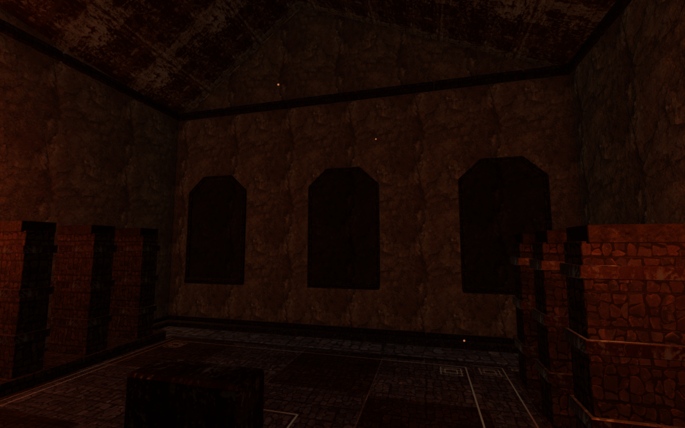
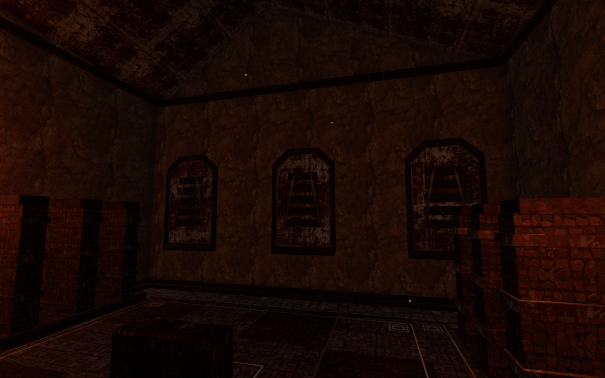
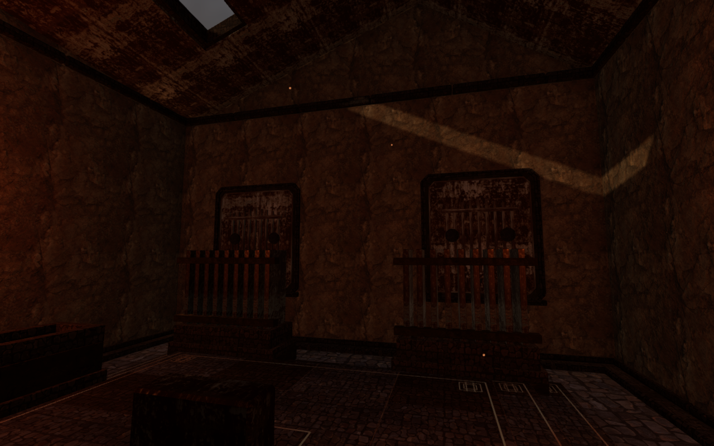
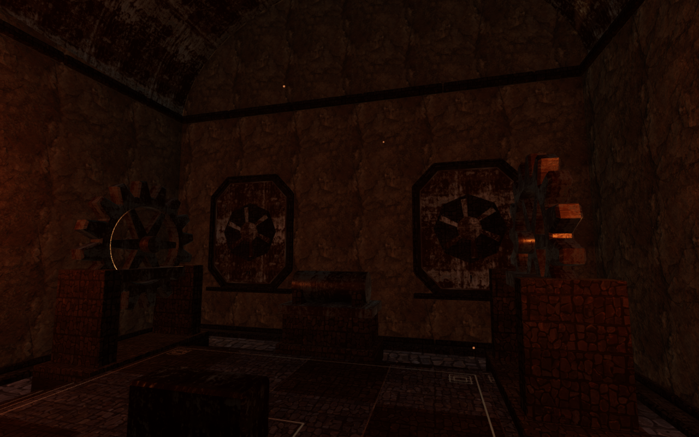

# Service covers inside the forge chambers

The forge's inner rear walls had plain, dark panels behind their working
machinery. Twenty-one fitted service covers now give those panels construction
and detail related to each chamber's job. Existing frames hold cast plates,
hinge lugs, fasteners and the appropriate mechanical fittings.

| Chamber | Inner service construction |
| --- | --- |
| Cold-air manifold | Tilted louvers on paired rails |
| Ignition galleries | Refractory baffles with diagonal keeper bars |
| Diagonal relief | Pressure casing, flange bolts and diaphragm cover |
| Gear jacket | Ribbed inspection casting and axle access cap |
| Smelting feeds | Paired mould leaves, rails and cross clamps |
| Eternal pilot | Three collared service lines and a common header |
| Tempering cradle | Cooling ribs, straps and paired access caps |
| Heart-engine balance | Octagonal casing with swept cover ribs |

These are stationary service fittings. They use the existing credited stone
and weathered-metal materials; the geometry is original project work. The
existing objectives, room outlines and wall frames retain their construction.

## Construction

Each cast plate enters its existing inset backing. Its smaller contour leaves
the old surround visible. Raised fittings connect to that plate through their
own closed bases, rails, castings or straps. Every sampled vertex remains
inside the existing inner profile and the old sill's 0.57 m depth reservation.
The camera captures the fittings before the wall's existing material batching.

The first rendered covers repeated the same conspicuous paint-loss patch.
Per-chamber and per-bay texture offsets now vary the cast plates while
preserving the map's scale and grain direction. They still share the existing
metal texture and its [attribution](asset-credits.md).

## Verification and remaining work

The construction tests inspect eight representative designs containing 258
closed parts and 5,004 triangles. Actual vertex/edge and triangle queries form
an attachment graph rooted at each backing plate. All parts connect to that
plate; moving one fastener forward breaks its connection in all eight controls.
Independent rays through all 21 assembled inner bays meet the raised fittings
at their existing reserved depth, with matching camera interception after
batching. Neighbouring-cover checks verify that texture placement changes
without changing plate positions, normals or texel scale.

All 49 selected tests across eleven files pass, together with three CPU-guard
checks. They cover the new construction, all 24 forge wall faces, vaults,
furnishings, movement, all 69 gates, sealed recesses, moving-door collision,
field-save restoration, campaign persistence, audio, rendering settings and
chapter startup. The production build passes with its existing large-bundle
advisory.

A comparison with `f038d7a` retains 49,932 rear-wall exterior triangle records
across the eight forge chambers. Material names, positions, normals and UVs
compare equal after sorting at 10⁻⁵ quantization. A separate comparison builds
54 walls from the six other wall themes, covering stages 0, 4 and 7 on three
sides at a 13 m span. All attribute/index bytes, material names, transforms and
returned measurements compare equal across those 549,712 triangles. These
checks cover the specified construction samples, rather than the entire world.

Eight preceding, seventeen draft and seventeen final room/detail/preset/controller
captures are reviewed. The final eight room observers retain the preceding
player/camera positions, clock and High settings. The magnified studies include
the baffle, gear and heart covers; Medium and Low repeat the gear chamber. All
final frames have linked shaders and finite buffers, with no recorded errors or
warnings. The final survey freezes 590 source/runtime-asset hashes; all 115
runtime assets retain their preceding bytes.

The normal follow, 3.64 m assisted walk and crouch/stand return sequence retain
full health, legal body/camera positions and an opaque avatar. Crouch blending
reaches 0.999775 and returns below 0.000225. Enemy simulation is not advanced
during the assisted walk. Replacing the forge chapter with the desert disposes
all 251 tracked gate geometries, materials and textures exactly once each;
the replacement world retains none of them. The browser and preview close
afterward.

Production keyboard and touch checks move 2.1 m and 3.0 m, retain full health
and each pass one whole-store reload comparison, excluding only per-chapter
`lastPlayed`. Their disposable fixture selects stage 3 and marks its field work
complete; those tasks are not earned by the check. Both cases use Low at a
360 × 600 CSS viewport and 0.5 pixel density. All four served JS/CSS response
hashes match the build, the development hook is absent, and requests/console
report no errors or warnings. Four native UI captures are reviewed separately
from the full-resolution figures above. The entry/game chunks are
`index-7H8q1QMX.js` and `game-Y1bP_7Nc.js`. Both browsers and the production
preview close after verification.

The four documentation figures preserve the complete 1280 × 800 capture pixels
through lossless WebP conversion. All verification shares the locked 5/16 CPU
allowance, with at most two test workers and one browser at a time.

The surrounding forge rooms still have broad dark masonry, repeated equipment
and simple material transitions. These covers improve a local interior surface;
they do not establish the whole playable world's polish. Broader landscape and
chamber composition, unseen snow interiors, continuous placement/contact review,
subjective listening quality and consumer-device performance remain open.
