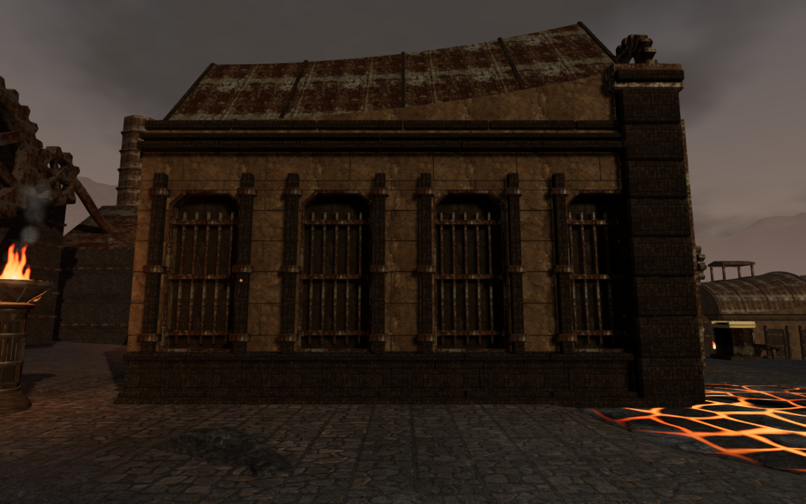
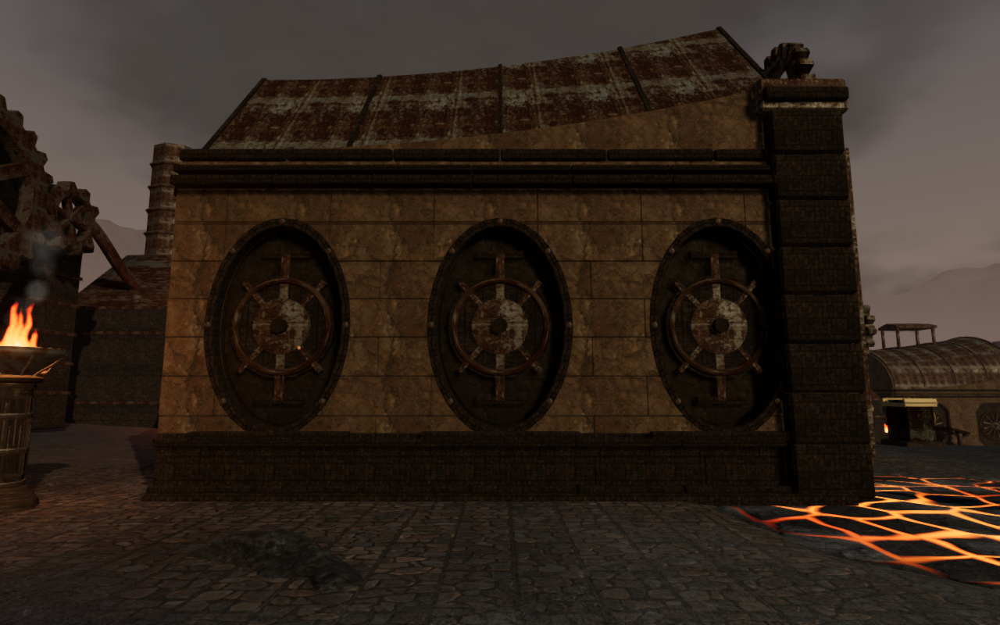
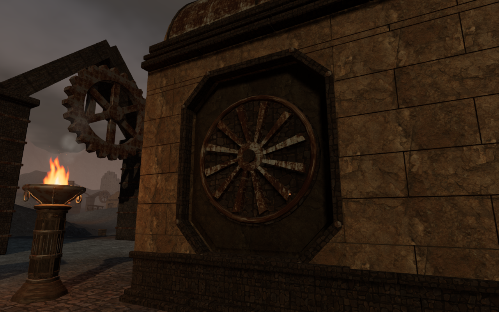
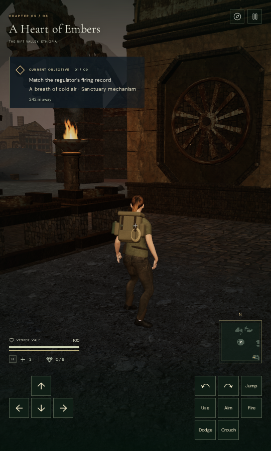

# Task-specific forge chamber walls

The eight objective chambers in A Heart of Embers now have wall fittings that
reflect their different jobs. Sixty-three recessed bays across 24 side and rear
walls replace the repeated vertical grilles. Wider gear and engine cases use
two bays per wall; the other installations use three.

| Chamber              | Wall construction                                         |
| -------------------- | --------------------------------------------------------- |
| Cold-air manifold    | Tilted intake louvers on vertical rails                   |
| Ignition galleries   | Tapered recesses with alternating heat baffles and stays  |
| Diagonal relief      | Oval pressure beds, diaphragms, stems and crossed stays   |
| Gear jacket          | Broad inspection cases with toothed wheels and six spokes |
| Smelting feeds       | Tapered feed moulds, central seams and horizontal clamps  |
| Eternal pilot        | Four capped burner registers on paired feed lines         |
| Tempering cradle     | Broad cooling fins with two coupled ports                 |
| Heart-engine balance | Swept impeller blades inside octagonal cases              |

The cold fittings are stationary, set into sealed recesses with textured stone
backs, dressed surrounds, fasteners and sills. The geometry is original project
work using the existing credited stone, paving and corroded-metal materials.
The wider profiles also change the proportions of the shallow inner rear-wall
panels. The chamber footprints, roof profiles and objective locations remain
the same.

## Construction checks

Each new fitting has finite vertices, closed oriented edges and outward volume.
Its depth stays behind the existing exterior cornice and inside the wall core.
The wall builder cuts the masonry around the same contour used by the inset
and surround. Independent rays sample 1,890 positions across the 63 built bays,
checking sealed backing and camera interception after material batching.

The broader chamber regression retains its original probes and adds samples
around the forge's larger cases and diaphragms. The old central probe locations
now encounter fittings; the added surrounding samples still verify the recessed
backing with the original depth thresholds.

The visual comparison uses the same legal ground-level observers and simulation
time before and after the wall replacement. All 24 baseline views and 40 revised
views are reviewed: three faces of each chamber, eight closer oblique views and
eight Low views. High output is finite, Low frames contain scene pixels and
sampled shaders link without page errors or application warnings.

## Body clearance

The independent body survey found a legal boundary position that embedded boots
and lower clothing in a chamber foundation. Twelve recorded standing/crouched
poses at one bay approach on each of its three walls produced 36,656 embedded
vertex records beyond the 15 mm observer threshold, reaching 144.816 mm. These were actual rendered
body samples checked against closed construction triangles.

Forty finite wall and jamb bounds now reserve a 0.65 m body margin across all
eight forge chambers. The bounds include the buried wall footings and end above
the masonry. Existing arrival recovery handles a saved position that is now
occupied without changing objective progress.

The revised survey checks 96 poses at one bay approach on each of the 24 walls,
standing and crouching while facing toward and away from the wall. None of the
4,617,120 rendered body vertex records penetrates the closed construction by
more than 15 mm. This is a settled wall-contact survey; moving, raised and
other bay approaches are not covered by that result.

## Automated checks

All 37 targeted tests pass, covering the new fittings, sanctuary gates, forge
vaults and thermal objectives. Three CPU-budget tests confirm that threads,
children and nested commands retain the shared allowance. New-file formatting
and the production build pass; the build retains its existing large-chunk
advisory.

## Routes and resource lifetime

Sixteen controlled route legs enter and return from all eight chambers, covering
243.7 m in 3,644 controller updates. Each finishes with full health and full
character visibility. These checks use prepared completed objectives with
combat disabled; rendering is disabled for the route observer.

Reloading the same objective state reproduces the static chamber position bytes
and wall plans. Animated dust is excluded from the construction comparison.
An earlier observer changed progress before reloading, cooling the slag and
changing buried footing heights; that comparison was invalid for stability.
The corrected check preserves progress and observes only the dust changing.
Reload and chapter change each dispose of all 243 watched gate resources
exactly once, and the jungle does not retain forge wall designs.

## Built-game input and persistence

The built game passes keyboard input at 1280 × 800 on High and portrait touch
input at 540 × 900 on Low. The keyboard fixture starts at the reproduced occupied
wall boundary; arrival recovery moves it 0.75 m to clear ground. The touch
fixture starts clear and remains at its saved position. Both retain objective
progress and full health.

Keyboard and touch movement cover 1.5 m and 2.1 m, respectively. The checks
exercise crouch, look, jump and map inputs and finish grounded with full health.
Each case passes two whole-save reload comparisons, excluding only the play
timestamp. The served character matches the delivery file, and loaded bundles
match the production build. All eight native release captures are reviewed
without page errors, application warnings or horizontal UI overflow.

These are automated Chromium checks from prepared saves, with combat enabled
and audio muted. The renderer uses Mesa llvmpipe through ANGLE/Vulkan; this
check does not establish consumer GPU performance, listening quality or a full
human playthrough.

The four documentation images are lossless WebP exports of actual game captures
with identical decoded pixels and dimensions. The development images use legal
observer cameras with the character hidden; the paired pressure-chamber views
retain the same observer and simulation time. The portrait uses the built
game's follow camera with its pause dialog hidden for the photograph.

All verification shares the locked five-CPU allowance. Owned browsers and
preview servers close after their checks, and temporary profiles are removed.

The broader visual audit remains open. Chamber floor plans, rear furnace
composition, other body contacts, device coverage and listening acceptance
still require work.
