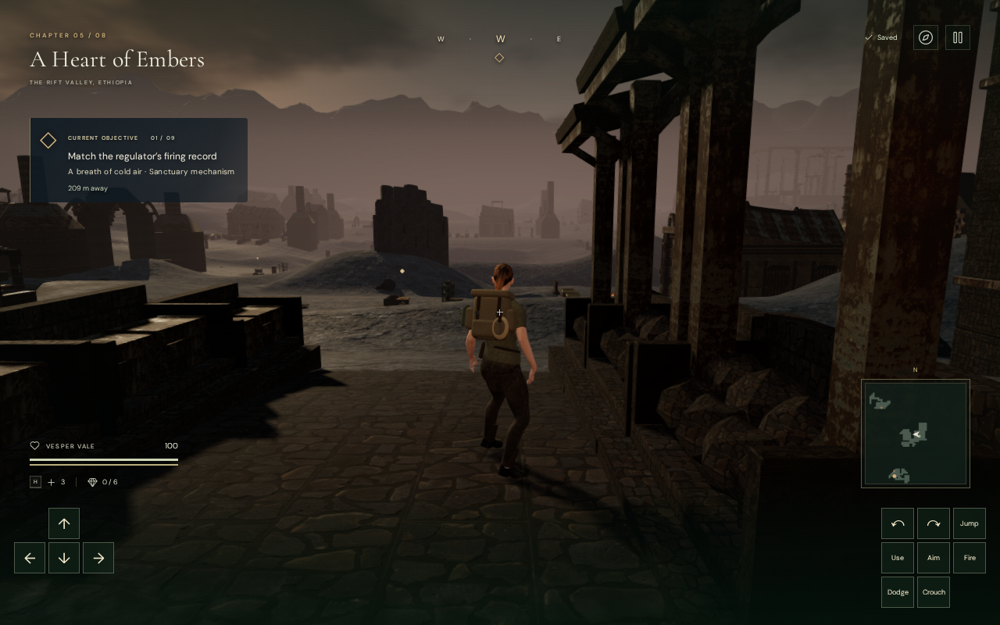
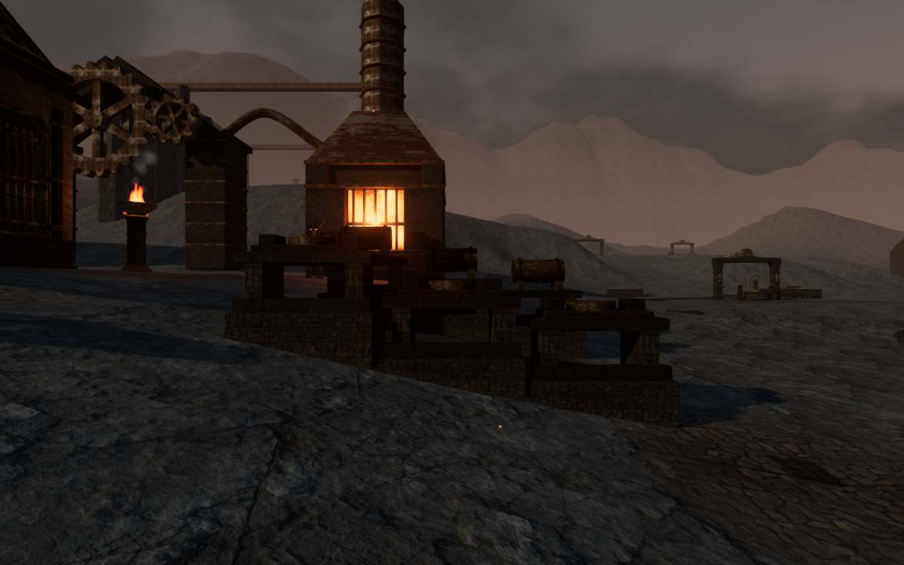
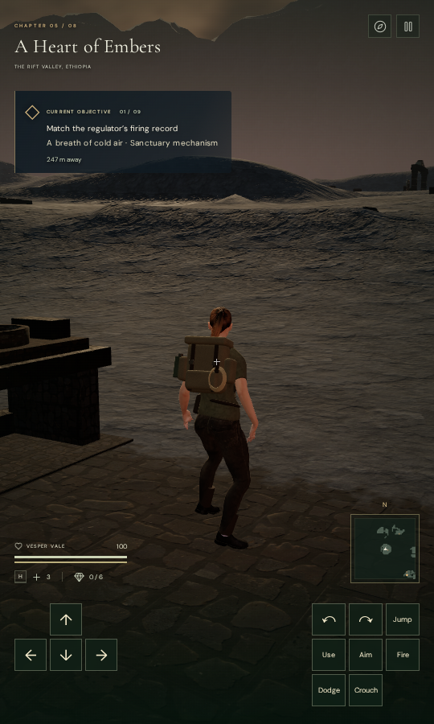

# Foundry workyards in A Heart of Embers

Nine furnished workyards give the volcanic courts signs of their different
jobs: expedition supplies, air conduits, ignition fuel, pressure casting, gear
fitting, smelting, pilot bellows, tempering and engine assembly. Ore and ingot
bins, pipe cradles, crucibles, casting moulds, anvils and cooling troughs sit
along open working aisles. Five yards have pitched shelters over one row.

## Construction and placement

Each yard has two rows of three independently seated bays. The 54 foundations
follow the volcanic slopes instead of imposing a single tall, level platform.
Their bases extend below the terrain, and their tops clear the highest terrain
lattice corner covering each footprint. Paving follows the actual terrain
triangles. The original terrain heights and map are unchanged.

The original meshes use the existing credited stone, metal and court materials.
Pipe bores include inner walls and annular ends; crucibles have solid bottoms
and visible interiors. Roofs, braces, tools, stored materials and foundations
have closed physical surfaces. Each part's tilt and scale are baked before
registering its collision triangles and camera bounds. Rendering then merges
parts by material: 48,225 triangles in 45 batches, with four shared cloned
materials and the existing paving material. These counts are not performance
measurements. No downloaded asset, texture, audio, dependency or save-schema
change is added.

Placement reserves the main walking paths, traversal areas, objective and
discovery spaces, water, older obstacles and thermal-focus camera approaches.
The later scanned-rock placement pass also respects the new furnishings.

## Verification

All 39 selected JavaScript checks pass, along with the three CPU-budget guard
checks, formatting and the production build. The new tests cover finite,
closed, outward geometry; real pipe bores; foundations against rendered terrain;
physical support and blocking; retained path samples; paving contact; material
batching; deterministic placement; and no workyard allocation in the other
seven chapters. The build retains the existing large-chunk advisory.

The full chapter creates all nine yards. Independent containment checks against
actual closed render geometry examine 72 standing and crouched poses at the
18 middle-bay front approaches, facing both ways. None of the 3,462,840 sampled
character vertices penetrates more than the 15 mm observer tolerance. This is
a settled front-contact survey, not an all-sides or airborne-body claim.

Nine assisted aisle walks cover 86.07 m in 1,287 player/camera controller steps,
retaining full health and character opacity. They use prepared progress with
combat disabled. Reloading preserves the placement and geometry manifest;
reload and chapter change each dispose of all 50 tracked workyard geometries
and referenced materials exactly once. The jungle retains no workyard records.

Thirty-three final High/Low development captures are reviewed, including all
court fronts, furnishing fronts and aisle views. Output is finite, sampled
shaders link, and Low framebuffers contain scene pixels. These are prepared
legal ground observers with the character hidden, separate from the native
release views.

The built release's High keyboard case starts from a position proved legal in
the preceding version and now occupied by an ore workbench. Existing arrival
recovery moves the explorer 2.25 m to clear ground while preserving objective
progress. Movement, crouch, jump, look and map controls pass, as do two whole-save
reload comparisons excluding only the play timestamp.

The Low portrait touch case at 540 × 900 starts in the engine assembly aisle,
retains that arrival position, and passes the same controls and two reload
comparisons. The keyboard case uses 1280 × 800. All eight release captures are
reviewed; served character bytes and bundles match the build, with no development
hook, page error or application warning. These are automated muted Chromium
checks from prepared saves.

The three documentation images are lossless exports of actual game captures,
with identical decoded pixels and dimensions. The casting-yard image uses a
prepared observer; the two release images use the follow camera and hide the
pause dialog only for the photograph.

All verification workloads share the locked five-CPU allowance. Owned browsers
and previews close after their checks, and their temporary profiles are removed.

The workyards improve local foreground detail. Wider volcanic composition,
sparse terrain, repeated lower chamber arrangements, broader moving/raised body
contact, consumer-device performance and subjective sound acceptance remain
open. Automated muted Chromium checks do not establish those qualities or a
human full playthrough.
