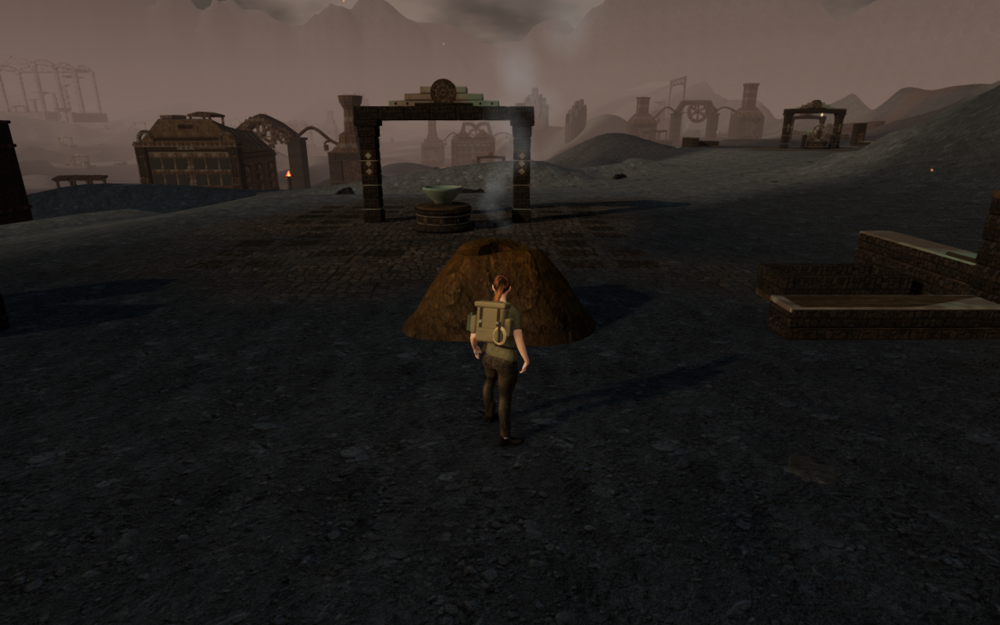
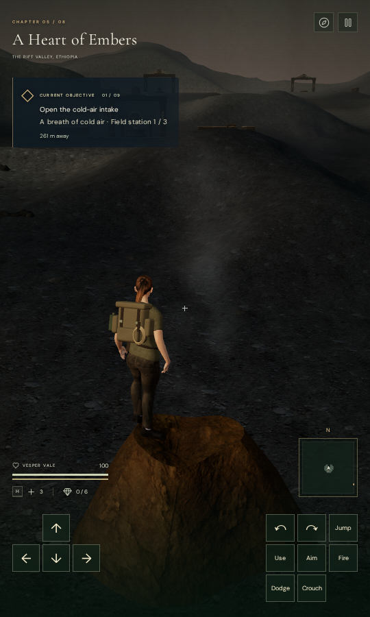

# Geothermal vents in A Heart of Embers

Seven mineral-coated vents add natural landmarks between the foundry courts.
Their hollow mouths release drifting steam with a low-level positional hiss. The
original closed rock geometry uses the credited Rock Face 03 maps; no texture,
recording or dependency is added.

Placement reserves the authored route centerlines, thermal work areas, climbing
projections, discoveries, water and existing masonry. Eight walking-collar
samples surround each vent, and a buried underside meets the sloping ground.
Mineral staining varies around the lip. The bore is a real opening with terrain
visible below it; camera, body, sight and sound queries use the same closed rock
surface.

The seven rocks contain 2,688 opaque triangles. They share one cloned material;
each has a separate steam plume. Twenty-eight softer particles per plume avoid
the initial effect's conspicuously spaced puffs. Steam follows the existing
paused forge clock. Each sound source sits above its mouth, reuses the
synthesized steam voice and fades over an 18 metre range. The existing voice
limit and chapter/objective music continue to apply.

## Verification

All 18 selected geometry, forge and audio tests pass, together with three
CPU-budget tests, formatting and the production build. Vite retains the existing
large-chunk advisory.

The delivered-character survey covers 112 standing/crouched poses at the four
sides of all seven vents, plus 28 poses on their rims. All 6,733,300 inspected
visible body vertex records are finite and have no detected embedding beyond the
15 mm threshold. Independent rendered-surface rays find a planted sole in every
resting pose. Seven ordinary approach jumps, their walk-offs and seven assisted
vertical landings retain legal roots throughout 2,940 controller updates. Seven
simulated older positions inside the new rocks recover to legal nearby ground.

The initial survey could not find a standing approach behind one vent. Reserving
space for walking around the rock makes all four sampled approaches available at
every vent. A lower, wider skirt improves the transition into the ground. All
fourteen initial High views, ten cap/Performance views and ten final
denser-steam views are reviewed. Shader linkage, finite High output and recorded
WebGL checks pass. The final particle adjustment preserves every rock position,
normal, UV and colour record, the planner and the inspected sound anchors.

Four isolated Web Audio renders measure steam RMS at 2, 8 and 16 metres as
0.00435, 0.00268 and 0.000545, with zero output at 20 metres. All samples are
finite. These measurements establish distance attenuation rather than subjective
listening quality. Correctly versioned saves at the start of all nine objective
stages load the same vent plans, geometry bounds and sound anchors.

Production checks use keyboard input at 1280 × 800 High and touch input at 540 ×
900 Performance. Both pass Jump, crouch and walking with full health, then
restore the complete localStorage save twice, excluding last-played timestamps.
The touch case retains its 1.22 m saved rim height, jumps back onto it and walks
5.13 m to the ground; the keyboard walk covers 1.5 m. All eight native captures
are reviewed. There is no application error, warning or horizontal UI overflow;
production has no development hook, bundle names match the build, and six
explorer-model responses match the repository asset hash.

The revised ground circuit visits all nine courts and returns to spawn over
2,422.9 m across 18 legs and 36,236 controller-camera updates. Every controller
root remains legal, health stays at 100 and all 68 route captures are reviewed.
The outward distance matches the initial 1,212.1 m baseline. This is an assisted
survey resumed from an exact saved checkpoint after its second outward leg,
using two browser sessions on unchanged source. Gates are opened and enemies are
disabled for geometry inspection; this does not establish an unassisted campaign
playthrough. Chapter change disposes all fourteen vent geometries and eight
materials exactly once and clears their references and sound sources.

Verification uses the locked shared five-of-sixteen CPU allowance, at most two
test workers and one browser. Browsers and temporary previews close after each
finished check. Both documentation images are lossless exports of actual game
captures with identical decoded pixels and dimensions. The first is a prepared
development view; the portrait restores a prepared rim save in the built game,
with its pause dialog hidden for the photograph.

Broader landscape composition, other continuous routes and moving-body coverage
remain open in the [playable-world audit](visual-audit.md). The subsequent
[cooling-column base inspection](basalt-bank-contact.md) finds buried undersides
at the sampled positions behind the two suspect distant silhouettes.
