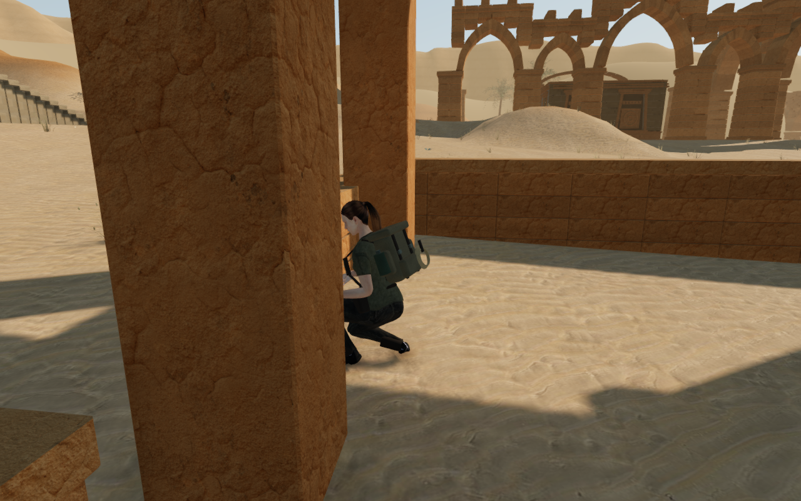
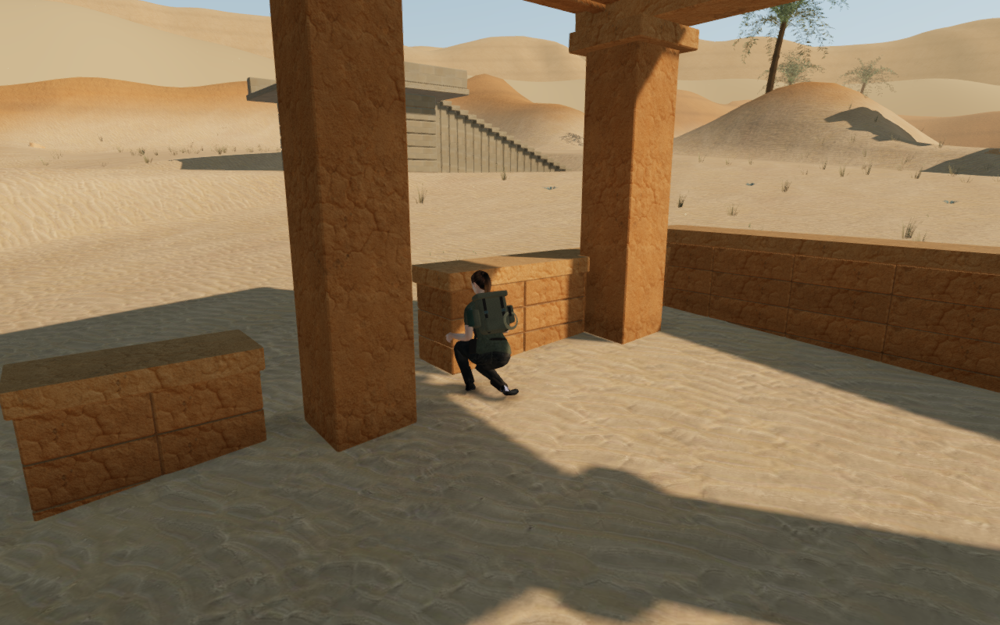
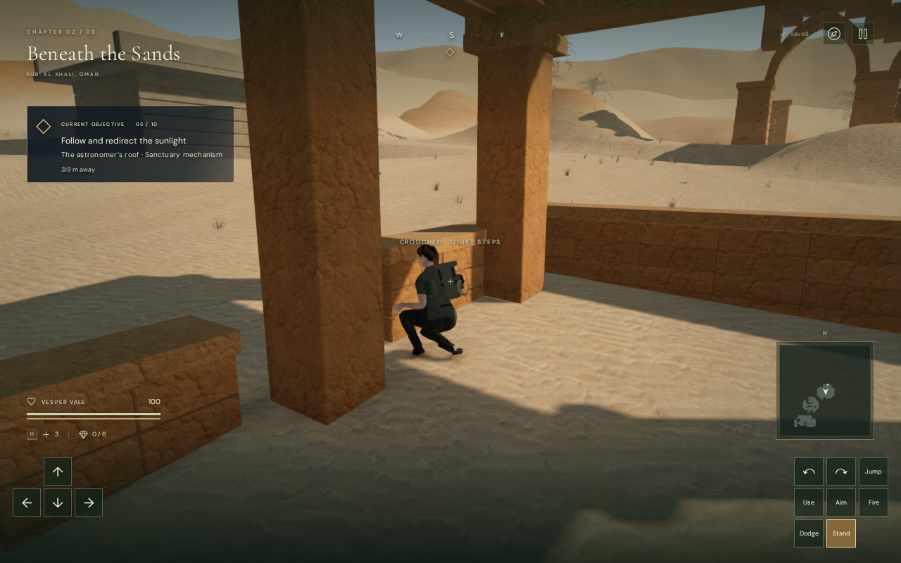
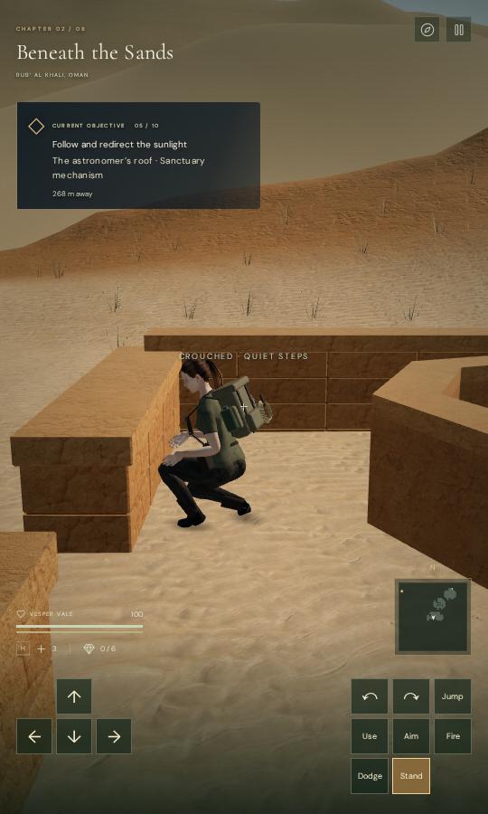

# Clear walking views beside gallery columns

The walking camera now checks the explorer's posed head, torso, arms and boots
when choosing a view beside solid architecture. A clear ray to the camera's
central target could previously leave the crouched explorer partly hidden
behind a desert gallery column. The camera can now follow a nearby clear view
and retain that detour while its requested view remains obstructed. The
player's position, selected yaw and pitch, and saved progress remain intact.

| Previous walking camera                                                                           | Revised walking camera                                                                                             |
| ------------------------------------------------------------------------------------------------- | ------------------------------------------------------------------------------------------------------------------ |
|  |  |

These are actual browser captures of the same prepared movement and crouch
sequence in the previous and revised development runtimes. The camera changes;
the explorer, masonry, terrain and input look are retained. They are assisted
reproductions of a previously observed native-input view, rather than fixed
camera construction comparisons.

## Framing and independent observation

Fifteen posed joints supply three small screen-facing clearance samples each.
Their bone references belong to the current character rig. The camera uses the
existing indexed static and dynamic surfaces, keeps its ordinary swept arm and
terrain clearance, and checks the interpolated view. It prefers nearby pitch
and yaw offsets, expanding the search when a column covers that neighborhood.
A chosen arm or body detour gets first consideration until the requested
body rays and comfortable arm both clear. This also prevents a clear
interpolated view from falling back towards an obstructed request. Aiming,
swimming, diving, rope views and comfortable mantle views retain their existing
camera behavior.

The [independent observer](../scripts/inspect-explorer-camera-browser.js) bakes
actual posed clothing and equipment vertices into temporary geometry, projects
the body bounds, and casts rays to the nearest body surface. A second ray checks
for delivered static scenery at least 15 mm before that surface. This depth
margin excludes immediate numerical contact from the occlusion count. It does
not use the controller's joint probes, captured collision bounds, or arm length
as its
visibility result. Temporary geometry and materials are disposed; original
scene assets remain owned by the game. Unsupported instanced or skinned
obstruction inputs are rejected.

This measures geometric occlusion at the stated samples. It does not reproduce
shader alpha masks, prove every raster pixel is visible, or certify angles and
motion that were not observed. The gallery survey supplies actual opaque
forecourt meshes; the cross-chapter survey has a different scope.

## Verification

The original keyboard movement and 0.3-second crouch sequence reproduces the
column obstruction with the preceding camera: 77 of 566 sampled body surfaces
are blocked, or 13.60%. The revised view has zero blocked samples out of 466.
The delivered-character regression loads the shipped GLB, reproduces the
obstruction despite a clear central arm, then verifies the recovered view.

| Check                                                 | Result                                                                                                         |
| ----------------------------------------------------- | -------------------------------------------------------------------------------------------------------------- |
| Column and wall pressure approaches                   | 40 normal approaches, including all 20 gallery columns                                                         |
| Intermediate posed-surface checks                     | 160 snapshots on a 16 by 24 sampling grid; zero blocked samples                                                |
| Settled posed-surface checks                          | 40 views on a 32 by 48 grid; zero blocked samples                                                              |
| Actual body surfaces hit across those pressure checks | 50,384; zero blocked or invalid samples                                                                        |
| Repeated idle, movement and crouch trace              | 138 updates, 23 surface snapshots; zero blocked samples                                                        |
| Largest camera movement over 3,600 pressure updates   | 0.161 m                                                                                                        |
| Ordinary return from the recorded column              | 4.8 m; four intermediate surface checks and the settled view clear; detour released                            |
| Cross-chapter stance survey                           | 128 settled states across eight chapters, two positions, four bearings and two stances; all joint probes clear |
| Shortest camera arm in the cross-chapter survey       | 3.310 m, with full explorer opacity                                                                            |
| Repeated jungle stance changes                        | Four changes and 360 updates; maximum camera movement falls from 0.406 m with the previous camera to 0.024 m   |

The pressure preparation disables combat and places the explorer at each local
start. Three wall-directed paths stop on an intervening inner cistern rim;
they are rim-contact checks rather than successful approaches to those walls.
The cross-chapter survey measures the controller's joint probes and reviews 32
actual rendered captures. It does not apply the independent forecourt-triangle
observer to all scenery in those chapters. All 41 gallery captures, 32 chapter
captures, the recorded crouch and return, and the jungle comparison are
reviewed. Their shaders link and HDR output remains finite.

All 254 selected regressions across 34 files and the release build pass. Checks
include camera arms and modes, actual delivered character contact, terrain,
traversal, wind controls, campaign persistence and audio behavior. The build
retains its existing large-chunk advisory.

The keyboard/High gallery and CDP touch/Low cistern cases exercise movement,
crouch, look, jump, map access and two complete-store reloads each. Their stores
match after reload apart from play timestamps. The touch case jumps out of the
cistern before moving sideways. Both finish healthy on the ground. The native
gallery crouch capture visibly clears the previously covering column.

| Native keyboard / High                                                                                                | Native touch / Low                                                                                                 |
| --------------------------------------------------------------------------------------------------------------------- | ------------------------------------------------------------------------------------------------------------------ |
|  |  |

The earned wall-cap save retains its 1.320 m height over repeated reloads,
departs through normal input and reloads on the ground. An occupied older-format
save still recovers to clear nearby ground while preserving progress, settings
and other-chapter data; normal missing survey bearings initialize as before.
All twenty native captures are reviewed. There are no failed asset responses,
console errors or warnings. Fetched scripts and styles match the build, and the
release has no development game hook.

Verification uses the shared nine-of-sixteen CPU set, at most two test workers
and one browser. Temporary servers and browsers are stopped. The final host
check finds no owned verification processes, no surviving tracked children
with their recorded start times, and neither test port listening. The four
public images are lossless WebP conversions with identical decoded RGBA pixels
and dimensions. Existing asset attribution remains in [asset credits](asset-credits.md).

The survey uses prepared progress and does not establish a human playthrough,
every body pixel or every camera angle. Inward contact corrections remain
immediate. Larger sparse spaces, repeated main installations, wider continuous
camera routes, subjective listening and consumer-device performance remain
under review. The full eight-chapter visual acceptance target is still open;
this repair does not establish AAA graphics.
