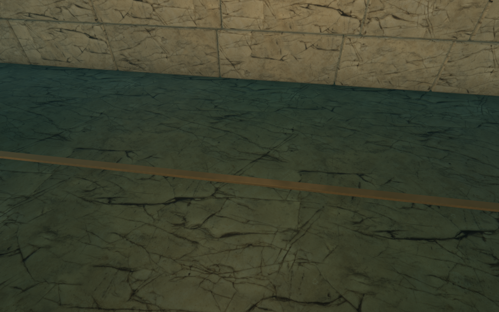
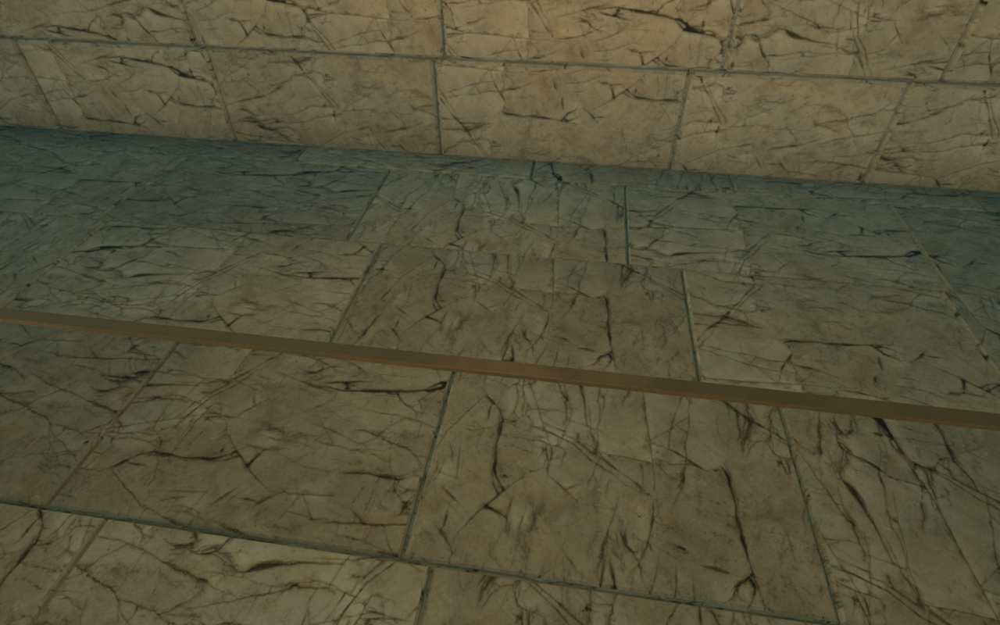
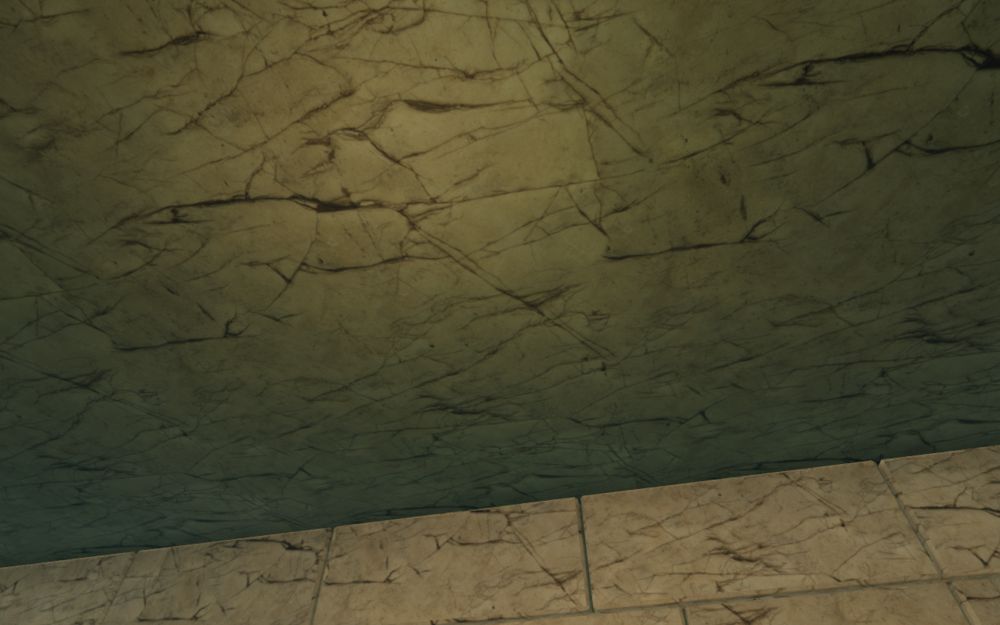
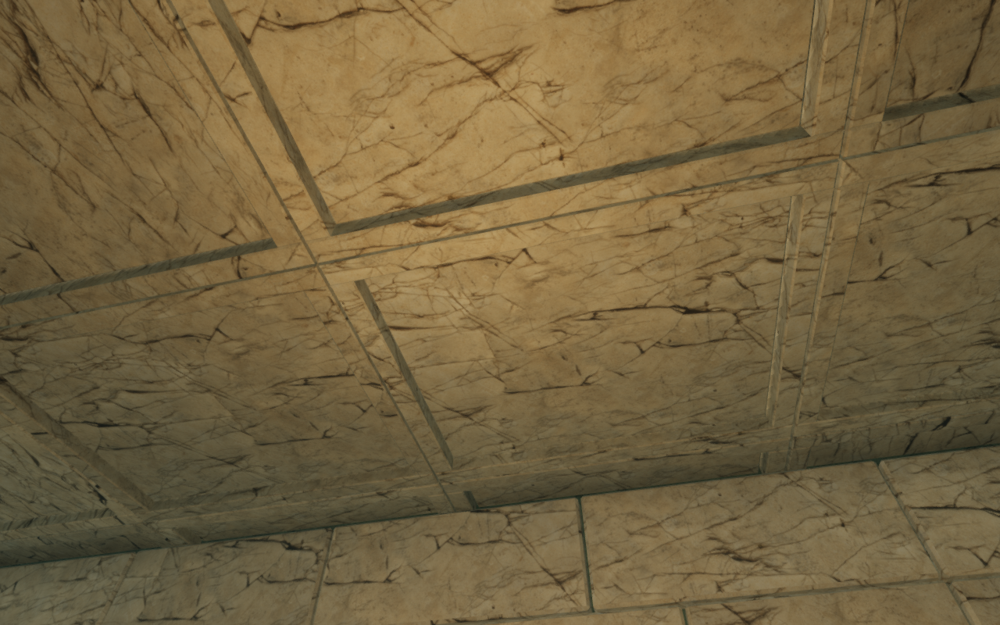

# Fitted paving and stone ceiling coffers

The submerged gallery's broad floor and ceiling surfaces repeated one flat
cracked texture. Fitted limestone paving now follows the actual room footprint
and changes of level. The flat ceilings have framed, recessed stone panels.
Individual pieces vary in length, tone and texture orientation; narrow bevels
and backed joints give the construction depth under the existing lighting.

The memorial retains its existing curved masonry vault. No hidden coffers are
built above that room. The new lining uses the existing credited stone textures,
with 1,765 closed pieces batched into two meshes and two materials. Those meshes
contain 105,900 vertex records. No texture, external model or dependency is added.

The bronze survey strips are seated 4.5 cm lower, with their undersides reaching
the paving and their tops still visible. The room floors, waterline and swim
clearances retain their nominal heights. Paving bevels recede into the stone;
ceiling recesses extend upwards. Recessed backing closes the joints, including
the wall foot and crown. Existing steps retain their exposed heights.

## Matched inspection views

The entrance paving before and after the revision, at High quality and
1280 × 800. Both captures retain the same player/light position, camera,
world time and quality. Inspection cameras hide the explorer. The preceding
shell geometry and survey-strip height are replayed for the first image:

The entrance ceiling under the same matched conditions:

## Verification

Twenty-eight scene captures are reviewed. They cover floors and ceilings in all
nine gallery areas, six matched before/after pairs, and both breathing stops at
High and Low quality. Regional inspection uses the opened-gate state and legal
body and camera positions. The memorial ceiling comparison retains its existing
vault. All checked programs link without graphics errors. The 26 High captures
have finite half-float bloom inputs; Low uses the direct LDR path.

All 31 selected regressions across six files pass, including automated memorial
traversal, breathing, gates, wheel operation, saves and sound boundaries.
Three new geometry regressions inspect the delivered triangles: closed pieces,
correct normals, nondegenerate texture coordinates, separated slab volumes,
and no intrusion into the existing swim space. Independent vertical probes at
more than 5,000 positions cover floors and ceilings across all nine areas.
Survey-strip bearing and anchor-footing checks use the delivered paving and
joint beds. Three CPU-budget checks and the production build also pass;
existing large-bundle advisories remain.

A comparison against the preceding published version retains all 75 nominal
camera boundary panels, 402 solid bounds, normalized gallery progress and the
four sound-source records. The original wall masonry, memorial stonework and
bronze geometry are checked separately from the revised lining and survey
strips. This verifies the retained records and sampled geometry; it does not
establish continuous camera timing or consumer-device performance.

Production verification uses the normal launcher and a prepared second-bell
save. Actual touch and keyboard dives reduce air to 31 seconds; rising restores
32 seconds at health 100. Two complete-store comparisons pass across initial
restoration and the final reload, apart from the designed initial checkpoint
and last-played timestamp. All four release captures are reviewed. These checks
use Low quality at a 360 × 600 viewport and half pixel density, producing
180 × 300 images. Release assets match the build, with no development hook or
recorded application/resource errors.

Replacing the chapter disposes the two new materials, the two lining buffers,
the revised backing buffer and the survey-strip buffer exactly once. All
verification browsers and preview servers close. Checks use the locked shared
5/16 CPU allowance, at most two test workers and one browser. Private saves,
profiles and reports remain in local staging.

The four figures are complete, unretouched game captures converted losslessly
to WebP; decoded pixels and dimensions match their sources. Existing
[asset attribution](asset-credits.md) applies.

## Remaining work

The sampled gallery surfaces have more visible construction detail. Wider
continuous movement and contact checks, regional material repetition, sparse
surroundings, shared object families and whole-world composition remain under
review. Camera timing, consumer-device testing and listening acceptance also
remain open. This local pass does not establish completion of the full world.
