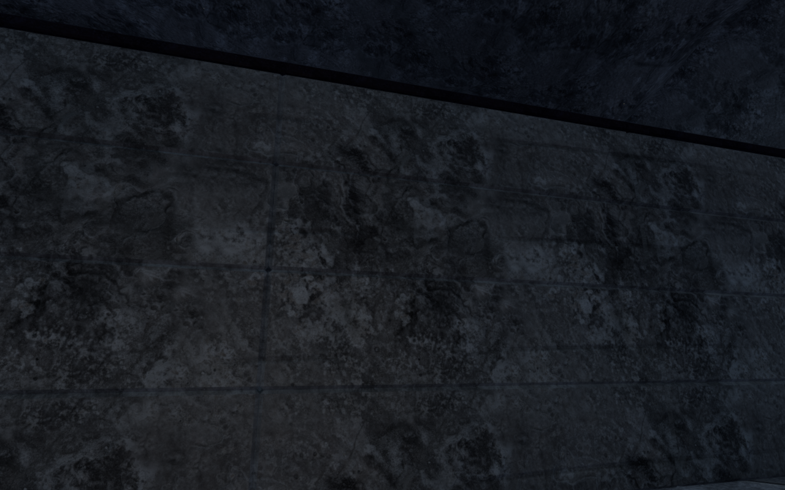
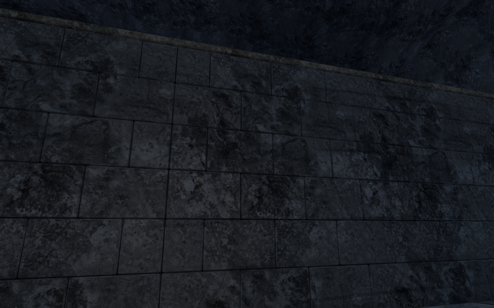
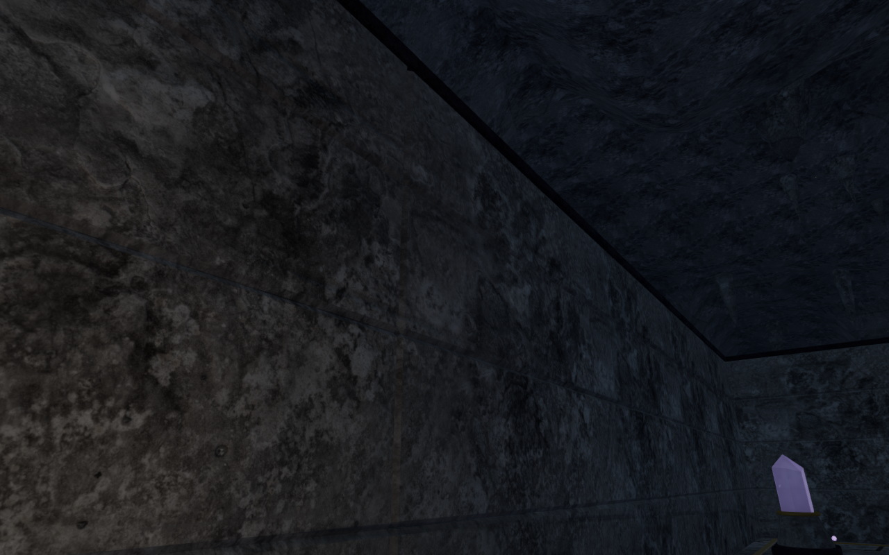
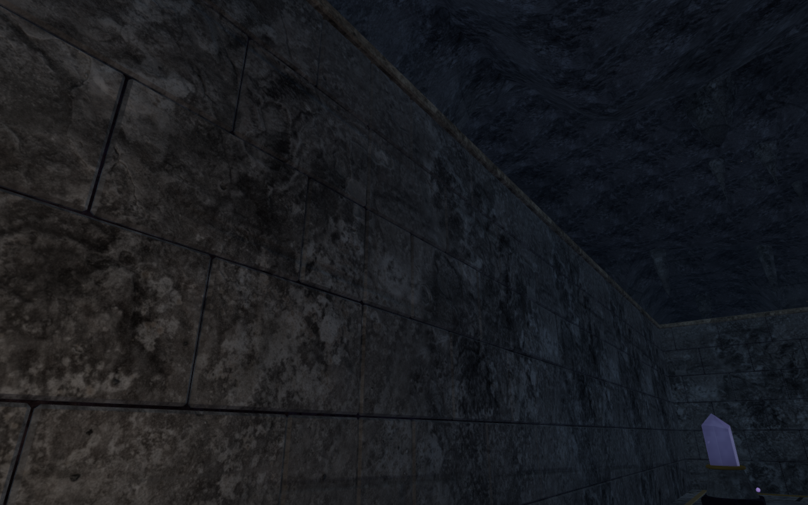

# Listening Gallery masonry and foundations

The Listening Gallery now has six staggered masonry courses on each of its
38 permanent walls. The 1,026 individual stones have narrow recessed joints
and dressed limestone capstones. This replaces the long unbroken slab faces
and nearly black upper outline seen from the entry camp and within the maze.
The existing cap shapes and wall heights are retained.

The first course and backing extend below the delivered terrain. Outer floor
samples reach about 16 cm below the preceding nominal wall base. Reconstructed
original-base controls miss 204 below-floor probes; the revised assembly covers
them. A single closed backing follows the union of the fixed walls and fills
their collinear connections. Its ends sit behind the chipped stone end faces,
avoiding the triangular dark intersections found in the first visual draft.

The gallery's logical obstacle bounds, two shortcut doors, control positions
and sound anchors match the `79733d4` baseline exactly in the built-world
comparison. The puzzle order, pulse counts, attenuation, sparse listening
score and save rules are retained. The coping material shares the existing
limestone textures. No new asset, texture file or dependency is introduced;
existing [asset attribution](asset-credits.md) applies.

All 20 selected geometry, gallery, visibility, temple and audio checks pass.
Closed-geometry fixtures cover 49,468 triangles. Independent render rays cover
25,146 samples, including 2,016 below-floor probes and 748 shared-wall-end
probes. They check actual terrain, the visible stone surfaces, and camera
stops. Another 1,368 rays check separation between the backing and exposed
stone ends. Geometry fixtures use the delivered gallery's seed slots.
The gallery graph, ordered memories, moving-door collision, source approaches,
audio envelopes and quiet score checks also pass. These fixtures do not
establish continuous whole-campaign body contact.

All six baseline views and 51 final views are reviewed in labeled sheets,
with selected comparisons also inspected at full resolution. Final coverage
includes the entrance and outer margins, all 32 cells, five stone-adjacent wall
views, three Performance views, two High follow-camera views, four partially
raised/full-door poses, and jungle startup after chapter replacement. The two
follow views retain legal positions and full character opacity. Application
shaders link, High HDR buffers remain finite, and no application errors or
warnings are reported. The inspection views use independent cameras and
hidden avatars; they do not constitute a continuous playthrough.

Chapter replacement disposes all 72 tracked gallery resources once: 33
geometries, 24 materials and 15 textures. The three CPU-budget checks and
production build pass; the build retains its large-chunk advisory. Verification
shares the locked five-of-sixteen CPU allowance, uses at most two test workers
and one browser, and closes owned browser/server helpers when finished.

Prepared keyboard/High and portrait touch/Performance release cases record the
first and third memories through the normal E/Use controls. Their reloads
retain one and three recorded fragments respectively; the latter still needs
the return-tablet step. Crouch, jump and movement cover 5.61 m and 6.60 m at
full health. Two complete-store reload comparisons preserve all saved data
apart from `lastPlayed`. All ten native screenshots, including both memory
dialogs, are reviewed at full resolution. The expected JS/CSS assets load,
there is no horizontal overflow, and the release exposes no development hook.
The completed cases report no application errors or warnings. All 419 runtime
hashes and 791 frozen source/test/script/build inputs match after verification.

The baseline uses the published `79733d4` source. The revised images retain
the same prepared viewpoint, player position, graphics setting and elapsed
time. Six source-identical draft captures are retained in the final set rather
than repeated. The four figures below compare prepared development fixtures.

| View | Published-source baseline | Revised masonry |
| --- | --- | --- |
| Eastern wall |  |  |
| First listening chamber |  |  |

The four lossless WebP figures preserve their source pixels and dimensions.

Larger cavern spaces, repeated main installations, the gallery's moving-panel
art, crystal optics, continuous body/campaign contact, other devices and
subjective listening remain under review. Prepared visual fixtures use muted
audio. This local improvement does not establish consumer frame rates, human
playthrough duration, listening quality or AAA graphics. The overall game-polish
goal remains incomplete.
