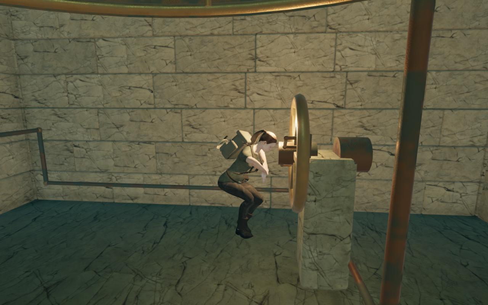
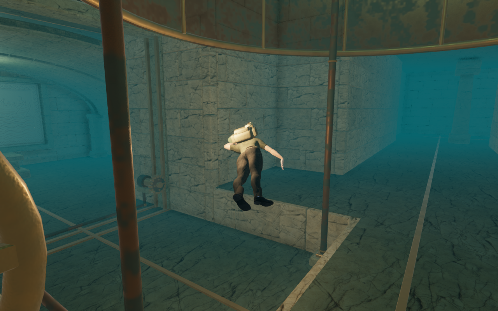
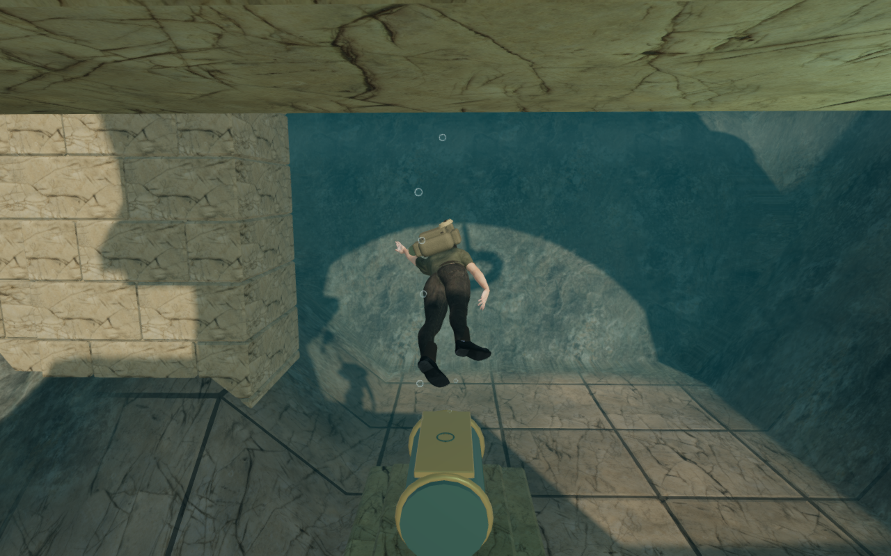
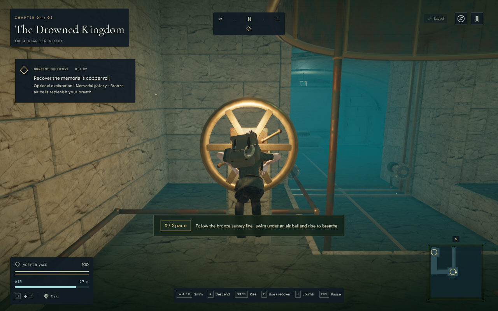
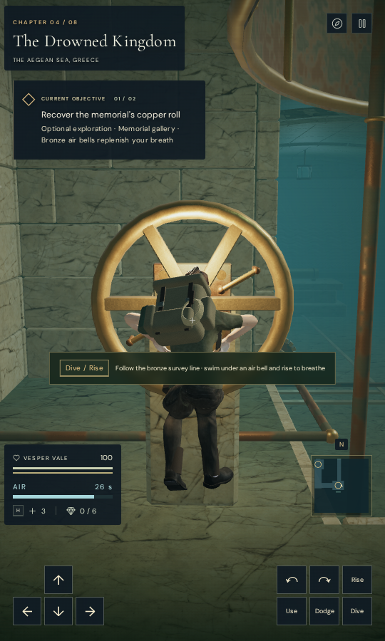

# Clear camera paths beside the gallery wheel

The submerged return route could spend over a second searching for a camera
detour beside the emergency wheel, then turn abruptly at the entrance. Both
recorded views were blocked by geometry that their camera proxies filled in,
even though independent rays missed the delivered scene triangles.

The wheel now retains a circular rotating envelope for each casting before
render batching. Its rim, hub and fittings keep their own depths. Contained
and duplicate envelopes are removed. This avoids both the square corners
beside the wheel and the false region formed by combining the hub's depth
with the rim's radius. The delivered rotating geometry and its materials are
retained.

At the entrance, body sight now checks whether the actual terrain-entry point
was removed by a gallery construction volume. It retains the courtyard above
the cut ceiling, the banks beside it and any later ridge crossed by the ray.
The physical gallery shell continues to block its walls and ceiling.

A separate posed-surface inspection found that a folded swimmer's head and
hair could enter the wheel hub. Folding now retains the torso's rearward
offset, keeping the delivered head out of the hub while the hands and feet
use their existing world-space targets. The authored wheel grip and ordinary
unfolded stroke retain their existing offsets.

The release also prepares that fold while the wheel interaction is active.
Previously its upright physical-footprint exemption suppressed the fold until
the interaction ended, swinging the head through the wheel during release.
Movement retains that authored exemption; the drawn pose computes the free
stroke's clearance early enough to blend safely away from the handles.

## Verification

All 148 selected tests across twenty-two files pass, together with the three
CPU-guard checks and the production build. The build retains its existing
large-bundle advisory.

New independent triangle-ray controls reproduce both kinds of empty wheel
space. Thirty-two rim rays still hit rendered metal and remain obstructed.
Every delivered wheel vertex fits a casting envelope at the start, middle and
end of the turn. Sampled visible character vertices clear the actual
hub cylinder across sixteen stroke phases; restoring the former forward
offset reproduces the head overlap. Existing pier, water-surface, bell,
wheel-grip and static posed-surface regressions also pass.

Both sideward and rearward saved looks complete the actual grip and release
without embedded sampled head/hair vertices, fading or a sharp camera turn.
Independent desktop and portrait posed-surface grids retain zero blockers for
both looks. The rearward-look control failed during release before the fold
was prepared.

Actual cut-terrain rays check the opening, retained courtyard, lower/side bank
and a later ridge. The existing 300 terrain-ray comparisons and eight-chapter
terrain/campaign checks pass. Two new 120-update motion regressions retain legal lenses,
full opacity, bounded camera work and six independent posed-surface
observations each, with zero observed blockers at those grids.

The focused loaded-world browser comparison records:

| Recorded route segment | Earlier scene queries in one camera update | Revised peak scene queries | Earlier peak angular step | Revised peak angular step |
| --- | ---: | ---: | ---: | ---: |
| Leaving the wheel | 31,994 | 559 | 0.10388 rad | 0.05 rad |
| Returning toward the entrance | 23,422 | 377 | 0.10746 rad | 0.05 rad |

Each comparison covers 120 updates with the actual movement and camera
controllers. The earlier raw counters include 201 and 235 additional
diagnostic rechecks, excluded from the table. The earlier instrumented timing
peaks were 1,436.7 ms and 1,244.7 ms;
the revised canonical camera peaks were 53.1 ms and 35.8 ms. These are capped
sandbox diagnostic timings, including cold work, and do not establish player
frame rates. Maximum revised lens steps are 20.59 cm and 14.22 cm. The selected
look is retained, and opacity stays at 1.

| Leaving the wheel | Returning to the entrance |
| --- | --- |
|  |  |

The full assisted memorial loop covers 185.88 m and 4,496 updates at health
100. It breathes in both bells, opens both gates, recovers the record and
returns to the well. Minimum remaining air is 15.48 seconds, opacity stays at
1, and all sampled physical-body and lens positions are legal. Its maximum
angular step is 0.05 rad. Three independent stopped posed-surface grids
record zero blockers among 114 descent, 163 wheel-turn and 212 opened-wheel
rays. This route uses supplied waypoints and omits enemy updates.

All 45 final development captures are reviewed: the complete loop, Medium
and Low repeats, and the two air-bell anchor views. The opened-wheel view
retains a clear head after the folded release.

Chapter replacement releases all fourteen tracked gallery draw resources
exactly once, and leaves no old gallery sound source. The new camera bounds
are CPU metadata and add no rendered mesh, material or texture.

Current production keyboard/High at 1280 × 800 and simulated portrait
touch/Low at 540 × 900 pass diving, movement, interrupted wheel use and a
completed turn. Four complete-store reload comparisons preserve position,
look, settings, health 100, recorded time and progress; only visit timestamps
are excluded from equality. All six release captures are reviewed. Both
completed-wheel views retain the explorer in front of the rim. Touch performs
movement, diving and Use; keyboard pause is used in both cases. These are
prepared saves in desktop Chromium with muted audio.

| Keyboard after release | Portrait touch after release |
| --- | --- |
|  |  |

Both cases load the current built assets: `index-CrjpqQiN.js`,
`game-CGkXaQE-.js`, `three-CsvFtkjV.js` and `index-B8Rg8Jto.css`. There is no
development hook, horizontal overflow, failed asset, page error or unexpected
console warning. Browser contexts, Chromium and temporary servers close
normally.

## Remaining work

This revision recorded a 337.3 ms camera update while returning from the
memorial, at frame 3,018. The subsequent [memorial return recovery](gallery-return.md)
addresses its redundant clear-view search. These repairs do not establish
smooth follow throughout the route or consumer-device performance.

Broader camera routes, plain floors and ceilings, coarse bronze patina, repeated structures, sparse
surroundings and wider contact remain part of the unfinished visual target.
Subjective listening, consumer devices and human pacing remain unverified.

Existing [asset attribution](asset-credits.md) applies. No external asset,
recording, score or dependency is introduced. The distance-sensitive
soundscape and quiet adaptive music remain in place; these checks use muted
audio. Verification uses the locked shared five-of-sixteen CPU allowance,
lower priority, at most two test workers and one browser. Scratch files remain
inside the ignored local staging folder.

The five documentation images are complete game captures converted
losslessly. Their decoded pixels and dimensions match the source captures.
