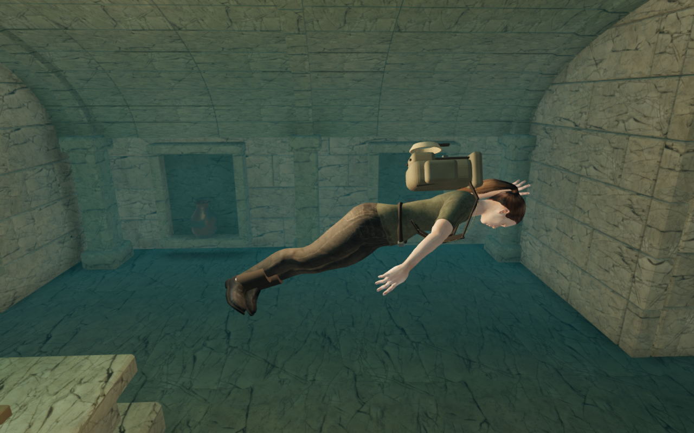
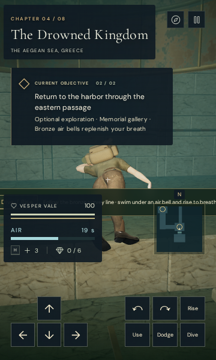

# Retaining the explorer during a camera turn

Returning from the memorial could make the camera search twenty clear views
in one update. The first interpolated view was just 1.1 mm inside the
character's fade range, so the solver kept searching despite its clear body
sight and comfortable destination.

The confined swimming camera now tries a small outward adjustment along the
same candidate direction. It retains a 2.21 m radius, one centimetre beyond
the existing fade boundary, provided that this stays within the previous
camera radius plus the existing radial recovery rate. Both the central arm
and the actual lens journey must remain clear, and the full posed-body and
destination checks still apply before accepting the view.

This retains the existing fade threshold, movement controls, saved look and
gallery geometry. It adds no camera waypoint or retained world position.

The loaded-world view at update 32, with the explorer visible throughout the
turn (High, 1280 × 800):

The production touch trip returning toward the second air bell (Low,
360 × 600). Its paused save supplies the separate breath/reload check:

## Verification

All 149 selected tests across twenty-two files pass, together with three
CPU-guard checks and the production build. The existing large-bundle advisory
remains.

The new 120-update memorial-return regression reproduces a failure at 6,249
registered scene queries with the preceding solver. The revised fixture peaks
at 746. It retains opacity 1, a legal lens, a maximum 0.05-radian angular step
and an 18.47 cm lens step. Seven independent posed-surface grids have zero
blockers, and actual double-sided gallery triangles do not cross any of its
120 lens sweeps. The preceding wheel-departure and entrance-turn cases retain
their 559/377 query peaks. Static squeezes, wheel grips/releases, well rises,
air-bell surfacing, water arrivals, local saves and campaign checks also pass.

The loaded-world diagnosis reproduces the exact player and camera positions
of the previously recorded return witness. It records 7,717 scene queries
and twenty candidates with the preceding solver, with no body-ray failures.
The current canonical camera peaks at 746 queries over the matching
120-update departure. Three independent grids at updates 32, 33 and 120 have
zero blockers among 94, 92 and 176 actual body rays.

Timing samples vary substantially under the shared CPU allowance. The
instrumented preceding run peaks at 362.9 ms; the revised canonical run
records a 517.2 ms peak despite its reduced work. These observations establish
the avoided search, rather than a frame-rate improvement. Consumer-device
performance and broader continuous follow remain unverified.

The full assisted route covers 185.88 m and 4,496 updates at health 100. It
breathes in both bells, opens the gates, recovers the record and returns to the
well. Minimum air remains 15.48 seconds, opacity stays at 1, body and lens
positions are legal, and the maximum angular step is 0.05 rad. Its three
stopped posed-surface grids retain zero blockers among 114 descent, 163
wheel-turn and 212 opened-wheel body rays. All 45 route/preset/anchor captures
are reviewed. This uses supplied waypoints and omits enemy updates.

The same run records a 1,044.9 ms camera update at the early entrance-bank
view, frame 134. It retains a comfortable arm and no recorded recovery offset.
This additional timing observation remains open; the reduced return search
does not establish continuous smoothness.

Chapter replacement releases all fourteen tracked gallery draw resources
exactly once, leaving no old gallery sound source. The change adds no draw
geometry, material, texture or persistent camera state.

Production input checks start at a prepared second-bell checkpoint. The touch
controls reach the memorial, turn, return beside the bell and surface at health
100. Reopening that trip's actual paused save preserves the complete store
apart from the designed checkpoint position and last-played timestamp. A
further native touch dive/rise restores the air meter from 31 to 32 seconds;
another save/reload preserves the complete store. The independent keyboard
trip also reaches the memorial, returns, restores full breath and passes its
complete-store reload comparison. All three comparisons pass, with no
recorded application or resource errors.

The native checks use Low quality to limit rendering work: the touch trip has
a 360 × 600 viewport and capture; its separate checkpoint check and the
800 × 500 keyboard viewport use half pixel density, producing 180 × 300 and
400 × 250 captures. All twelve native images are reviewed. These functional
checks complement the High development captures and do not establish High
input performance. The browser contexts, browser and temporary preview server
close after verification.

## Remaining work

The broader target remains unfinished: continuous camera performance, plain
floors and ceilings, coarse bronze patina, repeated structures, sparse
surroundings, wider contact and listening/device acceptance still need work.

Existing [asset attribution](asset-credits.md) applies. No external model,
bitmap, recording, score or dependency is added. The positional soundscape
and quiet adaptive music remain in place; the browser checks use muted audio.
Verification uses the locked shared five-of-sixteen CPU allowance, lower
priority, no more than two test workers and one browser. Staging remains
inside the ignored local directory.
