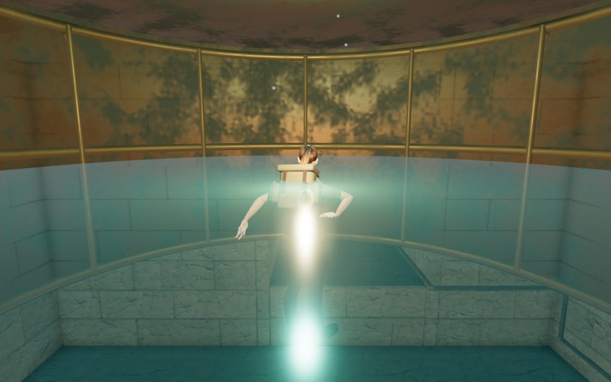
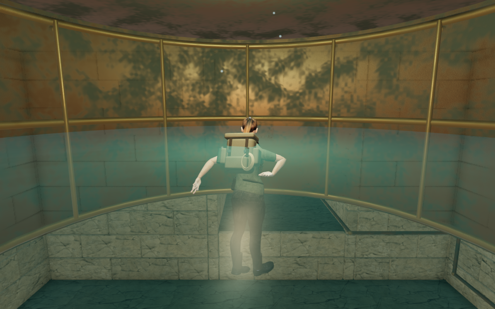
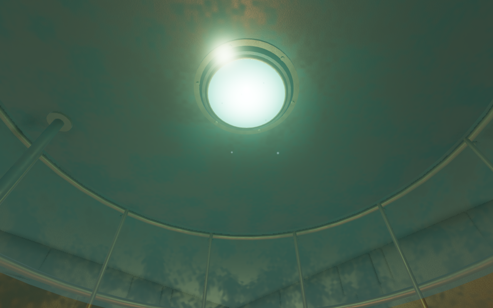
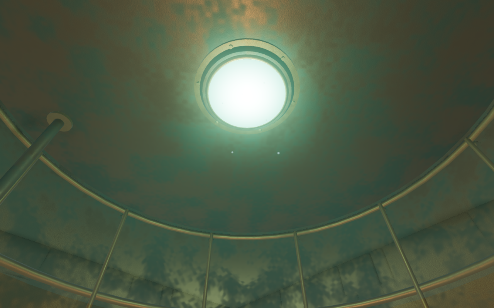

# Clearer air-bell water and lighting

The later [gallery lining revision](gallery-lining.md) adds fitted paving and
ceiling construction to the plain surfaces recorded below. This page retains
the water milestone's captures and verification scope.

The resting explorer was obscured by two bright columns across the water in
both bronze air bells. A controlled lighting study isolates those columns to
water highlights from the carried fill and the fixed bell lamp. Turning bloom
off retains them; hiding the water removes them. The preceding water was a flat,
partly metallic surface, and the carried light sat just above it.

The sheltered water now uses a dielectric material with a water index of
refraction, softer highlights and more transparent facing angles. Small moving
ripples use the existing wavelength-filtered water normal field, with the
underside normal facing the submerged viewer. The carried fill moves 60 cm
higher inside the gallery. Its intensity and the fixed lamps are retained.

The meniscus geometry stays at the breathing boundary. Both bell surfaces and
their outer reservoir patches remain separate live meshes, so reservoir changes
can still move and hide the outer patches. All four share one material and time
uniform. No texture, model, recording, score or dependency is added.

## Matched views

The second bell at High quality, 1280 × 800. The preceding water and light
offset are replayed on the same geometry, player pose, camera and world time:

The same bell from a legal underwater inspection position, looking up through
the water. These two inspection views hide the explorer:

## Verification

Eighteen scene captures are reviewed: both bells at High, Medium and Low, two
later ripple phases, underwater swimming views, and four upward inspection
views. Six before/after pairs retain identical player, camera, field-of-view,
quality and time records. All checked programs link without graphics errors.
The sixteen High/Medium captures have finite raw half-float bloom inputs; Low
uses the direct LDR path.

At the matched High breathing stops, the largest raw RGB component falls from
151 to 1.54 in the second bell and from 150.38 to 1.56 in the first. These are
per-view rendering measurements, not calibrated luminance or a frame-rate
claim. The upward inspection still includes the bright luminous ceiling lamp;
its revised raw peak reaches 133.13. Softer water reflections remain visible
around the legs, while the torso, pack and silhouette are clearer.

All 26 selected regressions in the gallery, diving, rendering-settings and
gallery-visibility suites pass, including the memorial route, breathing stops,
wheel, gates, sound boundaries and saves. A new delivered-mesh regression checks
both outer patches after consolidation at multiple reservoir heights, using
triangle hits on their live geometry and their hidden state near the ceiling.
Three CPU-budget checks and the production build pass. Existing large-bundle
advisories remain.

The isolated delivered gallery matches the preceding published version across
39 meshes, 200 geometry/index arrays and 375,232 vertex records, including world
transforms. Solid bounds and sound-source records also match. The revision
changes water shading, its animation clock and the carried light offset.

Production verification uses the normal launcher and a prepared second-bell
save. Actual touch and keyboard dives reduce air to 31 seconds; rising restores
32 seconds at health 100. Two complete-store comparisons pass across initial
restoration and a final reload, apart from the designed initial checkpoint and
last-played timestamp. All four release captures are reviewed. They use Low
quality at a 360 × 600 viewport and half pixel density, with 180 × 300 images.
The checked release assets match the build, with no development hook or recorded
application/resource errors. All verification browsers and preview servers close.

The four figures are complete, unretouched game captures converted losslessly
to WebP; decoded pixels and dimensions match their sources. Existing
[asset attribution](asset-credits.md) applies. Verification retains the locked,
shared 5/16 CPU allowance, at most two test workers and one browser. Private
saves, profiles, logs and helpers remain in local staging.

## Remaining work

This improves the recorded air-bell glare. Continuous movement, other viewpoints
and consumer-device performance still need wider evaluation. The new underwater
views also retain broad, repetitive cracked floor panels and plain ceiling
areas. Wider floor and ceiling treatment, repeated structures, sparse margins,
contact, camera timing and listening/device acceptance remain part of the
unfinished whole-world target.
