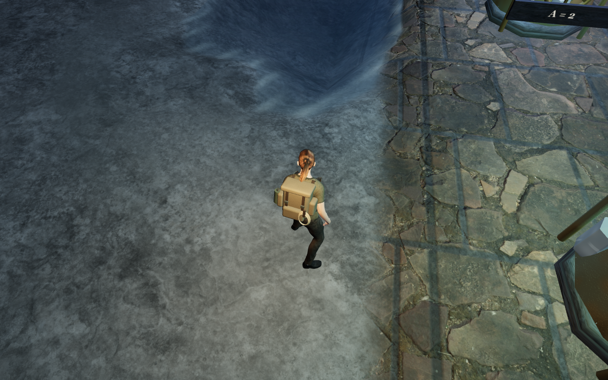
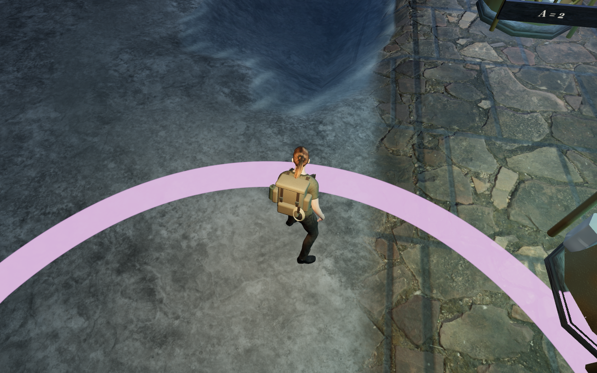
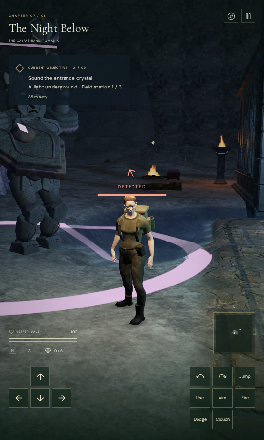

# Warnings follow the rendered ground

Guardian and trap warnings now appear on the terrain, paving, supported
platforms and exposed water already rendered by the game. The warning follows
the bank or step beneath it, instead of using an independent horizontal disc.
Edges use a continuous radial mask and pixel derivatives for antialiasing.

A controlled keeper windup at the recorded cavern bank reproduces the old
placement defect: 42 of its 98 ring vertex records lie below the floor. The
smallest sampled gap is -8.82 cm and the largest clearance is 77.08 cm. The
selected old view largely loses the ring. This is a prepared attack state on
accepted guardian footing, rather than a complete combat playthrough.
The final comparison preserves the player position, chosen look and warning
centre. The current view shows a continuous band on that bank.

| Preceding flat ring | Warning on the actual bank |
| --- | --- |
|  |  |

The shader uses each receiving surface's world position after its existing
vertex transforms, including instancing, batching and the water waves. It
changes surface colour while keeping the surface's geometry, depth, shadow and
collision rules. Upward faces receive the warning; near-vertical faces, actors,
skinned characters, alpha foliage and tagged non-contact ground cover retain
their own rendering. A locked ranged warning uses the target's actual height,
including a swimmer or raised landing, so the buried floor below does not hide
its cue.

The existing marker objects still hold their position, radius, opacity and
visibility, with no independent rendered ring vertices. Guardian attack timing,
locked direction, damage, hit cover, dodge costs and the trap cycle continue
through their existing controls. Trap warnings, moving ice targets and the
expanding observatory pulse share the projection. Sound and player save schemas
are unchanged.

One 3×64 RGBA float texture holds the chapter's live cue controls: 3,072 bytes,
reused across updates. Existing surface shader hooks and cache variants are
chained. Chapter replacement disposes the texture and restores owned hooks.
When a later foliage wrapper retains a hook, retiring the projection leaves
that wrapper intact and forces a fresh program. Late asset readiness cannot
revive a retired state. No external asset or dependency is introduced.

## Verification

All 54 unique selected checks pass, covering seven new projection regressions,
combat, hazards, guardian patrols/art and chapter preparation. The tests retain
telegraph timing, evasion, damage and motion, while adding world transforms,
fading, parent visibility, trap/pulse states, actual ranged target height,
shader chaining, cache variants, geometry preservation, actor/foliage exclusion,
texture reuse, exact disposal after late readiness and the actual foliage
wrapper across retirement and reinitialization.

The final production build passes in 7.65 seconds with the existing size
advisory. All 34 prepared High/Low on/off comparisons pass and their views are
reviewed. They cover guardian and trap warnings in all eight chapters, plus the expanding
observatory pulse. Every selected warning changes visible pixels; the smallest
measured change is 2,427 pixels at the comparison threshold. Guardian bodies
remain visible, no actor material receives the projection, and all sampled
programs link with zero GL errors. No independent ring vertices are drawn.

Diagnostic comparisons disable planar water reflection weights to isolate the
direct cue; they do not prove every effect or moving combat state.

A separate matched cost sample uses the actual jungle scene at Low, 960×600,
in headless software Vulkan with the shared five-CPU allowance. Each median
contains nine GPU-finished frames after three warmup frames:

| Condition | Median frame cost |
| --- | ---: |
| Projected materials, no active warning | 9.2 ms |
| Original material hooks restored | 11.6 ms |
| One active warning | 15.8 ms |
| Projected materials, no warning, repeated | 9.6 ms |

All sampled programs link and return no GL errors. This small, variable sample
does not establish consumer frame rates. The retirement/recreation portion
also exercises the later foliage wrapper without duplicate shader injection.

The actual production interface passes keyboard/High at 1280×800 in the
jungle and emulated portrait touch/Low at 540×900 in the cavern. Movement is
1.28 m and 2.40 m respectively, with full health retained. Chosen look and all
four paused whole-store reload comparisons pass, ignoring only `lastPlayed`.
There are no camera adjustments, page/console errors, warnings or horizontal
viewport overflow. The loaded release includes `game-DrQZzZvL.js`; all loaded
JavaScript/CSS names match the current build, with no development game hook.
All six arrival, movement and reload views are reviewed. These fixture-based,
muted input checks do not establish earned routes, complete combat, listening
quality or physical-phone performance.

All staging remains in ignored local directories, with the shared locked 5/16
CPU allowance and at most two test workers and one browser. Owned browsers,
workers and preview servers close after their checks.

Wider scenery composition, continuous combat and routes, body-face contact,
listening and physical-device acceptance remain open.

The projection is in [ground-cues.js](../src/ground-cues.js), used by
[combat.js](../src/combat.js), [hazards.js](../src/hazards.js) and
[game.js](../src/game.js). Its tests are in
[ground-cues.test.js](../tests/ground-cues.test.js), with the live observer in
[inspect-ground-cues-browser.js](../scripts/inspect-ground-cues-browser.js).
The documentation captures reuse the [existing credited assets](asset-credits.md).
