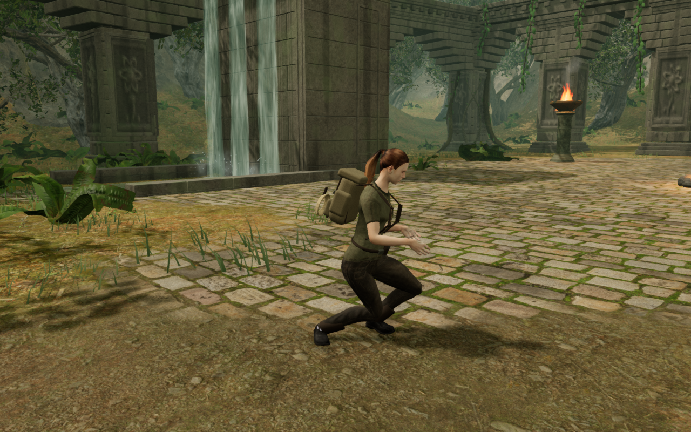
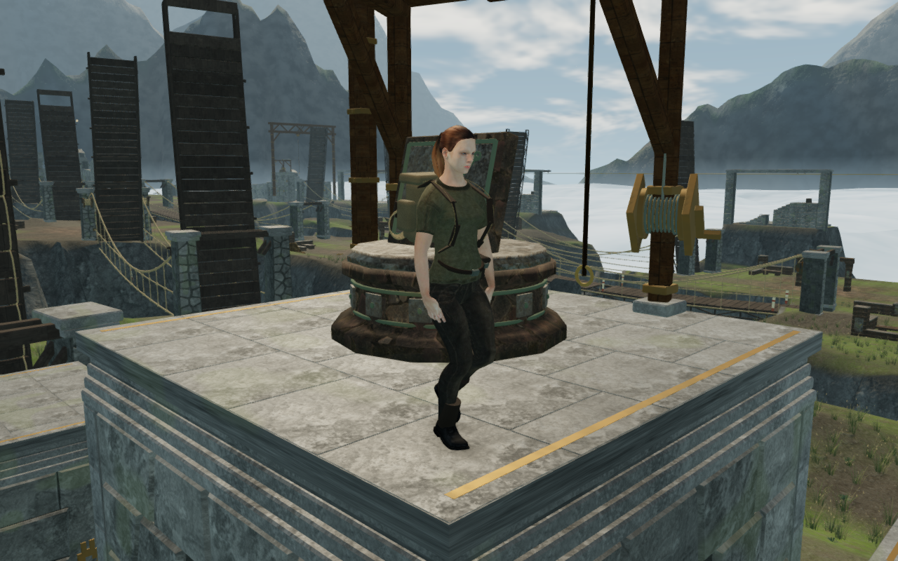

# Local support queries for the explorer's feet

Fitting the character's soles and clothing to uneven ground can require many
small support queries in one update. Each query previously visited every
obstacle in the level. A recorded monastery stance contains 1,978 obstacles,
including furniture in distant rooms that cannot support either boot.

Grounding now selects nearby support candidates once per synchronous update.
It retains the original objects and their order, then uses the existing support
calculation with that shorter list. Terrain, natural-rock/tree indices and the
chapter's special deck systems still receive the complete game state. Movement
and arrival continue to use the support function's default complete list.

The selection covers probes within two metres of the current root and contact
radii up to the existing 0.55 m body radius. Probes outside those bounds use the
full list. Array replacement or growth also triggers the full search. Each
new grounding update rebuilds its selection from the current obstacle state;
there is no persistent world index to invalidate when a platform moves.

Rotated stations expand their support margin in local axes before calculating
world bounds. Cylinders use their circular extent, and triangle stations retain
their actual bounds and configured support/body footprint. Unknown bounds stay
in the candidate list. Heights, visibility, triangle faces, walkable slopes and
surface identity are resolved by the existing query at the time it is called.

Five new regressions compare 57,600 support results with the full search across
boxes, rotated stations, cylinders, sloping triangle caps and legacy supports.
Heights and original surface identities compare exactly. Additional checks
cover a rotated margin touching the selection boundary, a large contact disk,
current heights/visibility, moved and activated stations, list mutation, unknown
footprints and the natural/tree support systems. A work-count control visits
2,000 distant obstacles once during selection and zero times during 100 local
queries; the complete-list reference visits them 200,000 times. A distant query
still scans the full list and finds its real cap.

All 96 selected tests across ten files pass. They include the complete
43-test delivered-character suite, sole and terrain observers, station
footholds, field furniture, campaign reachability and saves, audio, rendering
settings and chapter startup. The existing swimming/rope/aim test had omitted
the floor function now read by its swimming pose. The same failure reproduces
in an isolated copy of the published `3663090` source. Supplying its flat-floor
stub makes it pass on both revisions; the game receives no fallback behavior.

A CPU sampling run exercises sixty normal crouched `updatePlayer` calls at the
same recorded monastery position, with High settings and a 1280 × 800 viewport.
The batch takes 51.091 seconds before this change and 4.088 seconds afterward.
The original samples are dominated by support queries through distant stations.
Garbage collection remains a significant part of the later sample. These are
instrumented CPU batches on this sandbox, excluding render submission; they do
not establish consumer frame rates or a supported-device performance target.

The browser comparison uses the preceding animator against the current one.
Each selected sequence records controller state and every avatar object's
world matrix at every frame, then compares all visible deformed character and
equipment vertices. Controller positions and motion flags require exact equality.
Footstep counts, surfaces, intensity and timing also require exact equality.
Visual transforms and metre coordinates use a 10⁻⁸ numerical tolerance.

That tolerance is calibrated separately from the production change: repeating
the unchanged reference produces a 9.445 × 10⁻¹¹ difference on the first thumb
transform, while final skinned vertices remain identical. Another diagnostic
compares all 32,580 real queries in a walk against the complete support search;
heights and surface identities all match exactly. A deliberately displaced
character remains a required failure control.

The final comparison passes 32 paired sequences across all eight chapters:
standing and crouching at entry, then standing and a short walk near a field
station. Each version contributes 1,152 simulated frames and 1,539,040 final
visible body/equipment vertex records. Controller state matches exactly, as do
the eight positioned footfalls and their metadata. The greatest intermediate
matrix difference is 9.446 × 10⁻¹¹; final vertex and footstep-coordinate
differences are zero. The deliberate 4 cm character lift fails the comparison.

All 64 High-quality comparison captures are reviewed, with linked rendering
programs and finite observed HDR buffers. No browser error or warning is
recorded. The 592 runtime source/asset files and the comparison observers retain their frozen
hashes through the run; all 115 delivered runtime assets retain their published
bytes. These are assisted, short sequences on disposable progress, rather than
earned objective completion or a continuous chapter playthrough.

The retained crouched jungle stance and moving cloud-platform pose below are
lossless 1280 × 800 captures from that comparison. Their decoded pixels match
the private PNG observers exactly; they are selected views, not evidence of
whole-world visual completion.

The three CPU-affinity guard checks and the release build pass. The build keeps
the existing chunk-size advisory. Production checks use the built application,
without its development hook, at Low quality and a 360 × 600 CSS viewport with
half pixel density. Keyboard `B` and the touch crouch button both accept the
pose; held movement covers 0.77 m on the lower monastery floor and 1.32 m on
the raised bell landing. Both arrivals retain their saved position, health
stays full, and crouching remains active through movement.

Each case then pauses, saves and reloads. The complete store compares equal
apart from the fresh `lastPlayed` timestamps; the transient pose returns to
standing. All four served JavaScript/CSS hashes match the release files, with
no recorded browser errors, warnings or horizontal overflow. All four small
portrait captures are reviewed. These use prepared progress and establish
input/save behavior, not earned campaign completion or hardware frame rates.

Verification uses the shared five-CPU allowance, at most two test workers and
one browser at a time. The browsers, helpers and preview servers close; the
final scoped process audit finds zero temporary verification processes. The
broader whole-world visual and soundscape review remains open.
