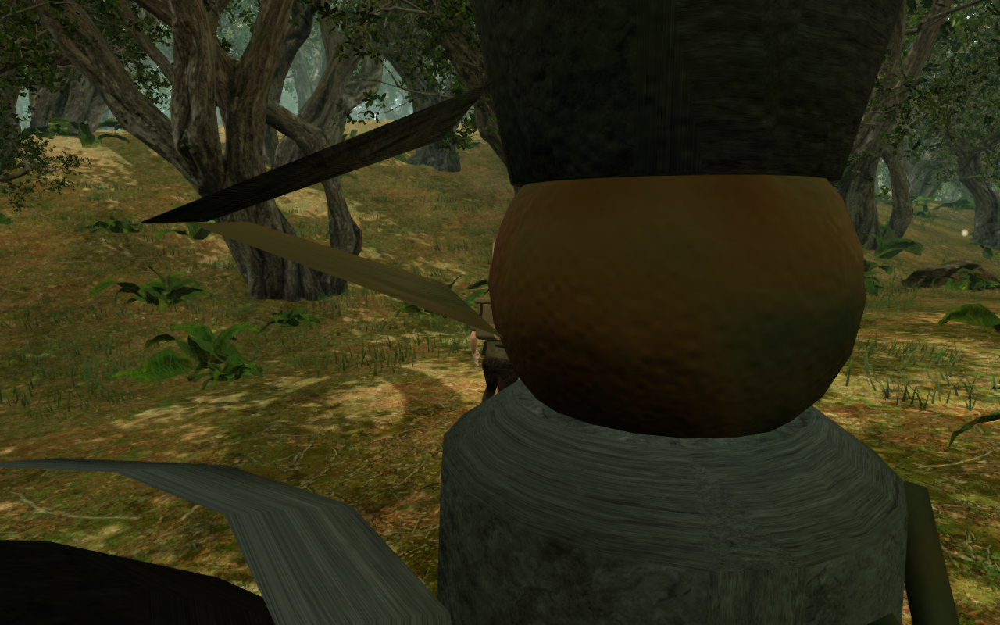
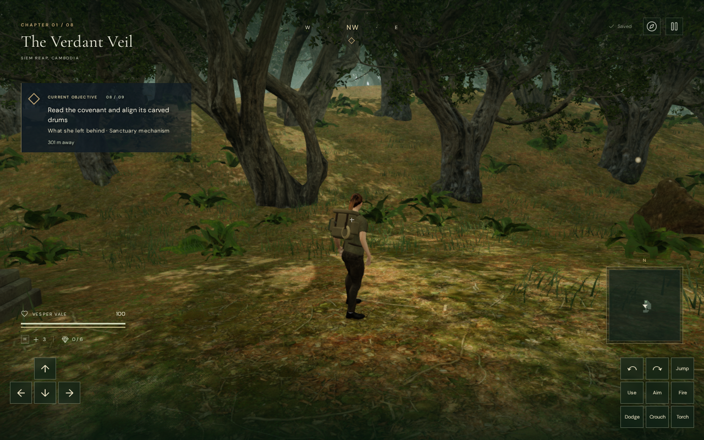
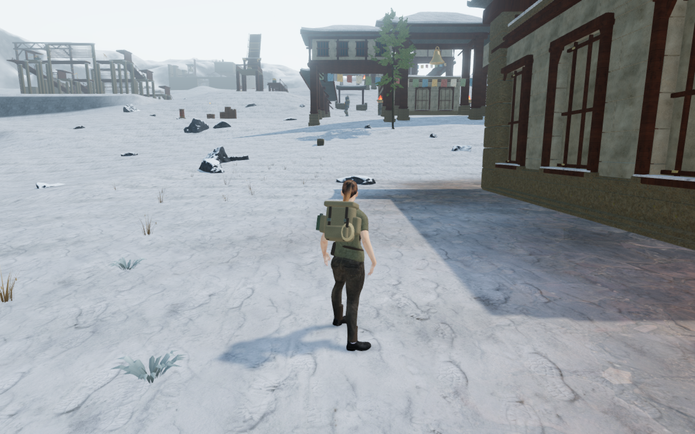
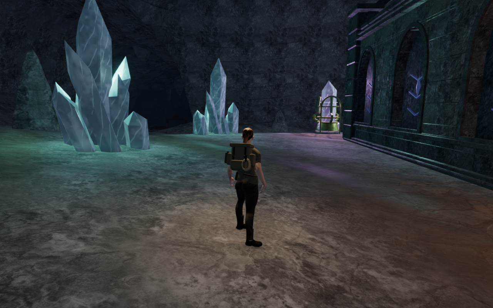
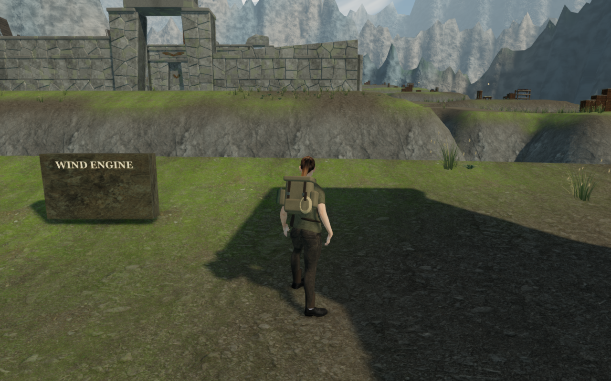
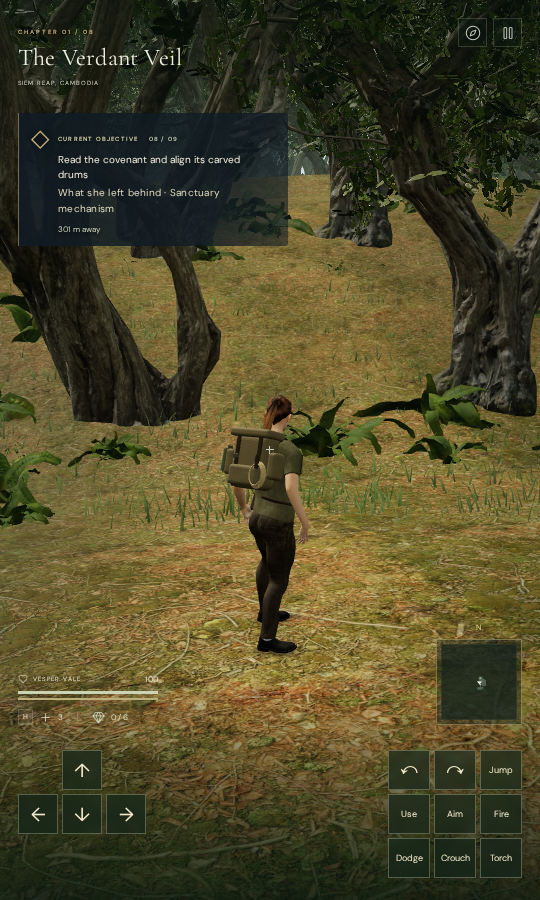

# Guardian camera clearance

A normal jungle walking view could place the camera inside a warden’s torso.
Its armor then filled most of the screen while the explorer remained behind it.
The ordinary scenery clearance check considered that lens position clear.

The camera now includes nearby posed guardian armor in its swept arm and body
framing checks. Separate bone-local bounds follow the rigid armor, limbs,
weapons and shields across both delivered detail tiers. Their union preserves
spaces around the actor instead of treating its entire render sphere as a wall.
The normal follow solver can retract or select a nearby clear orbit, retaining
the player’s chosen yaw and pitch. The guardian remains visible.

The reproduced view before the repair:

A native built-game arrival at the same position and saved look, after camera
recovery:

These are normal game worlds with guardians retained. The native view includes
the interface and a later prepared objective state; it is not a pixel-matched
comparison of every world setting. The earlier gallery inspection removed the simulation array while leaving guardian meshes visible;
the defect was independently reproduced with the actual array before making
this repair. The before/after cameras differ because collision response is the
behavior being checked, rather than a fixed construction-lens comparison.

## Construction and persistence

Each delivered armor vertex is rigidly weighted to one bone. Its bind transform
provides local bounds; high and distant geometry contribute to the same cached
shape. Every camera solve reads the nearby bones’ current transforms once,
shares that snapshot across candidate views, and releases it on return or an
exception. Cache entries contain local shapes, not scene actors. Hidden and
distant guardians do not obstruct the solver.

A target within a close attacker may look outward through that armor, but the
camera endpoint itself must clear it. The actor bounds apply to walking follow,
aimed shoulder sweeps and ordinary/cipher arrival views. Original world-surface
queries still serve physical controls, sight and sound. Save fields are unchanged;
a physical detour does not replace the stored look input.

## Verification

- All **971 automated tests pass**. Four new guardian regressions check all
  four kinds, both detail tiers and sixteen idle/attack/recovery/rush poses.
  Bounds enclose 1,263,360 independently posed delivered vertex records. Other
  checks cover moving/hidden actors, empty side space, original world-ray
  behavior, unchanged look and visibility, and snapshot/error cleanup.
- Sixty-four current observer views cover sixteen actual guardians in all eight
  chapters, with idle, windup, navigation and Low cases. All were reviewed.
  Independent rays against disposable copies of the actual posed armor find
  zero obstruction across 10,409 sampled explorer-body rays. Registered arms,
  grounded legal roots, full health, linked programs and zero GL errors pass.
  Sixteen navigation trials move guardians a combined 8.24 m through their real
  footing checks. Poses and progress are prepared; this is not a full combat
  playthrough. A supervisor deadline interrupted the first observer run after
  42 valid captures; their results were audited and the missing 22 cases were
  verified separately, retaining the original log.
- The production build passes with the existing bundle-size advisory. Native
  keyboard/High and portrait touch/Low exercise the built interface at the
  reproduced jungle position, without development hooks. Walking moves 1.31 m
  and 2.40 m respectively with health 100. Four paused whole-store reload
  comparisons preserve all values except visit timestamps, including the chosen
  camera angles. There are no camera adjustments, failed requests, browser
  errors, warnings or horizontal overflow. All six native captures were reviewed.
  These muted, prepared browser checks do not establish real-phone performance
  or subjective sound quality.
- All verification uses the shared locked five-of-sixteen CPU allowance
  (31.25%), at most two test workers and one browser. Completed workers,
  browsers and preview servers are closed; raw stores, profiles, logs and
  intermediates stay in ignored workspace staging. The final game bundle is
  `game-DlAxX0fr.js`.

A moving hunter in the snow chapter:

The crystal chapter’s sentry windup view:

A cloud-city navigation case:

Native portrait touch arrival:

## Reconciled pool and terrain checks

The earlier full-suite failures came from the intentional `2c14f7d` crystal
working-ground repair. Comparing current terrain against its preceding
`c072798` source finds exactly 98 raised crystal vertices, at most 1.65 m, while
the other seven chapters and every water-site record are identical. Eight of
2,673 crystal main/field working-core samples changed.

The terrain regression now requires those eight exact documented raised values,
then substitutes only their frozen preceding values to check the original
complete-core digest. Every other sample remains protected by the original
hash. It does not simply replace that digest with the new terrain’s digest.

Pool checks use the actual delivered triangle surface for movement. They retain
the original centre-depth and radius limits for the ten unchanged desert and
observatory pools, and require the four corrected crystal radial profiles.
Swimming starts in each retained deep pocket, rather than requiring old centres
that the repaired instrument pads now occupy. Thirteen deep pockets reach a
shallower bank, the final crystal pocket retains shallow water, and two
ground-relative arrivals at formerly wet centres remain on their dry floors.
All 5,656 buried border probes and objective-foundation comparisons remain.

Broader court and chamber composition, sparse surroundings, continuous campaign
routes, moving/underwater contact, listening evaluation and real-device
performance remain open. This repair does not establish whole-campaign visual
acceptance, playthrough duration, subjective audio quality or AAA parity.
