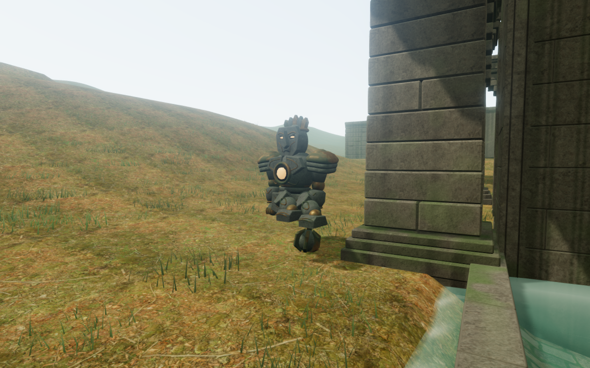
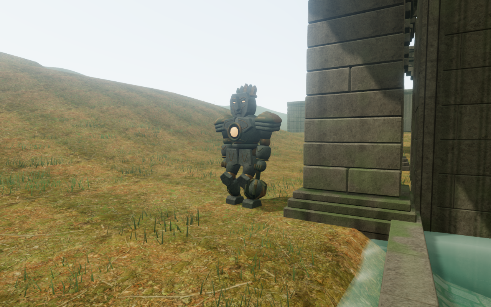
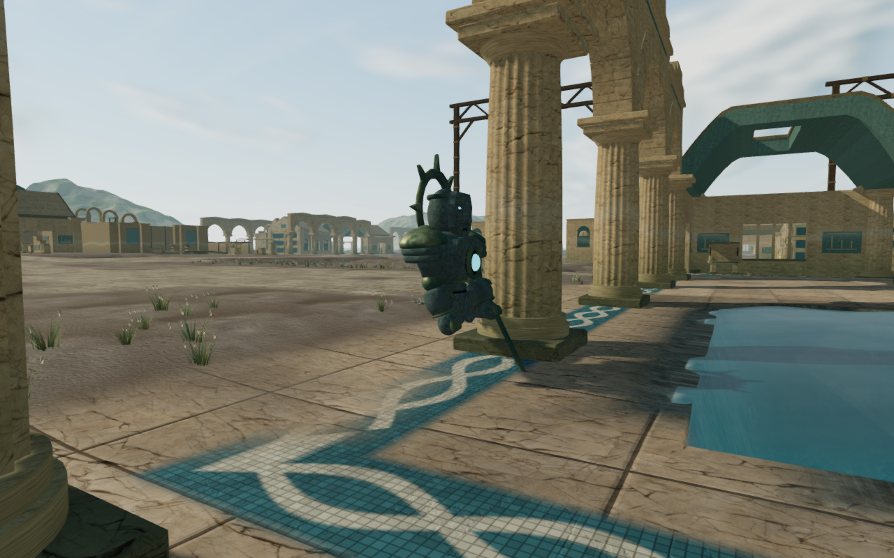
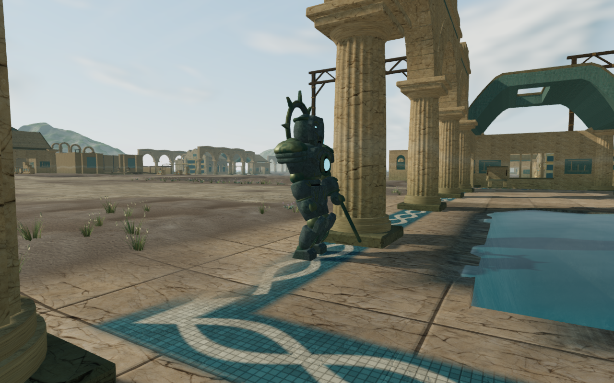

# Guardian soles, slopes and returning patrols

Guardian ankles reached their targets while the rigid soles could still enter
sloping ground or the edge of raised paving. A modest 8% by 6% slope reproduced
2.6–3.7 cm of sole intersection across the four guardian types. The chapter
inspection found overlaps up to 18.57 cm at initial positions and 6.55 cm in
sampled patrol poses.

A separate defect folded the legs of returning patrols. Their models stop
posing beyond the rendering distance, while patrol movement continues. The
old world-space foot anchors then belonged to a different location. On return,
the legs tried to reach those anchors and could hang above the ground.

These prepared diagnostic comparisons share the camera, guardian root, player
position and simulation time. They inspect the character from fixed offsets;
they do not establish normal follow-camera framing or a player playthrough.
The four lossless WebP exports preserve the source captures' decoded pixels
and 1280 × 800 dimensions.

## Repair

Foot placement now fits the actual foot geometry to slopes and shallow treads.
Both delivered geometry tiers contribute cached contact points, including sole
bevels and metal fittings. The fitted ankle orientation follows local ground,
with a bounded tilt, and the swing clears intermediate ground as well as its
landing. Planted contacts use 3 mm of clearance. Existing footfalls remain
attached to the posed ankles.

The three detailed boot bindings also sit within the stone toe. The former last
binding projected beyond it and could hold the distant foot unnecessarily high
at a paving edge. A regression checks both geometry tiers for intersection and
unwanted hovering.

Returning visible models replant at their current patrol position. Step lead
also follows actual displacement: patrol torsos turn gradually and can initially
face away from their travel. Leading a step along that delayed facing direction
could place it beyond leg reach. Patrol routes, speeds, encounter rules and save
identifiers retain their existing behavior.

## Evidence and remaining work

All forty selected guardian geometry, surface, camera, patrol and combat tests
pass, as does the production build with its existing bundle-size advisory. The
new regressions inspect delivered sole vertices on slopes and paving edges,
turning movement, distance-culling recovery and movement during a slow torso
turn. Each defect was reproduced before its corresponding repair.

The final browser inspection covers all 122 guardians across eight chapters,
with both geometry tiers at their initial positions: 244 character poses.
Twenty-four assisted patrol segments cover 197.54 m over 5,760 normal enemy
controller updates, with 576 sampled moving poses. Together these observations
inspect 3,110,688 delivered foot vertices against independent rendered terrain
and paving triangles. No embedded or missing samples occur at the 15 mm
tolerance. The lowest planted-foot gaps remain approximately 3 mm; lifted swing
feet are treated separately.

All sixteen preceding and sixteen revised diagnostic captures are reviewed.
Some fixed offsets are obstructed or enter terrain, limiting their usefulness
for visual contact and camera acceptance. The independent sole observations
cover those samples separately. Shaders link and sampled HDR output is finite.
The baseline runner retained a native graphics-driver queue warning and exited
on that warning; its measurements and captures were inspected separately.
The final run has no application error or warning, with native driver diagnostics
retained separately.

The first portrait release case stopped at the existing jungle walking-grid
edge: its second outward move covered only 0.50 m and failed the required
movement distance. The grid and player margin place that boundary at about
x = 374.05 m, z = 49 m, matching the observed stop. A return over the previously
traversed segment provides the revised input case; the visible-ground boundary
remains a separate open finding rather than part of this contact repair.

Built keyboard/High and portrait-touch/Performance cases each defeat the nearby
warden with five native fire inputs, then walk, crouch, look, jump, land and
open the map. All six complete-store reload comparisons pass, excluding only
play timestamps. Both preserve the earned defeat and 82 health. The corrected
touch return covers 2.10 m with its movement-distance assertion unchanged.
All sixteen final release captures are reviewed; served bundles and character
responses match the build. No application error or warning is recorded.

Verification uses the shared locked five-of-sixteen CPU allowance, two test
workers at most and one browser at a time. Owned workers, previews and browser
descendants close after their checks. The contact cache introduces no new GPU
resource or material batch.

This is sampled foot contact, rather than continuous whole-body clearance against
every nearby structure or rock. Apparent shadow separation in sunny close views,
broader body contact, landscape composition, discovery/traversal/water coverage
and listening/device acceptance remain open in the [visual audit](visual-audit.md).
Foliage behind the heading and objective panel also reduces contrast in the
prepared portrait flank view; fitting the viewport alone does not close that
readability finding. No external asset, recording, music or dependency is
introduced.
