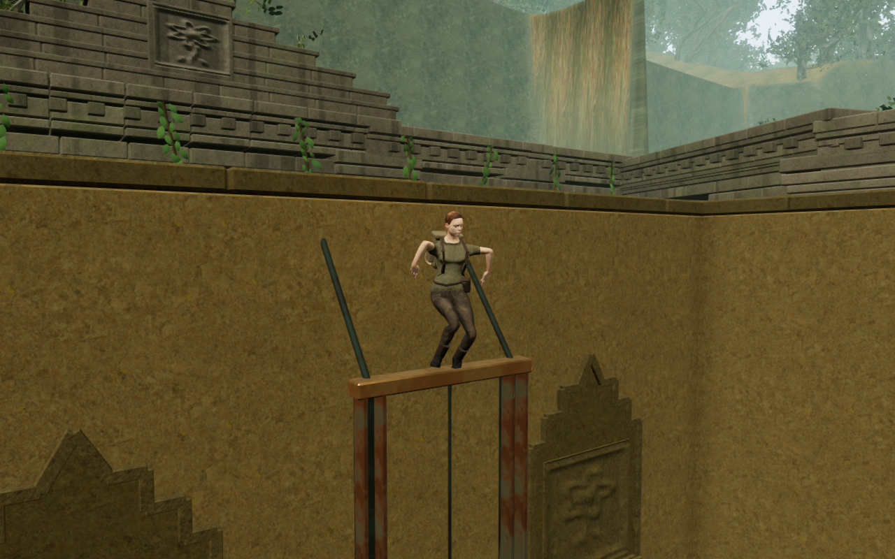
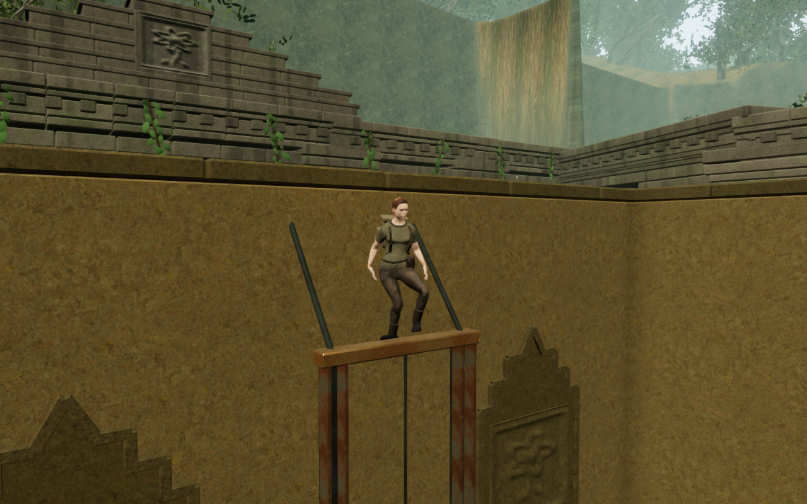

# Landing on the sanctuary hoist beam

The fixed horizontal beam above each first sanctuary guard now catches a
falling explorer on its rendered upper surface. Previously its physical frame
had no support surface and a falling body could enter the beam before clearing
sideways. The fixed beam now has its own triangle-based support and underside
ceiling contact. Glancing descents beside the guide assembly have enough
clearance to leave its narrow members. The diagonal ties, channels and moving
guard retain their existing non-platform behavior.

Both images show zero-based frame thirteen of the same prepared jungle fall on
High at 1280 × 800. The inspection camera uses the same offset and follows the
actual player position. Lossless WebP exports retain the full rendered image
without cropping or retouching. These are contact inspections rather than
human-earned routes onto the beam.

A regression covers six initially clear drops, standing support, a jump and
return, and departure toward the board. Every sampled movement state stays
legal, and the drops retain their initial horizontal coordinates. The preceding
construction fails the drop at frame thirteen. All 69 selected regressions,
three CPU-budget checks and the production build pass, including the eight
existing counterweight walking/grip solutions. The existing build chunk-size
advisory remains.

The delivered jungle chamber repeats four falls over 720 updates. The preceding
response records sixteen invalid root positions in each fall, and three contact
poses have boot vertices more than 15 mm inside the visible beam. With fixed
beam support, all 720 updates remain legal and land at the actual upper face
without horizontal displacement. Twelve sampled character poses check 577,140
vertices with no invalid coordinates or overlap beyond the 15 mm tolerance.
The observer includes only visible furniture; its hidden legacy crystal is
excluded, matching the crystal's physical visibility state. This corrects an
initial observer inclusion that reported a false resting-pose overlap.

Six valid chapter-fixture center drops start in clear air and land on the
beam without invalid movement. The selected water and forge starts already
intersect upper fittings, so those two cases are excluded from fresh-contact
acceptance. The diagonal-brace starts from the first diagnostic are also
initially occupied. These prepared tests do not establish continuous airborne
coverage or rooftop access in every chapter.

All eight regional construction comparisons retain identical vertex attributes
and mesh transforms. Materials, cameras and sound anchors are retained. Seven
final developer-browser images are reviewed, including the follow-camera view
on the beam; sampled shader programs link and HDR inputs stay finite.

Native production keyboard/High and portrait touch/Performance both restore
the measured beam stance at its 5.23 m local height without arrival recovery.
Both crouch, jump, land and walk along the beam at 100 health. Keyboard moves
0.30 m and touch moves 0.40 m. Both complete-store reload comparisons pass,
excluding only per-level timestamps, and retain the supported height. All ten
release captures are reviewed. Loaded JavaScript/CSS names match the current
build, and the developer hook is absent. These cases begin from a save fixture
measured after the prepared fall; they do not prove an earned route onto the
beam from the chapter entrance.

All 423 runtime source hashes and 800 frozen code/test/build inputs match the
verified publication content. No application warning, failed asset request or
WebGL error is recorded in the accepted browser runs. Browsers and temporary
previews close after verification.

The broader [playable-world audit](visual-audit.md) remains open, including
wider scenery, constrained views, continuous moving contact and listening and
device acceptance. Verification uses the shared five-of-sixteen CPU allowance;
owned browsers and previews close after their runs.
