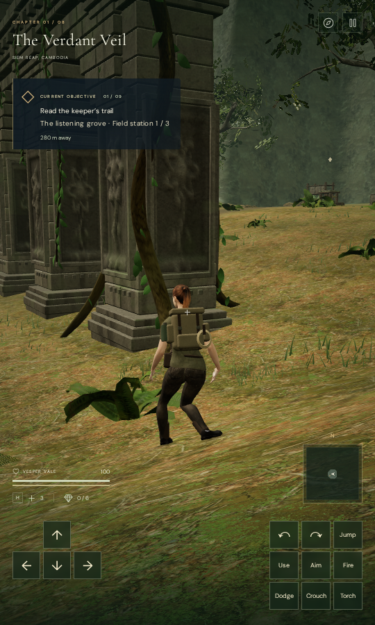
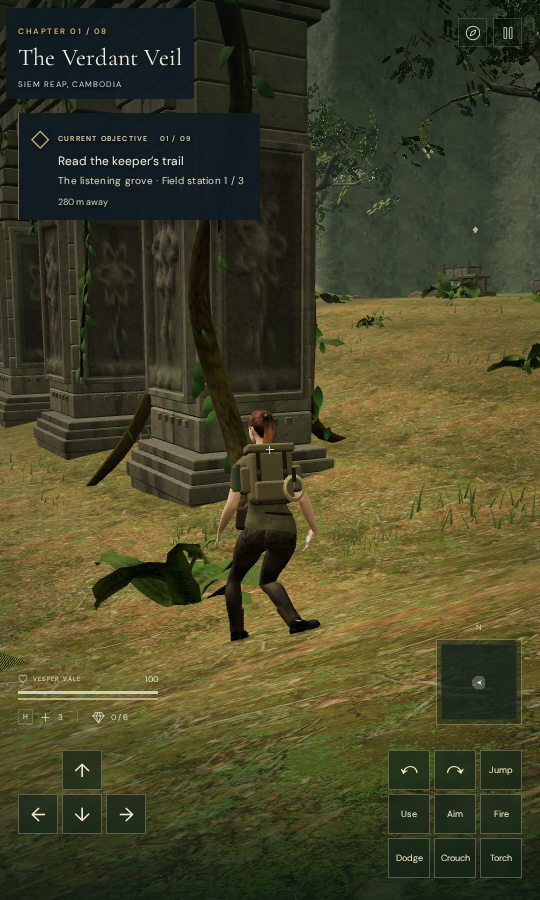
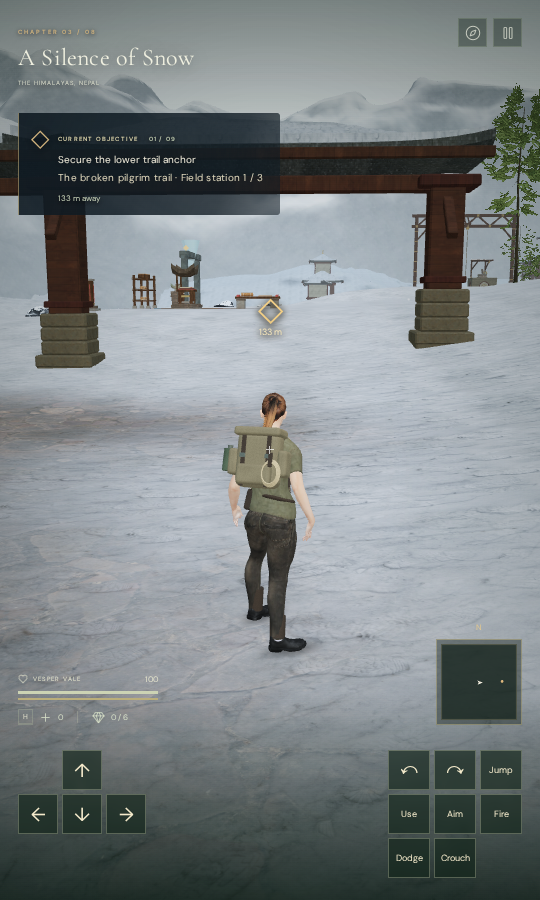
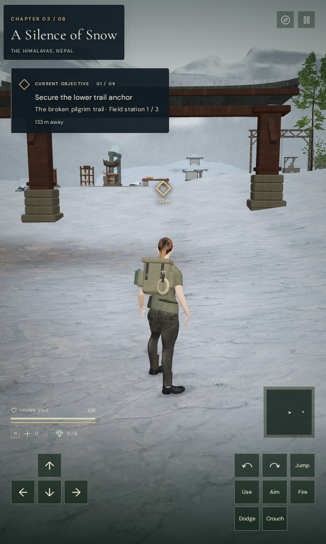

# Chapter and objective readability

The chapter heading and current objective now use a consistent dark backing.
The former heading depended on shadows over the world, while the objective
panel became much more transparent toward its right edge. Bright scenery and
near foliage competed with those labels.

The heading, action buttons and objective share a two-row layout. The objective
follows the heading's actual height, including wrapped titles, instead of
relying on a fixed vertical offset. Both panels paint above projected world
markers. A compact desert view reproduced a waypoint crossing the chapter
title; it now passes beneath the backing.

At widths up to 550 pixels, chapter and location labels increase from 6 to 8
pixels, the objective label from 6 to 7, the main instruction from 10 to 12,
and the distance from 8 to 9. The background uses ordinary CSS gradients.

The pairs are actual prepared Performance-preset game captures at 540 × 900.
Each pair shares a frozen world, camera and explorer pose. The control restores
the preceding HUD placement, styling and type sizes; the revised capture uses
the current layout. The pause dialog is hidden for the photographs.

## Evidence

A browser observer reads the actual text runs and their computed foreground
colors, then captures the same view with their text and shadows removed.
It compares those colors with every sampled background pixel inside the text
run rectangles. This measures the backing beneath the text without treating
the text's own pixels or shadows as its background. The comparison uses linear
relative luminance and a project target of at least 4.5:1.

The nine actual scenery cases cover the recorded jungle flank and all eight
chapter starts at 540 × 900, followed by each revised layout at 360 × 740.
The following values are the lowest sampled ratios at 540 × 900:

| Scene | Previous HUD | Revised HUD |
| --- | ---: | ---: |
| Recorded jungle flank | 5.354 | 8.252 |
| Jungle start | 4.802 | 8.260 |
| Desert start | 2.267 | 7.972 |
| Snow start | 1.681 | 7.810 |
| Coastal start | 2.225 | 8.040 |
| Volcanic start | 5.228 | 8.252 |
| Sky start | 2.915 | 8.080 |
| Cavern start | 8.440 | 8.428 |
| Final chapter start | 7.532 | 8.340 |

White, black and checkerboard background controls also cover 360 × 740,
540 × 900, 900 × 540 and 1280 × 800. Across all 51 control/revised observations,
the 30 revised cases pass the contrast and layout checks. Their 451,410 sampled
text-background pixels have a minimum ratio of 7.207:1. The preceding white
and checkerboard controls reach 1.161:1, confirming that the observer detects
the former dependence on scenery.

All eighteen revised scenery captures and four revised white-background
captures are reviewed, along with both preceding documentation views. The
heading backings clear the action buttons, the objectives clear the headings,
and all observed text runs fit inside the viewport. Map and pause button hit
checks pass, with no horizontal overflow. Application errors and warnings are
absent; the checked main script and stylesheet hashes remain unchanged.

The production build passes with its existing bundle-size advisory. Native
keyboard/High and portrait-touch/Performance cases move from the recorded
flank, open and close the map, pause and reload. The first moves cover 1.1952 m
and 1.8000 m. All four complete-store reload comparisons pass, excluding only
play timestamps. The heading's input-hit check reaches the game canvas, and
the revised map/pause buttons operate normally. All twelve release captures
are reviewed; served bundle names match the build, with no application error,
warning or horizontal layout overflow. These prepared cases mark guardians
defeated; they do not verify combat or a complete objective playthrough.

The four documentation exports retain identical decoded pixels and dimensions
in lossless WebP. Checks use the shared locked five-of-sixteen CPU allowance,
one browser at a time and sequential expensive workloads. Thread-affinity
audits pass; the owned previews, workers and browser descendants close after
their checks. No external asset, font or recording is added.

## Remaining review

VA-162's recorded heading/objective readability problem is repaired. This is
not a complete accessibility or HUD audit: the observer measures these two
panels, not every label, anti-aliased glyph or moving view. The snow and extreme
background reviews still show weak health/supply-label contrast; other HUD
elements need a separate pass. Tree-base strips, possible masonry/soil gaps,
broader composition, body/solid contact and listening/device acceptance remain
open. The graphics acceptance goal remains incomplete.
