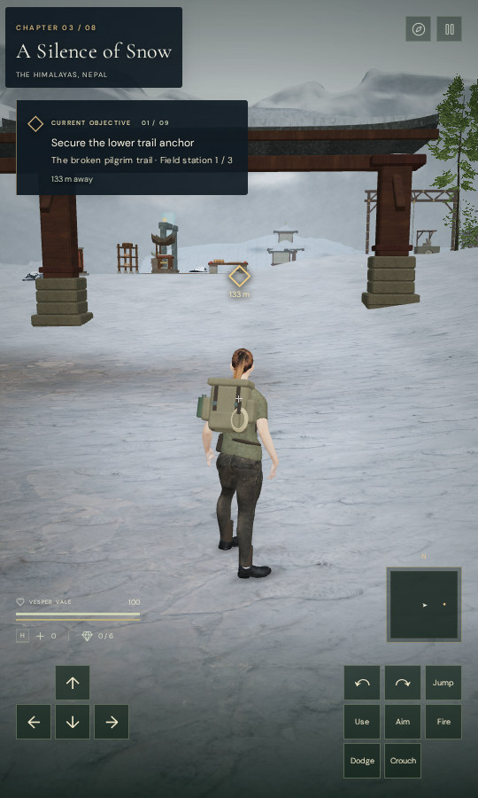
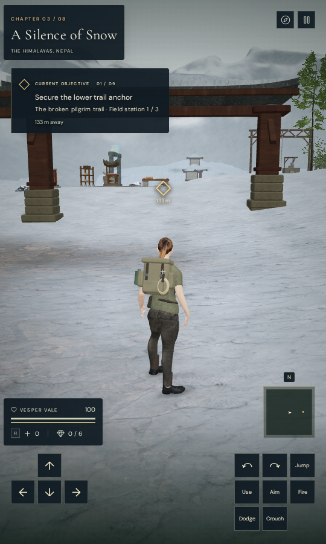
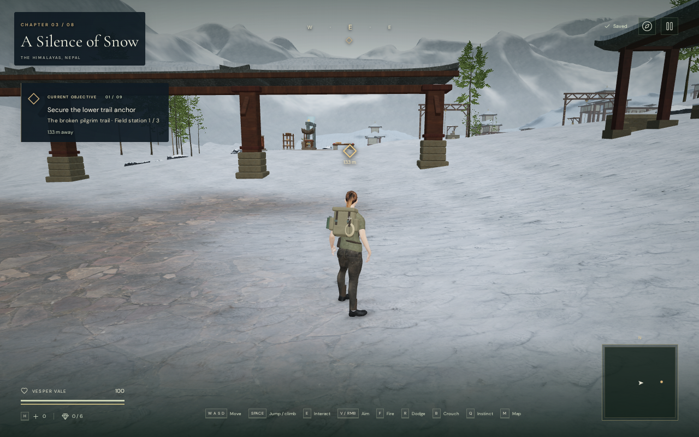
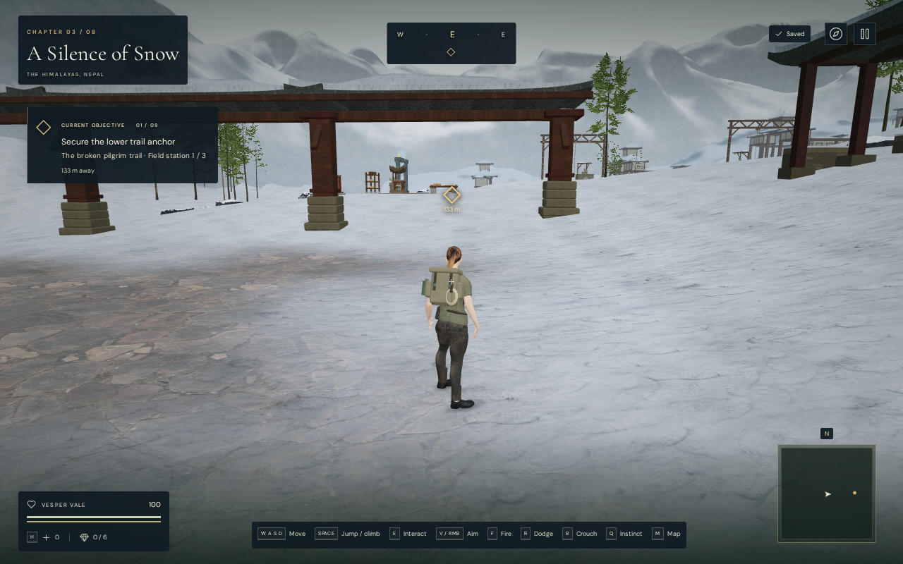

# Health, supplies and navigation labels

The health and supply labels in VA-166 depended on the scenery behind them.
Their pale text became faint over snow and bright controls. The vitals panel
now has the same dark backing as the chapter and objective panels, including
room for air and torch status. Its backing leaves camera input available.

The compass, save indicator, minimap north label and desktop keyboard hints
also have consistent backing. Map/pause buttons and touch controls use the
same surface; selected touch buttons use darker bronze. The landscape compass
backing includes the complete diamond, which the first revised check found
extending below its panel.

At mobile widths, the name label increases from 6 to 8 pixels, the health value
from 8 to 10, and supplies from 8 to 10. Desktop keyboard hints increase from
8 to 9 pixels. Existing controls, save behavior and world assets are unchanged.

Each pair is an actual prepared Performance-preset view with the same frozen
world, camera and pose. The control uses the complete preceding stylesheet;
the revision uses the updated styles. CSS transitions are frozen for both
captures, and the pause dialog is hidden. Lossless WebP exports preserve the
source pixels and dimensions without cropping or retouching.

## Evidence

The observer reads actual text runs and SVG foreground colors, hides their
text/strokes and shadows, and samples the rendered backing beneath their
rectangles. It compares linear relative luminance against a project target of
at least 4.5:1. Freezing color transitions prevents a partially faded button
glyph from contaminating the background sample. These measurements do not
measure every anti-aliased glyph or establish accessibility certification.

Eight actual chapter starts cover the revised interface at 540 × 900 and
360 × 740, with preceding-style comparisons at the larger size. The lowest
sampled text/icon ratios at 540 × 900 are:

| Chapter | Previous labels | Revised labels |
| --- | ---: | ---: |
| The Verdant Veil | 2.306 | 9.997 |
| Beneath the Sands | 1.609 | 9.709 |
| A Silence of Snow | 1.336 | 9.502 |
| The Drowned Kingdom | 2.389 | 9.738 |
| A Heart of Embers | 7.284 | 10.159 |
| Where Eagles Sleep | 4.852 | 9.853 |
| The Night Below | 3.904 | 10.081 |
| The Last Meridian | 7.317 | 10.380 |

White, black and checkerboard controls cover 360 × 740, 540 × 900, 900 × 540
and 1280 × 800. Selected touch buttons receive a separate white-background
check at each size. A separate desktop input context covers the snowy start
and all three backgrounds with keyboard hints visible. Six synthetic UI-state
fixtures cover normal air, low air and a lit torch at both portrait widths.
Those fixtures exercise labels and layout, not actual swimming or torch inputs.

All 42 revised observations pass, alongside 24 preceding-style controls.
Across 316,638 sampled revised text/icon background pixels, the minimum ratio
is 6.374:1. Labels remain within the viewport, compass text remains inside its
backing, vitals clear the map and touch controls, and map/pause hit checks pass.
The final sweep retains 38 earlier observations whose layouts hide the
compass: the only intervening stylesheet change extended that hidden element's
backing. A supplemental run corrects the synthetic status inputs while retaining
the 60 unchanged ordinary/control observations. Application errors and warnings
are absent; final stylesheet and main-script hashes remain unchanged.

All 32 revised scenery, white-background, selected-button and status captures
are reviewed, along with the two preceding documentation views.

The production build passes with its existing bundle-size advisory. Native
keyboard/High and portrait-touch/Performance cases start at the snow entry,
move 1.2462 m and 1.8000 m, crouch and stand, open/close the map, pause and
reload. The vitals and heading leave camera input routed to the game canvas.
All four complete-store reload comparisons pass, excluding only play
timestamps. All fourteen release captures are reviewed, with no horizontal
overflow or application errors/warnings. Served bundle names match the build.
These are short entry input/save checks, not complete objective or combat
playthroughs. No full unit-suite rerun is needed for this stylesheet change;
the actual contrast, layout, input and build checks cover the changed behavior.

Checks use the shared locked five-of-sixteen CPU allowance, at most two test
workers and one browser, with expensive workloads run sequentially. Thread
affinity audits pass, and owned previews, workers and browser descendants close
after their checks. All five documentation exports, including the separate
pier review image, retain identical decoded pixels and dimensions.

## Remaining review

This addresses VA-166's recorded health/supply-label contrast and the shared
static navigation/control labels tested above. It does not close the broader
world, body/solid contact, device or subjective audio review. The native snow
crouch capture still shows faint quiet-steps status, recorded as VA-167. Other
contextual prompts and moving views remain outside this contrast observer's
scope; unbacked world-marker distance labels also remain weak in the artificial
white-background controls.
