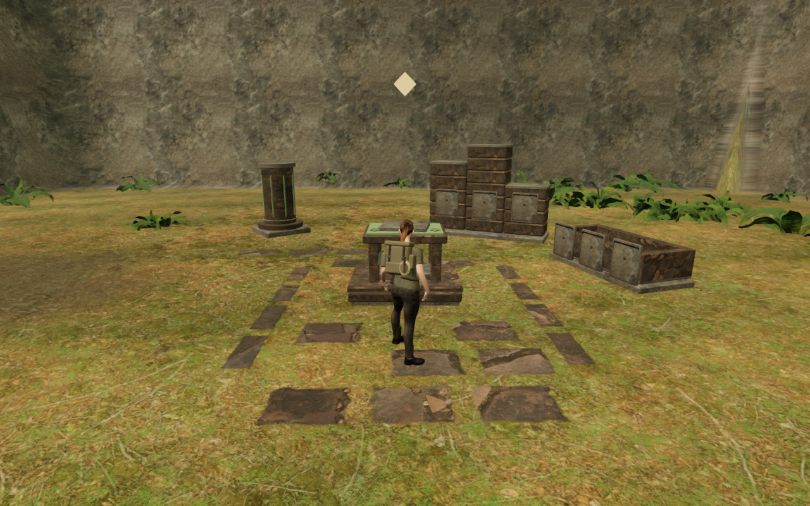
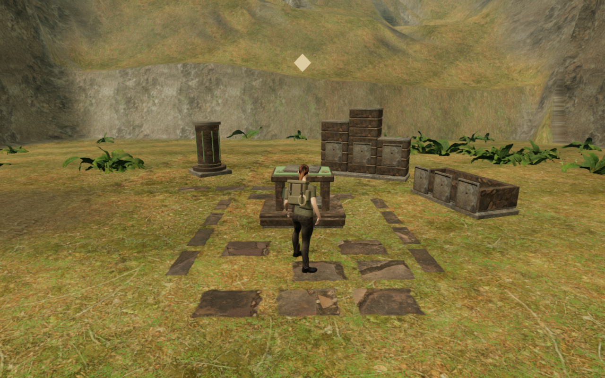

# Graded jungle boundary and outer terraces

The archive approach exposed a nearly vertical rock sheet across the valley
edge. A ray trace against the delivered terrain locates a 25.436 m rise inside
one 1.75 m cell: the boundary vertex stood at 34.234 m while its inward neighbour
stood at 8.797 m. The preceding rim treatment preserved that strip, leaving the
large sheet in place.

Where authored routes approach the boundary, the last cell now retains a lower,
varied rock edge. The measured archive rise is 4.584 m. The larger elevation
continues into three unequal beds on the outer forest floor, with interrupted
channels and more closely spaced mesh rings near the join. Existing wooded
banks inside the valley retain their profiles and protected root areas.

The main height-field comparison changes 261 vertices, all within the outer
3.5 m. All 33,280 authored walking vertices, 1,573 buffered water-bed vertices
and 45,369 interior vertices retain their published values. These sets overlap.
Water, bridge, physical-court and visual-court data also match. The other seven
chapters retain their height and court fields, water and bridge data. The old
boundary-strip height digest is deliberately replaced by the new grade and
joined-mesh contracts; preserving it would preserve the observed sheet.

The outer bank reads the exact new terrain edge. Its additional rings resolve
the terrace transitions, and corner-specific normal fitting repairs lighting
vectors that oppose their delivered faces. Existing geometry tests inspect all
four joins and every triangle's winding and normal agreement. Tree seating
continues to use the actual outer-bank triangles, including their internal
diagonals, across distance tiers.

All 78 selected tests across fifteen files pass, together with the build and
three CPU-budget checks. Coverage includes retained height digests, boundary
walking and repeated jumps, physical terrain obstruction beyond the stopped
poses, root and apron seating, full planted-forest path checks, terrain support,
camera sight, discovery approaches and court contracts. The bare forest fixture
accepts 734 trees rather than 731, with its existing path-centre and visible
wood-witness checks retained. The build keeps its existing bundle-size advisory.

In the actual final jungle world, six prepared boundary walking/jumping legs
and three tree approaches complete 7,650 controller updates with legal positions
and grounded ends. Eleven stopped poses inspect 529,045 delivered character
vertices against independently read terrain triangles, with no embedding beyond
15 mm, invalid coordinates or missing ground. These are terrain-embedding
checks; they do not prove continuous contact or complete body/sole support
against every surface.

All eighteen discovery collection stances remain legal, camera-clear and
reachable, selecting the intended discovery and retaining their published
placement records. The final world plants 734 woodland trees and 1,023 outer
trees. All 1,064,866 inspected root samples across 4,248 distance-tier records
remain seated, with no missing support or reserved-footprint violations.
The independent normal observer accepts all 456,768 terrain/outer-bank corners
and detects every reversed control. Normal fitting repairs 188 outer-bank
lighting corners without changing their triangle positions.

All 33 final High development views are reviewed against 27 published-source
baseline views. Three court angles remain partly hidden by foreground trees;
the close boundary views provide separate local coverage. Shaders link,
sampled render buffers stay finite and no unexpected browser error or warning
is recorded. All 440 runtime files match the tested source.

Production keyboard/High and portrait touch/Performance retain the prepared
forest approach, move at full health and keep stage zero. Four complete-store
comparisons pass across the initial and post-movement reloads, ignoring only
per-level `lastPlayed` timestamps. All six release images are reviewed. Bundle
names match the verified build and the development hook is absent. These are
short prepared input checks with guardians disabled and sound muted; broader
earned routes, combat and subjective audio acceptance remain separate.

The paired figures use the same prepared player position, follow camera and
elapsed scene time at High, at 1280 × 800. They are lossless WebP exports of
actual game frames, with identical decoded source RGB pixels and dimensions.

| Previous boundary sheet | Lower rock edge and outer terraces |
| --- | --- |
|  |  |

Verification uses the shared locked five-of-sixteen CPU allowance at lower
priority, with at most two test workers and one browser. Staging, fixture saves,
captures, browser profiles and installed dependencies remain under the ignored
local directory. Each browser and preview server closes after its check.

Broad eastern rock faces remain visible. The wider cliff composition, shared
court massing, sparse surrounding spaces, continuous moving-body contact,
listening review and consumer-device evaluation remain open. This revision
addresses the measured boundary sheet; the full game goal remains active.
