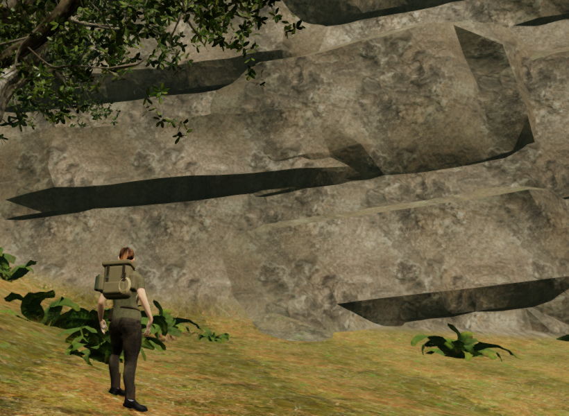
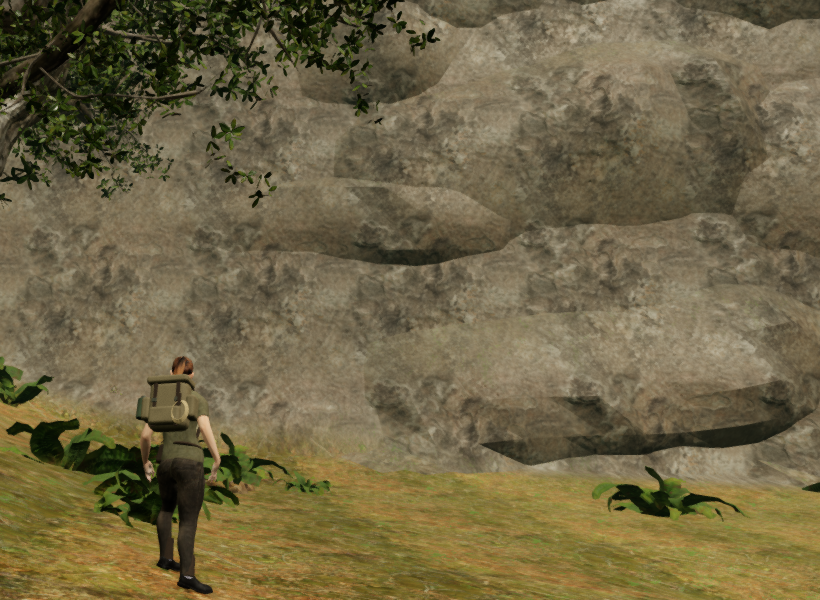

# Weathered jungle buttresses

The cliff review showed long, evenly projecting shelves with dark, straight
undersides. The exposed rock pieces now taper over their height, vary their
shoulders and recess into seeded vertical channels. Shorter, unequal
buttresses interrupt the shelves while retaining the existing stone material.

The changed closed geometry supplies rendering, body collision, exposed
walking support, camera cells and sight/sound cover. The perimeter seating and
back-face burial checks still reject pieces that fail to join the hillside.
Terrain heights, walking cells and water data remain unchanged.

In a geometry-only comparison with published source `398e926`, the number of
connected exposed underside spans longer than eight metres falls from 33 to
eight. This measurement groups delivered downward-facing triangles sharing
an edge; it is a shape diagnostic, not a rating of visual quality. The longest
measured span falls from 14.36 m to 13.27 m, so long forms remain in places.
The revised seating accepts 63 sites and 252 closed pieces, compared with
60 sites and 240 pieces. Total triangles increase from 108,128 to 113,680;
the grid density within each piece is unchanged.

The figures preserve every RGB pixel of the same 820 × 600 region of actual
High game frames. Player and camera coordinates, camera rotation, view angles
and scene time match. They are neither resampled nor retouched. Guardians are
disabled and audio muted for this assisted local inspection.

## Contact and regression coverage

Recorded bank heights can describe a shoulder that has moved. The character
fixtures now settle those heights through the current support surface and
local arrival search before checking skin contact. They retain strict checks
for both soles, ankle separation, legal roots and terrain/stone clearance at
every recorded facing. The legacy wall-perch height must still fall to legal
support. A current bank control reproduces the high-foot problem when natural
footing is disabled, and restores both contacts when it is enabled.

The recovered crouch is checked over 65 updates. The new bank clears the
previous relaxed-finger overlap, so a small delivered contact control now
encloses actual distal hand skin to retain an independent obstruction-response
check. With feedback enabled, the fitted skin must clear that control without
moving the player. This control is test geometry, not a new prop in the game.

The cliff ray fixture now checks every front triangle, including narrow
shoulders between channels. The campaign observer continues its existing
sampling interval. It records fewer exposed rays and walkable ledges because
the new forms project less uniformly; every observed render/physical/camera
comparison must still agree.

## Recorded checks

- All 236 selected tests across 33 files, the build and three CPU-budget
  checks pass. The existing build chunk-size advisory remains. The tests
  include the actual cliff joins and query kernels, changed bank/crouch
  fixtures, shared terrain factories, audio, camera and foliage behavior.
- Six live approach/jump/stop sequences complete 6,300 controller updates and
  84 independent moving-body inspections against delivered terrain and closed
  stone. All six stopped roots are legal and grounded. Both footwear soles
  retain contact in each stopped view, with minimum gaps of approximately
  6 mm and at least 26 contact records per foot.
- The delivered world passes 376,456 back/perimeter probes with no missing
  ground or exposed join. All 113,680 triangles belong to 252 closed
  components. Render, physical and camera queries agree across 766 sampled
  rays, including 66 supported ledges, with no reported failures.
- All 797,808 checked terrain, fringe and cliff lighting corners have finite,
  correctly oriented normals; reversed controls detect every corner. All
  inspected roots of the 705 woodland and 1,023 fringe trees have finite
  support and no reported gap. All 134 sound origins clear the cliff volume,
  and all eighteen discovery approaches remain legal, reachable, camera-clear
  and nearest to their own collectible.
- Production keyboard movement at High and portrait touch movement at
  Performance preserve stage 0 and health 100. A published occupied-bed save
  recovers 75 cm locally and retains field/journal progress. All three cases
  pass two complete-store reload comparisons each, omitting only
  `lastPlayed`. Release script/style names match the build, the development
  hook is absent and the portrait viewport has no horizontal overflow.

All twelve final High prepared/stopped views and nine release views are
reviewed. The twelve prepared/stopped poses retain contact on both soles and
pass their sampled terrain/closed-stone body checks. The final checks report no
failed assets, console errors or application warnings; Chromium GPU-readback
notices are excluded from warning totals. Verification stays under the shared
five-of-sixteen CPU allowance, and owned browsers/previews close after each run.

## Remaining work

The eastern comparison still contains broad terrain sheets, and some cliff
undersides remain long. Foreground tree composition, larger cliff/court forms,
sparse spaces and wider continuous route/water/contact coverage remain open.
The eight-world visual audit, listening review and device coverage are not
complete. This local pass does not establish consumer hardware performance,
subjective audio quality or AAA graphics.
