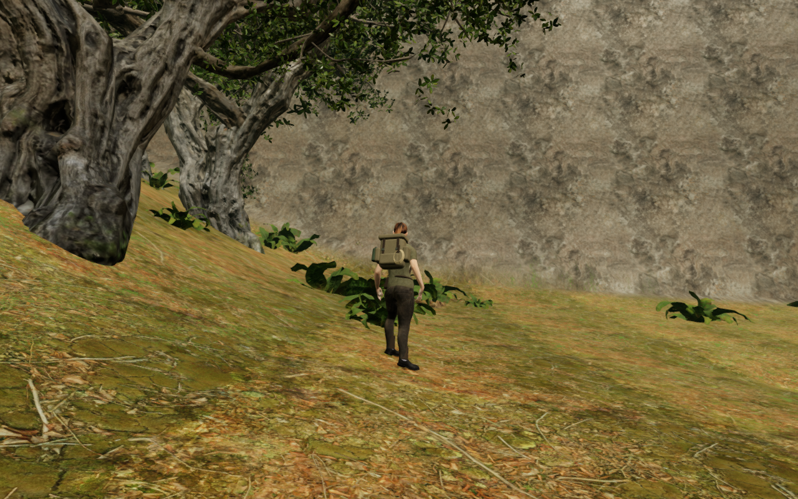
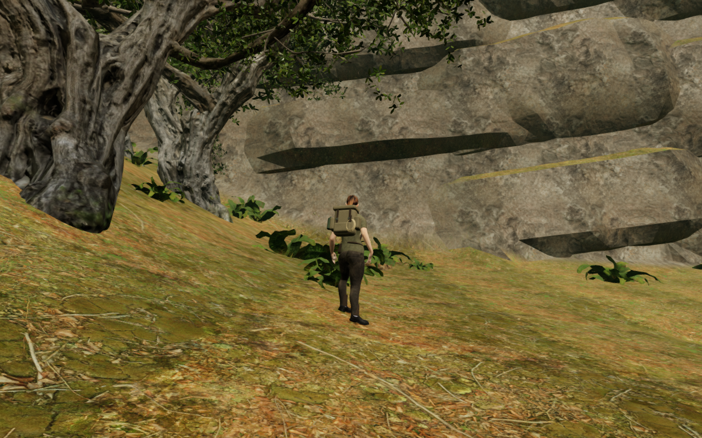

# Jungle cliff beds and descending-jump soles

The eastern woodland approach exposed a broad, nearly flat rock sheet. The
jungle cliffs now carry broad, staggered stone beds with unequal heights,
sloping fractures and moss on their upper faces. The initial narrow, aligned
forms read as a grid of attached blocks and were discarded.

Sixty accepted assemblies contain 240 closed pieces, batched into one shared
terrain-material mesh with 108,128 triangles. Each piece follows the actual
triangle surface of its hillside. A perimeter fit retreats edges where an
erosion hollow would otherwise expose the join; buried backs close the volume.
Candidates that cannot seat all four pieces are omitted. Authored routes,
traversal courses, discoveries, water and existing installations retain their
reserved space. Neighbouring closed rock beds may intersect as a solid union.

Movement, support, sight, existing sound occlusion and projectile queries use
copies of the actual closed triangles. The camera retains matching convex
cells, including clearance for its swept radius, after render batching disposes
the source geometry. Nature placement tests the finite stone volume so a buried
back does not reserve an invisible column through the woodland above it.

The eight terrain-factory comparisons retain every stored height, court and
bank field, plus water and bridge data. This revision adds physical relief;
the main terrain and outer woodland floor retain their published profiles.

The moving-body review also exposed an airborne-pose defect. A descending jump
could leave the controller legal while an uphill boot entered the terrain by
about 7 cm. Flight feet now use delivered sole probes to tuck clear of nearby
ground, within a bounded ankle lift. The root, saved position and velocity do
not move. Ordinary flight in clear air retains its previous pose.

All 191 selected tests across 27 files pass, together with the build and three
CPU-budget checks. Coverage includes closed volumes, independently read joins,
displaced-geometry and missing-camera controls, rendered ray/query agreement,
ledge support, nature clearance and batching. Delivered-character tests cover
48 slope, facing and height combinations, detect untreated penetration and
retain clear-air flight. The build keeps its existing bundle-size advisory.

In the actual jungle world, all 240 components close. The independent observer
accepts 307,104 back and 50,960 perimeter samples against delivered terrain
triangles; a 200 m displacement control exposes every required join and restores
the draw buffers. Registered physical and camera queries match 1,583 rendered
rays, including 228 upward ledges and 1,583 interior-volume probes. One ray with
an origin inside another bed is excluded from the entry-distance comparison.

Ten boundary and cliff approaches complete 10,500 controller updates. Their
140 sampled moving-body poses and fifteen stopped/prepared poses inspect
7,454,725 delivered character vertex records against terrain and the new stone.
No sampled embedding exceeds 15 mm; terrain support is present and coordinates
are finite. These are sampled contact checks, not continuous proof of sole
support or a complete traversal playthrough.

A separate three-leg repeat supplies measured movement speed and samples
actual walking/running clips as well as flight and rest. Its 1,260 controller
updates and 45 body poses pass the same terrain/stone checks. Three tree
approaches add 1,350 controller updates with legal, grounded ends. Chapter
replacement disposes all sixteen tracked cliff geometry, shared material and
texture resources once, clears the cliff state and removes its old obstacle
and camera references.

All eighteen discovery collection stances remain legal, camera-clear and
reachable, selecting the intended item. The world retains 707 inner woodland
trees and 1,023 outer trees; the updated stone-clearance rules omit 27 inner
trees. All 1,041,739 inspected root samples across 4,167 tier
records retain support, without reserved-space violations. All 781,152 terrain,
outer-bank and cliff lighting corners pass, including reversed-normal controls.
The 134 sound origins remain finite and outside the new rock volume. These
checks do not establish subjective audio quality.

All 37 final High world views and 27 published-source baseline views are
reviewed, using full-size close views and labelled diagnostic contact sheets.
Foreground trees still obscure three court angles and some bank views. The
inspection cameras remain outside the delivered new stone. Shaders link and
sampled render buffers remain finite, without unexpected browser warnings or
errors.

An archived copy of all 440 published runtime files establishes a previously
legal saved position on the south bank. Loading it in the current application
raises the root by 0.192 m at the same X/Z, clearing the newly occupied volume.
The arrival is already legal before the pose helper runs, and its 48,095
character records clear both terrain and stone. Its steep-bank resting pose
still looks awkward and remains a visual follow-up despite the legal root and
sampled volume clearance.

Production keyboard/High and portrait touch/Performance retain the prepared
cliff approach and accept movement at full health and stage zero. Four
complete-store reload comparisons pass, ignoring only per-chapter `lastPlayed`
timestamps. The independently established older save also recovers in the
release build and passes a fifth complete-store reload comparison, without
vertical drift. All eight release images are reviewed. Served bundle names
match the verified build and the development hook is absent.

These are short prepared input checks with guardians disabled and audio muted.
They do not replace earned-route, combat, subjective listening or consumer-device
acceptance. All 443 runtime files match the tested source. Verification uses
the shared locked five-of-sixteen CPU set, at most two test workers and one
browser, with expensive checks run sequentially. Owned browsers and preview
servers close after each check. Temporary fixtures, profiles and reports remain
under the ignored local directory.

| Published eastern sheet | Current stone beds |
| --- | --- |
|  |  |

The figures are actual High-preset game frames at 1280 × 800, with the same
prepared player position, follow camera and elapsed scene time. The lossless
WebP exports retain the original decoded RGB pixels and dimensions.

The full world goal remains active. Broader cliff composition, repeated court
massing, sparse margins, steep-bank resting poses, foreground occlusion,
continuous contact across every route, listening and consumer-device evaluation
remain open.
