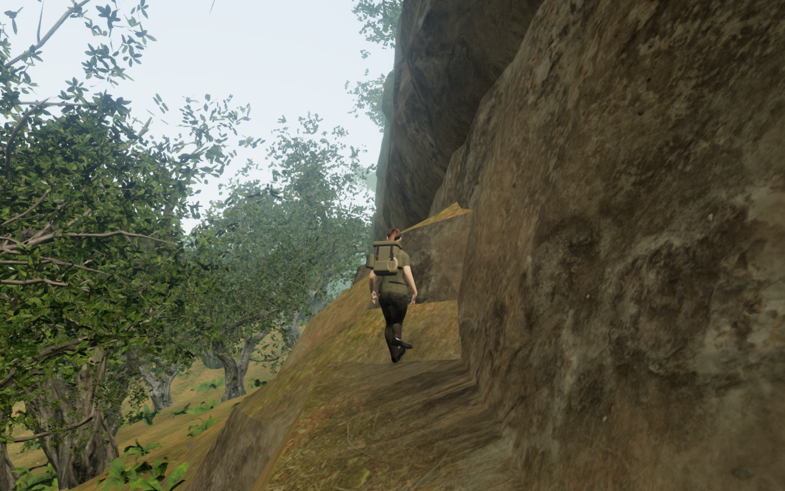
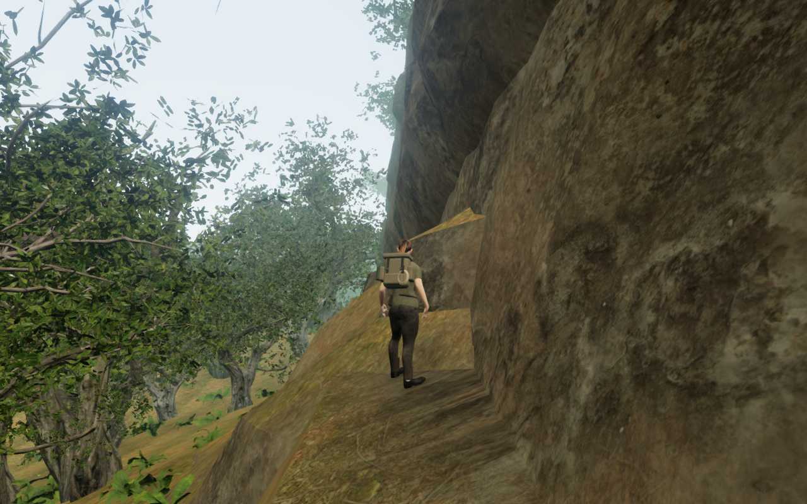

# Exposed jungle cliff footing

Follow-up: [Bank resting stances](bank-resting-stances.md) addresses the small
boot gaps and raised ordinary-bank idle poses recorded below. This page retains
the evidence and limits of the preceding milestone.

The cliff-bed repeat found two different resting defects. At the retained
save position near the southern bank, the controller stood legally while
one boot crossed toward the other ankle and hovered about 26 cm above its
floor. Other positions rested on upward rock faces hidden inside the
hillside. Fitting the visible legs alone could not correct those wall perches.

The natural beds now have a separate walking-support index. Each upward
rock face is clipped against the two actual terrain triangles in every
overlapping grid cell, using a 5 mm separation before Float32 storage.
The closed rock volume still handles body collision, projectiles,
sight and sound cover. Camera geometry and rendered cliff geometry retain
their preceding construction. The temporary support geometry is disposed
after its CPU coordinates are copied into the index.

Natural-bed boot queries select upward surfaces below the actual footwear,
including lower exposed treads beneath an overhang. They can follow the
ordinary soil beside a low bed instead of pulling one ankle across the body
onto a narrow stone edge. A bounded shorter idle stagger helps on abrupt
banks; the existing leg fit also checks standing trouser clearance there.
These pose adjustments do not move the controller or change its velocity.

The browser repeat also found a boot entering the uphill soil after the
western wall descent ended on a tree branch. Replaying the actual 9,931
tree triangles and the delivered actor reproduces 70 embedded footwear
records, with a deepest observed gap of about 122 mm. The planted boot's
fit exhausted its five correction passes. Ten bounded passes clear that
sampled overlap, preserve the supported root and leave observed footwear
contact with the floor; each vertical correction
still has the existing 3 cm limit. Clear poses exit the loop early.

The matched frames use High quality, the same prepared root, facing, camera
and scene time, with guardians disabled and audio muted for inspection.
The preceding frame uses published source `aea067b`; the revised frame uses
the tested implementation. They are lossless game-frame exports, with no
retouching. They establish this local comparison, not broader world acceptance.

## Recorded checks

- All 198 selected tests across 29 files pass, including the actual delivered
  actor in eight resting directions, explicit floating/lowered footwear
  controls, a lower tread beneath a roof, steep-face rejection, and exposure
  clipping against both terrain diagonals. An uncut cap reproduces the buried
  support; raising it exposes its top. The production build and three
  CPU-budget tests pass. The existing chunk-size advisory remains.
- The recovered western branch rest has an additional real-asset regression
  using its recorded tree placement and actual terrain triangles. It keeps
  the supported root and an observed planted contact while the full delivered
  body clears the terrain at the 15 mm threshold.
- The retained root at `(119, 13.410755, 410.5)` keeps its exposed body support
  to within one micrometre. With the former pose policy, the independent
  delivered-footwear observer reproduces the raised boot. All eight revised
  facings have observed low-footwear contact on both sides, preserve ankle
  separation, and pass the full-body terrain and stone observations at the
  15 mm penetration threshold.
- A geometry-only campaign sweep finds 47 eligible low-bed sites and checks
  four facings at each: 188 poses. All full-body terrain/stone inspections
  pass. Two facings still flag a small unsupported boot gap, about 29 and
  34 mm. They remain open findings; runtime contact declarations alone are
  not accepted as sole-contact evidence. This sweep does not include the
  rest of the world's props and vegetation.
- All 52 positions retained from the preceding support sweep complete 180
  controller updates each without an illegal body position, finishing grounded.
  Thirty-seven now choose a different support height. At the reproduced
  western wall perch, the uncut kernel still reports the old height while
  the exposed index rejects it; the controller descends clear of the wall.

- The actual browser world retains 60 exposed-support indices with 44,223
  triangles. All 176,892 vertex/centroid comparisons have finite terrain
  coverage and positive separation; the minimum is 4.719 mm. An initial
  4.8 mm expectation flags 175 records. The maximum measured terrain grade
  and the indices' coordinate range bound Float32 rounding error at 0.545 mm,
  accounting for those records without accepting buried faces. The follow-up
  audit retains their count and verifies the positive exposure separately.
- Six assisted approach/jump/stop legs complete 6,300 controller updates;
  the three retained bank/wall positions add 540 settling updates. All 96
  sampled body inspections pass against actual terrain and closed cliff
  geometry: 4,617,120 delivered vertex records. All eighteen discovery
  collection stances remain legal, reachable and clear to their cameras.
- Twelve final High world views are reviewed at full size. The bank and
  western branch views have substantial foliage occlusion; they do not show
  all footwear. The north, east and east-81 stopped views still show a raised
  idle leg against steep ordinary ground. Those poses remain open alongside
  the two small hovering-boot findings, despite passing penetration checks.
- Normal startup of a prepared pre-repair wall save chooses a nearby supported
  position and retains it exactly through 180 controller updates. Four
  subsequent pose inspections pass against the terrain and cliff stone.
  The synthetic fixture disables guardians and mutes audio.
- Production keyboard input at High quality and portrait touch input at
  Performance quality both move the character, preserve stage/health and
  pass four complete-store reload comparisons. Only `lastPlayed` is omitted
  from equality. The production development hook is absent, loaded script
  and style filenames match the build, and the touch viewport has no
  horizontal overflow. The six release views are inspection frames;
  animation and camera framing need not match across pauses and reloads.
- Production startup of the prepared wall save matches the supported
  development arrival and passes a fifth complete-store reload comparison,
  preserving health and objective state. Both additional release views are
  reviewed. The moved/reloaded views near the first bed still need broader
  direct sole-contact diagnosis; stored-position equality is not a claim
  that every pose or camera framing is finished.

All eight release images are reviewed at full size. The two public figure
exports preserve every RGB pixel of their source frames. All 444 runtime
source files match the selected checks, production build and final browser
captures. Browsers and temporary previews are closed after their checks.

## Remaining acceptance

The two small boot gaps, raised-leg ordinary-bank poses, near-bed reload poses,
continuous airborne contact,
foreground occlusion, broad cliff and court composition, sparse surroundings,
and wider listening/device evaluation remain open. These local checks do not
establish an uninterrupted campaign playthrough, subjective audio quality,
consumer hardware performance or AAA graphics. The full playable-world audit
remains incomplete.
