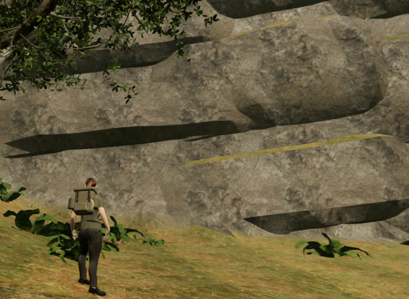
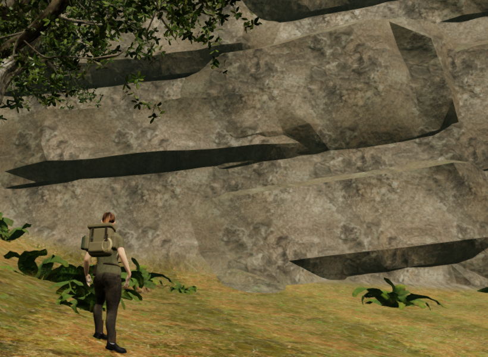

# Jungle cliff relief and stone surfaces

The cliff review found large triangular earth patches across exposed rock
ledges, alongside broad, nearly flat wall faces. The cliff pieces shared the
ordinary slope-based terrain blend, so a less steep stone surface could acquire
a soil finish. That weakened the continuity of the rock around its ledges.

Exposed cliff pieces now carry an explicit rock material attribute. Their
existing triplanar stone maps continue over upward ledges, with restrained moss
coverage. Ordinary terrain chunks and the outer forest floor carry zero for
that attribute, retaining their soil blend. No texture, model or recording is
added. The jungle shader cache key changes with the new material branch.

The upper wall interiors also have deterministic fracture recesses. Only steep,
exposed front vertices participate. The buried back, perimeter, low contact band
and every vertex incident to a tread or substantial underside keep their
coordinates. Each proposed recess must retain face orientation and stay below
the walking-face slope threshold. The modified closed geometry feeds rendering,
physical/sight/sound queries and the paired camera cells.

A geometry-only campaign comparison changes 34,926 delivered draw corners,
with a maximum observed recess of 446 mm. It retains all 240 pieces at 60 sites
and the same 108,128 triangles.
All 221,904 inspected back/perimeter corners retain their exact coordinates.
The 132,669 vertices of the exposed walking-support geometry are byte-for-byte
identical to the published baseline. Some assembly bounds contract with the
recessed faces; physical and camera bounds are rebuilt from the new geometry.
The views show more continuous stone and added relief on the upper faces;
broad horizontal ledge shapes still need further work.

The figures use the same 820 × 600 pixel region of matching High game frames.
They preserve every source RGB pixel without resampling or retouching. The
baseline is published source `f6fc247`; camera, player, facing and scene time
match. Guardians are disabled and audio muted for this local inspection.

## Recorded checks

- All 207 selected tests across 29 files pass, as do the build and three
  CPU-budget checks. The existing chunk-size advisory remains. The cliff tests
  inspect actual closed components, buried joins, rendered/physical/camera rays
  and supported ledges. The new fracture control retains authored ledge,
  underside, back and border vertices.
- Six High before/after view pairs retain exactly matching roots, cameras,
  camera rotations and scene time. All twelve prepared roots are legal and
  pass independent full-body terrain and closed-stone observations. The two
  sets retain the same piece counts and candidate/reservation outcomes.
- An isolated gallery builds the actual terrain meshes and materials for all
  eight chapter profiles, including all their texture sets. Every branch links
  and renders finite half-float pixels with no reported GL error. A jungle
  zero/one rock-attribute control changes 57,566 colour channels without
  changing the geometry. This is a shared-material regression check, not a
  full-world render or playthrough of those chapters.

- Six actual-world approach/jump/stop sequences complete 6,300 controller
  updates. They end legally grounded, and all 84 sampled moving-body
  inspections pass against delivered terrain and closed cliff stone. Six
  additional High stopped views also pass their full-body observations.
- The delivered pieces pass all 358,064 back/perimeter probes, with no missing
  ground or exposed back/edge. All 108,128 triangles belong to 240 closed
  components. Render, physical and camera queries agree across 1,583 checked
  rays; the survey records one skipped inside witness and 228 supported ledges.
- All 781,152 checked terrain, fringe and cliff lighting corners have finite,
  correctly oriented normals; reversing them triggers the control. The actual
  world retains 707 woodland and 1,023 fringe trees. All 1,041,739 inspected
  root samples have finite support and no reported root gap. All 134 sound
  origins clear the cliff volume, and all eighteen discovery approaches remain
  legal, reachable, camera-clear and nearest to their own collectible.

- Production keyboard movement at High quality and portrait touch movement
  at Performance quality both preserve stage 0 and health 100. Four complete-
  store reload comparisons pass, with only `lastPlayed` omitted. The release
  has no development hook, loaded script/style names match the build, and the
  portrait viewport has no horizontal overflow. All six release views are
  reviewed; their live animation and cameras need not match across reloads.

All twelve final High development views and the six baseline views are
reviewed. Several retain foreground foliage/trunk occlusion, long horizontal
ledge forms, or broad terrain sheets; those remain open visual findings. The
final checks record no failed assets, console errors or application warnings;
Chromium GPU-readback notices are excluded from the warning totals. All 446
runtime sources match the tests, build, geometry comparison, shader gallery
and world checks. Owned browsers and temporary previews close after verification.

## Remaining acceptance

The long ledge silhouettes, larger cliff/court composition, sparse spaces,
foreground visibility and wider continuous route/water/contact work remain
open, as do listening and device reviews. These local checks do not establish
consumer-GPU performance, subjective sound quality or AAA graphics. The full
playable-world audit remains incomplete.
