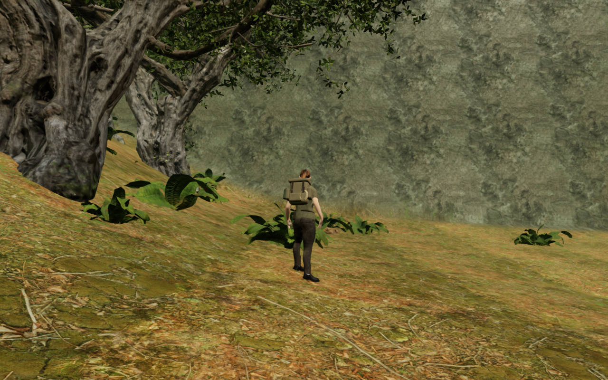
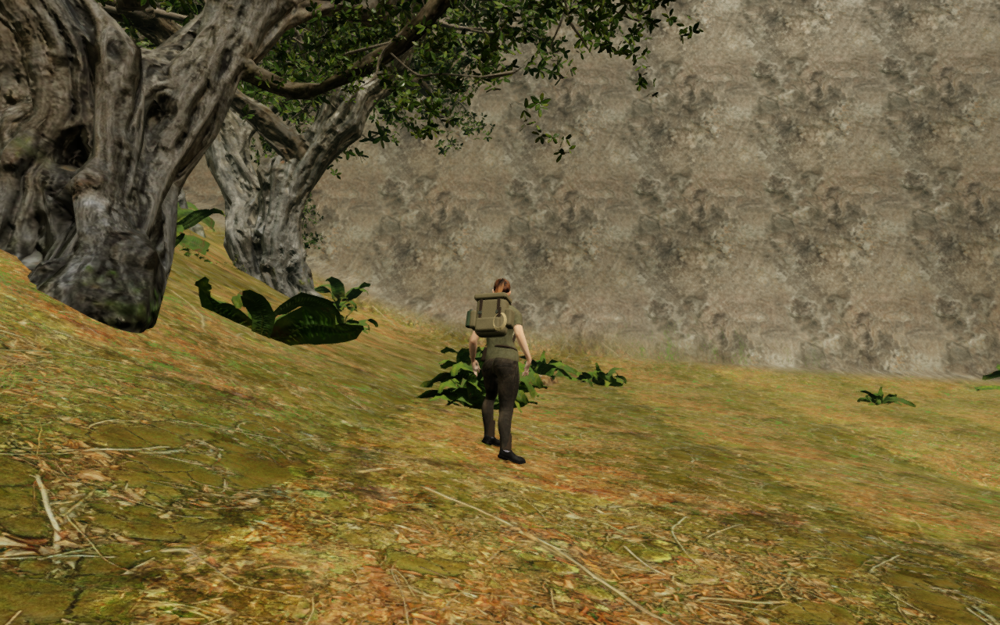
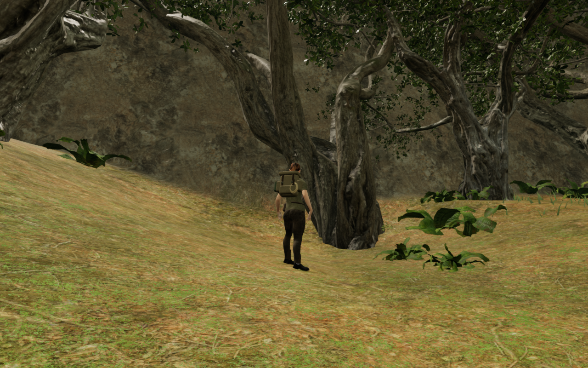

# Wooded jungle escarpment

The jungle valley rim now retains soil caps beneath its seeded tree groups,
with selective erosion and unequal ledges between them. Its exposed faces use
the existing local rock maps with a lighter limestone tint, vertical runoff
staining and bed variation. The material treatment fades across the outer
30 m; terrain changes stay inside the outer 28 m.

Height-field rays from the current entrance survey locate the broad faces on
the natural valley rim, beyond the authored room grid. The retained-tree
treatment keeps the wooded outline while varying selected exposed parts of
the bank. Large smooth
faces remain in several views, so this does not close the broader landscape
finding in the [visual audit](visual-audit.md).

The paired High views retain identical player and camera coordinates and scene
time. Lossless WebP exports retain every RGB pixel of the 1280 × 800 captures.

The final height comparison changes 1,647 jungle vertices. Regression digests
retain all 33,280 authored walking vertices, 1,573 buffered water-bed vertices,
45,369 interior vertices and 1,944 outer-edge-strip vertices. These sets overlap.
The edge strip preserves the join with the existing distant forest floor.
Terrain heights and water descriptions in the other seven chapters match the
published `62ffdb8` baseline.

The bare tree fixture accepts 731 placements, compared with 729 previously.
All 51,978 standing samples and 2,079 path centres retain their checks. The
single blocked edge sample still has an independently measured visible bark
witness. Whole-level tree counts also depend on structure reservations.
The final browser world plants 731 trees, compared with 728 at the baseline.

All 89 selected regressions pass across terrain, water, court floors, roots,
tree and rock collision, camera terrain checks and rendering settings. The
new boundary digest extends the existing protections; the repeated boundary
walking/jumping tests still settle grounded. All three CPU-budget regressions
pass. The production build passes with the existing chunk-size advisory.

All 22 final entrance/court overviews and ten near/stopped poses are reviewed.
Three court views remain partly hidden by foreground trunks and branches.
The browser completes six prepared rim walking/jumping legs and three tree
approaches over 7,650 controller updates, all with legal positions. The ten
poses inspect 480,950 delivered character vertices against independently read
terrain triangles, with no invalid/missing samples or embedding beyond 15 mm.
These are terrain checks; they do not establish complete body contact against
every tree or rock. Shaders link, sampled HDR buffers remain finite, and no
application warning or error is recorded.

Production keyboard/High and portrait touch/Performance both restore the
prepared forest approach without arrival recovery, move 0.30 m / 0.90 m at
full health and retain stage zero. Complete-store reload comparisons pass,
excluding per-level timestamps. All six release images are reviewed. Loaded
JavaScript/CSS names match the current build and the development hook is absent.
The fixtures disable guardians; these are short input and persistence checks,
not earned routes or combat acceptance. Owned browsers, previews and workers
close after verification. All 424 runtime source hashes match the captured
candidate and staged publication content.

The broader review remains open for cliff silhouettes, court composition,
continuous routes and contact beyond the sampled poses. This work adds no
new external assets and makes no hardware-frame-rate or subjective audio claim.
Verification uses the shared locked five-of-sixteen CPU allowance, with at
most two test workers and one browser. Staging, fixture saves, captures and
installed dependencies remain excluded from publication.
